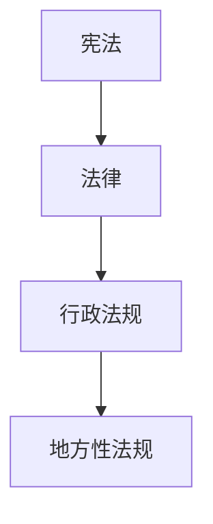

# 可视化（visualize）

一张图只有在展示文字表达不了的东西时才有资格存在——结构、方向、关系、层级。本 skill 产出**一张**这样的图，直接以 ```mermaid``` 代码块嵌入教学回复：本 TUI（pi）与 Obsidian 均原生渲染 mermaid，无需任何外部渲染管线。

你是**创意总监**：决定确切要表达的单一想法，并把它削减到最少承载元素。

## 何时可视化（何时不）

本教学系统在学习者脑中建**依赖图**——无条件真理在根，派生事实挂在其上。法学场景的高价值图：

- **效力位阶**：宪法 → 法律 → 行政法规 → 地方性法规/规章（树，节点就是层级）
- **法律关系**：当事人、客体、权利义务指向（flowchart，节点是人/物/权利，边是关系）
- **程序流程**：立案 → 审理 → 判决 → 上诉（flowchart 或 sequenceDiagram，节点是程序步骤）
- **要件结构**：某制度/罪名的构成要件树（flowchart TD，根是制度，叶是要件）
- **概念对比**：近义概念逐要件对照（两列 flowchart 或表格——表格不是图，但对比时表格往往更合适，优先表格）
- **状态机**：合同成立/生效/无效/撤销/解除（stateDiagram-v2）
- **依赖图**：本课的知识 DAG（无条件真理 → 派生节点 → 目标）

以下情况**不要**画：一句话或一张表就能说清；图只是把旁边那句话再陈述一遍（装饰性噪音+犯错机会）。拿不准就不画——缺图比错图便宜。

## 画图规程

1. **一个想法、最少元素。** 最常见的失败是塞太多。画之前先删：每个标签问「删掉它，想法还清楚吗？」清楚就删。超过约 5-7 个元素就先砍。
2. **只用稳妥的 mermaid 子集**，保证 TUI 与 Obsidian 都能渲染：`flowchart TD|LR`、`graph TD|LR`、`sequenceDiagram`、`stateDiagram-v2`。避免花哨语法（subgraph 可以用但要克制、样式类/点击事件不要、图标不要）。
3. **方向语义要正确**：层级用 TD（上→下），程序流程用 TD 或 LR，交互时序用 sequenceDiagram。箭头 `-->` 带文字标签说明关系性质（如「制定」「优先于」「上诉」）。
4. **节点标签短**：`A[宪法]` 不是 `A[具有最高法律效力的根本法——宪法]`。文字全放在图外的正文里。
5. **自检后再发出**：图里的每条边都问自己「这条边在现行法下成立吗？」。位阶图的边错一条（比如把司法解释画在行政法规之上）比没有图更糟。没把握的边，先经 `law-verifier` 核对，再画。
6. 中文标签直接写；含特殊字符（引号、括号）的标签用双引号包裹节点文本：`A["民法典第184条"]`。

## 嵌入方式

直接在回复中插入：

````markdown

````

用一句话引出图，然后让图自己说话——不要再用散文把每个元素复述一遍。图前一句说明「这张图在展示什么关系」，图后如果需要，只补充图表达不了的东西。
