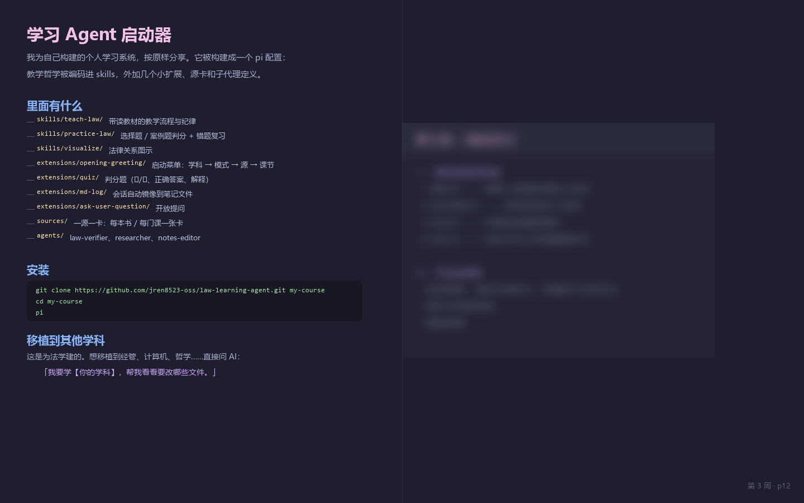

# 学习 Agent 启动器

这是一个 pi 项目。你可以把它当作一个开源模板，基于它搭建任何学科的 AI 导师（目前基于法学）。



## 这是什么

我为自己构建的个人学习系统，按原样分享。它被构建成一个 pi 配置：教学哲学被编码进 skills，外加几个小扩展、源卡（source cards）和子代理定义。

## 里面有什么

- `skills/teach-law/` —— 带读教材的教学流程与纪律
- `skills/practice-law/` —— 选择题 / 案例题判分 + 错题复习
- `skills/visualize/` —— 法律关系图示
- `extensions/opening-greeting/` —— 启动菜单：学科 → 模式 → 源 → 课节
- `extensions/quiz/` —— 判分题（✓/✗、正确答案、解释）
- `extensions/md-log/` —— 会话自动镜像到笔记文件
- `extensions/ask-user-question/` —— 开放提问
- `sources/` —— 一源一卡：每本书 / 每门课一张卡（frontmatter + 教法）
- `agents/` —— `law-verifier`（法条核验）、`researcher`（调研）、`notes-editor`（讲义校对）

## 安装

这个仓库**本身就是一个项目目录**。克隆后，用 pi 打开即可：

```
git clone https://github.com/jren8523-oss/law-learning-agent.git my-course
cd my-course
pi
```

## 移植到其他学科

这是为法学建的。想移植到经管、计算机、哲学……直接问 AI：

> 「我要学【你的学科】，帮我看看要改哪些文件。」

AI 会读你的仓库，逐个文件告诉你改什么。核心要改的只有几处：`skills/` 里的学科纪律、`sources/` 里的源卡、`APPEND_SYSTEM.md` 里的规则。`extensions/` 是学科无关的，不用动。

## 实操经验

这些都是我实际跑过的，不是设想。

### 让 agent 带你读 PPT：课件 + 课堂录音

想跟课走，光有老师 PPT 不够——PPT 上的字只是提纲，真正的讲解在老师嘴里。我的做法：

1. **PPT 转逐页文本**：`python-pptx` 或 `pymupdf` 抽出每页文字，加 `## pNN` 页号锚点，让 agent 报页号、和屏幕对得上。
2. **课堂录音转文字稿**：录音用通义千问转写（阿里云有大量免费额度，够用很久），得到逐字稿。
3. **文字稿两个用途**：
   - **校对**：PPT 提取的文字常有错漏，拿逐字稿校订，别让 agent 对着错的文本讲。
   - **结构化**：逐字稿有大量口语和闲话，让 agent 整理成结构化讲稿——去口语、保留讲解思路、加 `[mm:ss]` 回听锚点。上课时 agent 读的是整理稿，不是原始口水稿。

上课时双屏：你开着 PPT，agent 报「第 N 周 · pNN」讲该页，讲的内容以 PPT 原文为准、讲稿补思路。你能当场核对它有没有讲错。

### 别改造你的学习 SOP，让 agent 融入进去

这是最重要的教训。**不要为了用 agent 改变你原本的学习流程**——那样会乱，而且你很快就会放弃。

正确的方向是反过来：先想清楚你本来怎么学（哪门课、什么节奏、用什么材料），然后让 agent 去适应你的流程。它应该是你学习流程里的一个助手，而不是一套要你从头学的新系统。这套系统里的"一源一卡"就是这么来的——一张卡对应你本来就要读的一本书或一门课。

### 教材入库：有文字层直接提取，扫描件用 paddleOCR

- **PDF 有文字层**：直接提取（`pymupdf` 一条命令），又快又准，别上 OCR。
- **扫描件 / 图片型 PDF**：用 paddleOCR 识别。这一步慢且容易出错，识别完要抽检几页对读。

### 一定要主动参与规划

agent 能帮你很多，但**学习规划必须你自己参与**。主动和 AI 讨论：目标是什么、时间预算多少、哪部分薄弱、想怎么学。把你的需求讲清楚，别把规划全交给它。它给的是建议，你拍板。这套系统里"开一本新书前先定读法"就是这个意思——读法是你和 AI 一起定的，不是 AI 单方面定的。

### 汇总：让 agent 当你的学习枢纽

学习进度散在各个会话里会丢。这套系统把 agent 做成枢纽：每个源只写自己的进度文件，每周五一个「汇总」会话统一刷新总账——这周做了什么、哪条线到哪了、下周从哪继续。你不需要自己记。