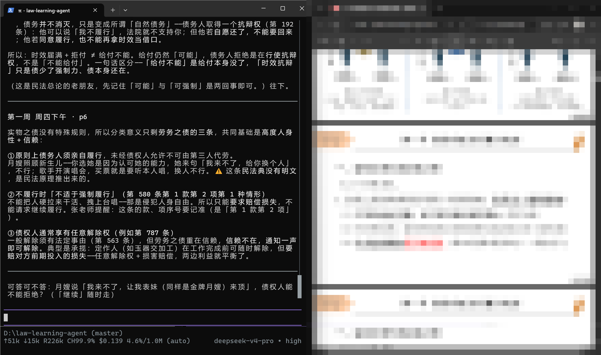
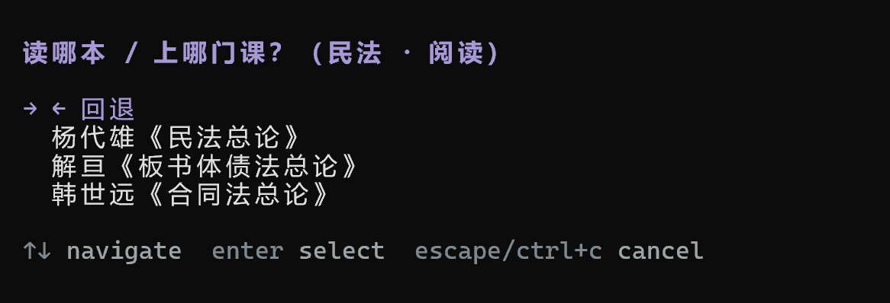
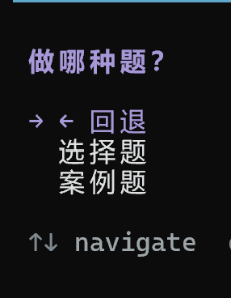

# 学习 Agent 启动器

这是一个 pi 项目。你可以把它当作一个开源模板，基于它搭建任何学科的 AI 导师（目前基于法学）。



菜单（阅读选题源 / 做题选题型）：





## 这是什么

我为自己构建的个人学习系统，按原样分享。它被构建成一个 pi 配置：教学哲学被编码进 skills，外加几个小扩展、源卡（source cards）和子代理定义。

## 五种模式

启动 pi，第一件事是选今天做什么。菜单五项，对应五种工作方式（「设置」见末尾）。

### 上课 · 跟课逐页对读

跟学校课或网课走。选一门课 → 选周 → 选课节（**一份 PPT＝一节课＝一个会话**）。

选完课节，agent 自动用浏览器帮你打开对应的课件 PDF，然后按页推进：报一个页头，如「第一周 周四下午 · p6」，再讲这一页的重点。讲解依据三层递进：

1. **PPT 原文**（逐字，权威）；
2. **课堂整理稿**（录音转写后去过口语、保留讲解思路，带 `[mm:ss]` 回听锚点）；
3. **浓缩稿**（补 PPT 里缺的结构）。

页末留一句可答可不答的互动；你说「继续／过／跳到 pN」就照办。上课线不 quiz、不复述、不写提炼稿。

### 阅读 · 一本一本地精读教材

选学科 → 选书 → 选章。你在读，agent 在旁**带读**：挑关键论证段落直接呈现（引文 + 出处），在推理关节处停下来提问、解难点、连体系；你随时可以问它，一问一答**留档**。

读法不写死——**开一本新书前先和 agent 一起定读法**，写进那本书的 `README.md`。读完一本再定下一本。

收尾时 agent 自己产出**读书笔记**（存 Obsidian）：本节重难点／「你问我」／「我问你」／未解决项。

### 做题 · 判分 + 错题复习

选学科 → **选题型**（选择题／案例题）。

- **选择题**：从习题册抽样出题、判分（✓/✗、正确答案、解释）。选项**自动乱序**，答案绝不提前泄露。
- **案例题**：你写答案，agent 对照参考答案批改。
- **复习**：错题记入错题档案（附记忆锚点），每章配复习队列，间隔重测。

题目只出自你自己的习题册，**agent 不编题**。

### 汇总 · 每周五的枢纽

进度散在各会话里会丢。每周五打开，菜单把「汇总」置顶推荐。它读各源的进度文件，先在对话里给一份草稿（这周做了什么、数字、卡点、下周），你点头后再落盘到全局总账。你不需要自己记。

### 设置 · 还没设计好

用来自我调整（改源卡、skills、扩展、约定、画像）。**这部分我还没做完善，比较粗糙**，留给大家自己发挥。

## 里面有什么

| 路径 | 作用 |
|---|---|
| `skills/teach-law/` | 阅读模式：带读教材的流程与纪律 |
| `skills/practice-law/` | 做题模式：选择题／案例题判分 + 错题复习 |
| `skills/visualize/` | 法律关系图示 |
| `extensions/opening-greeting/` | 启动菜单：学科 → 模式 → 源 → 课节（含自动打开课件） |
| `extensions/quiz/` | 判分题（选项乱序、答案不泄露） |
| `extensions/md-log/` | 会话自动镜像到笔记文件 |
| `extensions/ask-user-question/` | 开放提问 |
| `sources/` | 一源一卡：每本书／每门课一张卡 |
| `agents/` | `law-verifier`（法条核验）、`researcher`（调研）、`notes-editor`（讲义校对） |
| `tools/` | 素材管线：课件／教材转逐页文本、OCR |

## 安装

这个仓库**本身就是一个项目目录**。克隆后，用 pi 打开即可：

```
git clone https://github.com/jren8523-oss/law-learning-agent.git my-course
cd my-course
pi
```

## 移植到其他学科

这是为法学建的。想移植到经管、计算机、哲学……直接问 AI：

> 「我要学【你的学科】，帮我看看要改哪些文件。」

AI 会读你的仓库，逐个文件告诉你改什么。核心要改的只有几处：`skills/` 里的学科纪律、`sources/` 里的源卡、`APPEND_SYSTEM.md` 里的规则。`extensions/` 是学科无关的，不用动。

## 实操经验

这些都是我实际跑过的，不是设想。

### 让 agent 带你读 PPT：课件 + 课堂录音

想跟课走，光有老师 PPT 不够——PPT 上的字只是提纲，真正的讲解在老师嘴里。我的做法：

1. **PPT 转逐页文本**：`python-pptx` 或 `pymupdf` 抽出每页文字，加 `## pNN` 页号锚点，让 agent 报页号、和屏幕对得上。
2. **课堂录音转文字稿**：录音用通义千问转写（阿里云有大量免费额度，够用很久），得到逐字稿。
3. **文字稿两个用途**：
   - **校对**：PPT 提取的文字常有错漏，拿逐字稿校订，别让 agent 对着错的文本讲。
   - **结构化**：逐字稿有大量口语和闲话，让 agent 整理成结构化讲稿——去口语、保留讲解思路、加 `[mm:ss]` 回听锚点。上课时 agent 读的是整理稿，不是原始口水稿。

上课时双屏：你开着 PPT，agent 报「第 N 周 · pNN」讲该页，讲的内容以 PPT 原文为准、讲稿补思路。你能当场核对它有没有讲错。

### 让流程更顺手：选完课，自动打开课件

选到某一课，agent 可以顺手把对应的 PPT 帮你打开，省得你自己去文件夹里翻。但**打开方式要事先约定好**——用哪个程序打开、双屏还是单屏、要不要翻到上次那页。约定清楚了，一点就开、坐下就学；不约定，它打开了你还得自己调，反而添乱。

### 别改造你的学习 SOP，让 agent 融入进去

这是最重要的教训。**不要为了用 agent 改变你原本的学习流程**——那样会乱，而且你很快就会放弃。

正确的方向是反过来：先想清楚你本来怎么学（哪门课、什么节奏、用什么材料），然后让 agent 去适应你的流程。它应该是你学习流程里的一个助手，而不是一套要你从头学的新系统。这套系统里的"一源一卡"就是这么来的——一张卡对应你本来就要读的一本书或一门课。

### 教材入库：有文字层直接提取，扫描件用 paddleOCR

- **PDF 有文字层**：直接提取（`pymupdf` 一条命令），又快又准，别上 OCR。
- **扫描件 / 图片型 PDF**：用 paddleOCR 识别。这一步慢且容易出错，识别完要抽检几页对读。

### 一定要主动参与规划

agent 能帮你很多，但**学习规划必须你自己参与**。主动和 AI 讨论：目标是什么、时间预算多少、哪部分薄弱、想怎么学。把你的需求讲清楚，别把规划全交给它。它给的是建议，你拍板。这套系统里"开一本新书前先定读法"就是这个意思——读法是你和 AI 一起定的，不是 AI 单方面定的。

## 最后几句

这套东西还很粗糙。它是我一个人在深夜、在课后、在快被债务不履行绕晕的时候一点点攒出来的，谈不上成熟，更谈不上完备——有些地方是权宜之计，有些地方我自己都还没想清楚。

但它确实陪我读完了不少页书。

我把它摆在这里，不是要交付一个成品，而是想请你也来改一改。你读什么、怎么读、卡在哪儿，这些才是我最想知道的事。**哪怕只是一句"我觉得这里可以更好"，也欢迎写信告诉我：renjj36@outlook.com。**

愿你找到自己愿意一头扎进去的学问。也愿你在里面，遇见那个更清醒的自己。

如果它对你有一点点用，**请点个小星星 ⭐** —— 那是我继续打磨它的理由。

谢谢你看到这里。

