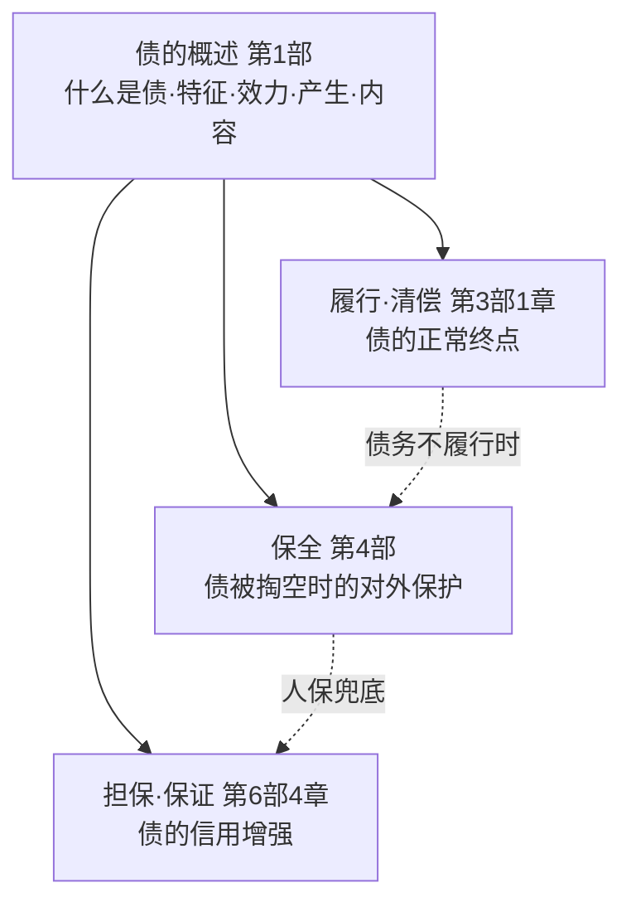
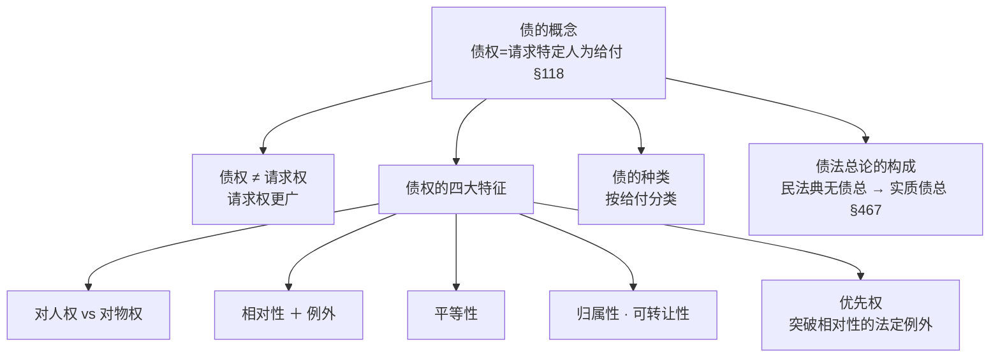
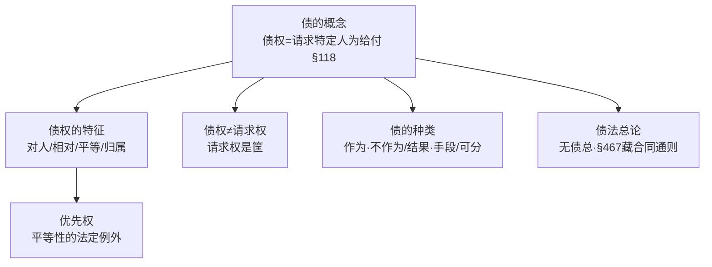

> [!quote] YOU

说说给我的学习规划

> [!abstract] PI

读完你的进度档案了，先给你盘一盘现状，再给规划。

## 现状盘点（数据说话）

| 维度 | 实况 |
|---|---|
| 主线 | 12/15 章讲完，剩第 13「权利救济」、14「时间维度」、15「期间与期日」 |
| 掌握度 | 全部 ⭐⭐，**没有一个 ⭐⭐⭐** → 讲得快、沉淀浅 |
| 复习队列 | ~80 项，大半「未测」 |
| 久未触及 | 18 项约一周没碰（集中在 9-10 章地基：悬赏广告/意思实现/戏谑/实践合同/成立vs生效/§153 系列） |
| 错题复发 | ① **物债二分 4 次** ② 「一律/一概」触发词 3 次 ③ 多选漏选 |

## 学习规划（三条线）

**① 先回炉，别急着开新课（本周优先）**
你现在最大的风险不是「没讲完」，而是「讲了但忘了」。18 项久未触及 + 全 ⭐⭐，说明该回头了。建议先做一次 **review**，把 18 项从旧到新过一遍，重点测那批早期项。

**② 收尾第 13–15 章（随后 1–2 周）**
这三章相对轻，且和第 11 章 §152 除斥期间、§188 诉讼时效有衔接，能较快走完，**完成全书主线闭环**，之后进全书综合拷问/案例。

**③ 错题专项穿插：钉死「物债二分」**
复发 4 次 = 全书最顽固的坑，还是考研物权/债法地基。别等它第 5 次复发，单独安排一次「拷问」把它钉死。顺带治「一律/一概 → 先翻例外」和「多选逐项扫」。

## 节奏建议
每次 session：开头 10 分钟微任务热身 → 主任务（复习 or 新课）→ 结尾 quiz 收口；**讲考交替**，别连续开新课不回头。

> [!question] Question
> 规划就是这样。现在从哪条线开始？
>
> 1. 先复习清 18 项久未触及（Recommended）
> 2. 直接开第 13 章「权利救济」
> 3. 先钉「物债二分」错题专项

> [!warning] Question — cancelled
> (user skipped)

> [!abstract] PI

好，规划已经摆出来了。你想从哪条线开始，直接说就行——「复习」清 18 项 / 「学第 13 章」/ 「拷问物债二分」，或者你有别的想法也随时说。

> [!quote] YOU

我希望直接开始债法，先学完债的概述，履行，保全与担保部分

> [!abstract] PI

读完了。你这是要**从民法总论线切到债法自学线**——我先跟你对齐一下理解，再给教学计划（这是动手前的确认，先不动文件）。

## 我对你的需求的理解

你要学的是**债法总论**，主线用**解亘《板书体债法总论》**（已入库 6 部 22 章），对照深挖用**王泽鉴《债法原理》**（华政学硕参考书目）。不是校课的马工程轻量口径。

你要的「概述 / 履行 / 保全与担保」映射到解亘书：

| 你要学 | 解亘对应 | 体量 |
|---|---|---|
| **债的概述** | 第1部 债的基本概念 | 4 章（绪论 / 债权的效力总论 / 债的产生 / 债的内容） |
| **履行** | 第3部第1章 清偿 | 1 章 |
| **保全** | 第4部 债的保全 | 3 章（概述 / 债权人代位权 / 债权人撤销权） |
| **担保** | 第6部第4章 保证 | 1 章 |

合计 9 章，这是**多节课**的量，不是一次讲完。

## 学习路线（依赖图）

**地基是「债的概述」（第1部 4 章）**——债的概念、特征、效力、产生、内容，后面履行/保全/担保全挂在这上头，所以从它开讲，顺序不变（概述→履行→保全→担保）。

## 首次课安排（债的概述 · 第1部）

- **第1章 绪论**：债的概念（债权=请求他人为给付）→ 债权的四大特征（对人权/相对权/平等性/归属性可转让性）→ 债的种类 → 债法总论的构成与意义 → 优先权
- **第2章 债权的效力总论**：四项权能（请求力/给付保持力/诉求力/执行力）→ 不完全债务（自然债务/无责任债务）

后两章（债的产生、债的内容）视进度接续。

## 两个说明

1. **债法线暂未设习题册**（`README` 明示「先以理解为主」），所以检测不走 quiz 题库，改用**费曼复述 + 苏格拉底式提问**收口。
2. 教材是 **OCR 产物**，含噪声（侦=债、全=金、千=于 等）；法条我会按 `kb/laws/` 或派 law-verifier 核对后再讲，不凭记忆背。

> [!question] Question
> 确认一下：按「解亘自学线（深挖，学硕口径）」、从「债的概述·第1部第1章绪论」开讲，对吗？
>
> 1. 对，就按这个开讲（Recommended）
> 2. 先用校课马工程口径轻量过一遍
> 3. 范围调整

> [!example] Answer
> 3. 范围调整

> [!question] Question
> 范围想怎么调？（告诉我具体怎么改即可）
>
> 1. 先只学「债的概述」这一块，其余往后排
> 2. 加入「债务不履行」作为履行前的地基
> 3. 换主线教材（如用王泽鉴《债法原理》为主）

> [!example] Answer
> Other: 刘家安讲义笔记里面也有债法内容，加进去

> [!abstract] PI

查清楚了。刘家安民法基础课（57 讲）里**确实有债法内容，但它是散见的**（不是系统的债总序列）——因为它本是「民法总论」课，债法点是讲「债权」「保证」「物债二分」「债的发生」时带出来的。我已把相关讲次定位好。

## 最终材料栈（三层）

| 主题 | 解亘（主线） | 王泽鉴《债法原理》（对照） | 刘家安民法基础课（加深） |
|---|---|---|---|
| **债的概述** | 第1部 4 章 | 第一编「债之关系的结构分析」 | 第5/6/8/13/14 讲（债的关系、债权定义§118、债的发生、意定/法定之债、物债二分） |
| **履行** | 第3部第1章 清偿 | —（王本未收录，靠解亘+刘家安） | 第4/6 讲（清偿、诚信受领、履行期§511、诉讼外清偿） |
| **保全** | 第4部 3 章 | —（同上） | 第6 讲（债权人撤销权＝形成诉权，§538/539） |
| **担保** | 第6部第4章 保证 | —（同上） | 第1/2/6/7/11/14 讲（保证类型§686、要式、先诉抗辩§687、从属性、公司担保§16） |

**顺序不变**：债的概述（第1部）→ 履行（清偿）→ 保全 → 担保，地基仍是概述。

**两点提醒**（记入教学纪律）：
1. 刘家安笔记是 **2020 年**的，旧法条（《担保法》《合同法》）讲时一律折算到现行《民法典》——尤其保证默认从「连带」改成了「一般」（§686），这是高频考点。
2. 王泽鉴《债法原理》只覆盖「债之关系结构分析」一编能帮概述；履行/保全/担保它没收录，这几块深挖靠解亘＋刘家安。

> [!question] Question
> 材料栈和顺序就这样定了，现在开讲「债的概述·第1部第1章绪论」吗？
>
> 1. 开讲，从第1章绪论开始（Recommended）
> 2. 先从刘家安视角切入
> 3. 还要再调

> [!example] Answer
> 1. 开讲，从第1章绪论开始（Recommended）

> [!abstract] PI

笔记已链接：`notes/债法总论-解亘/第1部/2026-10-13-债的概述-第1章绪论.md`（后续讲解与问答自动镜像）。

开始前一个说明：债法线暂无习题册，所以本章检测改用**自测题（我出，非习题册）＋ 费曼复述**，判分锚点还是教材结论。

## 第1章 绪论 · 知识结构

- **A 可理解**（带你推）：债权 vs 物权（对人权 vs 对物权）、相对性、平等性、为什么需要债法总论
- **B 记忆**（直给＋口诀）：§118 定义、相对性/平等性的具体例外（§725 买卖不破租赁、§535 代位、§538 撤销）、优先权种类

先摸底——你校课和民法总论都碰过这个，看地基牢不牢：

> [!question] Quiz
> 甲与乙签订手机买卖合同，约定一周后交付。合同成立后、交付前，下列说法正确的是？
>
> 1. 乙对甲享有请求交付手机并移转所有权的债权，所有权仍归甲
> 2. 手机所有权归甲乙共有，直到交付才转移给乙
> 3. 乙对手机享有支配权，可直接向甲以外的第三人主张
> 4. 乙已取得手机所有权，只是还没拿到手

> [!warning] Quiz — cancelled
> (user skipped)

> [!quote] YOU

等等，还要看一个材料，我校课的ppt

> [!abstract] PI

PPT 已读（`kb/债法/讲义/第一章 债的概述.md` 72 页、`第二章 债的履行.md` 80 页）。它给你的是**法考/期末的完整清单**（债的要素、7 种发生原因、8 组分类、连带债务效力 §519/520、三抗辩权 §525-528、情势变更 §533 这些它都铺齐了），但基本是"结论清单"，缺原理。

所以材料栈现在是**四层，各司其职**：

| 层 | 材料 | 干什么 |
|---|---|---|
| 主线（深度） | 解亘《板书体债法总论》 | 原理推导、论证 |
| 校课骨架（清单） | 马工程 PPT | 法考/期末要背的点，当"checklist" |
| 加深 | 刘家安民法基础课 | 案例、问题意识 |
| 对照 | 王泽鉴《债法原理》 | 债之关系结构分析 |

**教学策略**：解亘带读为主，PPT 当"这章法考要考哪些点"的清单对照，刘家安案例填肉。开讲——

---

## 节点 1 · 债的概念（无条件真理）

**教材 p.32**：「一般认为债权是请求特定的他人为一定之作为或者不作为（＝给付）的权利，现行法也采纳了这种定义（§118Ⅱ）。相应的，该他人负担的为一定之作为或者不作为（＝给付）的义务，便是债务。」[已核实: kb/laws/民法典.md §118]

**逐个名词拆开**（精读三步）：

1. **「请求」** —— 债权的核心动作是"**求**"，不是"**拿**"。这是它和物权最根本的分水岭，下面会展开。
2. **「特定的人」** —— 只能向**特定的债务人**主张，不能向全世界主张。这四个字里已经埋了"相对性"的种子。
3. **「为或不为一定行为」** —— 作为（交钱、交货、讲课）或不作为（不竞争、保密）。这个"作为/不作为"整体叫**给付**。
4. **「给付」** —— 债权的**客体**。解亘给的定义很关键：给付是"**带有增益他人财产之目的的行为**"。注意别和"具体动作"混了：卖房里的"过户登记、腾空房屋"只是**实现给付的手段**，给付是"应为之具体行为的总和"。

**白话重说**：债，就是"甲对乙说：你得为我做某件事（或别做某事）"。甲手上那个"要求乙做/不做"的权利叫**债权**；乙背上那个"得做/不做"的义务叫**债务**。一对债权债务，捆成一个**债的关系**。

---

现在到关键的一步，**你来推**：

物权是"人对物的直接支配"——我的手机，我想用就用、想卖就卖，**不用求任何人配合**。那债权为什么注定做不到这一点？换句话说：

> 甲把手里的手机卖给了乙（合同已签、手机还没交）。此刻乙手里有什么？他能不能像物权人那样"自己动手"去拿回手机？

用一句话回答我（这是 A 类节点，不是背定义，是想明白"请求 vs 支配"这条线）。

> [!quote] YOU

乙的手中有着取得手机的债权。不能，物权的转移与债权无关

> [!abstract] PI

前半句对，后半句**翻车了**——而且正好是你物债二分的老坑，从"混为一谈"反方向栽进了"一刀两断"。

**先确认对的**：乙手里有"请求甲交付手机并移转所有权"的**债权**，而且他**不能自己动手拿**——"求"和"拿"的分界你抓到了。✔

**但你说"物权的转移与债权无关"，这句是错的。** 停下来反问你：

> 如果债权真和物权转移"无关"，那乙凭什么能让甲把手机交给他？——乙去起诉甲、要求甲交货，法院凭什么支持他？乙最终能成为所有权人，靠的到底是哪几样东西？

（提示：回想你民法总论第十章的"负担行为 vs 处分行为"——买卖合同这个**负担行为**，和后来所有权移转的**处分行为**，到底是什么关系？）

用一句话回答我。

> [!quote] YOU

负担行为只是一个处分行为的理论基础

> [!abstract] PI

**"理论基础"这个词用错了**——负担行为和处分行为之间不是"理论"关系，是**「原因 → 履行」**的关系（学理叫 causa，原因关系）。你抓到"有关"了，但关系说反了层级。

**干净答案**：乙最终成为所有权人，靠**三件套**——

| 件 | 是什么 | 作用 |
|---|---|---|
| ① **有效债权** | 买卖合同（负担行为） | 乙"凭什么"能找甲要手机？凭这个请求权——这是**法律依据（原因）** |
| ② **交付** | 移转占有的处分行为＋公示（§224） | 动产所有权"自交付时转移"——这是**完成手段** |
| ③ **处分权** | 甲得是手机所有权人 | 他主物买卖（卖别人的手机）时，光有①②不够 |

解亘原文（p.33）把这个叫**协作关系**：「债权关系可以促成物权关系的变动。买受人基于其对出卖人的债权，可以请求出卖人履行债务，从而实现双方之间物权关系的变动。不过，在他主物买卖中债权不一定能促成物权的变动。」[已核实: 解亘 p.33]

**一句话正解**：**债权是物权变动的"原因＋推动力"，交付是"完成手段"**——两者协作，既不是你说的"无关"，也不是"负担行为只是处分行为的理论基础"。

---

现在**你来复述**（费曼闭环，这是这轮的关键）：用你自己的话，一句话说清"债权和物权变动到底是什么关系"，再把"乙成为所有权人的三件套"背出来。

（注意：你民法总论里物债二分栽了 4 次，今天这个"无关"是第 5 次、而且方向反了——从"合同=物权变动"滑到了"债权跟物权变动没关系"。这个点今天必须钉死。）

> [!quote] YOU

债权是物权变动的原因
甲拥有物的处分权，甲乙间存在买卖合同，形成有效债权，甲将物有效交付

> [!abstract] PI

✔ **这一遍对了，钉死了。**

- 关系：**债权是物权变动的原因**（不是"无关"，也不是"理论基础"）
- 三件套：**处分权 ＋ 有效债权（买卖合同）＋ 有效交付** —— 三点全中。

**核心钩子（15 字内）**：**「债权是原因，交付是手段」**——正好接上你民法总论的旧锚"合同生债、公示生物"。

（物债二分第 5 次、今天方向反了，稍后我会记进 `课程进度.md` 错题档案。）

---

## 节点 2 · 债权的四大特征

这 4 个特征**全是从"债的概念"这粒种子长出来的**，不是新背的东西。

| | 债权 | 物权 |
|---|---|---|
| 实现方式 | 靠**请求**债务人给付（对人权） | 靠**支配**物本身（对物权） |
| 效力范围 | 只能向**特定人**主张（相对权） | 对**全天下**主张（绝对权/对世权） |
| 相互关系 | **平等**（无排他性） | **排他**（一物一权） |
| 公示 | 不公示 | 公示（登记/占有） |

**① 对人权** —— 就是刚才的"求 vs 拿"，已建立。✔

**② 相对权** —— 从 §118"**特定的人**"直接演绎：乙只能找甲要手机，不能向路人丙主张。**A 类，你已会推。**

**③ 平等性** —— 这是重点，看这个例子：

> 甲把同一套房一物二卖，先卖给乙、又卖给丙（丙已抢先办了过户登记）。乙、丙手里各有什么？谁能拿到房？

物权有**排他性**（一物一权），同一套房上**只能有一个所有权**，所以乙丙只能"二选一"。但债权**没有排他性**——乙、丙**各**都对甲享有一个"请求过户"的债权，两个债权**并存、平等**。最后谁赢？**先办登记拿到所有权的丙**；乙的债权还在，但只能转成找甲赔钱（违约责任），**不能**要求丙把房交出来。

**为什么债权平等？** 因为债权**不公示**——丙在买的时候根本不知道乙的存在，没理由让"在先的"乙优先。物权能排他、能优先，恰恰因为它有**公示**（登记/占有）垫底。这条逻辑就是"先下手为强"的来历。

**④ 归属性 + 可转让性** —— 债权一定属于特定人（债权人）；历史上罗马法把债当"法锁"（捆住两人的锁，不许转让），近代财产化之后才普遍可转让。（例外：依性质/约定/法律规定不可转让，属 B 类，稍后进复习队列。）

---

**你来复述**（费曼）：用一句话说出**债权为什么是平等、相对、对人**的——把"不公示→不能排他→平等"这条链自己串一遍。再举一个"相对性的例外"（提示：债的保全里，债权人为什么能告到第三人头上？）

> [!quote] YOU

债权无需公示，所以无论先后获取债权，都是平等的；因此债权就不是只能存在一个。  不知道

> [!abstract] PI

✔ **平等性这条链你自己串对了**：不公示 → 无排他 → 可并存多个 → 平等、先下手为强。这条是本章最重要的推导，过了。

**「相对性的例外」你不知道很正常**——那是债的保全（你点名的第 3 个主题），现在还没讲。先给你留个**预告**（详细到第 4 部再展开）：

> 债的保全打了两个"相对性"的口子，让债权人能越过债务人、直接告到第三人头上：
> - **代位权**（§535）：甲欠你 100 万不还，甲对丙有 80 万债权却**懒得去要** → 你可以代甲直接找丙要。
> - **撤销权**（§538）：甲为了赖账，把房子**贱卖/白送**给丙 → 你可以撤销甲丙之间的行为。

记下这两个名字即可，后面整章讲。

---

## 节点 3 · 债权 ≠ 请求权（重要概念辨析）

**教材 p.33**：「从上述债权的定义看，似乎债权＝请求权。然而，民法上还存在其他的请求权。例如……物权请求权……占有返还请求权……这些请求权并不是债权。」[已核实: 解亘 p.33]

拆成三层：

**① 请求权 ≠ 债权的专属** —— 请求权是个**更宽**的筐：物权请求权（我把我的手机要回来）、占有保护请求权，都是请求权，但**不是债权**。所以"是请求权"是债权的必要条件，不是充分条件。

**② 债权的内涵 > 请求权** —— 债权除了"能要"，还有**受领权能**（东西给我我能收下）、**保持权能**（收下后不用还）……这些下一章"债权的效力"展开。所以债权不只是一个请求权。

**③ 债权是"元权利"，请求权是"救济手段"** —— 这条接你民法总论第八章的原权/救济权：

> 房东 S 把房租给 G，下水管破了 G 没法住。G 去起诉，**不能笼统请求"S 履行租赁义务"**，必须具体化——"请 S 修好这条下水管"。抽象的那个"租赁债权"是元权利；起诉时落到具体的"修水管请求权"，才是救济手段。诉讼标的必须特定，光拿抽象债权没法打官司。

**一句话**：债权是"你欠我"这个**关系本身**（元权利、抽象）；请求权是"我现在**具体要你做某件事**"（救济、具体）。

---

**复述**（一句话）：为什么说"债权是请求权，但请求权不一定是债权"？各举一个例子。

> [!quote] YOU

债权是请求权，可以依据债权向相对人请求做什么什么事，但是请求权的种类有很多，占有返还 请求权，物权请求权等等

> [!abstract] PI

✔ 复述对。钩子：**「请求权是筐，债权是筐里一种」**（债权 ⊂ 请求权）。

---

## 节点 4 · 债的种类（第 2 节）

先立一个法学方法：**为什么要给债分类？因为两类法律后果不一样**——后果一样就没必要分。所以每一组分类，先问"分出来干嘛用的"。

解亘在绪论只讲**宏观**分类，具体类型（特定物/种类、选择之债、金钱之债、利息之债）留到第 4 章细讲。这里三组：

**① 作为之债 vs 不作为之债**（给付是"做"还是"不做"）
- 作为：交钱、交货、讲课。
- 不作为：不竞争、保密；典型是**容忍之债**（专利许可里，专利权人"容忍"被许可人实施专利）。
- 分出来干嘛：**强制执行方法不同**（不作为只能间接强制），且不作为债通常**不可转让、不可代履行**。

**② 交付之债 vs 行为之债**（作为之债的再细分）
- 交付之债（"与之债"）：交物 → 可**直接强制**（法院直接把物拿给你）。
- 行为之债（"为之债"）：提供劳务 → 只能**替代执行/间接强制**（法律不能摁着人替你干活）。

**③ 结果之债 vs 手段之债**（★最重要，举证责任的分水岭）——这一组**你来推**：

> G 到 S 医院看病，病没治好反而加重。G 要告医院"债务不履行"，是不是只要甩出"病情加重"这个**结果**就够了？还是说 G 还必须证明点别的？

（提示：先想清楚——医生的债，担保的到底是"**一定治好**"，还是"**按规范好好治**"？这决定了 G 举证时要证明什么。）

> [!quote] YOU

按规范好好治。看有没有按规范

> [!abstract] PI

✔ **对**。医生的债是**手段之债**——担保的是"按规范好好治"，不是"一定治好"。所以 G 不能只甩"病情加重"，必须证明"医院**没按规范**（违反诊疗规范/有过错）"。

**这组分出来干嘛：举证对象不同。**

| | 内容 | 债权人举证 |
|---|---|---|
| **结果之债** | 结果的实现（交货、完工） | 只要"结果没实现"就够 |
| **手段之债** | 特定手段、谨慎勤勉（诊疗、律师代理） | 须证明"债务人没按规范/有过错" |

**钩子**：**「结果债看结果，手段债看手段（过错）」**。记住：越专业、越不确定的业务（医疗、律师、受托理财），越倾向手段之债——因为没人能担保"一定治好/一定赢"。

---

## 节点 5 · 债法总论的构成和意义（第 3 节）

**教材 p.41-42**（关键段）：「我国《民法典》虽然在总体上采用的是潘德克吞模式的立法体例，却**未设置债法总则**。……起草者在合同编第一分编（通则）中设置了类推规则：'本法或者其他法律没有明文规定的合同，适用本编通则的规定，并可以参照适用……类似合同的规定'（§467Ⅰ）。这一规则意味着**合同编第一分编中存在着实质意义上的债法总则规范群**。」[已核实: 解亘 p.41-42]

拆一下（这条对你考研的**体系思维**最关键）：

**① 我国民法典"有债法，但无债法总则"** —— 债法总则该有的东西（债的保全、债的消灭、多数人之债……）散落在合同编通则里，靠 **§467 这把钥匙**把合同通则"借"来当债总用。

**② 这样做的两个后遗症**（解亘点名批评）：
- **要逐条甄别**：合同编通则里哪些是"只适用于合同的"，哪些是"其实是债总规范"（比如§525 抗辩权、§535 代位权，其实是债总规范，不限于合同）。
- **盖不全**：合同通则毕竟是"合同"的通则，法定之债（侵权、无因管理、不当得利）的共性问题，它兜不住，还得靠解释填补漏洞。

**③ 那为什么还要学"债法总论"这门学问？**
- **实质债总的存在**：债法总论负责去"发现＋解释"合同编里那套实质债总规范群。
- **体系思维**（解亘原话）：「我国法也并未抛弃**物债二分**的格局。如果在学理上放弃债法总论……各种债之关系中具有共性的内容将失去立足之地。**体系思维恰恰是民法思维的生命力之源。**」

一句话收束：**民法典把债总"藏"进了合同编，但债法总论这门学问没死——它负责把那套共性规范从合同编里"挖"出来、串起来。**

---

**复述**（一句话）：为什么我国民法典没有"债法总则"编，却还要学债法总论？（提示：两个理由——§467 是什么、"物债二分"和体系思维怎么扯上关系。）

> [!quote] YOU

民法典467条第一款给了去合同编寻找总则规范的工具，债总虽未在法律上落实，但由于物债二分的逻辑等，债法总论实际存在

> [!abstract] PI

✔ **复述到位**。§467 是"去合同编挖债总规范的钥匙"，债总虽没立成编、但作为学问因物债二分而实存——两点都抓住了。

**钩子**：**「民法典无债总，债总藏在合同通则（§467）」**。

---

## 节点 6 · 优先权（第 4 节）——平等性的"法定例外"

呼应前面：债权平等是原则，但法律基于**特定政策**可以给某些债权"插队"。

**含义**：对某些债权，法律赋予**优先受偿**地位——优先于普通债权，甚至**优先于担保物权**（突破相对性，波及债务人之外的人）。

**为什么设它**：保护特定利益（生存、弱势）。比如：
- **建设工程价款优先权**（§807）→ 背后是农民工工资的生存利益；
- **商品房消费者优先权** → 背后是买房人的安身之所。

**代价（解亘重点）**：优先权**没有公示手段**——其他债权人（尤其抵押权人）根本不知道它的存在，危害很大。所以各国态度两极：
- 德国、瑞士 → **消极**；法国、日本 → **积极**（日民 15 种＋特别法百余种）；
- **我国 → 消极、种类有限**。

**种类**（B 类，记名字，稍后进复习队列）：
- 优先于担保物权：①税收（发生于担保物权设立前，税收征管法 §45）②建设工程价款（§807）。
- 不动产优先权：无过错买受人、商品房消费者、预告登记权利人。

**钩子**：**「优先权＝没公示的插队权，所以法律给得抠」**。

---

## 第 1 章 收束

**本章 6 个钩子**：①债权是原因、交付是手段 ②求 vs 拿 ③不公示→无排他→平等→先下手为强 ④请求权是筐、债权是筐里一种 ⑤结果债看结果、手段债看手段 ⑥优先权＝没公示的插队权。

---

**微任务（输出型，就地打字交作业）**：给不懂法的朋友讲清——"甲把手机卖给乙（没交货），转头又卖给丙（交了货）"：为什么**手机归丙**，乙**只能找甲赔钱**，不能找丙要手机？用"**债权平等＋交付生物权**"两把尺子，两三句话。

> [!quote] YOU

因为债权不唯一，物权唯一，物权是先到先得的，债权没有谁先谁后。所以手机归丙，乙只能找甲依据违约请求赔偿

> [!abstract] PI

✔ **这一遍满分。** 你交的这份作业，正是"物债二分"的正解——债权可并存（无排他）、物权唯一（一物一权）、**交付（公示）才生物权**、乙的债权转向违约赔偿。今天从"无关"翻车到作业全对，这条链算钉进去了。

**一个精度补丁**："物权是先到先得" 精确说是"**先完成交付（公示）者得**"——因为光签合同不生物权，必须交付/登记。你后半句其实已经点到（"交付生物权"），只是口头上别把"先到"说成"先签合同"。

第 1 章绪论全 4 节讲完。我先收尾归档，再给你下一步。

> [!quote] YOU

结束

> [!abstract] PI

收工。本次会话小结：

**讲了**：债法总论（解亘线）第1章「绪论」全部 4 节——
- 债的概念（债权=请求特定人为给付 §118）
- 债权四大特征（对人/相对/平等/归属可转让）
- 债权≠请求权
- 债的种类（结果/手段是重点）
- 债法总论构成（民法典无债总 → §467 藏合同通则）
- 优先权

**关键战果**：物债二分第 5 次复发、且方向反了（"物权转移与债权无关"），当场钉正——你最后的作业"债权平等＋交付生物权"全对，这条链算稳了。

**已归档**：`kb/债法总论-解亘/课程进度.md`（进度＋错题＋复习队列）、`进程树.md`（债法线状态＋最近笔记）、会话笔记 `notes/债法总论-解亘/第1部/2026-10-13-债的概述-第1章绪论.md`。

**下次**：第2章「债权的效力总论」（四项权能＋不完全债务），说"继续"即可。想巩固今天的内容，说"拷问我债法"或"复习"。
