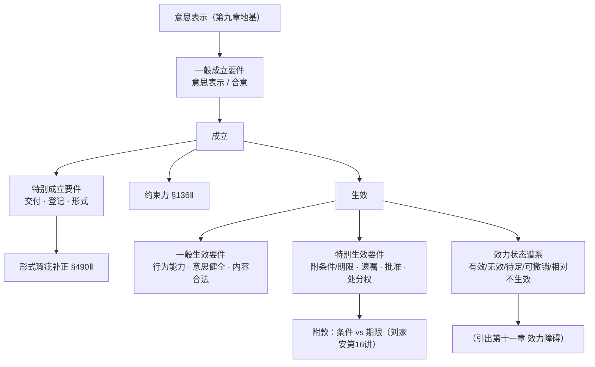
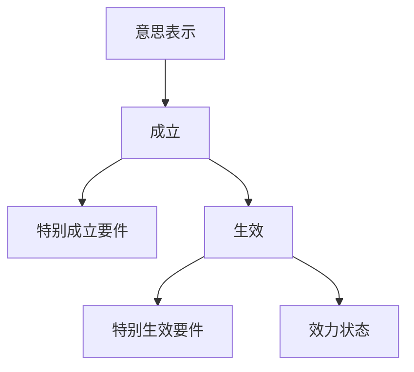

> [!quote] YOU

继续

> [!abstract] PI

**会话提醒**

1. **上次进度**：第九章《法律行为与意思表示的一般原理》已全部讲完（第一～六节），掌握度 ⭐⭐。
2. **复习队列**：今天（10-01）有 **13 项到期**（上两节课留下的概念/法条锚点，如行为意思vs表示意识、戏谑vs真意保留vs通谋、欺诈/胁迫构成等）。
3. **今天**：你说"继续"，即进入 **第十章 法律行为的成立与生效**（教材 p.371–383，较短，两节：成立 / 生效）。

这一章是第九章的自然延伸——第九章讲"法律行为是什么、意思表示怎么构成"，第十章讲"它什么时候成立、什么时候生效、成立≠生效为什么重要"。核心区分点你已接触过雏形（比如实践合同、悬赏广告）。

开讲前先摸个底：

> [!question] Question
> 第十章「法律行为的成立与生效」你之前学过吗？到什么程度？
>
> 1. 没学过，零基础
> 2. 有印象但模糊
> 3. 基本掌握
> 4. 学过但只记得结论

> [!example] Answer
> 2. 有印象但模糊

> [!abstract] PI

明白了——知道「成立≠生效」这个说法，但讲不清"为什么分、要件各是什么"。这正好是本章的主攻点。我先读刘家安对应讲次，给你出教学方案。

> [!abstract] PI

摸底清楚了：你知道"成立≠生效"这句口号，但讲不清"为什么分、两边要件各是什么"。这正好是本章的主线。我已读完教材第十章全文 + 刘家安对应讲次（第 15 讲第三节、第 16 讲第四、五节）。下面是教学方案，你点头我就开讲。

---

## 教学方案：第十章 法律行为的成立与生效

### 路径叙述

本章两节，很短但很"重"——它是整个法律行为效力的**总开关**，后面的第十一章（效力障碍）全挂在这一章的框架上。按"真理在根 → 派生挂靠"排：

**第一节 成立**（4 个节点）
1. **为何区分成立与生效**〔A类，核心〕→ 带读教材"从概念层面/从实践层面"两段论证（p.371），停在一个关节：*成立与生效是"时间上一先一后"吗？*（刘家安第15讲「成立、生效的思维逻辑」【例13 电商标价 19.99 元】【例14 日记遗嘱】——这两个例子专治"先成立后生效"的误认）
2. **一般成立要件 = 意思表示（或合意）**〔A类〕→ 带读教材否定"三要件说"的论证（标的是意思表示内容、主体是任何行为的一般要件，故只有意思表示一个）。刘家安：「意思表示是法律行为的生命」
3. **特别成立要件**〔B类三法条 + A类解释〕→ 实践合同（保管 §890 / 自然人借款 §679 / 定金 §586，自交付成立）+ 要式行为形式=特别成立要件（§490Ⅱ"成立"反面解释 + §134/135/136 体系解释）+ 形式瑕疵补正 §490Ⅱ（为什么"履行"能治愈——履行发挥警示功能）
4. **约束力 vs 效力**〔A类〕→ 带读教材 §136Ⅱ，形式约束力 vs 实质约束力，以及"效力障碍的行为仍有约束力"的例外

**第二节 生效**（3 个节点）
5. **一般生效要件三项**〔A类 + B类〕→ §143 三项 + 刘家安对 §143"正面规定"的著名批评（"法律行为成立了就应推定有效，反面列举瑕疵即可"）
6. **特别生效要件**〔B类清单〕→ 附停止条件 / 附始期 / 遗嘱死亡 / 须批准 / 处分权，其中"附款"（条件 vs 期限）由刘家安第16讲第四节深挖（【例1~7】，区分钥匙=**将来事实是否确定**）
7. **效力状态谱系**〔A类〕→ 带读教材"不生效是上位概念"（图10-3），有效 / 无效 / 效力待定 / 可撤销 / 相对不生效五种 + 障碍轻重排序（图10-4）。刘家安第16讲第五节（【例8 玉石欺诈】讲透"可撤销=已生效但可变"）

### 依赖图（= 教学顺序）

### 两条说明
- **刘家安补充标注**：节点 1（成立/生效思维逻辑）、5（§143 批评）、6 的"附款"、7（效力状态）主要取自刘家安；教材骨架在节点 2、3、4。
- **随堂检测**：用单元练习十（`10-单元练习十：法律行为的成立与生效-题目.md`），每个节点至少 1 题，重点节点 2–3 题，只抽样不刷光。

---

确认一下方向：**就按这个顺序讲**，还是你想先跳过某些节点、或反过来想让我先重点讲某个节点（比如"效力状态谱系"）？说"开始"我就按计划逐节点开讲。

> [!quote] YOU

你的mermaid失败了

> [!abstract] PI

抱歉，图塞太满、还用 ` ` 换行，TUI 渲染崩了。按 visualize 规程精简重画——核心只有一条脊柱：**意思表示 → 成立 → 生效**，两类"附加要件"分挂两边：

- **特别成立要件** = 交付（实践合同）、登记（结婚）、形式（要式行为）＋形式瑕疵补正
- **特别生效要件** = 附停止条件 / 附始期 / 遗嘱死亡 / 须批准 / 处分权
- **效力状态** = 有效 / 无效 / 效力待定 / 可撤销 / 相对不生效

教学顺序不变（前面方案里的 7 个节点照旧）。确认一下：**按这个顺序开始讲吗？** 说"开始"即可。

> [!quote] YOU

开始

> [!abstract] PI

开讲。今天这条主线，我们从第一块地基打起。

---

## 节点 1：为何区分「成立」与「生效」〔A 类，核心〕

### 动机

第九章我们造出了工具——**意思表示**。现在手里有一个意思表示（比如甲向乙说"这台手机 2000 卖给你"），紧接着要问两件事：

1. 有没有一个法律行为**存在**？（这是"成立"问题）
2. 这个法律行为**要不要如你所愿地发生效力**？（这是"生效"问题）

你之前说知道"成立≠生效"但讲不清为什么。这个"为什么"不是学究气的概念游戏——它背后藏着一个民法总则里最锋利的分野。跟着教材原文走：

### 带读（教材 p.371，概念层面）

> 法律行为是一种法律事实，与侵权行为、加工行为、无因管理等法律事实一样，法律行为也需要符合一定要件才能构成。法律行为的构成要件就是其成立要件，可据以判断是否存在法律行为这一法律事实，一如需要依据侵权行为的构成要件判断是否存在一项侵权行为。与侵权行为之类的法律事实不同的是，判断存在一项侵权行为的，可依法发生相应的法律效果，即侵权责任；而判断存在一项法律行为的，则不能依法当然发生相应的法律效果，还须判断该法律行为是否生效，才能决定其是否发生当事人所欲的法律效果。侵权行为等法律事实仅涉及是否成立（构成）之问题，不涉及有效无效之问题，唯独法律行为涉及有效无效之问题。

\[已核实：教材 10-第十章 p.371\]

现在停在这个推理关节上，请你先自己走一步：

**侵权行为"成立"了就直接产生侵权责任；法律行为"成立"了却不能当然发生效果，还得多问一句"有效无效"。为什么偏偏是法律行为多出这一层？**（提示：想想两者的"效果"分别是从哪来的——一个是你想要的，一个是法律直接规定的）

> [!quote] YOU

把这段带读重发一遍

> [!abstract] PI

好的，重发这段带读原文：

---

## 节点 1：为何区分「成立」与「生效」〔A 类，核心〕

### 带读（教材 p.371，概念层面）

> 法律行为是一种法律事实，与侵权行为、加工行为、无因管理等法律事实一样，法律行为也需要符合一定要件才能构成。法律行为的构成要件就是其成立要件，可据以判断是否存在法律行为这一法律事实，一如需要依据侵权行为的构成要件判断是否存在一项侵权行为。与侵权行为之类的法律事实不同的是，判断存在一项侵权行为的，可依法发生相应的法律效果，即侵权责任；而判断存在一项法律行为的，则不能依法当然发生相应的法律效果，还须判断该法律行为是否生效，才能决定其是否发生当事人所欲的法律效果。侵权行为等法律事实仅涉及是否成立（构成）之问题，不涉及有效无效之问题，唯独法律行为涉及有效无效之问题。

\[已核实：教材 10-第十章 p.371\]

---

现在停在这个推理关节上，请你先自己走一步：

**侵权行为"成立"了就直接产生侵权责任；法律行为"成立"了却不能当然发生效果，还得多问一句"有效无效"。为什么偏偏是法律行为多出这一层？**（提示：想想两者的"效果"分别是从哪来的——一个是你想要的，一个是法律直接规定的）

> [!quote] YOU

继续

> [!abstract] PI

收到，我接着往下带。既然这个关节你暂时不想自己推，我把答案讲透，再带你走完节点 1 的后两半——**实践意义**和**一个最容易踩的误认**，最后用一道题锁住。

---

## 节点 1（续）：为何区分「成立」与「生效」

### 先回答那个悬着的问题

**侵权行为"成立"了就直接产生责任，法律行为"成立"了却还要多问一句"有效无效"——为什么？**

因为两者的法律效果**来源不同**：

- **侵权行为的效果是「法定」的**——侵权责任是法律直接规定的，行为人要不要、愿不愿意都无所谓，构成要件一满足，法律就直接命令你承担责任。所以它只有"构不构成"这一个问题。
- **法律行为的效果是「意定」的**——债权债务、所有权移转，是**当事人自己想要的**效果。当事人通过意思表示"点单"，法律只是"上菜"。但法律**不能无条件上菜**：它必须审查这张单子值不值得被尊重——你有没有能力点单（行为能力）、点的时候是否真实自由（意思表示健全）、点的内容是否越了私法自治的禁区（强制性规范、公序良俗）。

所以一句话锁住这个区分：**侵权行为的效果是法律给的，法律行为的效果是自己订的——自己订的东西，法律必须多问一句"我认不认"。**

\[已核实：教材 10-第十章 p.371\]

### 实践意义（教材 p.371，为什么这区分不只是概念游戏）

教材自己挑明了两项实践意义：

1. **效力瑕疵可以治愈，构成瑕疵不能治愈**——比如形式瑕疵可以因履行补正（§490Ⅱ，后面节点 3 讲），但一个根本没成立的行为，没有东西可"治"。
2. **举证责任分配**（教材明说"**第二项更为重要**"）：成立是**请求权发生事实**，由请求人（原告）证明"这行为存在"；无效是**权利阻却抗辩**，由被请求人（被告）证明"有无效事由"。谁主张、谁举证的对象完全不同。

教材原话直戳关键：「假如没有这项实践意义，则可以说区分法律行为的成立与生效基本上仅具有理论阐述上的意义。」

### 一个最常见的误认：成立与生效是"时间上一先一后"吗？

**不是。** 这是刘家安反复提醒初学者最容易踩的坑。绝大多数法律行为**成立时立即生效，是同一个时点**。先成立、后生效的只有少数：附生效（停止）条件、附始期、待审批等。

所以"先成立、后生效"说的是**思维上的先后**（先判断有没有这个行为，再判断它效不效力），**不是时间上的先后**。这个区分在诉讼里直接决定你的攻击路径——是"釜底抽薪"攻它不成立，还是承认成立、转攻它不生效：

**〔刘家安·例13〕** 电商把 2000 元的电视误标成 19.99 元，一万个订单涌进来。消费者起诉要货，电商答辩时，僵化的思路是只能主张"重大误解"去撤销；但更锐利的前置一问是：**合同到底成立了没有？** 若销售页面只是要约邀请、消费者下订单才是要约、电商只回了"确认收到"而非承诺——则合同根本没成立，连撤销都省了，直接"约都没有，何谈违约"。

**〔刘家安·例14〕** 老人和大儿子吵架后，在日记里写"我死了一分钱都不留给他，全给小儿子"，当晚去世。小儿子拿日记主张这是遗嘱。前置问题不是"这遗嘱形式合不合格、老人意识清不清醒"，而是——**这日记是意思表示吗？** 不是。那就根本谈不上"遗嘱的效力"，更轮不到讨论它的无效或可撤销。

\[已核实：刘家安第15讲第三节「成立、生效的思维逻辑」\]

---

这两组例子都在说同一件事：**先问"有没有（成立）"，再问"认不认（生效）"——顺序绝不能倒。** 用一道题验一下你抓住了没有：

> [!question] Quiz
> 下列关于法律行为成立与生效的说法正确的是（ ）（多选）
>
> 1. 成立的法律行为未必生效
> 2. 在遗嘱人死亡之前，遗嘱未成立
> 3. 法律行为成立与生效的时点一致
> 4. 在我国民法上，采用法定形式是法律行为的特别成立要件

> [!success] Quiz — correct ✓
> Your answer: 1. 成立的法律行为未必生效, 4. 在我国民法上，采用法定形式是法律行为的特别成立要件
> Correct answer: 1, 4
>
> 本题考成立与生效的关系。『成立的法律行为未必生效』正确——附停止条件、附始期、待审批等法律行为成立后尚未生效。『采用法定形式是特别成立要件』正确——《民法典》第490条第2款用的是「该合同成立」而非「该合同生效」，经反面解释可知形式是特别成立要件而非特别生效要件。『成立与生效时点一致』错误——先成立后生效的情形（附条件、附始期、待审批）时点并不一致。『遗嘱人死亡前遗嘱未成立』错误——遗嘱在书写完成时已成立，只是以遗嘱人死亡为特别生效要件，死亡前是「成立但未生效」，不是「未成立」。

> [!abstract] PI

✓ 答对了。这道题正好把节点 1 的三个要点全验了一遍：成立未必生效、形式是特别成立要件、遗嘱是"成立未生效"而非"未成立"。

**节点 1 核心钩子**：`成立看有没有，生效看认不认`——先判行为存不存在，再判法律认不认可，顺序不能倒。

---

## 节点 2：一般成立要件 = 意思表示（或意思表示的集合）〔A 类〕

成立要件分一般和特别。**一般成立要件**是"任何法律行为都得有"的东西。带读教材的论证：

**教材 p.372**：「上述三要件说中，首先应予否定的要件是标的。标的既然被定义为法律行为的内容，必为意思表示所包含……意思表示旨在发生特定法律效果，该法律效果即为法律行为的标的。既然已经承认意思表示是法律行为的成立要件，则无需再将标的视为法律行为的成立要件。其次，主体是否为法律行为独立的构成要件，也有争论的余地……主体是任何行为的成立要件。无论侵权行为、违约行为还是先占行为……皆须存在行为主体……但在民法理论上讨论这些行为的成立要件时，一般均未将主体作为其成立要件。法律行为也不应例外。如果说意思表示是法律行为的一般成立要件，主体则是民法上各种行为的一般成立要件。」

推理的两刀，砍掉"三要件说"里的两个：

- **砍"标的"**：标的就是法律行为的内容，而内容就是意思表示的内容——意思表示本来就是"想发生某个法律效果"，那个效果就是标的。标的被意思表示**吸收**了。
- **砍"主体"**：主体是**一切行为**（侵权、先占、无因管理……）的成立要件，不是法律行为特有的。既然别种行为都不单列主体，法律行为也不该单列。主体是"行为"的一般要件，不是"法律行为"的一般要件。

**结论（刘家安点睛：『意思表示是法律行为的生命』）**：一般成立要件**只有一个——意思表示**。至于"意思表示的集合"，那是合同的合意、决议的多数决集体意思，本质仍是意思表示的组合。

\[已核实：教材 10-第十章 p.372\]

---

## 节点 3：特别成立要件〔B 类三法条 + A 类解释〕

一般成立要件之外，**某些**法律行为还多要一样东西，多了就分三类：

### ① 实践（要物）合同——以「交付」为特别成立要件

| 合同 | 法条 | 成立时点 |
|---|---|---|
| 保管合同 | §890 | 自保管物**交付**时成立 |
| 自然人之间的借款合同 | §679 | 自借款**交付**时成立 |
| 定金合同 | §586 | 自定金**交付**时成立 |

\[已核实：教材 10-第十章 p.372，法条引自教材\]

**记忆锚点**：「**保、借、定——交了才成**」（保管、自然人借款、定金，三兄弟都是"交付了合同才算数"）。这三条正是教材开头教学案例 1 的答案——姚某没交付 30 万，借款合同**没成立**，冯某自然无权请求支付。

### ② 要式行为——形式是「特别成立要件」还是「特别生效要件」？

学理上有争（台湾通说=成立要件，德国通说=生效要件，我国曾三说并存）。教材用两个解释把我国立场钉死为**特别成立要件**：

- **反面解释**：§490Ⅱ 用的是「该合同**成立**」而非「该合同**生效**」→ 书面形式影响的是成立。
- **体系解释**：§134 规定一般成立要件（意思表示）、§136 规定「自成立时生效」、夹在中间的 §135 规定形式 → 所以形式是**成立**这一环的要件。

### ③ 形式瑕疵的补正（治愈）§490Ⅱ〔A 类，为什么「做了」能救「没写」〕

法定形式有三大功能：**警示**（防草率，如保证合同要书面 §685）、**明确化—证明**（争议时有据可查）、**咨询—说明**（公证）。

那么，为什么"已经履行"能把"没写书面"救回来？教材的推理：当事人虽然没签书面，但**实际履行了主给付义务**——这个履行行为本身就表明他已慎重考虑、并非一时冲动，**发挥了和书面形式一样的警示功能**；而且履行的事实已经证明合同存在，此时再以"没写书面"判它不成立，只会逼着双方返还已受领的给付，徒增成本、有损交易安全。所以 §490Ⅱ 允许"因履行而补正"。

\[已核实：教材 10-第十章 p.372–373\]

用一道题锁住"实践合同 vs 诺成合同"这个最容易混的点：

> [!question] Quiz
> 下列哪个法律行为不以交付为特别成立要件（ ）
>
> 1. 仓储合同
> 2. 保管合同
> 3. 小陈与小李之间的借款合同
> 4. 定金合同

> [!warning] Quiz — cancelled
> (user skipped)

> [!abstract] PI

好，这题先跳过（你有权不测，我把它记进复习队列，之后"复习"时再补）。

一句话把那个易混点先落下来，别让它溜走：**保管合同是实践合同（交付才成立），仓储合同是诺成合同（成立即生效）**——一字之差，规则相反。做题时看到"仓储"别顺手按"保管"套。

我们刚讲完节点 3 的「实践合同」这一半；后面还有「要式行为的形式之争 + 形式瑕疵补正 §490Ⅱ」已经在上面带读了，没测的部分我一并记入队列。

接下来还有两个节点就收束本章：

- **节点 4**：约束力 vs 效力（§136Ⅱ 形式约束力，这是学硕很爱考的一个区分）
- **节点 5**：效力状态谱系（有效/无效/效力待定/可撤销/相对不生效，引出第十一章）

你想怎么走？

1. **继续讲**（节点 4、5 一口气收尾本章）→ 说"继续"
2. **今天就到这**（我把进度和复习队列更新好，下次接着节点 4）
3. **换模式**：想刷题巩固 → "拷问我第十章"；想练案例 → "练案例"

你定。

> [!quote] YOU

下次继续

> [!abstract] PI

已收尾，进度都存好了。✅

**本次小结**
- 讲了第十章第一节的**一～三**：为何区分成立与生效（含"成立即生效是常态、非时间先后"这个纠正）→ 一般成立要件＝意思表示 → 特别成立要件（实践合同三法条 / 要式形式 / 形式瑕疵补正 §490Ⅱ）。
- 随堂 2 题：多选"成立与生效关系"答对 ✓；"仓储 vs 保管"你跳过，已记入复习队列。

**下次从哪接**：第一节「四、约束力 vs 效力 §136Ⅱ」接着讲，然后进入第二节「生效」——一般/特别生效要件 + 效力状态谱系（这一块直接引出第十一章效力障碍，是重头）。

**已更新的档案**
- `kb/民法总论/课程进度.md`：第十章记录 + 复习队列新增 6 项（共 19 项，13 项今日到期）
- `进程树.md`：第十章标记 🔄、待复习计数、最近笔记
- 笔记镜像：`notes/民法总论/第10章/2026-10-01-法律行为的成立与生效.md`

下次直接说"**继续**"就行。也别忘了有 13 项复习已经到期，想清一清就说"**复习**"。
