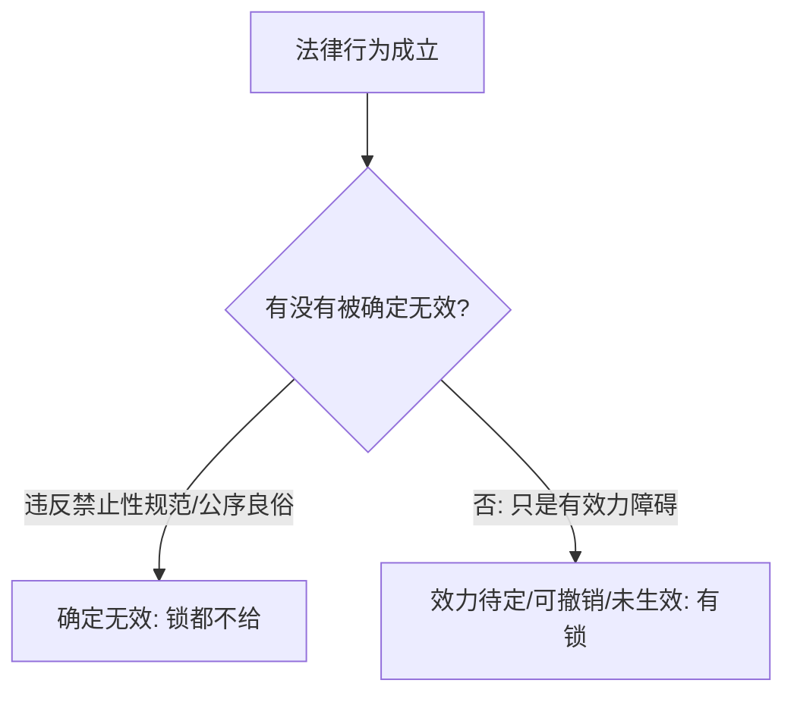

> [!quote] YOU

继续

> [!abstract] PI

今天接着讲第十章剩下的两块：**第一节「四、约束力」**，然后是**第二节「生效」**（一般/特别生效要件 + 效力状态谱系）。刘家安这边对应第 15 讲「成立与生效」和第 16 讲「效力体系/无效」两段的纵深。

我们先攻第一个节点——**约束力**。

---

## 第一节·四 法律行为的约束力

先不急着看教材，我想让你自己推一下这个概念的**存在理由**：

上一课我们刚确立了一个结论——**成立≠生效，而且成立即生效是常态，先成立后生效才是例外**（附条件、附始期、待审批）。

那问题来了：一个合同成立了但还没生效（比如约好「明年 2 月 15 日生效」的租赁合同），在这段「等待期」里，任何一方能不能随便反悔、单方把它作废？如果**不能**——那是凭「生效」约束他吗？显然不是，因为还没生效。那凭的是什么？

你先说说你的直觉。

（提示：想一想「成立」这个事实本身，是不是在生效之外，已经单独产生了一个东西。）

> [!quote] YOU

不能随意作废。成立时已经产生约束。信赖关系？

> [!abstract] PI

方向对了一半，我帮你把「凭的是什么」钉准——**不是信赖**。

信赖那套是「缔约过失 / 信赖利益」的逻辑，属于"因为对方信了你、有了投入，所以要赔他损失"；而约束力这里根本还没到谈损失的层面，它是更基本的一层：**表意人一旦把意思表示（或合意）作出去了，就不得再单方任意反悔**。锁住你的，是"表示已经作出"这个事实本身，不是"对方已经信了"。

教材把这个意思讲得很干净，我们精读一句：

**教材 p.382**：「法律行为成立后，即发生约束力（Bindung）。此处所谓约束力是指**当事人不得单方面任意以撤销、撤回或者解除等方式使法律行为消灭**。与之不同的是法律行为的效力（Geltung）。效力是指**法律行为欲发生的具体法律效果**，如债权债务关系的发生、所有权移转等。有学者把法律行为的约束力称为**形式约（拘）束力**，把效力称为**实质约（拘）束力**。」

拆三个名词：

- **约束力（Bindung）**＝一把"锁"。回答的问题是：**能不能单方反悔？** 成立后锁上，你不能凭一己之力撤销、撤回、解除，把它作废。
- **效力（Geltung）**＝具体法效果。回答的问题是：**债权债务发生了吗？所有权移转了吗？** 附始期的租赁合同在等待期里，效力还没发生（租客还没交租、房东还没交房），但约束力已经锁上（谁也不能反悔说"不租了"）。
- **形式约束力 / 实质约束力**＝金可可提出的一对术语。前者就是"锁"（约束力），后者就是"效果"（效力）。

用你自己的话复述一句这个区分——**「约束力」管什么、「效力」管什么？** 一句话说清楚。

> [!quote] YOU

约束力管作出的法律行为，效力管法效果

> [!abstract] PI

再收一收：约束力管的不是"法律行为"这个对象，而是**你能不能单方反悔**。

钩子（15 字内）：**约束力=锁（不得单方反悔）；效力=效果（债/物权变动）。**

---

现在上这一节真正的**核心命题**（这里有个可以自己推的关节，先别往下看）：

**教材 p.382**：「通常，一项**存在效力障碍**的法律行为依然具有形式约束力，但法律行为因**违反禁止性法律规范或者违背公序良俗而确定无效**的除外。附停止条件法律行为、附始期法律行为在成立后虽未生效，但已经产生形式约束力。须经批准的法律行为在获得批准前也具有形式约束力。」

先自己推一个关节：为什么「存在效力障碍」的法律行为**通常**还有约束力，唯独「确定无效」的**没有**？

提示：回想约束力挂在哪——挂在"成立"上，还是挂在"生效"上？

> [!quote] YOU

挂在成立上

> [!abstract] PI

对，就是挂成立上。所以只要**成立**了，锁就上了，跟"生效没生效"无关——于是效力待定、可撤销、附条件未成就、待批准，这些"有障碍但没死"的法律行为，锁都照常上。

唯独**确定无效**是例外。为什么连"锁"都不给？因为它违反禁止性规范或违背公序良俗——法秩序不仅不承认它的**效果**，连它作为"法律行为"这个**资格**本身都不承认。对这种行为，法律要的是"它从未发生过"，当事人反而**应当**不受其拘束。所以：**障碍≠死亡，只有确定无效才"锁都不给"。**

---

接下来是教材【深化与拓展】列出的**六种"没锁或锁不全"的特殊情形**，这属于要记的（B 类），我直接给，你抓对比锚点：

**教材 p.382–383**：

1. **遗嘱**——立遗嘱人死亡前可任意撤销、变更遗嘱 → **无形式约束力**。
2. **普通赠与**——赠与人依 §658 在财产权利移转前有权撤销 → 履行前**没有形式约束力**。
3. **动产物权变动中的物权合意**——交付前不具有约束力（这是物债二分的精细点，先记住结论）。
4. **消费者远程购物合同**——消费者享 7 天无理由退货权，可退货方式任意废止 → 7 天内**仅对经营者有约束力**，对消费者没有。
5. **效力待定法律行为的善意相对人**——享有撤销权，被追认前，不能约束善意相对人，也不能约束被代理人/限制行为能力人。
6. **可撤销的多方法律行为**——撤销权除斥期间届满前，**仅对一方有形式约束力**（对撤销权人没有）。

一条主线串起来：**凡是"法律容许某方反悔"的场合，那一方就不被锁（或不被锁死）。** 遗嘱人、赠与人、消费者、善意相对人、撤销权人——都是"手上留着反悔的钥匙"的人。

（教学案例 3 就是这个道理：A 对买卖合同有撤销权，但在他**行使**之前，合同对 B 仍有形式约束力，所以 B 不能单方解除。）

拿一道题验一下这个节点：

> [!question] Quiz
> 下列哪个法律行为没有形式约束力()
>
> 1. 附停止(生效)条件法律行为
> 2. 等待行政机关批准的合同
> 3. 可撤销的合同
> 4. 被继承人死亡之前的遗嘱

> [!success] Quiz — correct ✓
> Your answer: 4. 被继承人死亡之前的遗嘱
> Correct answer: 4
>
> 遗嘱的特别之处在于：立遗嘱人在死亡前可以任意撤销、变更遗嘱，所以遗嘱在死亡之前没有形式约束力（锁还没上）。而附停止条件法律行为、待批准的合同、可撤销的合同，虽然都有各自的效力障碍（未生效、未生效、可能被撤销），但它们都已成立，约束力挂在成立上，所以依然具有形式约束力。关键区分：形式约束力看的是"成立"而非"生效"，而遗嘱的"锁"要等立遗嘱人死亡才真正锁上。

> [!abstract] PI

对。再验一道，把"锁不全"的情形吃透：

> [!question] Quiz
> 下列关于法律行为约束力的说法正确的是()
>
> 1. 可撤销法律行为没有形式约束力
> 2. 违背公序良俗的法律行为具有形式约束力
> 3. 消费者订立的远程购物合同在7天内对消费者没有形式约束力
> 4. 效力待定的法律行为没有形式约束力

> [!failure] Quiz — incorrect ✗
> Your answer: 2. 违背公序良俗的法律行为具有形式约束力
> Correct answer: 3
>
> 消费者订立的远程购物合同，消费者享有七天无理由退货权，可以退货方式任意废止合同，所以该合同在 7 天内仅对经营者有形式约束力，对消费者没有——消费者是"手上留着反悔钥匙"的人。其余三项都错：违背公序良俗的法律行为属于确定无效，连形式约束力都没有（锁都不给）；效力待定和可撤销的法律行为虽然有效力障碍，但都成立于先，约束力挂在成立上，所以依然有形式约束力。

> [!abstract] PI

选错了，正好踩中这一节的**最关键的一个坑**。你选的是「违背公序良俗的法律行为具有形式约束力」——这是**把无效和"有锁"记反了**。

回看刚才的核心命题，一字不差：

> 通常，一项存在效力障碍的法律行为依然具有形式约束力，**但法律行为因违反禁止性法律规范或者违背公序良俗而确定无效的除外**。

「除外」两个字就是答案：违背公序良俗的法律行为属于**确定无效**，确定无效＝**连锁都不给**（连"不得单方反悔"这个最弱的拘束，法秩序都不承认它）。

反过来，另外两项（效力待定、可撤销）为什么**有**约束力？因为它们只是"有障碍、还没死"——成立了，锁就上，障碍只影响"生效"，不影响"成立"。

一张小图钉死这个坑：

补一道辨析，把这条单独钉死：

> [!question] Quiz
> 辨析：因违反禁止性法律规范而无效的法律行为自始没有形式约束力。
>
> 1. 对
> 2. 错

> [!success] Quiz — correct ✓
> Your answer: 1. 对
> Correct answer: 1
>
> 因违反禁止性法律规范而无效的法律行为属于确定无效，确定无效的法律行为自始连形式约束力都没有（"锁都不给"）。形式约束力挂在"成立"上，而确定无效的法律行为是法秩序根本不承认其作为法律行为的资格，所以自始无形式约束力。注意与"存在效力障碍但未确定无效"的法律行为区分：效力待定、可撤销、待批准、附停止条件等，都成立于先、锁照常上。

> [!abstract] PI

约束力这块过关了（坑是"确定无效连锁都不给"，你已钉住）。

---

## 第二节·一 法律行为的一般生效要件

进入第二节。先看教材怎么列，再挖刘家安对它的批评。

**教材 p.383** 列了三个一般生效要件（=任何法律行为要完全、确定发生效力都须具备）：

1. **当事人具备相应行为能力**
2. **意思表示健全**（＝意思表示无瑕疵，即**真实且自由**）
3. **法律行为内容不违反强制性法律规范且不违背公序良俗**

这三项，就是《民法典》第 143 条的内容。你自己先推一个关节：**为什么偏偏是这三项？** 它们各自在"拦"什么？

提示：法律行为是私法自治的工具，而自治有它的禁区。这三项，一项管"谁来自治"，一项管"意思本身"，一项管"内容边界"。

> [!quote] YOU

拦无民事行为能力人，拦表达错误意思，拦违法

> [!abstract] PI

三条都对，我给你钉成一张表，把"拦什么"补全：

| 生效要件 | 拦什么 | 缺了会怎样 |
|---|---|---|
| ① 相应行为能力 | 谁有资格来"自治" | 无行为能力→无效；限制行为能力→效力待定 |
| ② 意思表示健全 | 意思本身真不真、自不自由 | 不健全→可撤销 |
| ③ 内容不违反强制规范＋公序良俗 | 内容的边界 | 踩线→无效 |

第②③项是第九章、以及后面第十一章的主场，今天不展开。**第①项里藏着杨代雄一个很精的论证**，值得停下来读：

**教材 p.383**：「无行为能力人没有意思能力，在作出表示时**欠缺行为意思与表示意识，且无可归责性**，所以不成立意思表示，自然也不能成立法律行为。因此，严格地说，**无行为能力人实施的法律行为不成立**。不过，现行法将其规定为无效法律行为，未尝不可。」

这句话的精髓是：它把第四章的"行为能力"和第九章的"意思表示构成要件"接通了。你还记得第九章的结论——意思表示的成立，需要**行为意思＋表示意识＋可归责性**（杨代雄不承认有"不可或缺的主观要件"，但无行为能力人这里三项全缺）。既然连意思表示都不成立，那法律行为当然**不成立**；现行法说它"无效"，其实是在说一个"根本没成立的东西"。

而**限制行为能力人**不一样：他有意思能力、具备行为意思与表示意识，也有一定过错能力，所以他的表示**能**构成意思表示——只是可能超出他的能力范围，需要法定代理人"补足"。所以法律行为**成立**了，但**效力待定**。

一句话钩子：**无行为能力=意思表示都没做出来（无效）；限制行为能力=做出来了但需补足（效力待定）。**

---

再给你补一块**刘家安对 §143 的批评**（这是学硕深度，教材没讲）：

刘家安认为《民法典》第 143 条**从正面写生效要件，写得不好**。理由：民法讲私法自治，法律行为**只要成立了，就应推定有效**——谁要攻击它的效力，谁去证明存在瑕疵。可 §143 从正面规定"具备这些条件才有效"，等于逼主张有效的当事人先证明"意思表示真实"——这既荒谬、又无法证明。正确做法是砍掉正面规定，只从反面列"哪几种瑕疵会导致不生效"（就是后面第 144–154 条干的活）。

这条和上一课讲的**举证责任**正好呼应：成立由原告证明、无效由被告证明——§143 的正面写法，跟这个举证逻辑是拧着的。

这个批评记一句：**§143 正写=举证倒错；成立即推定有效才对。**

---

接下来是**特别生效要件**（第二节·二）。你先看一眼教材的清单，然后我抛一个反直觉的点：

**教材 p.383–384**：特别生效要件有五个——①附停止条件法律行为→条件成就；②附始期→始期届至；③遗嘱→遗嘱人死亡；④须经批准→主管机关批准；⑤**处分行为→处分权**。

先想一个反直觉的：**⑤处分权**是"处分行为"的特别生效要件。那一个**买卖合同**（负担行为）需不需要出卖人有处分权才生效？为什么？

> [!quote] YOU

不需要。它可以是不当得利之类的

> [!abstract] PI

"不需要"——**对**。但"不当得利"这个理由**接错了**，这里压根不是不当得利的地盘。

正确的理由是**物债二分**，这是整个生效要件里最要命的一根筋，听刘家安怎么讲：

**刘家安 第15讲**：「在物债二分理论中，一定要牢记**处分权是处分行为的生效要件**，如果要想处分行为发生效力，必须有处分权；如果讨论**负担行为，处分权根本毫不相关**。简单来说，要分清一个法律行为指向**负担行为**（即债的关系发生的效力）还是**处分行为**（发生物权的效力）。」

拆开：

- **买卖合同是负担行为**＝只产生债权债务：出卖人负担"交付并移转所有权"的义务，买受人负担"付款"的义务。它**不直接**让所有权变动。所以出卖人有没有处分权，跟买卖合同的效力**完全无关**——**出卖他人之物、一物多卖，买卖合同一律有效**。
- **处分权管的是处分行为**＝那个真正让所有权移转的行为（交付＋让与合意，或登记）。出卖人没处分权，买卖合同照样有效，但处分行为会**效力待定**（无权处分，待权利人追认）。

"不当得利"是另一个战场——那是合同**无效或被撤销后**，返还给付时的请求权基础之一。别把它扯进"买卖合同需不需要处分权"这里。

一句话钩子：**处分权＝处分行为的开关；负担行为（买卖合同）不需要。**

---

顺带把杨代雄在这一节里另一个**反直觉点**补上（这个观点很"杨代雄"，考试可能当论述问）：

**教材 p.384**：「以代理方式实施的法律行为，代理权本非法律行为的特别生效要件……作为法律行为归属依据的**代理权是法律行为的特别成立要件，不是特别生效要件**。无权代理之法律行为本应为**成立待定**之法律行为，而非效力待定之法律行为。当然，实证法普遍将无权代理之法律行为规定为效力待定之法律行为，约定俗成，所以本书在具体阐述时仍遵循实证法规定。」

翻译一下他的逻辑：代理人的意思表示能不能**算数**、能不能归属到被代理人头上，这是"这个法律行为成不成立"的问题，不是"生效不生效"的问题——所以代理权应该是**特别成立要件**。只是实证法（《民法典》第 171 条）已经习惯说"效力待定"，他就顺着实证法讲，但理论立场记清楚：**代理权=特别成立要件（杨代雄说）；实证法=效力待定**。

到这里，特别生效要件就剩最后一块硬骨头了——**效力状态谱系**。先验两道刚才的内容：

> [!question] Quiz
> 下列关于法律行为特别生效要件的说法错误的是()
>
> 1. 遗嘱以遗嘱人死亡为特别生效要件
> 2. 保管合同以交付保管物为特别生效要件
> 3. 附停止条件法律行为以条件成就为特别生效要件
> 4. 处分行为以处分权为特别生效要件

> [!failure] Quiz — incorrect ✗
> Your answer: 1. 遗嘱以遗嘱人死亡为特别生效要件
> Correct answer: 2
>
> 保管合同是实践（要物）合同，交付保管物是它的特别成立要件，而不是特别生效要件——这正是上一课讲过的"保管自保管物交付时成立（§890）"。所以这项说法错误，是本题答案。其余三项都对：附停止条件法律行为以条件成就为特别生效要件、遗嘱以遗嘱人死亡为特别生效要件、处分行为以处分权为特别生效要件。

> [!abstract] PI

又踩一个坑，而且是个**很有价值的坑**——你选的是「遗嘱以遗嘱人死亡为特别生效要件」，把它当成了"错误说法"。但这句话**是对的**，错的是另一个选项。

先分清这道题在考什么：它问"说法**错误**的是"，答案是「保管合同以交付保管物为特别生效要件」——因为保管合同是**实践合同**，交付保管物是它的**特别成立要件**（§890「自保管物交付时成立」），不是生效要件。这是上一课的考点，今天又在"生效要件"的语境里重新设了一个陷阱。

而你为什么怀疑「遗嘱」那一项？我猜你是把**第一节的"约束力"**和**第二节的"生效要件"**搅在一起了。记住这两个是**两个维度、可以并存**：

- 遗嘱**死亡前无形式约束力**（锁没上，可任意撤销变更）——这是"约束力"维度；
- 遗嘱**以遗嘱人死亡为特别生效要件**——这是"生效要件"维度。

两者一点不冲突：遗嘱写好了=**成立**，死亡前=**未生效＋没锁**，死亡时=**生效**。所以"遗嘱人死亡是特别生效要件"完全正确，是教材明文列出的五个特别生效要件之一。

一张图钉死这个十字路口：

拿一道多选题把这个点＋"成立≠生效"一起压实：

> [!question] Quiz
> 下列关于法律行为成立与生效的说法正确的是()（多选）
>
> 1. 法律行为成立与生效的时点一致
> 2. 成立的法律行为未必生效
> 3. 在我国民法上，采用法定形式是法律行为的特别成立要件
> 4. 在遗嘱人死亡之前，遗嘱未成立
