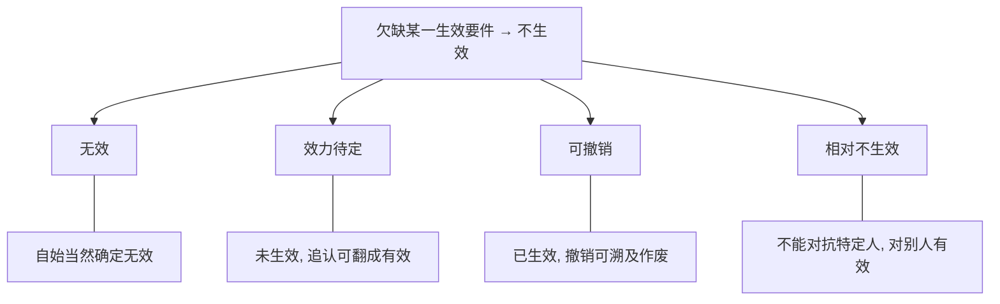
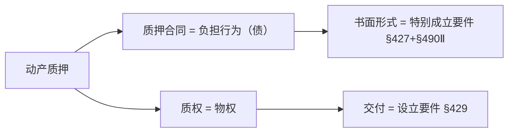
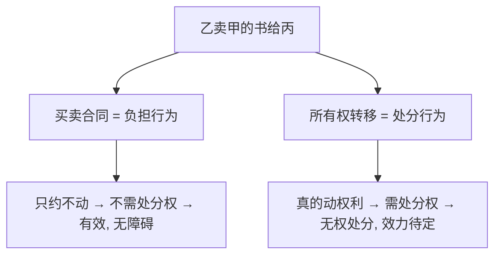
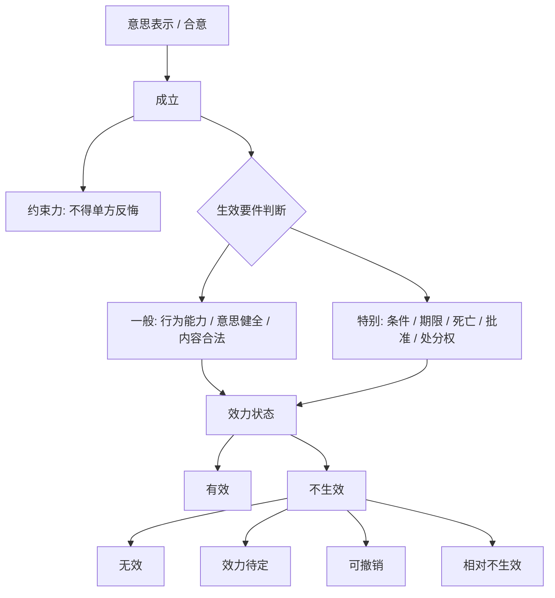
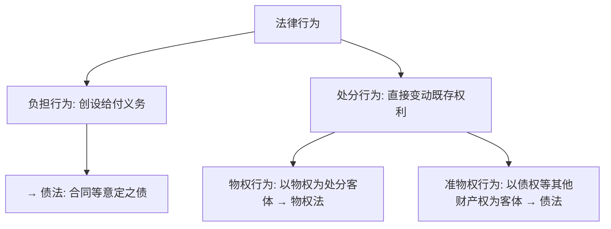

> [!quote] YOU

继续

> [!question] Quiz
> 下列关于法律行为成立与生效的说法正确的是()（多选）
>
> 1. 成立的法律行为未必生效
> 2. 在遗嘱人死亡之前，遗嘱未成立
> 3. 在我国民法上，采用法定形式是法律行为的特别成立要件
> 4. 法律行为成立与生效的时点一致

> [!success] Quiz — correct ✓
> Your answer: 1. 成立的法律行为未必生效, 3. 在我国民法上，采用法定形式是法律行为的特别成立要件
> Correct answer: 1, 3
>
> 「法律行为成立与生效的时点一致」错——成立即生效是常态，但附停止条件、附始期、待审批的法律行为是先成立、后生效，时点可以分离。「成立的法律行为未必生效」对——正是这个分离的体现。「在我国民法上，采用法定形式是法律行为的特别成立要件」对——§490Ⅱ用了「该合同成立」而非「生效」，反面解释＋§134/135/136 的体系解释，形式是特别成立要件。「在遗嘱人死亡之前，遗嘱未成立」错——遗嘱写就即成立，只是死亡前未生效且无形式约束力；成立≠生效，成立看意思表示作出，生效看遗嘱人死亡（特别生效要件）。

> [!abstract] PI

进度先对齐一下（有个小出入）：看笔记，**10-02 那次课其实已经讲到了第二节·二**——「约束力 → 一般生效要件 → 特别生效要件」都过了，只是那次会话在进入**第二节·三 效力状态**之前断了，没写回课程进度和进程树，所以看板还停在「第二节待讲」。今天从它断掉的地方接着讲，讲完我把进度和错题档案一起补上。

---

# 第二节·三 法律行为的效力状态

这是第十章的收尾，也是把前面所有「成立／生效／要件」焊成一张图的一节。

先看教材怎么把「不生效」这个口袋打开：

**教材 p.384**：「以上分析表明，法律行为须符合**全部生效要件**才能完全、确定地发生效力。此种效力状态通常被称为『有效的』（gültig）或者『生效的』（wirksam）……一旦欠缺某一生效要件，法律行为即为『不生效的』（unwirksam）。**不生效不等于确定无效，不生效是一个上位概念。**」

拆最后一个词——「上位概念」：它是说，「不生效」是一棵树的**树干**，下面长着好几根**树枝**。你缺的生效要件不同，落到哪根树枝就不同。教材接着列了四根树枝：

**教材 p.384**：

> 一般认为，不生效包括如下类型：①**无效**（nichtig），即法律行为**当然、确定无效**，与完全有效处于两个极端；②**效力待定**，即法律行为**最初不发生效力**，将来可能因为某人（如法定代理人）的追认而**溯及发生效力**；③**可撤销**，即法律行为**最初发生效力**，但一方当事人享有撤销权，撤销权的行使导致法律行为**溯及丧失效力**；④**相对不生效**，即法律行为**相对于受保护的特定人不发生效力，但相对于其他人都已发生效力**，如预告登记期间的不动产处分行为相对于预告登记权利人不发生效力，查封物的处分行为相对于申请执行人不发生效力。

先停一下，这里有一根**你自己能推出来的筋**——四个「不生效」里，**哪个是「已经生过效」的？** 剩下的三个里，哪个「还有机会翻成有效」？

先答主问题；真卡住了再看提示：想想「可撤销」在撤销之前，合同到底有没有在履行、有没有在约束双方？

（答完这一问，我再把四根树枝钉成一张图，然后接刘家安的「有效＝如你所愿」那一刀。）

> [!quote] YOU

第四个我看不懂。   
可撤销是已经生过效，效力待定有机会翻成有效

> [!abstract] PI

两个都对，先说结论再补你卡住的那个。

- **可撤销＝已经生过效** ✓ —— 撤销之前合同在履行、在约束双方，撤销是「事后把它作废」。
- **效力待定＝有机会翻成有效** ✓ —— 未生效，等追认，追认了才生效。

# 「相对不生效」——你卡住的第四根树枝

它不是「无效」，也不是「待定」，而是**「半生效」**：**对某几个受保护的人不发生效力，对其他人照常生效**。关键在「相对」二字——不是对全世界无效，只对**特定的那个人**无效（说专业点：**不能对抗他**）。

拿教材自己的两个例子掰开：

**例① 预告登记**：甲向乙买房，办了**预告登记**（＝先到登记簿上「挂个号」公示"这套房将来归甲"，防房主一房二卖）。此后乙又把同一套房卖给丙、办了过户。

- 对**甲**（预告登记权利人）：乙→丙的处分**不生效力**——丙的登记**对抗不了**甲，甲将来照样能拿到房。
- 对**丙**和其余所有人：这个处分在乙丙之间**是生效的**，丙成了（名义上的）所有权人，只是"压不过"甲。

**例② 查封物**：甲申请法院查封了乙的一批货物。乙撕掉封条，把货卖给丙并交付。

- 对**甲**（申请执行人）：乙→丙的处分**不生效力**——对抗不了甲，甲仍可强制执行这批货。
- 对**丙**：处分在乙丙之间**生效**，丙取得所有权，只是对抗不了甲。

一句话钩子：**相对不生效＝不能对抗那个人，对别人照常有效。**

跟「无效」的界线划清楚——**无效**是对**所有人、自始、当然、确定**不生效；**相对不生效**是对**特定人**不生效、对**其他人已生效**。所以它是「不生效」这棵树上最细的一根枝，教材特意单列，就是怕你把它错并进「无效」。

---

# 四根树枝，一张图钉死

把它们放上**两个轴**看，就不会再混：

| 效力状态 | 最初生不生效？ | 之后会不会变？ | 一句话 |
|---|---|---|---|
| **有效** | 生效 | 不再变 | 完全、确定生效 |
| **无效** | 不生效 | 不再变 | 自始、当然、确定无效 |
| **效力待定** | 不生效 | **可变有效**（靠追认） | 未生效，等人点头 |
| **可撤销** | **生效** | **可变无效**（靠撤销） | 已生效，等人拆台 |
| **相对不生效** | 部分生效 | 相对稳定 | 对那个人无效，对别人有效 |

---

# 刘家安补一刀：「有效＝如你所愿」

这是学硕深度的核心视角，教材没直说，但考研答效力状态题时的「魂」在这：

**刘家安 第16讲**：「法律行为有效意味着法秩序对当事人意思的认可，即『如你所愿』；而无效只不过意味着『未如你所愿』，仅此而已。」

所以「无效」**绝不是**「没有任何法律后果」——恰恰相反：

- 买卖合同被宣告无效后，**才**产生「卖方拿回货、买方拿回钱」的返还后果，还有缔约过失责任；
- 但这些后果都是**法定的**（不当得利返还、物权返还请求权……），不是当事人当初**约定的**那些。

无效=你想要的（物钱交换）没被承认，但法律**替你另配了一套**法定的收拾摊子的方案。

另一刀，记这两条发展轨迹（后面谱系全从这推）：

- **可撤销**：什么都不做 → **确定有效**（除斥期间一过，撤销权消灭，合同就稳稳生效了）。
- **效力待定**：什么都不做 → **不生效**；要做点什么（追认）才有效。

---

拿一道题验一下这四个状态的区分，选完后**用一句话说说「效力待定」和「可撤销」差在哪**：

> [!question] Quiz
> 下列关于法律行为效力待定的说法正确的是()
>
> 1. 行为人欠缺行为能力的，法律行为效力待定
> 2. 可撤销法律行为效力待定
> 3. 效力待定的法律行为可能因追认而发生效力
> 4. 效力待定的法律行为相对无效

> [!success] Quiz — correct ✓
> Your answer: 3. 效力待定的法律行为可能因追认而发生效力
> Correct answer: 3
>
> Note: 我前面怎么判断是生效要件还是成立要件不清楚
>
> 「可撤销法律行为效力待定」错——可撤销是已生效但可能被撤销，效力待定是未生效但可能因追认而生效，两者方向相反。「效力待定的法律行为相对无效」错——它并非确定无效，而是未生效、且可能因追认溯及发生效力。「效力待定的法律行为可能因追认而发生效力」对——这正是效力待定的定义。「行为人欠缺行为能力的，法律行为效力待定」错——要分：无行为能力人实施的法律行为（严格说意思表示都不成立，现行法规定为）无效；限制行为能力人实施的超出其能力范围且非纯获益的法律行为才是效力待定，不能一概而论。

> [!abstract] PI

这个 note 问到了**本章的命门**——「成立要件 vs 生效要件」分不清，你前面在 10-02 错的那道「保管合同=交付」，根子就在这。先把它焊死，再回主线。

# 怎么判断一个要件是「成立要件」还是「生效要件」

**总标尺一句话：成立要件管「行为存不存在」，生效要件管「效果发不发生」。**

再往细拆，给你一条可操作的直觉——**看它在「行为之内」还是「行为之外」**：

- **成立要件 = 行为本身的构成要素（行为之内）**。缺了它，这个行为**根本没做完整、不存在**。
- **生效要件 = 行为之外的「效果开关」（行为之外）**。行为已经做完整、存在了，只是效果被这个开关**按住**，等它打开才发生。

用这条尺子，把你最容易混的几组一对照就清楚了：

| 要件 | 它是「行为之内」还是「行为之外」？ | 归类 |
|---|---|---|
| **交付**（实践合同） | 自然人借款：钱没交出去，借款这个**行为本身没做完** | 成立要件 |
| **书面形式**（要式合同） | 形式是**意思表示的载体**，没签书面＝意思表示没做出来 | 成立要件 |
| **条件成就**（附停止条件） | 合同**已经签好**，条件成就是未来不确定的**外部事件** | 生效要件 |
| **主管机关批准** | 合同**已经签好**，批准是**外部**的国家许可 | 生效要件 |
| **遗嘱人死亡** | 遗嘱**已经写好**（成立），死亡是**外部事件** | 生效要件 |
| **处分权**（处分行为） | 处分**已经作出**，处分权是**外部**的权利基础 | 生效要件 |

**一句话口诀：** 差一块才「成形」→ 成立；已成形、等开关 → 生效。

---

# 但有一个必须诚实告诉你的坑

这个归类**不是纯靠逻辑推出来的**，最终是**实证法文义 + 学说立场**说了算。最典型就是「书面形式」：

- 我国大陆：§490Ⅱ明文写「该合同**成立**」，反面解释 → 形式是**特别成立要件**。
- 德国通说：§125 写「欠缺形式则**无效**」→ 形式是**特别生效要件**。

同一个「形式」，两国归类相反。所以你的判断要**双轨**：

1. **先看法条文义**——条文说「成立」还是「生效／无效」，这是最硬的裁判；
2. 条文没明说时，再用「行为之内／行为之外」的直觉 + 下面的**清单**兜底。

**清单（B 类，背下来，考点就这几个）：**

- **特别成立要件**：① 实践合同=交付（保管 §890／自然人借款 §679／定金 §586）；② 要式形式（§490Ⅱ）；③ 结婚=登记。
- **特别生效要件**：① 附停止条件=条件成就；② 附始期=始期届至；③ 遗嘱=死亡；④ 须经批准=批准；⑤ 处分行为=处分权。

拿一道正好卡在这个坑上的题验一下，选完**用一句话说清「书面形式为什么是成立要件而不是生效要件」**：

> [!question] Quiz
> 按照《民法典》第427条的规定，动产质押合同须采用书面形式。下列选项正确的是()
>
> 1. 书面形式是动产质权的特别成立要件
> 2. 未采用书面形式，即便质物已经交付，质押合同也不成立
> 3. 书面形式是动产质押合同的特别成立要件
> 4. 书面形式是动产质押合同的特别生效要件

> [!failure] Quiz — incorrect ✗
> Your answer: 1. 书面形式是动产质权的特别成立要件
> Correct answer: 3
>
> 「书面形式是动产质押合同的特别生效要件」错——依 §490Ⅱ「该合同成立」的反面解释，法定/约定书面形式是要式合同的特别成立要件，不是生效要件。「书面形式是动产质权的特别成立要件」错——书面形式约束的是「质押合同」（负担行为），质权本身靠交付设立（§429），不是书面形式。「书面形式是动产质押合同的特别成立要件」对——正是反面解释的结论。「未采用书面形式，即便质物已经交付，质押合同也不成立」错——若质物已交付即实际履行了主给付义务，形式瑕疵因履行而补正，质押合同仍成立（§490Ⅱ），这正是「因履行补正」的规则。

> [!abstract] PI

这次没栽在「成立 vs 生效」上——你选的是「成立要件」，方向对了。你栽在**「合同 vs 质权」**上：把书面形式挂错了对象。

# 你选错的那一项，问题出在「挂错了名头」

这题里其实藏了两个**不同的东西**，你合成了一个：

**质押合同**（负担行为）——甲、乙之间那**一纸债的关系**：出质人乙负担「交付质物、设立质权」的义务，质权人甲负担「妥善保管」等义务。它要的是**书面形式**（§427 明文「应当采用书面形式订立质押合同」，配 §490Ⅱ「成立」的反面解释 → **特别成立要件**）。

**质权**（物权，处分行为的效果）——那个真正的**担保物权**。它根本不吃「书面形式」这一套，它是靠**「交付质物」设立**的（§429「质权自出质人交付质押财产时设立」）。

所以：**书面形式管「合同」（债），交付管「质权」（物权）。** 你选的「书面形式是动产质权的特别成立要件」——把本该挂在「质押合同」上的书面形式，错挂到了「质权」头上。

# 顺带把「物债二分」这根筋再拉一遍

这正是 10-02 那课讲的「最要命的一根筋」，今天又冒出来了，说明它还没长牢：

- **负担行为**（买卖合同、质押合同、借款合同……）＝只产生**债权债务**，不直接变动权利。→ 书面形式、成立要件这类，多挂在这层。
- **处分行为**（移转所有权、设立质权、让与债权……）＝**直接变动权利**。→ 交付/登记、处分权这类，挂在这层。

一对照就通：**质押合同**是负担行为，需要书面形式（成立要件）；**质权设立**是处分行为，需要交付＋处分权（生效要件）。同一个「质押」两个字，拆成债与物权两层，要件各挂各的。

（这正好是本章案例题第 5 问的考点：乙不是瓷瓶所有人，**质押合同仍有效**——负担行为不需处分权；**质权**要等丙追认才成立——处分行为才要处分权。今天先点到，练案例时再展开。）

---

用你自己的话收一句：**「质押合同」和「质权」，各是债还是物权？各自靠什么要件「成形／设立」？** 说清楚我们再进最后一小块——效力障碍谱系（「未定的不生效」「未定的生效」那一层）。

> [!quote] YOU

合同是债权，靠书面形式而成立 ，质权是一种物权，靠交付要件而成形

> [!abstract] PI

复述基本到位，我给你把两个**术语钉准**，这俩词以后别混：

- **合同（债）**——靠「书面形式」而**成立**（成立要件）。
- **质权（物权）**——靠「交付」而**设立**（不是"成立"）。

一个细节：债用「**成立**」，物权变动用「**设立**」（或"移转"）。所以准确说法是「质押合同**成立**、质权**设立**」。你能把债/物权、书面形式/交付分到两边，这根筋就算长牢了。

---

# 最后一小块：效力障碍谱系（教材 p.384，图 10-4）

前面我们拿到了五根「树枝」（有效/无效/效力待定/可撤销/相对不生效）。现在教材再往上一拔，把这五根树枝＋条件、期限、批准，**按"障碍轻重"排成一把刻度尺**。这是学硕喜欢出的论述点，跟读一遍：

**教材 p.384**：「应当注意的是，效力待定亦称『**未定的不生效**』（schwebend unwirksam），若从广义上理解，也包括如下情形：须经批准的法律行为，在获得主管机关批准之前，不发生效力，将来获得批准的，发生效力；附停止条件法律行为在条件成就前，不发生效力，条件成就时，发生效力。与之相对的概念是『**未定的生效**』（schwebend wirksam），除了可撤销之外，这种效力状态还包括如下情形：附解除条件法律行为，最初发生效力，但将来可能因解除条件成就而丧失效力。」

先拆这一对**镜像概念**：

- **未定的不生效**＝「现在没生效，将来**可能**生效」——效力待定（等追认）、待批准（等批准）、附停止条件（等条件成就）。
- **未定的生效**＝「现在生效了，将来**可能**失效」——可撤销（等撤销）、附解除条件（等条件成就就失效）。

关键在「未定」两个字：**效力去向还不确定**。追认可能来也可能不来，条件可能成也可能不成，撤销可能行使也可能放弃——所以是「未定」。

---

接着读，看杨代雄怎么处理**附期限**这个「漏网之鱼」：

**教材 p.384**：「学理上尚未被归类的是附期限法律行为与死因行为。附始期法律行为在始期届至前，不发生效力，但**必然于始期届至时发生效力**，所以**不能称之为『未定的不生效』**，因为**不存在不确定状态**，只能称之为『**延迟生效**』；附终期法律行为在终期届至前，已发生效力，但必然于终期届至时丧失效力，不妨称之为『**有期限生效**』。死因行为与附始期法律行为类似，在行为人死亡前亦为『延迟生效』，特殊之处在于，行为人**可能撤销**死因行为，所以法律行为并非必然于行为人死亡时生效。」

这里有一个**你可以自己推的关节**——先别往下看：

**为什么附始期不能叫「未定的不生效」，只能叫「延迟生效」？** 差别就在两个字。

（提示：期限和条件，本质区别是什么？「将来事实是否确定」——期限是必然到来的，条件是可能来可能不来的。）

---

我先把答案摆出来，你对照你的推理：**因为期限是必然到来的，没有「未定」**。「未定的不生效」是说"生效与否还不确定"；而附始期，始期**一定会到**，只是晚点到，所以效力"必然发生、只是**推迟**"——叫「延迟生效」。条件就不一样，条件**可能根本不成就**，所以叫「未定」。

最后一刀，术语批判（这是杨代雄的招牌观点，论述题能直接拿来用）：

**教材 p.384**：「传统理论中用于统称法律行为不生效诸情形的概念是**法律行为效力瑕疵**。此概念的不足之处在于……法律行为**无效**意味着**不存在任何效力**，既无效力，何以谓之『效力瑕疵』？『瑕疵』的前提是存在被描述的事物……由此可见，『效力瑕疵』在外延上难以涵盖法律行为无效。……称之为『**效力障碍**的法律行为』更为贴切……可撤销法律行为、附解除条件法律行为尽管已经发生效力，但其效力中隐藏『炸弹』，一旦触发即导致效力丧失，可谓法律行为的**隐藏效力障碍**。」

逻辑很漂亮：**「瑕疵」得有东西可"瑕"**——物有瑕疵，前提是物存在；无效=根本没有效力，何谈瑕疵？所以统称该叫「**效力障碍**」。他还把障碍分两族：**意定障碍**（停止条件、始期——当事人**自己设的**）和**隐藏障碍**（可撤销、附解除条件——效力里**藏着炸弹**）。

---

拿一道多选把「效力障碍」整个概念验一下，选完**用一句话说说：为什么附始期叫"延迟生效"而不是"未定的不生效"**：

> [!question] Quiz
> 下列关于法律行为效力障碍的说法正确的是()（多选）
>
> 1. 无权处分的买卖合同存在效力障碍
> 2. 违背公序良俗的法律行为存在效力障碍
> 3. 限制行为能力人实施的纯获益法律行为存在效力障碍
> 4. 无权代理且相对人为恶意的法律行为存在效力障碍

> [!failure] Quiz — incorrect ✗
> Your answer: 1. 无权处分的买卖合同存在效力障碍, 4. 无权代理且相对人为恶意的法律行为存在效力障碍
> Correct answer: 2, 4
>
> 「限制行为能力人实施的纯获益法律行为存在效力障碍」错——纯获利益的法律行为有效（§145Ⅰ但书），没有效力障碍。「违背公序良俗的法律行为存在效力障碍」对——它确定无效，无效正是障碍最严重者。「无权代理且相对人为恶意的法律行为存在效力障碍」对——相对人恶意即不构成表见代理，无权代理的法律行为效力待定，属于未定的不生效（障碍）。「无权处分的买卖合同存在效力障碍」错——买卖合同是负担行为，不以处分权为生效要件，出卖他人之物的买卖合同依然有效，不存在效力障碍；效力障碍落在处分行为（无权处分，效力待定）上。这正是物债二分：障碍挂在处分行为，不挂在负担行为。

> [!abstract] PI

这一题你又踩了两个点，而且其中一个点**已经是第三次了**，我得跟你认真掰一掰。

# 你选错的那项：物债二分又滑了

你选了「无权处分的买卖合同存在效力障碍」——这是**同一个坑第三次出现**（10-02 的处分权、刚才的质押合同vs质权、现在又在这）。说明这根筋不是"没记住"，是**没焊进直觉**。我用一个最粗暴的锚点重新打一次：

**「约」和「动」是两个动作，不是一回事。**

- **负担行为 = 只「约」**：约定"我把书卖给你、你给我钱" → 只产生**义务**，**不碰权利**。
- **处分行为 = 才「动」**：交付＋让与合意，真的把所有权**从乙移给丙** → **动权利**。

无权处分（乙捡到甲的书卖给丙）拆开看：

所以：「出卖他人之物，**买卖合同照样有效**」——"约定卖别人家的东西"这个约定本身没毛病，法律不拦你**约**；拦的是**真的去动**（处分）那一步，你没处分权，处分行为才**效力待定**。

**一句话钩子：障碍永远挂在「动」（处分）上，不挂在「约」（负担）上。**

# 你漏掉的那项：把「无效」和「障碍」当成了两回事

你没选「违背公序良俗存在效力障碍」——我猜你是觉得"无效"已经死透了，不算"障碍"。错了。

**「效力障碍」是个中性的大口袋**，它 = "除完全有效之外的一切状态"的总称，从最轻排到最重：

| 障碍轻重 | 状态 |
|---|---|
| **最轻** | 附期限（延迟生效／有期限生效）——效力只是被时间推迟、限定 |
| **较轻** | 相对不生效、未定的生效（可撤销、附解除条件） |
| **较严重** | 未定的不生效（效力待定、待批准、附停止条件） |
| **最严重** | **无效** |

所以**无效恰恰是障碍的最严重一档**，不是"障碍之外"。违背公序良俗 = 确定无效 = 障碍登顶。

---

再验一道，就考你刚才这两个点，选完**用一句话说：为什么"无权处分的买卖合同"没有效力障碍**：

> [!question] Quiz
> 甲丢失一本新书，被乙捡到，乙将该书出卖给丙，并已经交付。下列说法正确的是()（多选）
>
> 1. 乙、丙的处分行为无效
> 2. 若甲追认，则乙、丙的处分行为生效
> 3. 乙、丙的买卖合同已经成立，但未生效
> 4. 乙、丙的处分行为效力待定

> [!failure] Quiz — incorrect ✗
> Your answer: 1. 乙、丙的处分行为无效, 2. 若甲追认，则乙、丙的处分行为生效, 3. 乙、丙的买卖合同已经成立，但未生效, 4. 乙、丙的处分行为效力待定
> Correct answer: 2, 4
>
> 「乙、丙的买卖合同已经成立，但未生效」错——买卖合同是负担行为，不以处分权为生效要件，出卖他人之物的买卖合同成立即生效，并非未生效。「乙、丙的处分行为无效」错——乙无权处分，处分行为是效力待定，不是无效。「乙、丙的处分行为效力待定」对——无权处分的处分行为效力待定。「若甲追认，则乙、丙的处分行为生效」对——权利人甲追认后，处分行为补正了处分权缺陷而生效。关键：障碍挂在处分行为（效力待定）上，买卖合同（负担行为）有效、无障碍。

> [!abstract] PI

先停一下，不刷题了。你这一题**同时选了「处分行为无效」和「处分行为效力待定」**——这两项**不可能都对**（一个说"无效"，一个说"待定"，互相打架）。这说明你已经开始**猜**了，不是没记住，是这根本来就没焊牢，越刷越慌。

我们把题放下，把这根筋**最后焊一次**，焊完再走。

# 一个核心图景：一个买卖，其实是**两件事**

乙卖一本书给丙，看着是一个交易，其实是**两件独立的事**，各管各的：

| | **第一件事：债** | **第二件事：物权** |
|---|---|---|
| 叫什么 | 买卖合同（**负担行为**） | 所有权转移（**处分行为**） |
| 干嘛 | 让乙**欠**丙一个"交书＋转移所有权"的义务 | 让所有权**真的**从乙转到丙 |
| 有效与否看什么 | 意思表示真实自由、内容合法、行为能力 | **乙有没有处分权** |
| 卖的是别人的书 | **合同照样有效**（欠债不碰权利） | **效力待定**（没处分权，转不动） |

# 你一直没接住的那句话，就一句：

**「合同有效」 ≠ 「权利已经转移了」。**

- 买卖合同**有效**，只说明：**乙欠了丙一个债**（"我答应把所有权转给你"）。欠债不需要乙**现在**就有处分权——他到时候弄到处分权再转就行。
- 所有权**真的转过去**，是**另一件事**（交付＋让与合意），这一步才卡「处分权」。乙没处分权 → 这一步**效力待定**，等甲（真权利人）追认。

所以「乙卖甲的书」这个案例，**两句话收口**：

1. **买卖合同（债）：成立且生效**——不是"成立但未生效"。
2. **所有权转移（物权）：效力待定**——不是"无效"；甲追认了，它就生效。

**钩子（15 字内）：欠债不看处分权，转移权利才要看。**

---

现在我不出题，就让你用**自己的话**说一遍——**乙卖丙一本书（书其实是甲的），请问：**「买卖合同」和「所有权转移」这两件事，各自是什么状态？为什么不一样？** 一句话说清，我再给你收这一章的尾。

> [!quote] YOU

买卖合同直接成立且有效，丙获得债权，乙产生交付的义务。所有权转移的效力待定，因为是无权处分

> [!abstract] PI

复述到位了，而且你这次把「债」和「物权」分到两边说得清清楚楚——**这根筋这次是真的焊住了**。「丙获得债权、乙产生交付义务」是负担行为的两个侧面，「所有权转移效力待定因无权处分」是处分行为的结论，都对。

---

# 第十章 收束：一张图塌缩全章

**双清单清零核对：**

- **教材第十章节点（全部清零）**：为何区分成立/生效 ✓｜一般成立要件 ✓｜特别成立要件（实践/要式/形式补正）✓｜约束力 ✓｜一般生效要件 ✓｜特别生效要件 ✓｜效力状态谱系 ✓
- **刘家安第16讲**：「效力体系」块（有效=如你所愿、无效≠无法律意义、可撤销/效力待定/未生效的发展轨迹）→ **本次已覆盖** ✓；「附条件与附期限」的**详细机制**（条件构成要件、拟制、不得附条件的情形）→ 杨代雄把它放在**第十一章第四节**专章，**归入下次课，不遗漏**。

---

# 微任务（5 分钟，对话里打字交）

拿你今天反复磕的那个点练输出——用你自己的话写 **3–5 句**，向一个完全不懂法的朋友解释：

1. 买卖合同为什么只是「**欠债**」、不是「**转移权利**」；
2. 由此推出——**卖别人的东西，合同为什么照样有效，但所有权暂时转不过去**。

写完直接发我，我改。改完这章就正式结课，你可以说「拷问我第十章」或「练一道案例」巩固。

现在我把进度、错题、复习队列一起写回档案：

> [!abstract] PI

档案已更新完毕：

- **课程进度**：第十章标记 ✅ 已学完（掌握度 ⭐⭐），三次课的要点、5 道新错题（含 10-02 补录的 2 道）、4 条新复习队列项都写进去了。
- **进程树**：第十章 → ✅，复习队列 19→23 项，错题 8→13 道，最近笔记补上今天这篇。

就差你的**微任务**了——写那 3–5 句（买卖合同为什么是「欠债」不是「转移权利」→ 为什么卖别人的东西合同仍有效、但所有权转不过去）。发过来我改。

> [!quote] YOU

1.因为物债二分，买卖合同属于一个负担行为，产生的是债权，而后续的处分行为才管权利的转移。      卖别人的东西有效，因为只产生了债权的转让，权利不变

> [!abstract] PI

改完了。两句话的**结论都对**——物债二分这次是真焊进去了：

1. 「买卖合同=负担行为，产生债权；处分行为才管权利转移」——对。
2. 「卖别人的东西合同有效、权利不变」——对。

但有一个词必须改，而且这个词正是这根筋的**最后一根刺**：

**「只产生了债权的转让」→ 应改成「只创设了债权债务（给付义务）」。**

为什么「转让」不能要：

- **负担行为是「创设」义务**——它让乙「欠」丙一个债，是**无中生有地造出一个义务**，不是把什么东西「转让」给谁。
- **「转让」是处分行为的词**——「债权转让」（债权让与）本身就是一种**处分行为**（把自己的债权让给别人）。你把「转让」用在负担行为上，等于又把这个词送回了处分行为的营盘。

**精修版（可以背的干净版本）：**

> 买卖合同是负担行为，只在乙、丙之间**创设债权债务**——乙负担「交付并转移所有权」的义务，丙负担「付款」的义务。**创设义务不需要乙有处分权**，所以卖别人的东西，合同照样有效。所有权真的从甲名下转到丙名下，那是**另一个行为**（处分行为），乙无处分权，所以那一步**效力待定**，等甲追认。

钩子再钉一遍：**负担＝创设义务（欠债）；处分＝转移权利（转让）。** 四个动词别串——创设/欠债归负担，转移/转让/设立归处分。

> [!abstract] PI

第十章正式结课 ✅。巩固入口备着：

- 说「**拷问我第十章**」→ 用习题册刷题（今天错过的物债二分、效力状态是重点）；
- 说「**练一道案例**」→ 单元十的案例分析题正好是「借款合同形式补正 + 质押合同 + 无权处分」的综合演练，今天这几个点全用上。

下次想接着往下，说「**学第十一章**」——那是「效力障碍」的大章，刘家安「附条件与附期限」的详细机制也会在那儿补上。

> [!quote] YOU

你和我介绍一下接下来一段时间学什么？什么时候可以进入债法的学习

> [!abstract] PI

好问题，正好把你自己的进度看板（`进程树.md`）讲清楚。路线早就定了，原则是**总论 ↔ 债法穿插、质量优先、不赶日历**。

# 接下来一段时间：先把「法律行为」收尾

你现在的位置是总论第 10 章（✅ 刚结课）。剩下还有三块**法律行为**的大章要收口，这是总论最重的部分：

| 章 | 内容 | 体量 |
|---|---|---|
| **第十一章 效力障碍** | 无效 / 可撤销 / 效力待定 / 附条件附期限（第四节）/ 无效转换 | 全书最厚之一（教材 p.384–442） |
| **第十二章 归属** | 代理、代表、意思表示的归属 | 全书最厚之一（p.443–507） |

这两章讲完，「法律行为」这个总论的核心骨架就**完整闭合**了——第十章埋的「效力状态谱系」会在第十一章全面展开，刘家安「附条件与附期限」的详细机制也在第十一章第四节补上。

# 什么时候进债法？——讲完第十一、十二章

**触发条件：第十一章 + 第十二章讲完，就正式开篇债法。** 不是等总论全讲完——路线是**穿插**的：

债法线用**解亘《板书体债法总论》**做骨架（6 部 22 章，已入库）：

| 阶段 | 债法线 | 同步穿插的总论 |
|---|---|---|
| B 债法开篇 | 第1部 债的基本概念（4 章） | **ch13 权利救济（请求权）** |
| C 债法主体 | 第2部 债务不履行（5）→ 第3部 债的消灭（3） | ch14 时间维度（时效） |
| D 债法后段 | 第4部 保全（3）→ 第5部 变动（3）→ 第6部 多数人之债（4） | ch15 期间 |
| E 补缺收束 | 典型合同（韩世远）、侵权/不当得利 | — |

为什么把总论 **ch13 请求权**放在债法开篇一起——因为请求权基础思维是债法（尤其债务不履行、违约责任）的**方法论底子**，先有它再读债法才不飘。

# 一个要分清的「债法」两层

1. **校课债法**（周五 6-8）：这学期你**校课已经在上了**，那根线独立走，随课消化（`kb/合同法总论/`）。
2. **自学债法线**：这里说的「进债法」指**系统自学线开篇**（解亘骨架），它跟校课**解耦**、按教材体系推进，不追校课节奏。

# 两个缺口（提前知道，不慌）

- 解亘债法骨架**不含典型合同**（用韩世远《合同法总论》补）和**侵权 / 不当得利**——但华政 615「法定之债」要考，所以这两块在阶段 E 补，不影响你现在推进。

---

**一句话总结**：短期 = 第十一章、第十二章把「法律行为」收口；**这两章一结束就开债法**（第1部债的基本概念 + 总论 ch13 请求权）。不给具体日期——质量优先，一章讲到「双清单清零、你复述过关」才算完，不凑进度。

想现在就开始，直接说「**学第十一章**」。

> [!quote] YOU

我提一个问题，债法和物权法是不是就对应负担行为和处分行为？

> [!abstract] PI

问到点子上了。**答案：不是一一对应——这是两层不同的分法，交叉但不重合。** 这是华政学硕（王泽鉴谱系）特别爱挖的一个点，正好借你这个问题焊清楚。

# 先分清「两层尺子」在量什么

- **债法 vs 物权法**：按**权利的性质**分。债权＝相对权/请求权（只能向特定人主张）；物权＝绝对权/支配权（对物直接支配、对世）。
- **负担行为 vs 处分行为**：按**行为的法律效果**分。负担行为＝**创设**给付义务；处分行为＝**直接变动**一项既存权利。

尺子不同，所以不能对折。教材第九章的图（p.370 前）其实已经画了：

# 正确的对应（记住这两条）

1. **负担行为 → 债法**：这条基本成立（合同就是典型的负担行为，产生债权债务）。
2. **处分行为 → 不限于物权法**：处分行为的客体可以是**任何财产权**——以**物权**为客体的是**物权行为**（落物权法）；以**债权**等其他财产权为客体的是**准物权行为**（落**债法**）。

# 一个反例就能打破你的直觉：债权让与

**把自己的债权转让给别人（债权让与），是处分行为，但它在债法里，不在物权法。**

教材第九章的案例就是现成的：C 公司把 5000 万债权以 2000 万卖给 D 公司——

- 那份「约定转让」的合同 = **负担行为**（C 负担"移转债权"的义务，D 负担"付 2000 万"的义务）；
- 「债权自价款付清时起移转」的约定 = **处分行为**（直接处分了"债权"这项权利），客体是**债权**，归**债法**管。

同样，**债务承担、债务免除**也都是处分行为（处分债权/债务），但都在债法里。所以：

**债法里既有负担行为（合同），也有处分行为（债权让与、债务承担、免除）；物权法里主要是物权行为（处分行为的一种）。**

# 还有一个更深的点（先记住结论）

债法甚至**不全是法律行为**——无因管理、不当得利、侵权是**法定之债**，是事实行为/事件，根本不是法律行为，更谈不上负担行为。所以「债法＝负担行为」也不精确：债法的**意定**来源是负担行为，**法定**来源是另外三个。

---

**一句话钩子：负担＝造债（债法）；处分＝变权利——变物权归物权法，变债权归债法。**

这跟第十章刚焊的「处分权」是通的：因为处分行为（包括债权让与）都要处分权，而负担行为不要——所以判断"要不要处分权"时，先问"这是在造债还是在变权利"。

> [!quote] YOU

你觉得我还需要补什么教材？

> [!abstract] PI

好问题，正好把你的「教材库」和「华政参考书目」对一遍账。先说结论，再展开。

# 结论：最该补三本，另外两本可补可不补

你现在缺的**不是**总论和债法——这两条线的主干都齐了（杨代雄《民法总论》+ 解亘《板书体债法总论》+ 王泽鉴《债法原理》+ 韩世远《合同法总论》）。**真正空白的三块**是：

| 优先级 | 补什么 | 为什么 |
|---|---|---|
| 🔴 最高 | **侵权行为（王泽鉴）** | 侵权责任法**完全空白**，华政 615「法定之债」必考 |
| 🔴 最高 | **不当得利（王泽鉴）** | **完全空白**，且跟你现在学的「无效返还」「处分行为」直接衔接 |
| 🟡 高 | **民法思维（王泽鉴）** | 请求权基础方法论，华政学硕重**鉴定式案例报告**，case 模式的主线 |
| 🟢 中 | 民法总则（王泽鉴） | 华政参考书，但杨代雄主线已很扎实，只作**争议对照**用 |
| 🟢 中 | 民法物权（王泽鉴） | 华政参考书，刘家安《民法物权》已入库顶着，王本作**对照补强** |

（史尚宽《债法总论》是民国经典，学理脉络用，纯扫描要 OCR，**非刚需**，排最后。）

# 对账：华政参考书目（王泽鉴系列）覆盖情况

| 王泽鉴参考书 | 状态 | 现状 |
|---|---|---|
| 民法总则 | ⬜ 待入库 | 杨代雄主线 + 刘家安讲义已覆盖 |
| 债法原理 | ✅ 已入库 | 解亘主线配套 |
| 民法物权 | ⬜ 待入库 | 刘家安《民法物权》已入库作对照 |
| **侵权行为** | ⬜ 待入库 | **完全空白** |
| **不当得利** | ⬜ 待入库 | **完全空白** |
| **民法思维** | ⬜ 待入库 | **完全空白**（方法论） |

# 什么时候需要它们（别现在一次性囤）

按你的路线，**入库节奏**应该是：

1. **现在～法律行为收尾（ch11-12）**：一本都不用急。总论用杨代雄主线 + 刘家安讲义 + 已入库的《法律行为论》（杨代雄专题）足够，王泽鉴《民法总则》想补对照现在投也行，但不影响推进。
2. **进债法线时**：债法已齐（解亘主线 + 债法原理 + 韩世远 + 史尚宽可选），无需补。
3. **物权线 / 侵权、不当得利之前**：把 **民法物权、侵权行为、不当得利（王泽鉴）** 三本投进来——这是**法定之债 + 物权**的主战场，也是华政 615 的大头。
4. **开始 case 训练时**：投 **民法思维（王泽鉴）**，做请求权基础/鉴定式报告的主线。

**一句话建议**：现在就投 **《侵权行为》+《不当得利》+《民法思维》** 三本王泽鉴进 `material/inbox/`，我入库；《民法总则》《民法物权》王本想对照时再补。这样法定之债、方法论两块空白先填上，总论和债法你手里已经够用了。

要不要我现在就按这个清单，把 `material/inbox/` 的待入库清单整理一遍？

> [!quote] YOU

已经放了
