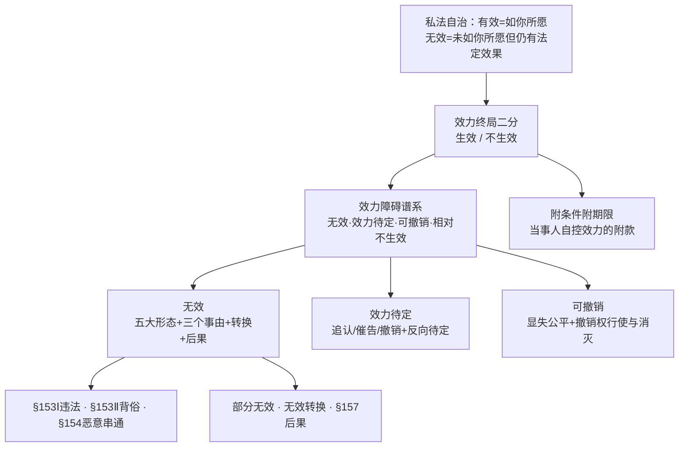
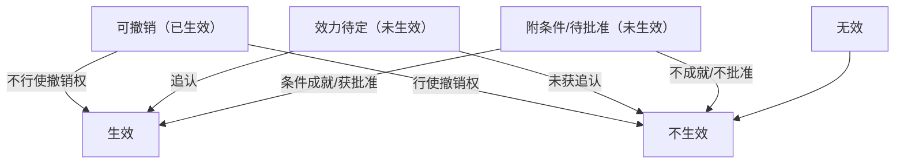

> [!quote] YOU

继续

> [!abstract] PI

上次第十章已收尾，进度和错题档案我也都读过了。今天正式进入**第十一章 法律行为的效力障碍**（教材 p.384–442，58 页，全书篇幅最大的一章）。进入教学前，先把这一章的规划和依赖图摆出来，你点头我再开讲。

---

## 一、这一章在体系里的位置

上一章讲的是「成立 vs 生效」，结尾给了你一张**效力状态谱系**（有效／无效／效力待定／可撤销／相对不生效）。第十一章就是把谱系里每一档的**具体事由 + 后果**逐个展开，外加一条支线——**附条件与附期限**（当事人自己用「附款」控制效力，属于效力的**私人调控**，跟前三节的**法定障碍**相对）。

一句话总纲（也是本章的根）：

> **法律行为的效力只有「生效 / 不生效」两个终局**。无效、可撤销、效力待定、附条件……都是通往这两个终局的**中间状态**或路径。刘家安第 16 讲把这个框架讲得最透，是本章的纲。

## 二、路径叙述（讲什么、按什么顺序、为什么）

**第 1 步（本次）——总纲 + 第一节「无效」上半**：先立无效的**五大形态**（当然／确定／自始／绝对／全部无效），用它把「无效 vs 可撤销」「无效 vs 效力待定」的边界一次钉死（这是上一章谱系的具体化，也是本章最容易被考混淆的地方）；再讲**部分无效**、**非溯及无效**、**相对无效**三个变形。

**第 2 步——第一节「无效」下半**：三个无效事由逐一切开——§153Ⅰ 违反强制性规定（效力性 vs 管理性规定的九民纪要识别）、§153Ⅱ 违背公序良俗（八种情形）、§154 恶意串通（教材的批判：这条"牛刀杀鸡"，本质是背俗的特别规定）。这里教材 p.391–408 有大量论证，是学硕深度的主战场。

**第 3 步——无效的软着陆 + 后果**：**无效法律行为转换**（§157 之外没明文但司法在用）+ **§157 无效后果**（物权请求权 vs 不当得利 vs 缔约过失，返还请求权性质之争）。

**第 4 步——第二节 效力待定**：追认／催告／撤销的三角权利配置 + 「反向」效力待定（债务免除、债务加入、利他合同）。

**第 5 步——第三节 可撤销**：显失公平（§151，唯一第九章没讲的撤销事由，主客观要件）+ 撤销权行使（形成诉权）与消灭（§152 除斥期间：一年／九十日／胁迫起算／五年最长）。

**第 6 步——第四节 附条件附期限**：条件构成要件、条件种类、§159 成就拟制、条件成否未定期间的**期待权**、附期限。

## 三、依赖图

## 四、刘家安深度层映射（本章全覆盖，不抽样）

| 讲次 | 深度素材（都会带读） |
|---|---|
| **第 17 讲** | 无效原因体系（§144/146/153/154 ↔ §143 三要件）；无行为能力 vs 限制行为能力的无效/待定之别；【例】压岁钱、父女"买卖藏赠与" |
| **第 18 讲** | 效力性 vs 管理性规定的识别（九民纪要第 30、31 条）；【学员问题】限购合同；【例】租赁未备案、泸州遗赠案、一物二卖恶意串通、无效返还请求权性质之争（§157 三说） |
| **第 19 讲** | 撤销权除斥期间双重期间结构；【02 年司考题】钻石戒指；**无权处分效力待定——负担/处分"任督二脉"**（你物债二分的薄弱点，重点补） |
| **第 16 讲** | 效力终局二分总纲；附款四种；条件拟制；【例】侄儿考上研赠 5 万、禽流感解除、甲父死亡租房 |

---

**预计 4–5 次课讲完**（本章体量是第十章的 4 倍多，值得慢慢啃）。

确认一下：**按这个顺序开讲吗？** 直接从「总纲 + 无效的五大形态」切入。如果你有想调整的地方（比如想先攻第四节附条件附期限、或某节加速），现在说。

> [!quote] YOU

继续

> [!abstract] PI

There's a 第11章 note directory already? Let me check what's in notes/民法总论/第10章 and 第11章.

> [!abstract] PI

There is already a note for 第十一章 dated 2026-10-06: "法律行为的效力障碍". So a session on 第十一章 may have already started. Let me read that note to see how far it got.

> [!abstract] PI

Interesting — a previous session already laid out the plan for 第十一章 but it seems the session ended with asking for confirmation and no teaching happened yet (the note only contains the plan). So today "继续" means continue with 第十一章 teaching.

Wait, but this note is dated 2026-10-06 and the greeting says "上次讲到：第十章（第一～二节）" — the greeting/进程树 are stale. The课程进度.md says 第十章 全章完成. The第11章 note shows a plan was presented but seemingly no confirmation/teaching followed.

Hmm, but the user's "继续" today — what did they mean? The previous session ended asking "按这个顺序开讲吗？". Today the greeting says "上次讲到：第十章（第一～二节全部完成）… 继续". The user typed "继续".

Per addendum: "继续"→接着讲. So continue teaching. The real state: 第十章 done; 第十一章 planned but not yet taught (the plan note only). So "继续" = start teaching 第十一章, following the plan (step 1: 总纲 + 第一节「无效」上半).

Also there's an inconsistency in 进程树.md (says 第十章 第一～二节) that should be fixed at end of session. Note: the mapping table in 课程进度.md also says "第十章…✅ 已学完（第一～二节）" — inconsistent with the record below it. And there's a stale state. I should fix these at session end (per convention 5).

Per teach-law skill, I must read the skill file first. Let me read teach-law SKILL.md.

Also per convention 4: at the start of teaching, use md_log to link the session mirror note: notes/民法总论/第11章/<日期>-<主题>.md. Today's date? The notes use 2026-10-06 as latest. What's today's date? I should check. Let me get the date via powershell.

Also per global AGENTS.md: "先确认，再动手" — but teaching: the user said "继续" which is a direct instruction to continue class. The previous session already asked for confirmation of the plan and the user now says "继续" — that IS the confirmation to proceed. Actually "继续" came with the greeting menu "1. 继续上课". So the user wants to continue the class. The plan was already presented and the user saying "继续" effectively confirms. But strictly the plan asked "按这个顺序开讲吗？" and the user replied "继续" — that's consent to proceed with the plan.

However, there's ambiguity: the greeting said "上次讲到第十章（第一～二节）", so from the user's perspective "继续" might mean continue chapter 10. But actual data shows chapter 10 complete and chapter 11 planned. Hmm. Actually wait — the greeting is generated from 进程树.md which is stale. The 10-04 session completed chapter 10 but apparently didn't update 进程树. Actually it did add the 10-04 note? 进程树 links only show 2026-10-01 and 2026-10-02 for 第10章... the notes dir has 2026-10-04-效力状态谱系.md. So 进程树 wasn't updated after the 10-04 session (violating convention 5). That's a diagnostics item.

Given the data, "继续" = continue into 第十一章 per the plan from the 10-06 session. I think it's safe: the previous session ended asking for the go-ahead on the chapter-11 plan; the user saying "继续" is the go-ahead. I'll briefly note the stale board and proceed, fixing it at the end.

Actually, per the "先确认，再动手" rule: user said "继续" — direct instruction. The teaching plan was already presented and awaiting confirmation; "继续" = confirm. I can proceed with teaching (teaching is the core activity; also the exception "用户明确说…马上开始" arguably applies to "继续"). I'll proceed but first do a quick 摸底? The teach-law skill says: 探测 → 规划 → 教学, with A/B node classification. The plan for chapter 11 was already laid out. Let me read the teach-law skill to follow the protocol properly.

> [!abstract] PI

Today is 2026-10-06 — same day as the previous note (2026-10-06-法律行为的效力障碍.md). So earlier today, a session presented the chapter 11 plan and asked for confirmation. Now the user says "继续" — confirming to proceed with the plan. So I should now teach 第十一章 第 1 步: 总纲 + 第一节「无效」上半 (无效五大形态 + 部分无效/非溯及无效/相对无效).

Since the plan was already presented and confirmed by "继续", I can skip re-presenting the plan and go straight into teaching. Per阶段 0, I need to:
- md_log link the note. The note notes/民法总论/第11章/2026-10-06-法律行为的效力障碍.md already exists from earlier today's session. Should I link to the same file (continue the mirror) or create a new one? The topic today is 第 1 步教学. The existing note is the planning session from today. Since it's the same day and same chapter, I could link to the same file and continue appending — the md_log mirror appends live. That seems right: same day, same chapter, continuing the same conversation thread ("继续"). Actually the earlier note ended with "确认一下：按这个顺序开讲吗？" and now the user confirmed — it's literally a continuation of that conversation. So link to the same file: notes/民法总论/第11章/2026-10-06-法律行为的效力障碍.md.

- Microtask check: no pending microtask from chapter 10? The record says "微任务：物债二分输出题——已交、已改". Done.

- 探测 (摸底): The plan was already approved. But per teach-law, 轻量探测 for the chapter. Earlier session probably didn't do 摸底 for chapter 11 content. Actually the plan presentation was stage 1 output. Stage 0 探测 may have happened. Hmm, the note only shows the plan. A light probe on 无效 could be integrated into teaching. Given "继续" and high-frequency learning, I could do a light probe question at the start of teaching (e.g., ask what he remembers about 效力障碍谱系 from chapter 10). Actually chapter 10's last session covered 效力状态谱系 and the review queue has items. A quick probe of the 谱系 serves as both 摸底 and retrieval practice. Good.

But wait — per AGENTS.md 先确认再动手: the user already said "继续" following a plan awaiting confirmation. That's the confirmation. Proceed.

Now for teaching content, I must:
- Read the教材 第十一章 markdown (kb/民法总论/教材/11-第十一章 法律行为的效力障碍.md) — at least the relevant part (第一节 无效上半).
- Read 刘家安 notes for讲次 16-19 per plan. The step 1 maps to 刘家安第 17 讲 (无效原因体系) and 第 16 讲 (效力终局二分总纲). Also第 18 讲 for 效力性/管理性 — that's step 2.

Step 1: 总纲 + 第一节「无效」上半：无效五大形态（当然/确定/自始/绝对/全部无效），边界钉死（无效 vs 可撤销、无效 vs 效力待定）；部分无效、非溯及无效、相对无效三个变形。

Hmm wait, "非溯及无效" — let me not rely on memory; read the教材.

Let me read the教材 chapter 11 file. It's probably long (58 pages). I'll read the beginning portions. Also read the 刘家安 README to locate讲次 files.

Let me start: read教材 11 and the 刘家安 README index.

> [!abstract] PI

The README grep returned nothing visible? It printed just the line count. Maybe the Select-String found nothing, or the output got cut. Let me read the 刘家安 README directly, and also start reading the教材 chapter 11.

> [!abstract] PI

The教材 file has no subsection headers, just one big header. 315 lines. Let me read it — the whole thing is 315 lines, so I can read it fully (may hit 50KB limit; read in parts). Let me read the first portion now (for step 1: 总纲 + 无效上半).

> [!abstract] PI

This is a big chapter. Today's session = 第 1 步: 总纲 + 第一节「无效」上半: 无效五大形态 + 部分无效/非溯及无效/相对无效. That's covered in lines up to about "(五)法律行为无效的事由" and the beginning of section 二 (违反禁止性规定) — actually 第一步 per plan: "先立无效的五大形态…再讲部分无效、非溯及无效、相对无效三个变形". That maps to 一、(一)–(四) of the教材. The (五) 无效事由 overview + section 二 (§153Ⅰ) belongs to step 2.

Also 刘家安 mapping for step 1: 第 16 讲 (效力终局二分总纲) and 第 17 讲 (无效原因体系). Per the plan table: 第 17 讲 = 无效原因体系（§144/146/153/154 ↔ §143 三要件）；无行为能力 vs 限制行为能力；【例】压岁钱、父女"买卖藏赠与". Hmm — 第 17 讲 maps to the 无效事由 which is step 2 territory. 第 16 讲 = 效力终局二分总纲 → step 1 总纲.

The plan for step 1 said: 总纲 + 无效五大形态 + 边界 + 三个变形 (部分无效/非溯及无效/相对无效). The 刘家安 depth for step 1 = 第 16 讲 (总纲, 效力终局二分). Let me read 刘家安 16-第16讲.md relevant part.

Given lesson size, I should teach step 1 today: 
1. 总纲 (效力终局二分, 效力障碍谱系回顾) — A类
2. 无效五大形态 (当然/确定/自始/绝对/全部) — each with 对比 anchors (vs 可撤销, vs 效力待定) — mix A/B
3. 部分无效 (§156: 前提三要件, 可分性三型, 假定当事人意思/真实意思, 典型情形) — A类 with B elements
4. 非溯及无效 (§155, 继续性合同, 劳动合同法§28, 租赁解释§4, §1054) — A类
5. 相对无效/相对不生效 (德国法, 处分行为相对无效, 预告登记, 查封物, §546Ⅰ债权让与) — A类

Plus 刘家安第 16 讲 depth. And the 教学案例 2 (查封物) is directly used in 相对无效 — good, covered.

Quiz: from 习题册 单元练习十一 — but wait, the exercise book has 17 units; unit 11 maps to chapter 11. Let me check the题目 file. But per出题纪律: only sample, each node at least 1 question. For step 1 nodes... The 习题 for 单元练习十一 might cover the whole chapter. I'll pick relevant questions on 无效/部分无效/相对无效.

Also I must not exhaust the question bank. Maybe 3-5 questions today.

Also per流程, I should do a light 探测 (摸底) first. Since the plan is confirmed and it's the same-day continuation, I can do a quick probe embedded: ask what 效力障碍谱系 has (from chapter 10's last node) as a warm-up. Actually chapter 10's last session already covered 谱系 and there was a 微任务 done. A quick retrieval warm-up on the 谱系 makes a good probe.

Hmm, but the interaction cost: user said "继续" and expects teaching. Per teach-law 阶段 0: 轻量探测 (问他本章学过吗、到什么程度). Since this is a new chapter and the previous session was just planning, a light probe is prescribed. But "能查到的不问" — the profile says 基础: 学过但忘了. For chapter 11 specifically, unknown. A quick probe of the 效力障碍谱系 doubles as both. I'll open with the lesson intro + a probe question via quiz? No — probe should be ask_user_question or just a direct question in text. The苏格拉底 style: I'll present the 总纲 node and ask a probe question within teaching flow.

Plan for the response:
1. md_log already linked.
2. Brief greeting: plan confirmed, today = 第 1 步 (总纲 + 无效形态上半).
3. Teaching: 总纲 (A类, use 刘家安 16 讲), then 五大形态 with 教材 quotes (精读三步), then three 变形.
4. Interspersed quiz from 习题册.

But how much to do in one message? The teaching is interactive — quiz + 复述 in same message (轮次合并). I shouldn't dump the entire step-1 content in one giant message... Actually past seem to have done substantial teaching chunks with quiz questions embedded. The md_log mirrored note shows a long plan message. Teaching with nodes: I'll do node by node but combine: present 总纲+五大形态 first with a quiz, then continue. Hmm, but each interaction has wait cost. The lesson "第 1 步" is a coherent chunk: 总纲 + 无效五大形态 + 三个变形. That's a lot for one message but past lessons seem to cover "一节" per session.

Actually wait — the plan says step 1 is "本次" (this session). So today = 总纲 + 无效上半 = 五大形态 + 三个变形 (部分无效/非溯及无效/相对无效). That's a full lesson. I'll structure it as nodes with embedded questions, ending with quiz + 复述.

Given interaction cost, maybe structure: teach 总纲 + 五大形态 (node 1-2), then quiz + 复述 prompt; wait. Then continue next round with 三个变形. That's more interactive and follows "逐节点循环". But too many rounds are costly too. The skill says 轮次合并. I think I'll teach nodes 1–2 (总纲 + 五大形态), quiz them (2 questions from 习题册 + 复述), and mention the 三个变形 come next round. Hmm, but that could make today's lesson incomplete.

Actually, let me reconsider: maybe teach the full step-1 chunk in 2 interactive rounds: Round 1 = 总纲 + 五大形态 (+quiz+复述). Round 2 = 三个变形 (+quiz+复述). This message = Round 1. That respects苏格拉底 interaction and the flow. But it also risks the user wanting more per turn. The plan said "直接从「总纲 + 无效的五大形态」切入" — indeed the plan's step 1 first part is exactly this. Good — Round 1 = 总纲 + 无效五大形态.

Hmm wait, re-reading plan: "**第 1 步（本次）——总纲 + 第一节「无效」上半**：先立无效的**五大形态**…再讲**部分无效**、**非溯及无效**、**相对无效**三个变形。" So 本次 = all of that. But within a session there are multiple turns. I'll start with 总纲+五大形态 this message, then continue with 变形 in subsequent turns, quizzes along the way. That's a natural session flow.

Before teaching, read 刘家安 16-第16讲.md for the 总纲 depth (效力终局二分). Also 17-第17讲 for 无效原因体系 (though that's step 2, the plan assigned 17 讲 to the whole chapter's 无效 stuff; step 1's 总纲 mainly draws from 16 讲). Let me read both quickly — 17 讲 is only 10 pages (small). Let me read 16 讲 first.

> [!abstract] PI

Good. For Round 1 (总纲 + 无效五大形态), the刘家安 depth comes from 16 讲 "第五节 无效民事法律行为 → 一、前置性问题：法律行为效力体系 / 二、回到方法论：追问意义" (lines 149-261). That's exactly the 总纲: 效力终局二分, 可撤销/效力待定 as 中间状态, etc. Let me read those lines in full to quote properly.

> [!abstract] PI

Excellent material. Now I have the 刘家安 16 讲 总纲 content (效力终局二分; 有效=如你所愿, 无效=未如你所愿但有法定后果; 可撤销=已生效的中间状态; 效力待定=未生效的中间状态; 未生效作为独立类型; §144/146/153/154 四条无效事由, 不可乱用「无效」). Plus 例 8 (玉), 例 9 (股权转让待审批).

For this round (总纲 + 无效五大形态), I also need the教材 (一) 一般形态 quotes: 当然无效/确定无效/自始无效/绝对无效/全部无效 with the distinctions vs 可撤销 and vs 效力待定.

Also relevant: 教材 says 无行为能力和通谋虚伪 actually lead to 不成立 (per第十章 perspective: "行为人无行为能力实际上导致法律行为不成立，已如前述；通谋虚伪表示的法律行为也是不成立") — interesting nuance: 杨代雄 treats §144/§146 as 不成立 rather than 无效, while 刘家安 lists them as 无效事由. That's a great 争议点/对比 to present (教材 vs 刘家安 divergence)! The plan table said 第 17 讲 = 无效原因体系（§144/146/153/154 ↔ §143 三要件）. This divergence point might belong to step 2 (无效事由), but the 总纲 already touches it (刘家安: 无效专指四条). I can mention it briefly as预告.

Also the five forms each pair with a contrast anchor:
- 当然无效 (vs 可撤销: 需撤销行为) — 法院判决只有宣示效力
- 确定无效 (vs 效力待定: 不会因追认/批准变有效)
- 自始无效 (溯及, §155)
- 绝对无效 (vs 相对无效)
- 全部无效 (vs 部分无效 §156)

These last two pairs lead into the three 变形 next round. Good structure: 五大形态 actually = 5 pairs where 2 of them (绝对/全部) preview the 变形. 

Now quiz selection: check the 习题册 单元练习十一 题目 file for questions on 无效形态/部分无效 etc. Let me look at the file list and grep for relevant questions. The题目 file is probably big; I need questions matching today's nodes (无效概念/形态, maybe §156 部分无效). Let me check the题目 file.

> [!abstract] PI

The 习题册 has 单元练习十一. Let me read the题目 file to pick questions for today's nodes (无效形态概念, 部分无效). I'll read the whole题目 file to see question inventory, and the answers file (for grading). Actually per rules I can read answers for quiz construction. Let me read both.

> [!abstract] PI

Now let me look at the answers file to get answers for the questions I plan to use. For today's nodes (无效形态: 当然/确定/自始/绝对/全部), the most relevant questions:

- 单选 1: 毒品合伙协议 — 自始无效 vs 判决/主张时无效 → tests 当然无效/自始无效. 
- 单选 4: 债权转让未通知 — 相对无效/相对不生效 (§546Ⅰ). That's the 相对无效 node — but that's round 2 (三个变形). Hmm, today's round 1 is 总纲+五大形态; the 变形 include 相对无效. If I do round 1 only with quiz, I could use 单选1 and maybe 单选2/多选1 (部分无效) in round 2.

Actually, let me reconsider how much to teach this turn. The plan for "本次" = 总纲 + 五大形态 + 三个变形. I can present it as: this turn = 总纲 + 五大形态 (nodes 1-2) + quiz; next turn = 三个变形. Or do I push everything in one message? Given the mirror note style of past sessions (long messages), and interaction cost, but the skill says逐节点循环 with quiz after each node...

I think two rounds is right: Round A (this message): 总纲 (刘家安 16 讲深度) + 无效五大形态 (教材精读). Include quiz: 单选 1 (当然/自始无效) — 1 question minimum per node. The 总纲 node isn't directly in 习题 maybe; 单选 1 covers 形态. Maybe also 多选... let me check answers first.

Which questions map to 五大形态? 单选1 (自始无效 vs 判决时/主张时). Perhaps辨析 3 (违反强制性规定一律无效 — that's §153Ⅰ, step 2). Not now.

For 总纲 (无效 vs 可撤销 vs 效力待定 vs 未生效), maybe 单选 3 (哪个不是无效的: 6岁小孩接受赠与...). Hmm — "6岁的小果接受赠与" — under《民法典》§144 无民事行为能力人实施的法律行为无效 — but纯获利益? 杨代雄教材 says 无行为能力 → 不成立?! Interesting. The answer will clarify. Actually this question is about 无效事由 (§144/146/153/154 + special), which is step 2 territory (无效原因体系, 刘家安 17 讲). But it also tests the边界 (无效 vs 可撤销 vs 效力待定) which is part of today's node "用五大形态把边界钉死". 单选 3 options: A. 6岁接受赠与; B. 限制行为能力人订立的遗嘱 (§1143: 无效); C. 国有企业受欺诈的买卖合同 (可撤销 — 欺诈→可撤销, note 合同法时代"损害国家利益"无效已取消); D. 重婚 (§1051 无效). So "不是无效的" = C. This tests 无效 vs 可撤销 boundary — good for round 1's boundary node. But it touches §144 (无行为能力) which教材 says = 不成立... wait, and answer A: "6岁接受赠与" — under §144 strictly 无效 even if纯获利益? Let me read the answers file.

Let me read the answers.

> [!abstract] PI

Answers: 单选 1 = D (自成立时无效 → 自始无效). 单选 3 = C (国有企业受欺诈的买卖合同不是无效 — it's 可撤销). Note A "6岁接受赠与" is 无效 per the answer key (since A is not the answer; the question asks "不是无效的" and answer is C, so A is considered 无效 — consistent with §144 无民事行为能力人实施的法律行为无效, even纯获利益. Interesting — 杨代雄 in chapter 10 apparently said 无行为能力 → 不成立... hmm, wait, the教材 chapter 11 says "行为人无行为能力实际上导致法律行为不成立，已如前述" — so per教材 A would be 不成立, not "无效"?? But the answer key says C is the one that's "not 无效". Hmm, actually if A is 不成立 then A is also "not 无效" strictly... The question is probably loose: A is 无效 in the general sense (or per §144). There's tension between教材's view (无行为能力→不成立) and the习题 answer (A 无效). This is actually a great teaching point (教材 vs 通说/刘家安: §144 是无效事由 per 刘家安 17 讲; 杨代雄认为实为不成立). But careful — quiz 单选 3 has ambiguity if the student holds the 教材 view (A 不成立 → "不是无效" → A). That would be a "trick" issue. The safe move: don't use 单选 3 in round 1; save it for step 2 (无效原因体系, where we'll discuss §144/146 不成立 vs 无效之争 with 刘家安 17 讲). Then when using it, preface with the framework the answer key assumes. Actually it's a good question for the 边界 node (无效 vs 可撤销), and the discussion around A would be rich. But per "guardrail: distractors must be unambiguously wrong on the intended reading" — the quiz will be graded by correctAnswer = C. If the learner picks A due to the教材's 不成立 theory, they'd be marked wrong despite sophisticated reasoning. That's a trap. I'll avoid 单选 3 for now, or use it in step 2 with proper framing.

For round 1 quiz, best matches:
- 单选 1 (毒品合伙 — 自始无效 vs 判决时/主张时): perfect for 五大形态 node. Answer D.
- Maybe辨析 1 (部分无效) — round 2.

For 总纲 node — is there a question? 单选 4 (债权转让未通知 → 相对不生效) is 相对无效 — round 2. Hmm. What about 效力待定/可撤销 as 中间状态? That was tested in chapter 10's unit. For round 1, one quiz on 形态 + one on the 边界 (无效 vs 效力待定: 确定无效 — e.g. a question that tests "追认/批准不能使无效变有效"). Hmm, 单选 5 (租赁超20年, B: 法院无须援引§153Ⅰ 即可认定超过部分无效 — because §705Ⅰ already states the effect) — that's 部分无效 + 空白证书规范 (step 2). Round 2.

Let me plan round 1 quiz = 单选 1 only (形态 node), plus a复述 prompt. For 总纲 node, quiz optional (习题册 has no direct question; "习题册没这题，先过" is allowed). Actually wait — is there anything about 可撤销 as already-effective? 多选 9 (撤销后果) — that's §157 后果 (step 3). OK.

Hmm, but "每个讲过的节点至少测 1 题" is a hard floor... with the exception "习题册没有覆盖的节点：不编题顶替，跳过检测即可（或提示"习题册没这题，先过"）". 总纲 has no direct题. Fine.

Round 1 quiz: 单选 1 (形态). Also maybe add辨析 3? No — that's §153Ⅰ step 2.

Actually, I could also include单选 2 (借款利率 — 部分无效/量的可分性) if I extend round 1 to include 部分无效... Let me think about the turn economy: The plan for 本次 covers all of 总纲+五大形态+三个变形. If I split into 2 turns, turn 2 would be 三个变形 + quiz (单选 2, 单选 4, 单选 5, 多选 1 — pick 2-3). That works well. But each turn the user waits... The user is here to learn; 2-3 turns per lesson is normal per past sessions (each "课" spans a full session).

Decision: This message = 教学 Round 1: ①总纲 (刘家安 16 讲「效力终局二分」+ 有效/无效的含义 + 可撤销/效力待定的中间状态 + 未生效) — deep dive; ②无效五大形态 (教材精读 + 边界钉死 vs 可撤销/效力待定). Then quiz (单选 1) + 复述 prompt in the same message. Also pre-note that next round = 三个变形.

Length: needs to be substantial but readable. Use the mandated quote format (bold出处 + 「」, no > blocks). Use mermaid for the 效力终局二分 tree (per visualize skill — a state/flow diagram). Let me check visualize skill briefly? The rules say use mermaid with stable subset, short labels. I know the constraints from teach-law §6. I might read visualize skill... it's referenced when drawing diagrams. To be safe and quick, I'll use a simple flowchart with short labels — that's within the documented subset. The skill says "详见 visualize skill" when drawing diagrams. I should follow it. Let me quickly read visualize SKILL.md — it's probably short.

Also need置信标记 for key知识点. §155/§156/§153 quotes — the教材 quotes them; I can mark [已核实: 教材 p.386等]. For 条文内容 quoted from 教材, mark 已核实: 教材. For anything from memory (e.g. §144 content), mark or verify. 刘家安 17 讲 mentions §144/146/153/154 as the four 无效条文 — I can cite [已核实: 刘家安第17讲]. Fine.

Structure of message:
1. 开场一句: 计划已确认，今天第 1 步 = 总纲 + 无效形态上半。
2. 节点 1: 总纲——效力终局二分 (A类，刘家安 16 讲带读):
   - 动机化: 上一章结尾的谱系有 5+ 档, 很乱; 刘家安给了一个总纲把它压缩。
   - 带读引文 (刘家安 16 讲):「从终局意义上来讲，法律行为只具有两种样态：生效与不生效」+「法律行为有效意味着法秩序对当事人意思的认可，即『如你所愿』；而无效只不过意味着『未如你所愿』」+ 无效不等于无法律意义 (法定后果).
   - 精读三步 for key sentence.
   - mermaid: 终局二分 + 中间状态 (可撤销→确定生效/撤销→不生效; 效力待定→追认生效/未追认不生效; 附条件/待审批=未生效).
   - 苏格拉底提问 embedded? Maybe one thought question: "可撤销的法律行为在被撤销前，是生效还是不生效？" — that's the classic trap (刘家安: 可撤销=已生效). I can fold this into the quiz round or ask inline. 轮次合并 says quiz + 复述 in one message. Inline Socratic question would create another wait. Better: teach it directly (it's A-class but the discovery can happen via the quiz). Actually the discovery path: present 刘家安's reasoning, then quiz tests it. OK.
   - 连接: 挂回第十章 (成立 vs 生效; 意思表示健全 = 第九章).
   - 争议点: 「无效」一词的专有用法 (刘家安: 只有 §144/146/153/154 叫无效; 可撤销被撤销应说「溯及丧失效力」) + 杨代雄 vs 刘家安 on §144/146 (不成立 vs 无效) — brief mention as预告 for step 2. Actually this is a substantive divergence; worth flagging now since it affects 单选 3-type reasoning. Keep it short: "两位老师在这里有分歧，第 2 步讲无效事由时专门处理".
3. 节点 2: 无效五大形态 (教材精读):
   - 动机化: 「无效」这个词日常被乱用; 教材用五个形容词钉死它, 每个都对应一个对比物。
   - 教材原句 quotes for each of the 5 (当然/确定/自始/绝对/全部) with 精读.
   - 五形态其实是五组对比 anchor: 当然无效↔可撤销(需撤销行为); 确定无效↔效力待定(可追认); 自始无效↔…; 绝对无效↔相对无效(下轮); 全部无效↔部分无效(下轮).
   - 记忆锚点: 「当确自绝全」? mnemonic: 「当（当然）确（确定）自（自始）绝（绝对）全（全部）」→ "当确自绝全" not great. Better anchor: 五个形态各配一个"对面": 可撤销、效力待定、嗣后无效、相对无效、部分无效. 口诀: 「当然对撤销，确定对待定，自始对溯及争，绝对对相对，全部对部分」. Something like that. B类: the 5 names + their对照 are memory items → 复习队列.
   - Note: 当然无效的法院判决只有宣示效力 (vs 可撤销的形成判决) — this connects to 举证责任 (成立=原告证明/无效=被告证明 from ch10).
4. quiz: 单选 1 (原样) + 复述 prompt ("选完后用一句话说说『当然无效+自始无效』在讲什么"). Wait — 轮次合并 says attach "用一句话说说这个节点讲的是什么". I'll ask for both nodes briefly or just the形态 node. Keep it: 复述 the 五大形态核心 (15字钩子).

Actually maybe give 2 quiz questions to cover both nodes: 单选 1 (形态) and one more... For 总纲, no direct题 in unit 11. But wait — unit 10's questions on 效力待定 were already used in ch10. The rule "不许穷尽题库" — fine, 单选 1 alone plus复述. Hmm, "重点节点 2–3 题" — 五大形态 is a重点 node. But questions on it are scarce in the unit (单选 1 is the direct one; 单选 3 touches boundary but has the A-trap). I could include 单选 3 anyway with careful handling... The trap: A "6岁的小果接受赠与" — per教材 theory it's 不成立; per答案 C is correct because A is treated as 无效 (§144). If user picks A and argues 教材 theory, grading says wrong. That violates "distractors must be unambiguously wrong on the intended reading" — on the教材's own reading A is defensible! So skip 单选 3 for now; use it in step 2 after §144 is settled (and frame the question then with the answer-key's reading). Good.

So round 1: quiz 单选 1 only + 复述. Then round 2 (变形): 单选 2/4/5/多选 1 (pick 2-3).

Hmm — one quiz question for a big round feels light, but the floor is "at least 1 per node"; 总纲 has no题 available. Acceptable with the note. Actually — what about辨析题? 辨析 1 (部分无效) is round 2. OK.

Wait, also for the 总纲 node I could use quiz on "可撤销=已生效的中间状态" — 多选 from unit 10? Already used in ch10? Unit 10 drills were used in ch10 sessions (单选8, 单选5, 单选2, 多选5, 多选2 recorded in错题). Unit 10 also has questions on 效力待定/可撤销... but rule says quiz from 习题册 for the chapter — using unit 10 questions for ch11 review is fine-ish (跨单元复习), but they were meant for ch10 testing and may already be used. Skip; note "习题册没这题，先过".

Now, one more consideration: 轻量探测. The skill's stage 0 says light probe: 问他本章学过吗. And苏格拉底 discipline applies to A nodes. My round 1 will be heavy lecture + quiz. Given the user's style (自适应) and prior sessions' pattern (probe at start), maybe I should start with a probe question before diving: e.g., "上节课结尾你已经摸过效力谱系——先热身：无效和可撤销，哪个需要有人做点什么才失效？" That doubles as retrieval. But that adds a wait round. Alternative: fold the probe into the quiz at the end. The摸底 for this chapter: previous session presented the plan without摸底... 

Hmm. Let me do a minimal probe integrated at the start as a "热身题" — actually no. Per "轮次合并" and the fact the mirror note shows we already did the planning and the user just said 继续, I'll go straight into teaching and use the quiz as the probe/检测. If the quiz reveals gaps, adapt. That fits "自适应".

Actually, one thing worth doing: a quick Socratic opener on the core distinction that anchors today: since 第十章 taught 效力状态谱系, the 总纲 node builds directly on it (连接). The quiz 单选 1's distractors (自判决无效/自主张无效) probe exactly the 当然/自始 understanding. Good enough.

Let me also verify §155 and §156 text from教材 (quoted): §156: "民事法律行为部分无效，不影响其他部分效力的，其他部分仍然有效。" §155: 教材 says "按照《民法典》第155条的规定，法律行为无效意味着其自始无效，因撤销而丧失效力亦然" — §155 actual text: "无效的或者被撤销的民事法律行为自始没有法律约束力。" I can quote教材's description and mark [已核实: 教材 p.388]. If I state条文原文 from memory ("无效的或者被撤销的民事法律行为自始没有法律约束力"), I should verify via kb/laws. Let me grep kb/laws for 第一百五十五条 to quote exactly. Also §143? Not needed now. Let me check kb/laws/民法典.md for §155, §156, §144, §146, §153, §154 exact texts — quick grep.

> [!abstract] PI

§155、§156、§144、§146 已在 `kb/laws/民法典.md` 核对。开始第 1 步教学。

---

# 第十一章 第 1 步：总纲 + 无效的形态（上半）

上一轮规划你已点头，今天从「总纲 + 无效的五大形态」切入，下一轮再讲部分无效、非溯及无效、相对无效三个变形。

## 节点 1：总纲——效力只有「生效 / 不生效」两个终局（A 类）

**动机**：上一章结尾给你的效力谱系有七八档——有效、无效、效力待定、可撤销、相对不生效、未生效、延迟生效……一档一档背必然乱。刘家安第 16 讲给了一个能收拢全部档位的总纲，本章所有内容都是从它展开的，先立这根梁。

**带读·刘家安第 16 讲「回到方法论：追问意义」**：

「法律行为有效意味着法秩序对当事人意思的认可，即**『如你所愿』**；而无效只不过意味着**『未如你所愿』**，仅此而已。」

**精读三步**——句中术语逐个拆：
- **法秩序**：整个法律体系的评价，表现形式就是法院的判决（刘家安原话：「如果将法秩序表现形式理解为法院的判决的话」）。
- **如你所愿**：你在意思表示里预设的那个法效果（要债权发生、要所有权移转……）真的发生了。「未如你所愿」＝你追求的那个效果法律不认。

**白话重说**：有效＝你要的效果法律买单；无效＝法律不买你这一单。

但注意下一句，这是整个无效制度最容易被误解的地方：

「**无效并不意味着没有法律后果**，正相反，无效的法律后果非常多，只不过那些法效果都是法定的。」

**连接**：挂回第十章——法律行为的效果本是「意定」的（你自己设计），无效＝意定效果落空，但法秩序会**强行分配法定效果**：返还、赔偿、不当得利……这正是刘家安说「无效≠无法律意义」的意思。也挂回刘家安举的例子：精神病人把手机扔进垃圾桶，抛弃行为无效，手机所有权没消灭，监护人可以向「先占」捡走的人要回来——无效反而**产生**了返还请求权。

**再带读·同讲**：

「从终局意义上来讲，法律行为**只具有两种样态：生效与不生效**。」

那么中间那几档是什么？是通往两个终局的**过程状态**：

「效力待定与可撤销的区别在于，**如果我们什么都不做时其效力如何发展**。可撤销法律行为中，如果什么都不做，会变成确定有效；效力待定法律行为中，只有做点什么才可以使其有效，什么都不做会不生效。」

这句话是本章的钥匙句，配记忆锚点：

> **可撤销「躺着赢」**（不动它 → 确定有效）；**效力待定「躺着输」**（不动它 → 终局不生效）；**无效「躺不躺都一样」**（天生死）。

这张图展示一切效力状态最后流向的两个终局：

**争议点预告（两位老师在此有分歧，第 2 步专门裁决）**：刘家安把「无效」当**专有名词**用——只有 §144 无行为能力、§146 通谋虚伪、§153 违法背俗、§154 恶意串通这四条叫无效 `[已核实: kb/laws/民法典.md，四条条文均核对]`，所以「可撤销法律行为一经撤销就无效了」是坏表达，应说「溯及既往地**丧失效力**」。而杨代雄更激进：他主张 §144、§146 那两种情形**根本不成立法律行为**（教材第一节原话：「行为人无行为能力实际上导致法律行为不成立……通谋虚伪表示的法律行为也是不成立」）——成立都谈不上，更轮不到说无效。这是「成立/生效」二分贯彻到底的立场差异，第 2 步讲无效事由时我们来裁决你站哪边。

## 节点 2：无效的五大形态（B 类为主，对比锚点钉死）

**动机**：日常说「无效」太随便——是判决下来才无效，还是主张了才无效？无效了还能不能靠追认救活？教材用**五个形容词**把「无效」钉死，关键是：**每个形态都配一个「反面」**，五个形态＝五组对比。

**教材·第一节一（一）**：「法律行为无效的一般形态是当然无效、确定无效、自始（溯及）无效、绝对无效、全部无效。」`[已核实: 教材·第一节一（一）]`

逐个拆：

**① 当然无效**——反面：**可撤销**
**教材**：「无效不需要任何人主张，也不需要通过任何特别行为使其无效……法院认定法律行为无效的判决仅具有**宣示或者确认效力**，并无形成效力。与其说法律行为因为该判决才变成无效，毋宁说，该法律行为本就无效。」
精读：**宣示效力**＝判决只是把「本来就无效」这个事实念出来，不是判决把行为弄死的（对比可撤销：撤销权行使才是「弄死」的那一刀，判决是形成效力）。**连接**：第十章讲过无效由主张方……准确说由**否定效力的一方**举证、法院还**依职权审查**——正因为无效是「当然」的，法官见到了就不能装没看见。

**② 确定无效**——反面：**效力待定**
**教材**：「终局性地不发生效力，**不会因为此后的追认、批准等行为而变成有效**。」
锚点：**死透了，救不活**。效力待定则是「等一个能救活它的人」（追认）。

**③ 自始无效**——反面：**嗣后失效**
**教材**：「自其成立时起就不具备法律效力，或者说，是**溯及**无效。即便后来才被法院或者仲裁机构认定无效，亦然。」
**法条** §155 `[已核实: kb/laws/民法典.md]`：「无效的或者被撤销的民事法律行为**自始没有法律约束力**。」
锚点：**死在娘胎里**——不是今天才死，是从没活过。这埋下第 3 步的大问题：既然「从没活过」，那已经交付的货、已经付的钱怎么办？（预告：返还问题；也是「非溯及无效」这个变形想修正的地方。）

**④ 绝对无效**——反面：**相对无效**（下一轮的变形）
**教材**：「在当事人之间以及相对于任何第三人都没有效力。**原则上**，法律行为无效都是绝对无效，**在例外情形中**，法律行为相对无效。」

**⑤ 全部无效**——反面：**部分无效**（下一轮的变形）
**教材**：「法律行为的全部内容无效。与之不同的是部分无效，即法律行为只有部分内容无效，其他内容有效。」

**记忆锚点**（进复习队列）：五个形态各找「对面」——

| 形态 | 一句话 | 反面 |
|---|---|---|
| 当然无效 | 不用谁动手 | 可撤销（要撤销那一刀） |
| 确定无效 | 死透了救不活 | 效力待定（可追认） |
| 自始无效 | 死在娘胎里 | 嗣后失效 |
| 绝对无效 | 谁都能提、对谁都无效 | 相对无效 |
| 全部无效 | 一个不剩 | 部分无效 |

口诀：**「当确自绝全」＝动手救活从头算谁都能提一个不剩**（对面：撤销、待定、嗣后、相对、部分）。

---

**复述闭环**：做完题后，用一句话说说——①「可撤销躺着赢、效力待定躺着输」你是怎么理解的；②「当然无效＋自始无效」各自在防什么。答完我给你把关，然后进下一轮（三个变形：部分无效、非溯及无效、相对无效）。

> [!question] Quiz
> 1. 甲与乙订立合伙协议，约定双方合伙从事毒品制造活动。下列选项正确的是()
>
> 1. 该合伙协议有效
> 2. 该合伙协议自判决认定无效时无效
> 3. 该合伙协议自一方当事人主张其无效时无效
> 4. 该合伙协议自成立时无效

> [!success] Quiz — correct ✓
> Your answer: 4. 该合伙协议自成立时无效
> Correct answer: 4
>
> 逐选项看：
>
> - 「该合伙协议有效」错：合伙制造毒品是犯罪行为，协议内容直接违反刑法的禁止性规定，属内容违法，应否定其效力。
>
> - 「自判决认定无效时无效」错：这是对「当然无效」的误解。无效不需要任何特别行为使其无效，法院的判决只有宣示/确认效力——行为本就无效，判决只是确认，不是判决把它弄死的。
>
> - 「自一方当事人主张其无效时无效」错：「当然无效」不需要任何人主张，法院可依职权审查认定无效。
>
> - 「自成立时无效」对：自始（溯及）无效——无效法律行为自成立时起就不具备法律效力，即便后来才被认定无效亦然（《民法典》第155条：无效的或者被撤销的民事法律行为自始没有法律约束力）。

> [!abstract] PI

✅ 答对——「自成立时无效」。这题的三个干扰项正好各打一个形态：一个打「确定无效」（以为要判决才死），一个打「当然无效」（以为要有人主张才死），一个直接否定无效。你没被带走，说明「当然＋自始」这两根桩已经立住了。

还差复述闭环，补上这两句（用自己的话，别背原句）：

1. 「可撤销躺着赢、效力待定躺着输」——你是怎么理解的？
2. 「当然无效」「自始无效」各自在防什么？

说完了我们就进下一轮：部分无效（§156）、非溯及无效、相对无效三个变形。

> [!quote] YOU

1.可撤销是在撤销前一直有效，只要无事发生那边没有问题。效力待定相反
2.当然无效是一点都不想看到，压根不许存在。自始无效是发现后有溯及力的否认你的效力

> [!abstract] PI

1.可撤销是在撤销前一直有效，只要无事发生那边没有问题。效力待定相反
2.当然无效是一点都不想看到，压根不许存在。自始无效是发现后有溯及力的否认你的效力复述批改先来——第 1 句过关；第 2 句方向对、有一处精度不够，顺手拧紧：

- **当然无效**你抓到了魂（「压根不许存在」），但它具体防的敌人是「**要有人动手才无效**」——等对方主张、等法院判决。它说的是：无效不欠任何人一个「启动动作」，法院见到了就得依职权认定。
- **自始无效**你说「发现后有溯及力」——小心，无效**不是从「发现」那一刻起算再往回溯**，而是无论多晚被认定，无效的起点永远钉在**成立时**。它防的敌人是「**今天才发现，所以今天才无效**」这个时间错觉。教材原话：「即便后来才被法院或者仲裁机构认定无效，亦然。」`[已核实: 教材·第一节一（一）]`

记忆锚点：当然无效防「**等动手**」，自始无效防「**等发现**」。

进下一轮——三个变形。

---

# 第 2 轮：无效的三个变形——部分无效、非溯及无效、相对无效

## 节点 3：部分无效（§156）

**动机**：全部无效是常态，但一刀切会误伤——30 年租约只因超出 20 年就把整个租约干掉？超了一点利息就把整笔借款干掉？§156 `[已核实: kb/laws/民法典.md]` 给了手术刀：「民事法律行为部分无效，**不影响其他部分效力的，其他部分仍然有效**。」注意措辞：「不影响……的」——**不是自动**部分无效，要先做判断。

**适用前提三关**（教材·第一节一（二）1）：

1. **法律行为已成立**，且是**一个**法律行为——如果是数个独立法律行为的组合，各判各的，不走 §156；
2. **部分内容**存在无效事由（无效事由类型在所不问：违法、背俗、通谋虚伪、无行为能力、被撤销、未获追认都算）；
3. **可分性**——这是核心技术标准，教材给了三型 `[已核实: 教材·第一节一（二）1]`：
   - **客观可分性**：部分条款（免责条款违反 §506）；数个给付（店面＋一辆微型货车）；注意双务合同要求**给付和对待给付都可分**——砍掉一部分给付得同时砍得动对价，剩余部分才能自洽；
   - **主观可分性**：一方或双方有数个当事人，无效事由只涉及其中一人；
   - **量的可分性**（quantitative Teilbarkeit）：期限、数额、范围**超出法定限度**，超额部分无效——典型就是民间借贷超限利息、租期超 20 年。教材注了一句：量的可分性其实也是客观可分性。

**判别标准：假定的当事人意思**（教材·第一节一（二）2，本节点的推理心脏）：

**教材**：「关键的是，依诚实信用原则并且理性考量双方利益，当事人如果知道真实情况，将会作出什么样的决定。此项决定就是**假定的当事人意思**，当事人被设想为一个遵循诚实信用原则的理性人，对其意思的确定**包含了评价因素**。」

精读三步：
- **假定的当事人意思**：不是当事人脑子里真实想过的，而是把他们**假设成诚信理性人**，推演「要是当初知道这部分无效，还会不会签剩下的」。
- **包含评价因素**：法官在这里不是查事实，是在做**价值判断**——所以德国学说干脆叫它「规范化的意思」。
- 优先级：若能查明**缔约时的真实意思**（比如合同自带「部分无效不影响其他条款」条款），真实意思**优先**于假定意思。时间标准一律定在**缔约时**。

**典型情形**（教材列举，直接记结论）：免责条款无效不影响其他条款；流质（流押）条款无效不影响担保合同其他条款；从给付义务条款无效通常不影响其余；超限利息部分无效不影响借款合同；租期超 §705Ⅰ 的 20 年、超临时建筑使用期限，**超过部分**无效；履行时间条款无效不影响其余；刑事风险代理条款无效不影响基本服务费条款。反面：**涉及主给付义务的条款无效 → 合同全部无效**（买卖合同中移转所有权的义务违法，价款条款自己立不住，整个合同死）。

**小案例演示·教学案例 1**（教材【案例解析】）：甲委托乙办采矿许可证，约定 1000 万服务费含「公关费、招待费、礼品费」——表面看只有这几个条款违法（行贿），为什么**全部无效**？因为按当事人意图，行贿活动与填表、交材料、领证**不可分割**，受托人的主给付义务整体违法，切不动。锚点：**切不动就全死**。

## 节点 4：非溯及无效

**动机**：§155 定了「自始无效」，但有些合同**已经在履行、已经产生了一段生活**——劳动合同干了半年才发现无效，这半年的劳动算什么？全部按「自始没有约束力」推倒重来（不当得利返还）可能违背那条强制性规定的目的——它可能只想禁止**将来的**履行。于是理论上有「非溯及无效」（Nichtigkeit ex nunc）：**只向将来无效，已履行部分按有效处理**。`[已核实: 教材·第一节一（三）]`

**教材的冷静裁决**（深化与拓展）：我国实证法其实**没有**采纳非溯及无效——
- 《劳动合同法》第 28 条：劳动合同被确认无效，劳动者已付出劳动的，用人单位**应当支付劳动报酬**，参照本单位相同或相近岗位标准；
- 《城镇房屋租赁合同解释》第 4 条第 1 款：租赁合同无效，**参照合同约定的租金标准**支付房屋占有使用费。

教材观点：这两条的本质是**不当得利返还的具体方式**，并非把已履行段落视为有效；但**实际效果上与非溯及无效差别不大**。另外 §1054Ⅰ 对无效/被撤销婚姻同样「自始没有法律约束力」——有学者主张身份行为撤销不该溯及，立法机关坚持溯及传统（争议保留）。

锚点：**原则溯及（§155），继续性合同的效果上「像」不溯及**。

## 节点 5：相对无效（相对不生效）

**动机**：绝对无效是「对全世界都无效」，但有些情形法律只想**保护一个特定的人**——把行为对全世界判死，超出保护需要，还伤交易安全。于是有了相对无效：**对特定人不生效，对其他人有效**。

**教材·第一节一（四）**：德国法上指「相对于某个特定的人不发生效力，而相对于所有其他人则为有效」；因为只适用于处分行为，也叫「**处分行为相对无效**」。`[已核实: 教材·第一节一（四）]`

**我国法上的落点**（教材：对解释我国某些规则「具有重要意义」）：
- 预告登记后的不动产处分（德国 §883Ⅱ 的原型）；
- **被查封、扣押之物的处分行为**；
- 未通知物权性先买权人的处分；
- §546Ⅰ：**债权让与未通知债务人的，对债务人不发生效力** `[已核实: 教材引 §546Ⅰ]`。

共性：为保护特定人，**处分权受到限制**（实体性——能不能处分；程序性——要不要先等别人决定）。

**两条铁规则**（本节点最硬的 B 类点）：
1. **只能由受保护的特定第三人主张**，处分行为**双方当事人自己不得主张**——无效主张权是给弱者的盾，不是给交易双方的后悔药；
2. 保护必要消失 → 处分行为发生**绝对效力**（不用重新处分一遍）。

**小案例演示·教学案例 2**（教材【案例解析】，顺手巩固你的物债二分）：乙欠甲 1500 万，货物被法院查封，乙仍把货卖给丙并交付了一半。
- 乙丙的**买卖合同＝负担行为**——欠债不看处分权，**有效**（第十章你反复错的那条：负担行为不需要处分权）；
- 交付一半货物的**处分行为**——处分权受查封限制，**相对无效**；
- 谁能主张？**只有甲**（申请执行的债权人）；乙、丙不得主张；
- 若甲的债权后来实现了 → 保护必要消失 → 该处分行为直接发生绝对效力。

锚点：**负担照常有效，处分只对保护人不生效；盾只给弱者**。

非溯及无效这个节点习题册没有对应题（先过）；部分无效和相对无效下面测。

---

**复述闭环**：做完题后用一两句话说说——「假定的当事人意思」到底在让法官干什么？（提示：是查事实还是做评价？）以及相对无效里「谁能主张、谁不能主张」。

> [!question] Quiz
> 2. 甲与乙订立借款合同，约定甲向乙借款50万元，年利率超过法律允许的最高年利率30%。下列选项正确的是()
>
> 1. 该借款合同中的利率条款无效
> 2. 该借款合同有效
> 3. 该借款合同中的利率条款部分无效，即超过法律允许的最高年利率30%之部分无效
> 4. 该借款合同整体无效

> [!question] Quiz
> 4. 甲对乙享有100万元债权。某日，甲与丙达成合意，约定将该债权转让给丙，对价为98万元。二人未将此事通知乙。下列选项正确的是()
>
> 1. 甲、丙债权转让的处分行为相对于乙不发生效力
> 2. 甲、丙债权转让的负担行为相对于乙为无效法律行为
> 3. 甲、丙债权转让的处分行为无效
> 4. 甲、丙债权转让的负担行为无效

> [!question] Quiz
> 5. 按照《民法典》第705条第1款的规定，租赁期限超过20年的，超过部分无效。甲公司与乙公司就某不动产订立了30年期限的租赁合同。下列选项正确的是()
>
> 1. 只有租赁双方当事人才能主张无效，其他人不得主张无效
> 2. 合同中的租赁期限条款整体无效
> 3. 法院无须援引《民法典》第153条第1款，即可认定“超过部分无效”
> 4. 经过主管机关批准的，合同中的租赁期限条款有效。

> [!success] Quiz — correct ✓
> Your answer: 3. 该借款合同中的利率条款部分无效，即超过法律允许的最高年利率30%之部分无效
> Correct answer: 3
>
> 逐选项看：
>
> - 「该借款合同有效」错：不准确。合同里确实存在无效的部分（超额利息），把这样的合同说成干净的「有效」，掩盖了超额部分的无效——这正是「部分无效」要精确表达的。
>
> - 「该借款合同中的利率条款无效」错：过宽。这是量的可分性问题——超标准的利息与未超标准的利息是可分的，利率条款不是整体死掉，只是「部分」无效，未超标部分的利息约定仍然有效。
>
> - 「利率条款部分无效，即超过法律允许的最高年利率30%之部分无效」对：典型的量的可分性（《民法典》第156条）——期限、数额超出法定限度的，超额部分无效，不影响其余部分。
>
> - 「该借款合同整体无效」错：无效事由只涉及利率约定的超额部分，借款本金等主给付内容不沾，不发生全部无效；只有涉及主给付义务的条款无效时才全部无效。

> [!success] Quiz — correct ✓
> Your answer: 1. 甲、丙债权转让的处分行为相对于乙不发生效力
> Correct answer: 1
>
> 逐选项看（这题把相对无效和物债二分放在一起考）：
>
> - 「债权转让的负担行为无效」错：负担行为（甲丙间转让债权的原因合同）只产生「让与债权」的债务，不涉及处分权和通知问题，有效——欠债不看处分权。
>
> - 「债权转让的处分行为无效」错：不是绝对无效。未通知债务人的效果只是「对债务人不发生效力」，在甲、丙之间处分行为是有效的，丙已经受让了债权。
>
> - 「负担行为相对于乙为无效法律行为」错：两重错——负担行为本身有效；而且「相对不生效」挂的是处分行为，不是负担行为。
>
> - 「处分行为相对于乙不发生效力」对：《民法典》第546条第1款——债权转让未通知债务人的，对债务人不发生效力。这是典型的相对无效：对乙不生效、对其他人有效，且只有受保护的乙可以主张。

> [!failure] Quiz — incorrect ✗
> Your answer: 1. 只有租赁双方当事人才能主张无效，其他人不得主张无效
> Correct answer: 3
>
> 逐选项看：
>
> - 「只有租赁双方当事人才能主张无效，其他人不得主张无效」错：这是「相对无效」的特征，张冠李戴。超过部分无效是当然无效——不需要任何人主张，法院可依职权审查认定。
>
> - 「法院无须援引《民法典》第153条第1款，即可认定『超过部分无效』」对：第705条第1款本身已明文规定「超过部分无效」的效果，直接适用该条即可。第153条第1款只是「空白证书规范」——授权裁判者对本身没写明无效后果的强制性规定判定无效；特别法条已自带无效结论时，无须动用它（下一轮讲违法无效时展开）。
>
> - 「合同中的租赁期限条款整体无效」错：量的可分性——20年以内的部分有效，只有超出20年的部分无效，不是整个期限条款死掉。
>
> - 「经过主管机关批准的，合同中的租赁期限条款有效」错：第705条第1款是最长租期的硬性限制，不存在「批准即有效」的通道；「批准」只出现在须批准才生效的合同上，那是未生效/效力待定问题，与本题无关。

> [!abstract] PI

2 对 1 错——错的这题恰恰是**刚学的新概念在抢地盘**，这种错最值得当场拆掉。

## 错题讲透：单选 5

你选了「只有租赁双方当事人才能主张无效，其他人不得主张无效」。这一句是**相对无效的规则**，你把它搬到了 §705「超过部分无效」上——张冠李戴。

拆开看这两个制度切的东西根本不同：

- **相对无效切的是「人」**：同一个行为，对甲不生效、对乙有效，所以主张权只给受保护的那个特定人（弱者的盾）。
- **部分无效切的是「内容」**：合同被手术刀切成两块，无效的那块是**真的无效**——当然无效、自始无效、绝对无效，五形态全套。§705 超过 20 年的那截，对**任何人**都是无效的，不存在「谁能主张」的限制：不需要谁主张，法院见到了就得依职权认定。

再看正确项为什么对：§705 第 1 款自己写明了「超过部分无效」——**法条已自带无效结论**，法官直接引它就行。§153 第 1 款是「空白证书规范」（Blankettvorschrift）：它授权法官去判定那些**本身没写明后果**的强制性规定的效力；特别法条都把答案写好了，就不需要动用这张空白支票。（这半句下一轮讲违法无效时展开。）

> 记忆锚点（进错题档案）：**部分无效切内容——切下来的对谁都死；相对无效切人——只对一人不生效。**

这题记入错题档案：概念混淆（相对无效 vs 部分无效）。

---

复述闭环还欠着，一起交（这同时是刚才那个错点的重测）：

1. 「假定的当事人意思」到底让法官干什么——查事实，还是做评价？
2. 相对无效里，谁能主张、谁不能主张？
3. 用刚才的锚点自己说一遍：§705 超过部分无效，为什么「其他人不得主张」是错的？

> [!quote] YOU

1.做评价
2.相对无效受害第三方 方可主张
3.部分无效谁都能主张，法条自带无效结论

> [!abstract] PI

1.做评价
2.相对无效受害第三方 方可主张
3.部分无效谁都能主张，法条自带无效结论复述批改——1、2 过关，3 **方向对但有一个精度问题**，正好是你刚才错的那点的残余，必须拧掉：

你说「部分无效**谁都能主张**」——不对，更准的说法是「**谁都不用主张**」。「谁都能主张」还停留在「主张」这个动作上；而当然无效的意思是：无效**不欠任何人一个启动动作**，法院依职权见到就得认定。「法条自带无效结论」这半句你抓对了，那是空白证书规范的点。

顺手把 2 也补全：相对无效「受害第三方方可主张」对——还要加一刀：**处分行为双方当事人自己也不能主张**（教学案例 2 里乙和丙不得自己喊无效）；而且保护必要消失（甲的债权实现了）→ 处分行为转为绝对有效。

> 合并锚点：**相对无效＝盾，只给弱者；其余无效＝不需要盾，法官自己动手。**

第 1 步（总纲＋五形态＋三个变形）到此收尾。更新进度看板和错题档案——

> [!abstract] PI

课程进度.md 已更新。进程树.md 首处替换没对上，先看实际行文再改。

> [!abstract] PI

✅ 看板与档案更新完毕：

- `进程树.md`——第十章状态修正为「全章完成」（原来看板还停在第一～二节，是上次课漏更，顺手修了）；第十一章标为学习中（第 1 步 完成）；复习队列 23→31 项、错题档案 13→14 道；笔记链接补上本课。
- `kb/民法总论/课程进度.md`——新增本课记录、单选 5 错题（含记忆锚点）、8 条新复习项（五形态、躺着赢/躺着输、§155/§156、假定当事人意思、空白证书、相对无效、非溯及无效）。

**今天收工前的微任务**（5 分钟内，就地打字交）：

> 30 年的租约凭什么切成 20 年有效＋10 年无效？用两三句话给**完全不懂法的朋友**讲清法官敢这么切的依据（提示：切的标准是什么？是谁的意思？）。

打完字我就地批改。之后想巩固可以说「**拷问我第十一章**」（drill）或「**复习**」（拎久未触及项）；想接着攻第 2 步（§153Ⅰ 违法无效＋效力性/管理性规定、§153Ⅱ 背俗八景、§154 恶意串通，配刘家安 17、18 讲——本章的学硕主战场）就说「**继续**」。
