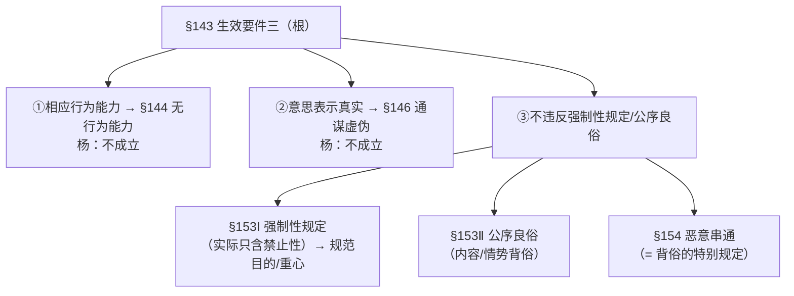
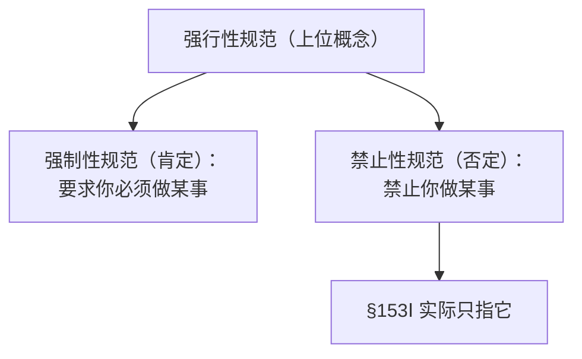
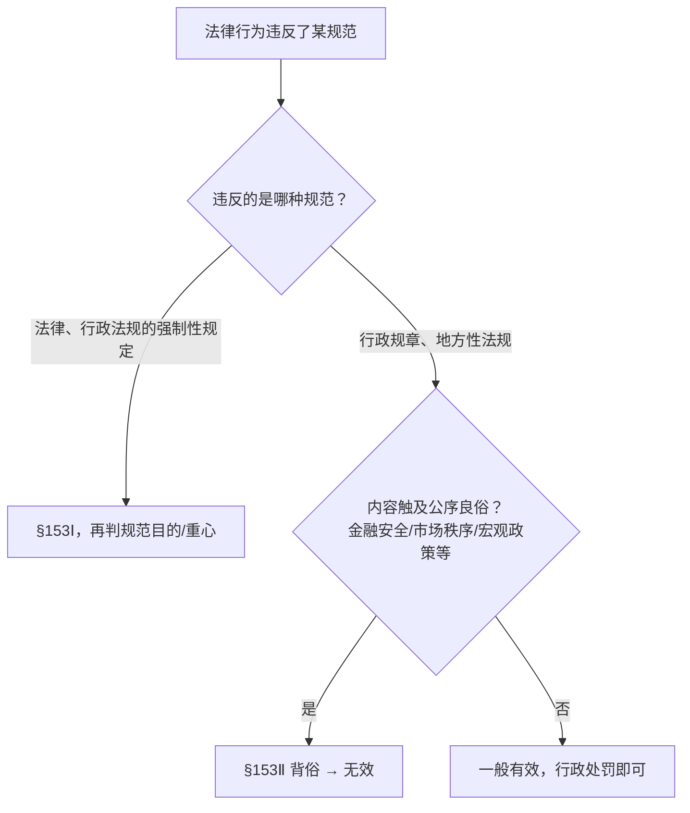
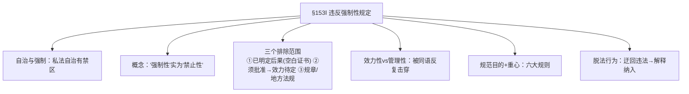
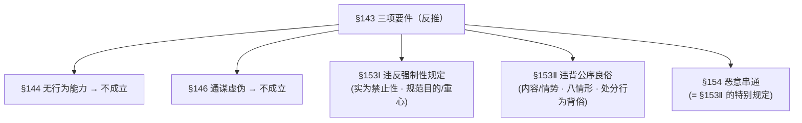

> [!quote] YOU

继续

> [!abstract] PI

好，继续第十一章第 2 步：**无效事由**（§153Ⅰ 违反强制性规定 / §153Ⅱ 背俗 / §154 恶意串通 ＋ §144/146 不成立之争裁决）。

动手前先把上次的作业收了——它正好是这一步的引桥。

**微任务（上次留的）**：30 年租约为什么切成 20＋10？给不懂法的朋友讲清「法官凭什么敢这么切」。就地打字，两三句话。

——顺带提示：这题表面考「部分无效（量的可分性）」，其实还藏着 §153Ⅰ 的一个排除情形（§705Ⅰ 自己就写明了「超过部分无效」，所以**不需要**动用 §153Ⅰ）。这一条正是今天节点 2 里的「空白证书规范」。

---

## 第 2 步路径（先说清讲什么、按什么顺序、为什么）

五个节点，前一个托着后一个：

1. **收尾裁决：§144/146 到底叫「无效」还是「不成立」？**（杨代雄立场）——这一步定的是「无效事由」清单的边界，必须先裁掉。
2. **无效事由总纲**：从 §143 三项生效要件反推出五个一般无效事由的对应关系（刘家安第 17 讲开篇的框架）。
3. **§153Ⅰ 违反强制性规定**（本章最重的一节，拆五小块）：
   - 自治与强制（私法自治 vs 禁区）
   - 概念辨析：强制性规定＝强行性规范＝**强制性（肯定）＋禁止性（否定）**，§153Ⅰ 实际只含禁止性
   - 三个排除范围：①已明定无效后果的（空白证书规范）；②须批准的（→效力待定）；③行政规章/地方性法规
   - 效力性 vs 管理性之争（史尚宽来源 → 德国规范性质说 → 杨代雄的「同语反复」批评 → 规范目的＋规范重心）
   - 规范目的/重心六规则 ＋ 脱法行为
4. **§153Ⅱ 违背公序良俗**：内容背俗 vs 情势背俗 → 主观要件之争（作者采少数说）→ 八种情形 → 处分行为背俗（新观点）。
5. **§154 恶意串通**：概念定位 ＋ 杨代雄「实属多余、本质是背俗的特别规定」的批评。

## 依赖图

---

先交作业（30 年租约那题），顺便说一句「讲吧」，我就从节点 1 开始。

> [!quote] YOU

因为部分无效纯在一个量的可分性，不要求彻底无效，要肯定符合规范的二十年租约有效性。同时该法条本身就存在表示，超过二十年无效，可以直接适用

> [!abstract] PI

作业收到——**两点都踩中了**：

1. **量的可分性**：30 年租约不是「全死」，只有超过 20 年的那 10 年无效，前 20 年照常有效。✅
2. **§705Ⅰ 自己就写明了「超过部分无效」**，法官直接适用它切一刀就行，根本不必绕到 §153Ⅰ 去判断「违反强制性规定」。✅

补一句外行版话术（以后给朋友讲用）：**「法律本来就写着『租期最多 20 年』，多出来的那 10 年等于没写，剩下 20 年照旧——法官不是拍脑袋改合同，是在执行法律那条『超过部分无效』。」**

（小毛病：「存在」打成了「纯在」，无碍。）这就是今天节点 3 的「空白证书规范」预演——§705Ⅰ 这类条文自己把后果说死了，§153Ⅰ 就退场。

---

现在开讲。先确认一下我记的账对不对，再进入节点 1。

> [!abstract] PI

账没错。开讲。

---

## 节点 1｜裁决：§144/146 是「不成立」，不是「无效」

**动机化**：上一步我们把「无效」的**形态**讲透了（当然/确定/自始/绝对/全部）。现在要定「**哪些事由**导致无效」。但清单最前面两项——§144 无行为能力、§146 通谋虚伪——杨代雄要先「裁」出去，说它们根本不是「无效」。为什么？答案在第十章你已经学过的那句话里：

**教材·第十章第二节（生效要件）**：「无行为能力人没有意思能力，在作出表示时欠缺行为意思与表示意识，且无可归责性，所以不成立意思表示，自然也不能成立法律行为。因此，严格地说，无行为能力人实施的法律行为不成立。不过，现行法将其规定为无效法律行为，未尝不可。」

**逐词拆**（这串词全是第九章的老熟人）：

- **意思能力**＝作出意思表示所需的精神能力，即能识别自己行为法律意义的能力。
- **行为意思**＝有意作出这个动作（管「举没举手」）。
- **表示意识**＝知道这个动作有法律意义（管「知不知举手＝出价」）。
- **可归责性**＝第九章杨代雄「无不可或缺主观要件」的配套概念：即使缺某个主观要件，只要这个表示可归责于你（你本该知道、本可避免），仍算意思表示。

无行为能力人这四项全无：没意思能力 → 没有行为意思、没有表示意识 → 又无任何可归责性 → 连意思表示都构不成。

**推理链**：第十章讲过，法律行为的**成立要件＝意思表示**。既然无行为能力人做不出意思表示，那就卡在「成立」这一关，根本走不到「生效」那关——所以严格说是不成立。§146 通谋虚伪同理：双方都无意受拘束、都不想要效果，也不构成真正的意思表示。

**张力**：但 §144、§146 条文白纸黑字写的是「无效」。杨代雄补一句「现行法将其规定为无效法律行为，未尝不可」——因为**结果上无差别**（第十章原话：「判定法律行为不成立与判定法律行为无效在结果上并无实质区别」）。所以教材把这两项从「无效事由」里剔出去，后文**不予阐述**。刘家安（讲 17）则按条文文字，把 §144 叫「无效原因一」、§146 叫「无效原因二」——这不是对错之争，是**概念精度**之争（考研会考你能否复述杨代雄这个立场）。

---

## 节点 2｜总纲：五个事由 ↔ §143 三项要件的对应

§143（你已学）从正面列了三项生效要件，把每一项**反过来**，就是无效事由的来源（刘家安讲 17 的框架）：

| §143 正面要件 | 反面 → 无效事由 | 杨代雄的归类 |
|---|---|---|
| ①有相应行为能力 | §144 无行为能力 | **不成立**（刚裁掉） |
| ②意思表示真实 | §146 通谋虚伪 | **不成立**（刚裁掉） |
| ③不违反强制性规定、不背俗 | §153Ⅰ 违反强制性规定 | 无效 ✅ |
| ③（续） | §153Ⅱ 违背公序良俗 | 无效 ✅ |
| ③（续） | §154 恶意串通 | 无效 ✅ |

所以**真正剩下的无效事由就三个：§153Ⅰ、§153Ⅱ、§154**——正是接下来节点 3/4/5。此外还有分则/特别法的一堆特别无效事由（§506 免责条款、§1051 重婚、§1143 遗嘱、保险法 §34、劳动合同法 §26Ⅰ 等），那是「特别规范优先」的问题，不在这里展开。

---

先测一下你刚才两个节点有没有接上（题是习题册原题）：

> [!question] Quiz
> 下列哪个法律行为不是无效的（ ）
>
> 1. 6 岁的小果接受赠与
> 2. 国有企业甲公司受欺诈而订立的买卖合同
> 3. 重婚行为
> 4. 限制行为能力人订立的遗嘱

> [!failure] Quiz — incorrect ✗
> Your answer: 4. 限制行为能力人订立的遗嘱
> Correct answer: 2
>
> 「国有企业甲公司受欺诈而订立的买卖合同」：受欺诈订立的合同是可撤销（§148），不是无效——这正是本题要选的。
>
> 「6 岁的小果接受赠与」：6 岁是无民事行为能力人，其实施的法律行为无效（杨代雄称严格说是「不成立」），属于无效事由，不选。
>
> 「限制行为能力人订立的遗嘱」：遗嘱是特别无效事由（§1143Ⅱ），限制行为能力人所立遗嘱无效，不选。
>
> 「重婚行为」：重婚是结婚的特别无效事由（§1051），无效，不选。

> [!abstract] PI

**答错了——但错得很有诊断价值。** 你选「限制行为能力人订立的遗嘱」，暴露的是：你把「限制行为能力人实施法律行为＝**效力待定**」这个合同规则，误用到了遗嘱上。

拆开看：

- **限制行为能力人订立的合同**（§145）→ 效力待定，法定代理人可追认。这个没错。
- **限制行为能力人立的遗嘱**（§1143）→ **无效**，不是效力待定。

为什么遗嘱不给你「追认」的机会？因为**遗嘱是单方、死因行为**：没有相对人，遗嘱人死后法定代理人无从「追认」，也来不及弥补能力瑕疵——所以法律对遗嘱的能力要求拉到最满：**只有完全民事行为能力人能立遗嘱**，无/限制行为能力人立的遗嘱直接无效。

**记忆锚点**：**「订合同看年龄、能追认；立遗嘱只认『完全』，能力不足直接死。」**

（这条和第九章你错过的那题「受欺诈/胁迫遗嘱无效 §1143Ⅱ」是同一个坑——遗嘱这块是特别无效事由的「重灾区」，已经两次了，我记进错题档案。）

正确项回一下：受欺诈订立的合同是**可撤销**（§148），不是无效——所以它才是「不是无效」的那个。

---

## 节点 3｜§153Ⅰ 违反强制性规定（本章最重的一节）

### 3.1 自治与强制

**教材·第十一章**：「依私法自治原则，当事人可以通过作出意思表示、缔结法律行为对其在社会生活中的私人关系予以安排……从这个意义上说，缔结法律行为是私人立法行为……对于此种私人之法，原则上应承认其效力。当然，如果其突破了禁区，则应否定其效力。划定禁区的法律规定就是禁止性（强制性）法律规定。」

一句话：私法自治给了你「给自己立法」的自由，但自由有禁区，**禁区由强制性/禁止性规范 + 公序良俗两道墙划定**（呼应 §143 第③项）。§153Ⅰ 管第一道墙。

关键还有那个**但书**：

**教材**：「违反法律、行政法规的强制性规定的民事法律行为无效，**但是，该强制性规定不导致该民事法律行为无效的除外**。此项但书旨在表达如下立法意图：违反法律、行政法规的强制性规定的法律行为并非一律无效。」

也就是说 §153Ⅰ 不是「违反即死」，它自己就留了个后门——这是后面「效力性 vs 管理性」之争的根源。

### 3.2 概念辨析：「强制性规定」其实指「禁止性规定」

**教材**：「《民法典》第153条第1款使用的术语是强制性规定。所谓强制性规定实际上指的是**强行性规范**，既包括要求当事人必须实施……某种行为之规范，也包括禁止当事人实施……某种行为之规范。在我国台湾地区民法理论中，第一种规范被称为**强制性规范**，第二种规范被称为**禁止性规范**。也就是说，强行性规范是强制性规范与禁止性规范的上位概念。」

**教材**：「一般来说，能够导致法律行为无效的是**禁止性规范**……因此，对于《民法典》第153条第1款中所谓的『强制性规定』，应当不拘泥于文字，将其理解为**禁止性规定**。」

这里有个三层结构，画出来：

**为什么肯定性的「强制性规范」不能导致无效？**（这是 A 类，你想一想）：它要求你「必须做」，针对的是「做不做」；而无效否定的是「做了之后的效果」。一个要求你去做的规范，不会去否定你做完之后的效力——两者根本不在一个维度上。能跟「无效」挂钩的，只有那个「不许你做」的禁止性规范。

——所以教材结论：§153Ⅰ 的「强制性规定」是文字上的不精确，实质是「**禁止性规定**」。理解成「违反禁止性规定→无效」就对了。

先停一下，把这个辨析锁住：**「§153Ⅰ 的『强制性』，读作『禁止性』」**。下一小节（3.3 三个排除范围）是关键，我们接着走——你先复述一句：为什么肯定性的强制规范（比如「必须登记」）通常不能直接让法律行为无效？

> [!quote] YOU

因为要区分强制性规范和禁止性规范。强势规范是让你去做，不会否定你做的效力

> [!abstract] PI

对，**推理对了**——「让你去做的，不会否定你做的」。补一个术语小瑕疵：你说的「强势规范」应该是「**强制性规范**」（肯定性）。完整三层是：

**强行性规范**（上位）＝**强制性规范**（肯定，让你做）＋**禁止性规范**（否定，不让你做）。§153Ⅰ 的文字写「强制性」，实质只取后一半——**「不让你做的，才可能否定你做的」**。

锁一句钩子：**「§153Ⅰ 的『强制性』，读作『禁止性』；肯定性规范管『做不做』，禁止性规范才管『做了无效』。」**

---

## 3.3 三个排除范围：这三类规范，§153Ⅰ 根本不管

§153Ⅰ 是一张「空白支票」，但不是所有禁止性规范都要往它身上靠。教材划了三个排除范围：

**① 已明定无效后果的规范（空白证书规范）**

**教材**：「某些禁止性（强制性）规定已经对法律行为无效予以明确规定，比如《民法典》第506条、第705条第1款、第850条。法律行为违反此类规定的，直接据此判定无效即可，无须适用《民法典》第153条第1款，因为该款是一般规范或者说『空白证书规范』（Blankettvorschrift），旨在授权裁判者在个案中援引相关强制性规定并依据该款之要件判定法律行为无效，一旦某项特别的强制性规范已经明确规定法律行为无效，裁判者即无须动用该款之授权。」

——这就是你刚交的作业的答案：**§705Ⅰ 自己写死了「超过部分无效」，法官直接切，§153Ⅰ 退场**。作业和教材在这一条上闭环了。

**② 须经准许（批准/同意）的规定 → 效力待定，不是无效**

- **公法准许（批准）**：§502Ⅱ 及《商标法》§42、《企业国有资产法》§53、《矿产资源法》§6、《商业银行法》§28 等。
- **私法准许（同意/决议）**：§19、§22（法定代理人同意）、《农村土地承包法》§34（发包方同意）、《公司法》§16Ⅱ（公司决议）。

**为什么是效力待定、不是无效？**（A 类，教材的论证）：

**教材**：「从合同审批制度的立法目的看，法律之所以规定某些类型的合同必须经过行政机关的批准，是因为此类合同可能影响社会公共利益或者国家利益，立法者授权行政机关代表国家予以审查……某一份合同订立后尚未获得批准，其是否符合社会公共利益或者国家利益**尚不确定**，所以暂不能确定合同究竟有效还是无效。此时发生纠纷的，法官如果依据《民法典》第153条第1款径行判定合同无效……相当于司法机关代替行政机关对合同是否符合社会公共利益或者国家利益作出判断，这是一种**越权行为**，欠缺正当性。恰当的处理应该是认定合同目前尚未生效……此为合同效力待定。」

记住这个逻辑：**「批准前是『还不知道好不好』，不是『确定坏』——所以是效力待定，不是无效。」**（这跟第十章「须批准＝特别生效要件」无缝衔接。）

**③ 行政规章与地方性法规 → 不能据之认定无效，但可能构成背俗**

**教材**：「从规范性法律文件的层级看，行政规章与地方性法规不属于《民法典》第153条第1款中的法律、行政法规，因此，不能据之认定法律行为无效。之所以……排除在外，主要是为了防止过度的行政管制导致法律行为无效现象泛滥，危害交易安全。实践中，如果某一项法律行为违反行政规章或者地方性法规，综合考虑个案相关情势，可能构成违背公序良俗，依《民法典》第153条第2款，亦为无效。」

——注意这一条的尾巴：规章虽不能进 §153Ⅰ 的门，但能**绕到 §153Ⅱ（背俗）**去。这是从节点 3 走向节点 4 的一座桥。

三个排除范围一句话总结：**「特别规范说死了 → 用特别规范；须批准 → 效力待定；规章/地方法规 → 走 §153Ⅱ 背俗。」**

先测一题（习题册原题）：

> [!question] Quiz
> 甲公司与乙公司订立《合作协议》，该协议违反了行政规章的禁止性规定。下列选项正确的是（ ）
>
> 1. 该协议确定有效，只须对当事人予以行政处罚即可
> 2. 该协议经过行政机关批准的，有效
> 3. 法院应当依据《民法典》第153条第1款认定该协议无效
> 4. 该协议可能违背公序良俗

> [!question] Quiz — I don't know
> Your answer: I don't know
> Correct answer: 4
>
> 「该协议可能违背公序良俗」正确：行政规章不属于 §153Ⅰ 的「法律、行政法规」，不能直接据之认定无效；但违反规章若触及金融安全、市场秩序、国家宏观政策等公序良俗，可依 §153Ⅱ 认定无效。
>
> 「法院应当依据 §153Ⅰ 认定无效」错：规章不在 §153Ⅰ 的适用范围内。
>
> 「经过行政机关批准的有效」错：批准与否不是规章违反情形下判断效力的依据，命题无此规则。
>
> 「确定有效，只须行政处罚即可」错：违反规章并非一律有效，若构成背俗仍无效。

> [!abstract] PI

没事，「不知道」就是真缺口，正好补上——这条是**排除范围③**，也是整个 §153Ⅰ 里最容易被忽略的一扇「偏门」。

## 重讲：违反规章 ≠ 违反法律

核心是**位阶**。§153Ⅰ 白纸黑字只写「违反**法律、行政法规**的强制性规定」——注意，它没写「规章」。所以：

- **法律、行政法规**（全国人大/国务院级别）→ 够格，走 §153Ⅰ。
- **行政规章、地方性法规**（部委/地方政府级别）→ **不够格**，§153Ⅰ 管不到。

为什么法律故意设这道位阶门槛？教材给了理由：**防止过度行政管制导致「无效」泛滥、危害交易安全**。如果连一个部委的规章都能随手把合同判死，那市场上没人敢签合同了。

但规章不能就此「逍遥法外」——它还有一扇偏门：**如果规章的内容体现的是「公序良俗」（金融安全、市场秩序、国家宏观政策等），就借 §153Ⅱ 认定无效**。这是《九民纪要》第 31 条的明确立场（刘家安讲 18 也讲了：限购令是规章/行政命令，不能走 §153Ⅰ，走 §153Ⅱ）。

决策树：

**记忆锚点**：**「法律行政法规走正门（§153Ⅰ）；规章走偏门（§153Ⅱ）。位阶不够，换个门进。」**

注意刚才正确项用的是「**可能**违背公序良俗」——违反规章不是自动无效、也不是自动有效，是个开放判断：看它触不触及公序良俗。

重测一题（同一考点，多选题，习题册原题）：

> [!question] Quiz
> 下列关于违反行政规章的法律行为之选项正确的是（ ）
>
> 1. 因行政规章并非《民法典》第153条第1款所指的法律规定，所以违反行政规章的法律行为有效
> 2. 须依行政规章的规范目的决定是否援引《民法典》第153条第1款判定法律行为无效
> 3. 应当谨慎认定违反行政规章的法律行为无效
> 4. 违反行政规章的法律行为可能违背公序良俗

> [!failure] Quiz — incorrect ✗
> Your answer: 3. 应当谨慎认定违反行政规章的法律行为无效
> Correct answer: 3, 4
>
> 「应当谨慎认定违反行政规章的法律行为无效」正确：规章不属 §153Ⅰ 的「法律、行政法规」，不能径行援引 §153Ⅰ；且违反规章并不当然无效，须谨慎判断。
>
> 「违反行政规章的法律行为可能违背公序良俗」正确：若规章内容涉及金融安全、市场秩序、国家宏观政策等公序良俗，可依 §153Ⅱ 认定无效。
>
> 「因规章非 §153Ⅰ 所指法律规定，所以违反规章的法律行为有效」错：违反规章并非一律有效，可能因背俗而无效。
>
> 「须依规章的规范目的决定是否援引 §153Ⅰ 判定无效」错：规章根本不能援引 §153Ⅰ，判断其效力的依据是 §153Ⅱ。

> [!abstract] PI

抓到一半——「应当谨慎」对，但漏了「**可能违背公序良俗**」。这两个选项不是矛盾的，是**一体两面**：

- 「谨慎」＝不能因为违反规章就**自动无效**；
- 「可能背俗」＝也不能因为违反规章就**自动有效**。

合起来才是完整规则：**违反规章是开放判断——既非当然无效，也非当然有效，要逐个看它触不触及公序良俗。** 你只记住了「别轻易判死」这半，漏了「但可能走 §153Ⅱ 判死」那半。（已记错题档案，规章→§153Ⅱ 这桥后面节点 4 还会再考你一次。）

---

## 3.4 效力性 vs 管理性：一个被杨代雄「击穿」的二分法

**动机化**：§153Ⅰ 的但书说「违反强制性规定**并非一律无效**」。那到底违反哪些无效、哪些不无效？司法解释一度想用一刀切的二分法：**效力性强制性规定 vs 管理性强制性规定**——违反前者无效，违反后者有效。这套东西从哪来的、又为什么被批，是学硕必考的深度点。

**来源**（台湾史尚宽）：

**教材**：「我国台湾地区在这个问题上，从史尚宽开始，把强制与禁止规定（统称为强行法）划分为**效力规范**与**取缔规范**。效力规范注重违法行为的法律行为价值，以否定其法律效力为目的，取缔规范注重违法行为的事实行为价值，以禁止其行为为目的。违反效力规范的法律行为无效，而违反取缔规范的法律行为有效。」

**比较法**（德国）：这套二分法接近德国早期的「**规范性质说**」——禁止性规范若只是单纯秩序（管理）规定或营业警察法规，违反只受公法制裁，私法效力不受影响。后来德国又陆续提出「规范对象说」「规范重心说」「规范目的说」。

**杨代雄的批评**（教材原文，重点读）：

**教材**：「该理论的缺陷一方面在于**缺乏关于效力性强制性规定与管理性强制性规定的具体识别标准**。绝大多数强制性规定都没有明确规定违反该规定之法律行为的效力，一条强制性规定究竟是否属于效力性强制性规定，从该规定的文义中通常得不到答案。实践中，裁判者难免**先入为主地预判系争法律行为应否生效，然后根据需要给相关的强制性规定贴上管理性强制性规定或者效力性强制性规定之标签**。另一方面……实际上，**『效力性』这个表述空洞无物**，以之为标准认定法律行为效力将陷入**同语反复**：此项法律行为之所以无效，是因为其违反了效力性强制性规定，此项规定之所以是效力性强制性规定，是因为其否定相关法律行为的效力！」

**教材**：「具有决定性意义的并非相关强制性规定的性质，而是其**规范目的和规范重心**。」

这里有两个杀手锏，你自己体会一下：

1. **倒果为因**：法官先拍脑袋「这合同该不该活」，再回头给法条贴标签——不是标签决定结论，是结论决定标签。
2. **同语反复（循环论证）**：「为什么无效？违反效力性规定。」「为什么是效力性规定？因为它让合同无效。」——绕了一圈，什么也没说。这就像说「他死了是因为他断气了，他断气是因为他死了」。

**结论**：放弃「效力性 vs 管理性」这个标签游戏，改问实质问题——**这条规范的目的和重心是什么**（下一节 3.5）。

> 附带一个立场对照（考研有用）：刘家安（讲 18）基本跟着《九民纪要》第 30 条走，**仍用**「效力性 vs 管理性」框架，只是用「是否涉及金融安全/市场秩序/宏观政策等公序良俗」来识别哪边算「效力性」。杨代雄则直接否掉这套框架。两说并存，华政学硕要能各自复述理由。

---

停一下，这个「同语反复」是本节灵魂。你用一句话说说：为什么「效力性规定」这个标签是空洞的（循环在哪）？答完我们进 3.5——那里全是案例，好题最多。

> [!quote] YOU

效力性规定的意思是会导致法律行为无效，导致法律行为无效又是因为他违反了效力性规定

> [!abstract] PI

**漂亮，完全点中了。** 就是这句：效力性规定＝「会让行为无效的规定」；而「行为无效」又是因为「违反了会让它无效的规定」——**用 A 解释 B，再用 B 解释 A，全程没有新信息**。这就是循环论证（同语反复），所以这个标签是空的。

---

## 3.5 规范目的 + 规范重心：六大规则

放弃标签之后，实质判断问的是：**这条禁止性规范「管什么」、在「保护谁」、否定效力是不是「非做不可」**。教材据此归出六条规则：

| # | 规范针对的是… | 结论 | 典型例子 |
|---|---|---|---|
| 1 | **行为内容本身** | 无效 | 毒品、人体器官、枪支买卖、权钱交易、非法传销、建设工程违法转包 |
| 2 | **外部条件**（时间/地点） | 原则有效 | 路边摆摊卖水果，违反市容条例，买卖合同照样有效 |
| 3 | **一方资格**（职业/劳动者/经营） | 分三种 | 无医师证行医→无效；雇童工→无效（但**无溯及力**）；无照放贷→无效 |
| 4 | **保护一方当事人** | 不一律无效 | 骗钱合同虽触犯刑法，但依 §148 **可撤销**，不是无效 |
| 5 | **规制一方行为、维护公共秩序** | 看行政/刑事制裁够不够 | 卖不合格食品：光罚款不够 → 合同无效（否则等于放行毒食品流通） |
| 6 | **后续行为** | 不影响行为本身 | 买卖标的物只能靠走私进口，买卖合同本身不因此无效 |

**规则 1 的一个隐藏延伸**（教材原句）：「如果法律行为的**履行行为**违反强制性（禁止性）法律规定，则**等同于内容违法**。」——内容违法的判定不仅看合同怎么写，还看实际履行怎么干。

**核心钥匙**（A 类，你自己能推）：判断时先问一句「**这条规范管的是『交易本身』还是『交易的外部环境』？**」

- 管**内容**（第 1 类）→ 交易本身是禁区 → 无效；
- 管**环境/后续**（第 2、6 类）→ 交易本身没问题，只是场合或配套环节有问题 → 有效，该罚的罚行为，别罚合同；
- 管**人**（第 3、4、5 类）→ 看它是**保护交易对方**（→无效，否则对方受害）还是**保护行为人自己**（→别用无效害他，可能只是可撤销）。

测一题（习题册原题，第 2 类的典型）：

> [!question] Quiz
> 某商贩在街道旁边摆摊出售小饰品，某女生路过此处，买了一条珍珠手链，正待付款，城管赶来，商贩仓皇逃离。下列选项正确的是（ ）
>
> 1. 该女生可以主张该商贩的行为违法，从而解除买卖合同
> 2. 因占用街道出售商品的行为违反《城市道路管理条例》，所以买卖合同无效
> 3. 该商贩对该女生享有价款请求权
> 4. 因该商贩私下销售商品，偷税漏税，所以买卖合同无效

> [!success] Quiz — correct ✓
> Your answer: 3. 该商贩对该女生享有价款请求权
> Correct answer: 3
>
> 「该商贩对该女生享有价款请求权」正确：摆摊违反的是规范行为外部条件（时间、地点）的行政法规，针对的是「交易的环境」而非「交易本身」，买卖合同仍有效，商贩交付手链后有权请求价款。
>
> 「因占用街道违反《城市道路管理条例》而无效」错：违反外部条件规定不导致合同无效（规则 2）。
>
> 「因偷税漏税而无效」错：税是后续/配套环节问题，不否定交易本身的效力。
>
> 「该女生可主张违法从而解除合同」错：合同有效，无解除事由。

> [!abstract] PI

对。第 2 类记住了：**「管的是环境，不是交易本身」**。

再来一题，这题是最阴的第 4 类（保护一方当事人）：

> [!question] Quiz
> 甲为骗取钱财，与乙订立买卖合同，实际上甲根本不想履行该合同。下列选项正确的是（ ）
>
> 1. 买卖合同是可撤销法律行为
> 2. 因甲的行为构成诈骗罪，违反了刑法的强制性规定，所以合同无效
> 3. 买卖合同是否有效，取决于乙是否追认
> 4. 法院可以依职权认定买卖合同无效

> [!success] Quiz — correct ✓
> Your answer: 1. 买卖合同是可撤销法律行为
> Correct answer: 1
>
> 「买卖合同是可撤销法律行为」正确：甲实施欺诈，乙受欺诈而订立合同，依 §148 合同可撤销。甲虽触犯刑法，但这里的禁止性规范是在保护受骗的乙，若一律判无效反而可能不利于乙，所以不是无效而是可撤销（规则 4）。
>
> 「构成诈骗罪所以合同无效」错：违反刑法不等于民事合同必然无效，须看规范目的。
>
> 「法院可依职权认定无效」错：可撤销须由受欺诈方（乙）主张撤销，法院不能依职权认定无效。
>
> 「取决于乙是否追认」错：可撤销是「是否撤销」，不是「是否追认」（追认是效力待定场合）。

> [!abstract] PI

又对。第 4 类的精髓你已经抓到了：**「保护谁的规范，别反过来用它害谁。」**

再一题，第 3 类（职业资格）——注意它的陷阱在「知情」：

> [!question] Quiz
> 小帆在某大学学习法律，毕业前顺利通过了法考，但尚未拿到律师执业证。为了给继续深造积攒学费，小帆充分运用广泛的人脉，以律师的身份按照比较优惠的收费标准为客户提供法律服务。下列选项正确的是（ ）
>
> 1. 小帆与客户之间的有偿法律服务合同因违反禁止性法律规范而无效
> 2. 基于合同，小帆对客户享有报酬请求权
> 3. 如果小帆提供的法律服务存在瑕疵，则客户有权请求其承担违约责任
> 4. 如果客户明知道小帆尚未拿到律师执业证，则合同有效

> [!failure] Quiz — incorrect ✗
> Your answer: 3. 如果小帆提供的法律服务存在瑕疵，则客户有权请求其承担违约责任
> Correct answer: 1
>
> 「小帆与客户之间的有偿法律服务合同因违反禁止性法律规范而无效」正确：无律师执业证而以律师身份提供职业性法律服务，违反职业资格禁止性规范，合同原则上无效（规则 3 之职业资格）。
>
> 「小帆对客户享有报酬请求权」错：合同无效，不发生约定的报酬请求权。
>
> 「客户有权请求其承担违约责任」错：合同无效，无违约责任可言。
>
> 「客户知情则合同有效」错：职业资格规范保护的是公众与职业秩序，不因个别客户知情而失效——知情不能「洗白」无效。

> [!abstract] PI

**错在根子上：你默认了合同有效，才会去选「违约责任」。** 这暴露一个混淆——你把「无证执业」当成「摆摊」那种外部条件问题了。区分一下：

- **摆摊无证**：违反的是「**在哪里**卖」（地点）→ 交易本身合法 → 有效；
- **无律师证执业**：违反的是「你**能不能干这行**」（职业资格）→ 交易本身不能做 → **无效**。

**分水岭**：规范管的是「**交易的场合**」，还是「**交易者有没有资格**」？资格规范直接否定交易本身，场合规范只罚行为。

教材给的理由（规则 3 之职业资格）：「违反此种禁止性规范的合同原则上无效，否则将导致顾客接受**不符合专业水准的服务并深受其害**。」——所以即便客户明知他没证、愿意冒险，合同照样无效，因为这条规范保护的是**公众和职业秩序整体**，不是客户一个人可以放弃的利益（这就是 D 项「知情→有效」为什么错）。

**记忆锚点**：**「摆摊管『在哪卖』→ 有效；无证管『能不能干』→ 无效。资格＝能不能，环境＝在哪/何时。」**（已记错题档案，和第 2 类「外部条件」是一对对比锚点。）

---

## 3.6 脱法行为：绕着走，也拦得住

**教材**：「脱法行为，是指当事人为了躲避法律障碍、禁止性法律规范或者负担，试图借助**其他法律构造形式**实现同样的法律或者经济效果，也称为规避法律的行为……这种脱法行为在本质上也是违反禁止性法律规范的法律行为，其特殊之处在于是以**迂回而不是直接**的方式违法。因此，在实践中一般通过对相关的禁止性法律规范予以**解释**，将系争的脱法行为纳入其适用范围，判定为无效。」

一句话：**换个马甲违法，照样算违法**——法官通过对禁止性规范做目的解释，把「迂回构造」也装进去，判无效。

历史包袱：原《民法通则》第 58 条、原《合同法》第 52 条曾有「以合法形式掩盖非法目的」这一无效事由；《民法典》删了它，改按性质分流——**通谋虚伪 → §146；犯罪手段合同 → 欺诈/无权代理；脱法行为 → §153Ⅰ**。

---

节点 3（§153Ⅰ）到此收口。整节的骨架再回看一遍：

进节点 4（§153Ⅱ 违背公序良俗）之前，你先复述一句收尾：**判断一条禁止性规范能否让法律行为无效，杨代雄给的钥匙是什么？（提示：不是「效力性/管理性」那个标签）**

> [!quote] YOU

规范目的和手段

> [!abstract] PI

对了一半——「**规范目的**」对；另一半不是「手段」，是「**重心**」。

- **规范重心**＝这条规范**针对的是什么**（内容本身 / 外部条件 / 一方资格 / 后续行为），这是六规则的切分依据。
- 「手段」其实出现在规则 5 里（行政/刑事制裁够不够），那是「要不要再动用『民事无效』这个手段」的问题，是另一码事。

所以完整钥匙是：**「规范目的 ＋ 规范重心」**——问它想保护什么、又管着哪一段。

---

## 节点 4｜§153Ⅱ 违背公序良俗

### 4.1 公序良俗是私法自治的第二道墙

**教材**：「私法自治的禁区不仅由强制性法律规定划定，公序良俗也是私法自治的界限。实际上，**强制性法律规定只是以实证法的方式体现了公序良俗而已**，对于那些尚未被表述为实证法具体规则的公序良俗，当然也需要予以维护。」

这句话点破了 §153 两款的**分工**：§153Ⅰ 管「已经写成条文的公序良俗」（强制性规定），§153Ⅱ 管「还没写成条文的公序良俗」（兜底）。所以前面节点 3 那个「规章 → 走 §153Ⅱ」的偏门，逻辑根源就在这：规章不是法律行政法规（进不了 §153Ⅰ），但它若体现公序良俗，§153Ⅱ 兜得住。

### 4.2 两种违背方式：内容背俗 vs 情势背俗

**教材**：「法律行为违背公序良俗有两种方式。其一，**内容背俗**，即法律行为的内容违背公序良俗，比如甲、乙约定，甲以金钱若干包养乙一年。其二，**情势背俗**（Umstandssittenwidrigkeit），即法律行为的客观内容本身并不违背公序良俗，但当事人**实施该法律行为的方式、目的、动机**违背公序良俗。」

**关键结论**（教材）：

**教材**：「导致法律行为无效的主要方式应该是**内容背俗**。情势背俗**并不必然**导致法律行为无效。有时，虽然当事人实施法律行为的动机或者方式违背公序良俗，但不应据此认定该法律行为无效。比如，一方为了谋取不正当利益，以欺诈的方式促使对方作出意思表示……其实施法律行为的动机与方式违背公序良俗，但该法律行为却并非无效，而是**可撤销**。反之，当事人实施法律行为的动机是正当的，该法律行为仍有可能因内容背俗而无效。比如某人为了维持家庭稳定，与其儿子达成一份合同，约定将一处房产赠与儿子，儿子承诺终生不离婚。此项约定的内容严重限制了一方当事人的基本自由，当属无效。」

两个反向的例子正好夹住一个判断标尺：

| 例子 | 动机 | 内容 | 结果 |
|---|---|---|---|
| 欺诈签约 | 背俗（想骗钱） | 中性（普通买卖） | **可撤销**，不是无效 |
| 赠房换「终生不离婚」 | 正当（维持家庭） | 背俗（限制婚姻自由） | **无效** |

**标尺**：**看内容、不看动机**——动机背俗但内容中性且不害第三人/公共利益的，不背俗；内容本身背俗（哪怕动机正当），照样无效。（教材：应把动机、目的、方式与内容「结合起来整体考量」，内容中性则不背俗，损害应受保护的第三人利益或公共利益则动机背俗会传染到行为。）

### 4.3 主观要件之争（作者采少数说）

教材列了三说：

- **多数说**：需要主观要件——不要求知道「背俗性」，只要知道（或因重大过失不知）**导致背俗的事实**即可。
- **部分学者说**：内容背俗不需要主观要件；情势背俗需要主观要件。
- **少数说（作者立场）**：**不需要主观要件**，只要客观上背俗即应否定。

作者的理由（教材）：「某一项法律行为只要在客观上违背了法与伦理的基本秩序，就是有害的行为，必须予以否定评价。至于当事人是否知道背俗性……并非决定性因素。**对背俗性的无知与对违法性的无知一样，都不能阻却法律行为的无效。**」

记法：**「背俗看客观，不问你知不知——就像违法不看你知道不知道那条法一样。」**（这跟 §153Ⅰ 违反强制性规定同调：都不问主观。）

---

节点 4 还剩两块（八种情形、处分行为背俗），先测一下你「内容 vs 情势」有没有立住：

> [!question] Quiz
> 甲虽与乙离婚，但不愿意看到乙将来另嫁他人，遂与乙订立合同，约定乙承诺10年内不再结婚，甲给乙一套新房作为补偿。下列选项正确的是（ ）
>
> 1. 该合同因违法而无效
> 2. 该合同符合私法自治原则，所以有效
> 3. 该合同因违背公序良俗而无效
> 4. 如果乙第二年与他人结婚，则甲有权请求其承担违约责任

> [!success] Quiz — correct ✓
> Your answer: 3. 该合同因违背公序良俗而无效
> Correct answer: 3
>
> 「该合同因违背公序良俗而无效」正确：约定乙 10 年内不再结婚，以婚姻自由为交易标的，内容本身严重限制基本自由，属「过度限制自由」的情形，违背公序良俗，无效。
>
> 「因违法而无效」错：没有具体法律、行政法规禁止这种约定，不是 §153Ⅰ 的违法，而是 §153Ⅱ 的背俗。
>
> 「符合私法自治而有效」错：私法自治有禁区，婚姻自由属公序良俗，不在自治范围内。
>
> 「甲有权请求违约责任」错：合同无效，不发生违约责任。

> [!abstract] PI

对，第⑤种情形「过度限制自由」立住了。把剩下两块一口气收掉：

### 4.4 八种主要情形（记忆类，配锚点）

1. **违背性道德**：卖淫、淫秽表演合同（多可走 §153Ⅰ）；「包养」合同（§153Ⅱ）。
2. **违背家庭伦理**：代孕合同、用高额离婚赔偿金给离婚设障碍、泸州遗赠案（遗赠给情人）。
3. **违背职业道德**：有偿介绍客户给律师/医师、刑事/行政/国家赔偿/群体性诉讼的**风险代理**。
4. **服务于犯罪/违法**：赌场里借钱给赌客作赌资。
5. **过度限制自由**：风险代理限制当事人和解权、附「再婚即失权」条件的遗嘱。
6. **高度人身性给付为标的**：出卖人格尊严/自由（约定不结婚/必须结婚）、**封口费**。
7. **干扰公权力/破坏公平竞争**：花钱找关系运作取保候审/缓刑。
8. **违背规章/地方法规中蕴含的公序良俗**：借名购房规避限购令。

记法：这八类其实都是「**拿不该当商品的东西当商品**」——性、家庭、职业操守、自由、尊严、公权力、公共秩序。

### 4.5 处分行为能否背俗？（传统 vs 作者，必考的争议）

**传统观点**：处分行为在伦理（价值）上是**中性**的，不因背俗而无效。它给两个理由：

1. **无因原则**：负担行为（买卖合同/赠与合同）背俗无效，不影响处分行为（所有权移转）的效力——因为处分行为是「无因」的，不随原因行为的无效而无效；
2. 若让处分行为也无效，就会**架空「双方背俗时给付不当得利请求权被排除」规则**（因为处分无效后给付方可主张所有物返还，不当得利排除就没意义了）。

**作者（杨代雄）观点**：这套「中性」规则过于绝对，应放弃。逐个拆：

**教材**：「首先，应否采用无因原则，尚有疑问。……即便采用无因原则，也不当然意味着处分行为不可能因违背公序良俗而无效。无论负担行为还是处分行为，都属于法律行为，具有伦理性……比如，丈夫将贵重财物赠与情人，不但作为负担行为的赠与合同违背公序良俗，而且贵重财物所有权转让给情人本身也违背公序良俗。无论如何，不能说『丈夫不能把财物赠与情人但可以把财物所有权给情人』。其次，双方背俗情况下给付不当得利请求权排除规则本身充满争议，其正当性备受质疑，因此，以该规则为逻辑前提否认处分行为可以因违背公序良俗而无效，也欠缺说服力。」

（引弗卢梅：处分行为是否背俗，看它引起的**权利变动**是否因背俗不能认可；涉及第三人利益或公共利益的，处分行为背俗无效。德国判例与主流观点也已承认这一点。）

记法：**「处分行为不是『无色无味』——权利往哪流，本身也能伤风败俗。」**

---

节点 4 收口。测一题（封口费，第⑥种情形，习题册原题）：

> [!question] Quiz
> 某单位员工小冬无意中窥见领导实施了违法犯罪行为，领导与小冬约定，向小冬支付10万元"封口费"，小冬答应绝对保密。下列选项错误的是（ ）
>
> 1. 双方的约定违反法律、行政法规的强制性规定，所以无效
> 2. 如果小冬泄密，则领导有权请求其承担违约责任
> 3. 双方的约定因违背公序良俗而无效
> 4. 依诚信原则，小冬应信守诺言，不向任何单位或者个人泄密

> [!failure] Quiz — incorrect ✗
> Your answer: 2. 如果小冬泄密，则领导有权请求其承担违约责任
> Correct answer: 1, 2, 4
>
> 本题问「错误的是」，应选三项错误表述。
>
> 「双方的约定违反强制性规定而无效」是错误表述：封口费约定不是违反具体法律、行政法规的强制性规定，而是以言论自由/检举权为交易标的，属违背公序良俗（§153Ⅱ）。
>
> 「小冬泄密则领导有权请求违约责任」是错误表述：约定背俗无效，不发生合同义务，更无违约责任。
>
> 「依诚信原则小冬应信守诺言不泄密」是错误表述：约定无效，小冬不负保密义务；检举违法犯罪是公民权利乃至义务，不能说成违约。
>
> 「双方的约定因违背公序良俗而无效」是正确表述，不选。

> [!abstract] PI

这题问的是「**错误的是**」，要抓**三项**；你只抓到「违约责任」那一项，漏了两项——每漏一项都是一个独立知识点：

**①「违反强制性规定」为什么错**：封口费没有哪条法律、行政法规明文禁止（不构成 §153Ⅰ 的「违法」），它是拿「言论自由／检举权」当交易标的 → 走 **§153Ⅱ 背俗**。你又把「背俗」和「违法」混了——这是你今天反复出现的同一个坑（规章→背俗、封口费→背俗）。**锚点：『有明文禁令的 → 违法（§153Ⅰ）；没明文但伤风败俗的 → 背俗（§153Ⅱ）。』**

**②「依诚信原则应守诺言」为什么错**：背俗无效＝这个约定等于**没存在过**，不产生任何「诺言」，也就没有「守诺义务」。诚信原则只约束**有效的承诺**，管不住一个本就不存在的承诺。反过来，检举违法犯罪是公民权利（甚至是义务），法律鼓励，绝不能算违约。

（这条和上面「违法 vs 背俗」一起，已记错题档案。）

---

## 节点 5｜§154 恶意串通（本章最后一个无效事由）

**定位**（教材）：恶意串通这个概念在传统民法里**找不到直接对应**，是我国《民法通则》时代的原创，一直延续到《民法典》§154。是否妥当，学界不无疑问。

**司法实践把它用成了「大杂烩」**（教材列了七种）：①代理人/代表人与相对人串通坑被代理人/法人；②双方代理里的串通；③串通逃债；④串通无权处分；⑤串通多重转让；⑥串通共同欺诈（骗取担保）；⑦串通规避法律。

**杨代雄的批评**（教材原句）：这七种里「绝大多数可以用其他规则予以调整，如《民法典》第153条第1款、第168条第2款、第311条、第538—539条、第597条等。余下的只有第一种情形」——所以 §154 真正的用武之地只剩「**代理（表）人与相对人串通**」这一种；为这一个代理问题设一条一般规则，**「牛刀杀鸡」**。

**结论定位**（教材）：「解释论上，应将该条解释为《民法典》第153条第2款的**特别规定**。从本质上看，恶意串通法律行为就是违背公序良俗之法律行为的一个类型。因此，实践中适用《民法典》第154条判定法律行为无效时，必须兼顾第153条第2款中违背公序良俗之法律行为的要件。」

一句话：**§154 不是独立新事由，是「背俗」的一个特例（恶意＋损害他人），杨代雄主张把它并入 §153Ⅱ 理解。**

**刘家安（讲 18）补的 §146 vs §154 三区别**（考研高频对比）：

| | §146 通谋虚伪 | §154 恶意串通 |
|---|---|---|
| 核心 | 意思表示**虚假**（瑕疵） | 合意可能**真实**，但**目的不法** |
| 性质 | 不以行为不法为要件 | 以**损害他人利益为目的**，贴近「违法」 |
| 对应 §143 | 第②项（意思表示真实） | 第③项（不违反强制/不背俗） |

记法：**「§146 是『假』（演给别人看），§154 是『坏』（合起伙来害人）。」**

---

到这里，**第 2 步（无效事由）五个节点全部讲完**。整步骨架：

我把进度文件和错题档案更新一下，然后给你留个收尾微任务。

> [!abstract] PI

进度文件和错题档案更新一下：

> [!abstract] PI

第 2 步收口。今天这一讲的信息量很大，给你留个**收尾微任务**（输出型，5 分钟，就地打字）：

**给一个完全不懂法的朋友讲清：为什么「路边无证摆摊卖水果」的合同有效，而「没律师证的人以律师身份接案子」的合同无效？关键要用「规范管的是什么」这把尺子，两三句话。**

——这正好戳你今天的两个易错点（单选 9：资格 vs 环境），写对了就说明「管什么」这把尺子真正进了你的脑子。

---

**本 session 小结**（第十一章第 2 步：无效事由，全讲完）：

- **裁掉两个「假无效」**：§144 无行为能力、§146 通谋虚伪 → 杨代雄说是不成立；
- **真正的三个无效事由**：§153Ⅰ（强制性规定，实为禁止性，钥匙=规范目的＋规范重心）、§153Ⅱ（背俗，看内容不看动机）、§154（恶意串通=背俗特别规定）。

**你今天反复踩的三个坑**（已进错题档案＋复习队列，下次会重点回炉）：
1. **违法 vs 背俗**：有明文禁令 → §153Ⅰ；没明文但伤风败俗 → §153Ⅱ（规章、封口费都走这条）；
2. **资格 vs 环境**：管「能不能干」→ 无效；管「在哪/何时干」→ 有效；
3. **背俗无效 = 不产生义务**：无守诺、无违约，反而检举犯罪是权利。

进度已更新：第十一章第 2 步完成（⭐2）。下次说「继续」进第 3 步（无效法律行为转换＋无效后果 §157）；想巩固今天这些概念，说「拷问我」或「复习」——顺带提醒一句，第九章有 13 个主题一周没碰了（行为意思/表示意识、身体强制 vs 胁迫那些），哪天有空说声「复习」，我给你拎出来过一遍。

> [!quote] YOU

路边卖水果惩罚的是行为地点，但是无证律师会影响职业规范市场秩序。

> [!abstract] PI

判定对了，尺子用对了一半——但另一半没把尺子贯彻到底。逐句看：

- **「惩罚的是行为地点」** ✅ 这句是标准的尺子：法律管的是「在哪儿卖」（场合），不管「卖水果」这件事本身 → 所以交易没问题，合同有效。
- **「无证律师会影响职业规范市场秩序」** ⚠️ 方向对，但你从「管什么」滑到了「影响什么」（结果）。尺子应该这么拿：无证执业，法律管的是**「你有没有资格干这行」**——直接否掉「接案子」这件事本身 → 合同无效。而且理由要更准一点：资格规范保护的是**「顾客」**（不能让没专业水准的人提供服务害人），所以连客户明知无证也洗不白。

给你一版干净的外行话术，以后照这个说：

> **「摆摊那个，法律管的是『在哪儿卖』，不管『卖水果』这件事本身——所以买卖照样算数。无证接案子那个，法律管的是『你有没有资格干这行』，直接否掉『接案子』这件事本身——所以合同作废。同一把尺子：管『场合』的，罚行为不罚交易；管『资格』的，连交易一起否。」**

核心就一句，已经刻进你错题档案的锚点：**「资格＝能不能（→无效）；环境＝在哪/何时（→有效）。」**

---

第十一章第 2 步（无效事由）到这里正式闭环。今天量不小，五个节点、四个错题坑都归档了。下次「继续」进第 3 步（无效法律行为转换 ＋ 无效后果 §157），想先消化今天这些就说「拷问我」或「复习」——尤其第九章那 13 个一周没碰的主题，哪天有空随时喊。

> [!quote] YOU

我大概还要多久能进入债法

> [!abstract] PI

按当前节奏，我给你估个实数——**大约 8～10 次课，也就是 3～4 周左右**能进债法线。怎么算的，拆给你看（依据 `进程树.md` 的学习路线，债法线在第 B 阶段开篇，而 B 之前要先收完第 A 阶段的法律行为）：

| 剩余路程 | 内容 | 预估课次 |
|---|---|---|
| 第十一章收尾 | 第 3 步（无效转换＋§157 后果）＋第二节效力待定＋第三节可撤销＋第四节附条件附期限 | 4～5 |
| 第十二章 法律行为的归属 | 代理／代表／无权代理等（整章） | 3～4 |
| **→ 债法开篇（B）** | ch13 请求权（作债法方法论底子）＋解亘《板书体债法总论》第 1 部「债的基本概念」 | — |

两个说明：

1. **这是「按当前节奏」的估计，不是承诺**。你每周 7 小时以上、每次课质量优先（带读＋拷问＋复述），第十一章这种大章我们用了 2 次课才走完「无效」这一节，后面还有三节，所以 3～4 周是实在的。想更快可以调：比如「继续」时不展开太细、或把某些记忆类节点丢给「复习」模式去滚。

2. **债法其实你已经在「进」了**——本学期校课就是债法（周五 6-8），`kb/债法/课程进度` 那条线是跟着校课走的。这里说的「进债法」是指我们 agent 的**自学主线**从总论切到债法（解亘骨架）。到时候 ch13 请求权会和债法第 1 部**穿插着讲**，不是生硬切过去。

一句话：**法律行为这条线再啃 8～10 课就通关，债法开篇就在第十二章结束后的下一次。** 现在最要紧的还是把第十一章这四节吃透——你今天的「违法 vs 背俗」和「资格 vs 环境」两个坑还没完全焊死，别急着赶路。

> [!quote] YOU

你觉得我接下来该干嘛

> [!abstract] PI

我的建议很明确：**先别急着进第 3 步，下一步应该「拷问第 11 章」，把今天踩的坑趁热焊死。**

理由很实在——今天不是「学过就过」的一天，是「边学边漏」的一天，账上记着 4 个新错题：

- **违法 vs 背俗**：你连栽三次（单选 6 → 不知道、多选 5 → 漏选、多选 8 → 漏选），这是今天最大的口子；
- **资格 vs 环境**：单选 9 错，虽然微任务已经补了一半，但只算「复述对」，还没经过再认检验；
- **限制行为能力人立遗嘱**：单选 3 错，和第九章「遗嘱特别无效」是同一个老坑，第二次了。

这些概念现在还是「新鲜但没焊牢」的状态，这时候马上堆第 3 步的新内容（无效转换＋§157），坑不会自己愈合，只会变成下一章的地基裂缝。趁热打铁是最划算的——**现在花 1 次课的代价，能省下以后 3 次回炉**。

给你排个顺序（不用现在都做，知道往哪走就行）：

1. **下一步（最高优先）**：说「拷问我」→ 进 drill，刷第 11 章第 1、2 步的题，重点照顾上面三个坑；
2. **再下一步**：说「继续」→ 进第 3 步（无效转换 ＋ §157 无效后果），把第一节收掉；
3. **到第三节（可撤销）之前**：说「复习」→ 把第九章那 13 个久未触及的主题顺一遍。**理由：欺诈、胁迫、错误、意思表示构成，正是「可撤销」这一节的地基**，现在不温，讲到可撤销时又要卡。

一句话：**焊牢旧的，再开新的。** 你现在最该干的就是歇口气，然后跟我说「拷问我」。
