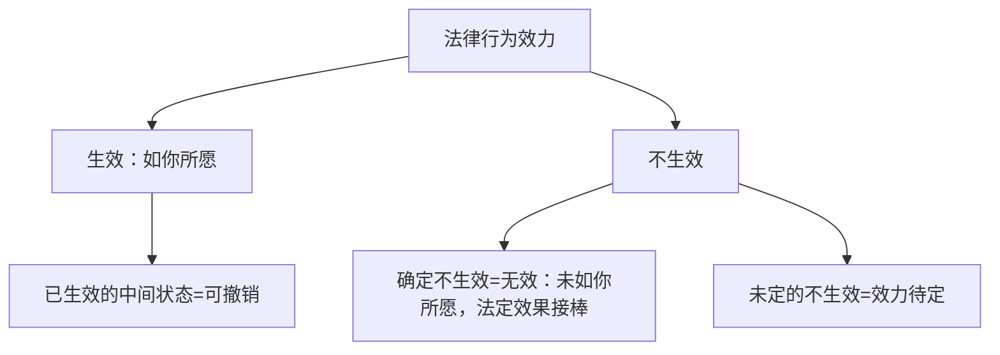
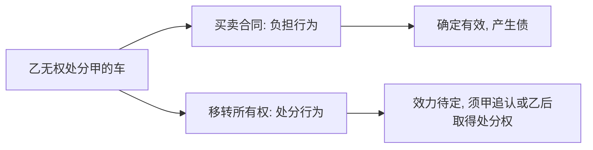
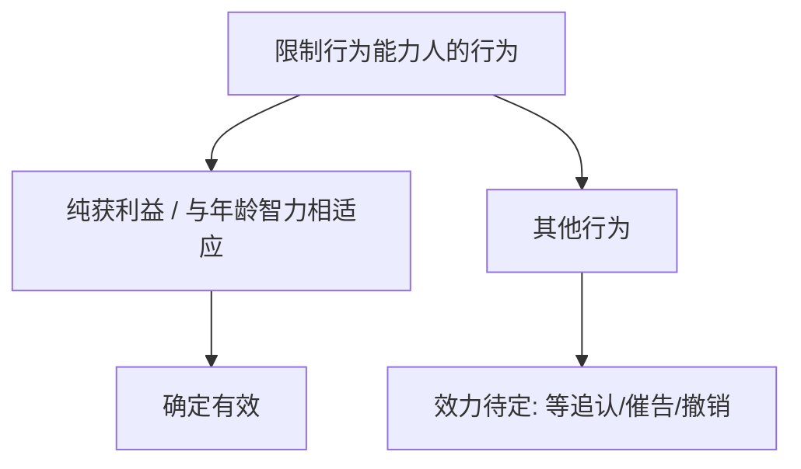

> [!quote] YOU

继续

> [!abstract] PI

继续第十一章。上次第 3 步收在「无效转换 + 无效后果 §157」，今天进**第 4 步：第二节 法律行为效力待定**。

先收一笔旧账——上次的微任务还没交（正好当热身，激活上步内容）：

> 给不懂法的朋友讲清：「我签了抵押合同，这房已经押给我了，他欠钱不还，这房我直接收下」错在哪？用「合同生债、公示生物」＋「流押逃清算、无效」两把尺子，两三句话。

先答这个，答完就开讲。今天这步的路径大致是：

1. **定位**：效力待定在效力谱系里的位置——和「可撤销」并排、方向相反（上一课你记过「可撤销躺着赢、效力待定躺着输」）
2. **本质**：缺一个「第三人同意」的特别生效要件 → 缺什么补什么（追认）
3. **事由清单**：限制行为能力、无权代理、无权处分、须批准未批准…（用「缺什么」这一把尺子串）
4. **权利配置三件套**：追认权 / 催告权 / 善意相对人撤销权
5. **刘家安重点**：无权处分「效力待定」到底指什么（物债二分，第三次盯你）

你先动笔交微任务，我等着。

> [!quote] YOU

签了抵押合同，产生债权，房子押给自己，，对方还不起，只能基于抵押物优先受偿，不能只接收下，因为这是流押，会造成不公平

> [!abstract] PI

交卷收到，给你打分：**对了一半，漏了最要命的一刀。**

你砍对了**流押**那一半——「不能直接收下、只能优先受偿、流押不公平」方向全对。但你说了一句**「房子押给自己」**，这句话本身就是错的，你正好掉进了题目埋的坑里。

拆开看：

**① 「合同生债」——你说的「产生债权」不精确。**
抵押合同生的是什么债？不是「你对乙的借款债权」（那是另一份**借款合同**生的），而是「**丙有义务去办登记、给你设立抵押权**」这一笔债。抵押合同是**负担行为**，自成立即生效——但这只是让丙「欠你一次登记」。

**② 「公示生物」——这才是你漏的那一刀。**
抵押权是**物权**，物权要靠**公示**（不动产＝登记）才出生。丙只是把房产证交给你、**没办抵押登记** → 抵押权**根本没设立** → 房子压根没「押」给你，你连优先受偿权都没有。

所以题目里「这房已押给我」这句前提就是错的，而你接过来顺着它说「房子押给自己」，等于默认了它成立。

**③ 物债二分——第四次复发了。** 前三次是「登记/交付挂错对象」，这次是「合同签了＝房子押进来了」的等价错觉。

给你换个更狠的锚点：

> **签字＝丙欠你一笔「去登记」的债；登记＝房子才真正押进来。没登记，你手里只有一张纸，不是一间房。**

现在用它验一刀——这就是你上次错过的原题：

> [!question] Quiz
> 甲与乙订立借款合同，约定甲将200万元钱借给乙。同时，丙与甲订立抵押合同，约定丙将一套房屋抵押给甲，担保甲对乙的借款债权。丙将房产证交给了甲，但一直未办理抵押登记。下列选项正确的是()
>
> 1. 抵押合同虽无效，但可以转换为连带责任保证合同
> 2. 抵押合同因未办理抵押登记而不成立
> 3. 甲未取得房屋抵押权
> 4. 抵押合同因未办理抵押登记而不生效

> [!success] Quiz — correct ✓
> Your answer: 3. 甲未取得房屋抵押权
> Correct answer: 3
>
> 逐项拆：
>
> 「抵押合同因未办理抵押登记而不成立」——错。抵押合同是负担行为（债），自成立时即成立并生效；登记与合同的成立、生效都无关（§215 区分合同效力与物权变动）。
>
> 「抵押合同因未办理抵押登记而不生效」——错。同上，登记只管「抵押权」这个物权生不生效，不动「抵押合同」这个债。
>
> 「抵押合同虽无效，但可以转换为连带责任保证合同」——错。抵押合同并非无效（只是未登记、未生出抵押权），且保证是人保、责任更重，不符合转换「效果只能弱、不能强」的前提。
>
> 「甲未取得房屋抵押权」——对。抵押权是物权，须登记（公示）才设立；丙只交房产证、未办登记，抵押权未设立，甲并未取得抵押权。

> [!abstract] PI

对，这次抓对了——**没登记＝没有抵押权，房子压根没押给你**。物债二分这一刀，今天算是切进去了。我顺手把复习队列里「抵押合同 vs 抵押权」那条记成「对、2026-10-10 触及」。（课后统一写回进度文件。）

---

回到正题，开讲**第二节 效力待定**。

**第 1 个节点：定位——效力待定在谱系里站在哪。**

第 1 步（总纲）你记过一句「可撤销躺着赢、效力待定躺着输」，今天把这张图补全：

两个「中间状态」，方向相反：

- **可撤销** = 已经生效了，只是**能被打回**（躺着赢：不撤销就一直是有效的）。
- **效力待定** = 还没生效，**等一个「补」的动作**（躺着输：不补就滑向确定不生效）。

刘家安把本质说得很透：

**刘家安第 19 讲·第七节**：「真正意义上的效力待定，是因为有关键的生效要件缺失，法律行为即便已经实施也不能生效。虽与确定的不生效（无效）比较接近，但终究**不存在违反法秩序等情形**，并不是真正意义上的无效，而是处于一种**可弥补的状态**之下，**缺什么补什么**。」

现在我考你一句（先答主问题，真卡住了再看提示）：

**同样是「关键要件缺失」，为什么限制行为能力人订的合同是「效力待定」（给一个等追认的机会），而无行为能力人订的合同却是直接不成立/无效（不给机会）？**

提示：想一件事——缺的那个东西，**能不能补、补上之后有没有意义**。

> [!quote] YOU

无行为能力人做的事情根本就不是法律行为，所以没法补

> [!abstract] PI

答得漂亮——你直接踩中了上一课（第 2 步）的裁决点，而且说得比教材更利落。

精确化一下这个推理，因为它是这一节的地基：

**「成立」和「生效」是两回事**（第十章你就学过）：

- **无行为能力人**（§144）：缺的是**意思能力** → 连意思表示都做不出来 → 法律行为**不成立**。行为本体都不存在，追认无从谈起——**没东西可补**。
- **限制行为能力人**（§145）：**有意思能力**（只是不完整）→ 意思表示**成立**、法律行为**成立**，缺的只是「法定代理人同意」这一块**特别生效要件** → **能补**。

所以效力待定的准确身位是：**行为已成立、但未生效**，卡在「缺一个第三人的同意」上。这就是刘家安那句「缺什么补什么」——把整个事由清单串成一把尺子：

**「缺什么补什么」——效力待定事由全景**

| 情形 | 缺的是什么 | 谁来补 |
|---|---|---|
| 限制行为能力人超越能力的合同（§145） | 法定代理人的同意 | 法定代理人追认 |
| 无权代理（§171） | 代理权 | 被代理人追认 |
| 自己代理、双方代理（§168） | 被代理人同意 | 被代理人追认 |
| 未经同意的转委托代理（§169） | 被代理人同意 | 被代理人追认 |
| **无权处分**（处分行为） | 处分权 | 权利人追认 / 处分人后取得处分权 |
| 须批准而未批准的合同（§502Ⅱ） | 公法上的批准 | 行政机关批准 |
| 免责债务承担未经债权人同意 | 债权人同意 | 债权人同意 |
| 农村土地承包经营权转让未经发包方同意（《农村土地承包法》§34） | 发包方同意 | 发包方同意 |

注意右栏全是「**某个人/机关的同意**」——这就是效力待定的DNA：缺的不是行为自身的病（那是无效），而是**外部的授权/同意还没到位**。

还有一类**「反向」效力待定**（方向反过来：先生效、拒绝后溯及失效），点个名：

- **债务免除**（§575）：债权人一表示免除，债务就消灭；但**债务人**在合理期间内可**拒绝**，拒绝则溯及地不消灭。
- **债务加入**（§552）：第三人加入债务即发生效力；但**债权人**可拒绝。
- **利他合同**（§522Ⅱ）：第三人取得给付请求权；但**第三人**可拒绝。

它的特殊性就一句话：**普通效力待定是「暂时不生效、追认后溯及生效」；反向的是「暂时生效、拒绝后溯及失效」。**

先锁一下这把尺子：

> [!question] Quiz
> 辨析：须经批准而尚未批准的法律行为效力待定。
>
> 1. 正确
> 2. 错误

> [!success] Quiz — correct ✓
> Your answer: 1. 正确
> Correct answer: 1
>
> 正确。须经批准（§502Ⅱ）的合同，在等待批准期间并非无效——它是否符合国家利益/公共利益尚不确定，最终生效与否取决于行政机关是否批准。这正是「缺一个第三人的同意（公法上的批准）」的效力待定形态：批准＝追认，合同溯及生效；不予批准＝确定不发生效力。上一课（第 2 步）讲 §153Ⅰ 三排除范围时也强调过：此类合同不能依 §153Ⅰ 径行判无效，而是效力待定。

> [!abstract] PI

对。尺子已经攥在手里了。接下来是这一节的主菜——**权利配置三件套**：效力待定期间，行为虽不生效力，却不是一潭死水。法律给三方各配了一件工具：

- **追认权** → 给「有权同意的那个人」（法定代理人/被代理人）
- **催告权** → 给相对人（催对方快表态）
- **善意相对人的撤销权** → 给善意的相对人（可以自己先撤）

先讲**追认权**。

**（一）主体与性质**
限制行为能力人的行为由**法定代理人**追认；无权代理由**被代理人**追认。追认权是**形成权**——追认权人**单方**一个意思表示，就能让效力待定的行为发生效力（也可以拒绝追认，让它确定不生效）。

**（二）方式（这里全是考点的密集区）**

**教材 p.4xx**：「追认是一项单方法律行为……追认可以向相对人作出，也可以向限制民事行为能力人作出。就无权代理而言，追认可以向相对人作出，也可以向代理人作出。追认表示是**不要式**意思表示。追认可以是默示的，但必须存在**积极的可推断行为**。」

拆成记忆点：

1. **向谁追认**：相对人 / 限制行为能力人本人 / 无权代理人本人——**两处都行**（不是只能对相对人）。
2. **不要式**：口头书面都行。
3. **默示追认要「积极行为」**：父母把未成年人买的东西拿来**管理和使用**＝追认；追认权人**请求相对人履行**＝追认；§503 无权代理中**被代理人开始履行或接受履行**＝视为追认。
4. **单纯沉默 ≠ 追认**：催告后 30 日不表态 = **视为拒绝追认**（教材特意纠正：这不是「沉默拟制为追认」，而是除斥期间届满、追认权消灭的法律后果——两个说法结论一样，机理不同）。

**（三）追认的内容**——这里有个好问题，我先问你：

**法定代理人看了孩子签的购车合同，说：「买可以，但价格得砍到 8000。」这算不算追认？为什么？**

先答主问题；真卡住了再看提示：追认的本质，是「对**已经存在**的那个行为表示同意」。

> [!quote] YOU

不算，没有同意孩子的行为，这样更像是想要重新作出一个新的行为

> [!abstract] PI

对，而且你一句话说中了本质——**追认的对象，是「已经存在的那一个行为」，同意就是同意它本身；改价格，就不是「同意」，是「另起炉灶」。**

教材原话给你背书：

**教材 p.4xx**：「追认权人虽对效力待定的法律行为表示同意，但对其内容予以变更的，不构成追认。此项同意表示仅构成由追认权人发出的**新要约**，相对人须对此作出**承诺**，才成立合同。」

精确术语：你改价格，就是把对方抛来的「要约」又抛回去了——这叫**反要约**。皮球在你这边变成了新的要约，得相对人点头（承诺），才成立一个**内容被改过的合同**。

教材还补了一个例外：**部分追认**。如果去掉没被追认的那部分，当事人仍会实施剩余部分（比如合同里 A 条款和 B 条款可拆，法定代理人只认可 A 不认可 B），那这份「变更后的同意」可以构成部分追认——前提和 §156 部分无效的「可分性」是同一个思路。

**（四）追认的效力——溯及力**

**教材 p.4xx**：「追认具有溯及力，使法律行为自其本应发生效力的那一刻发生效力。若无相反规定或者约定，即从法律行为成立时发生效力。应当注意的是，追认的溯及力**不应损害第三人的利益**。」

两句话记牢：

1. **追认是「补」，不是「新造」**——一经追认，行为**溯及**到成立时生效，仿佛当初就有这个同意。
2. **溯及力有个刹车**：效力待定期间，追认权人若已就标的物与第三人做了处分（比如把孩子那辆车又卖给了张三），追认不能把张三的交易也抹掉；对标的物采取强制措施的债权人同样受保护。这条我国法没明文（德民 §184Ⅱ 有），教材说解释上要漏洞填补。

三件套的第一件讲完了，验一刀（考「追认方式」）：

> [!question] Quiz
> 辨析：效力待定的法律行为，追认权人只能向相对人表示追认。
>
> 1. 错误
> 2. 正确

> [!failure] Quiz — incorrect ✗
> Your answer: 2. 正确
> Correct answer: 1
>
> Note: 我看错了，我以为下面的是错误
>
> 错误。追认既可以向相对人作出，也可以向表意人本人作出——就限制行为能力人而言，追认可向相对人或限制行为能力人本人作出；就无权代理而言，追认可向相对人或代理人作出。教材和 §145、§171 都未限定「只能向相对人」，追认向行为一方作出同样有效。

> [!abstract] PI

没事，看了你的备注——你是**把选项看串了**（「正确/错误」被打乱顺序，你以为下面那个是「错误」）。你的真实判断（这句是**错误**的）其实是对的：追认**既可向相对人、也可向表意人本人**作出。

以后辨析题的「正确/错误」我固定顺序（正确在上、错误在下），不再打乱，免得这种白扣分。

---

**第 3 个节点：催告权——给相对人的第一件工具。**

先点一个术语上的坑（刘家安专门批过）：**「催告权」这个叫法本身就不准**。催告不是「权利」，因为——

- 催告不是**意思表示**，而是**意思通知**（准法律行为）。
- 区别在哪？意思表示的法律后果由**表意人自己设计**（我想让合同成立就成立）；催告的法律后果由**法律直接给定**（一催告，就是「30 日内不追认＝视为拒绝」），催告人没得选。

所以「催告权」的说法，是拿「权利」硬套一个「通知」的动作。教材也顺着这个思路讲：

**教材 p.4xx**：「催告在性质上是一项意思通知，不是意思表示，但必要时应准用法律上关于意思表示的规定，比如关于意思表示到达的规定。」

考点三连：

1. **向谁催告**：只能向**法定代理人/被代理人**作出；向限制行为能力人本人、无权代理人催告＝**无效**。（限制行为能力人死亡的，只能向继承人催告。）
2. **效果＝30 日除斥期间**：法定 30 日，是「底线」——相对人**可以**在催告里指定更长（对对方有利），**不能**指定更短（剥夺对方决断时间）。30 日一过，追认权消灭 → 行为确定不生效。
3. **催告后，追认只能向相对人作出**：教材说这是漏洞填补——你催了人家，人家就该回你，不能背着你去跟未成年人嘀咕。

**第 4 个节点：善意相对人的撤销权——给相对人的第二件工具。**

**（一）凭什么给？（利益衡量的 A 类理由）**
效力待定制度本质是一场利益衡量：为了护「限制行为能力人/被代理人」，法律让相对人**等着**。但等是有限度的——**善意**相对人（不知道对方未成年/没代理权）值得更好的保护：

- 让他能**随时结束等待**，不被吊着；
- 更关键的：让他能**重新决定要不要跟「有特殊情况的人」做交易**——假如当初知道对方未成年/没授权，他未必愿意缔结这个行为。这叫「交易伙伴选择自由」的尊重。

**（二）要件三条（简答题出题点，背下来）**

1. **相对人善意**：缔约时不知道对方欠缺行为能力/代理权；对此**有无过失在所不问**（门槛低，因为撤销只是"退出"，不害对方）。
2. **尚未追认**：法定代理人/被代理人已经追认的，行为已生效，不能撤。
3. **尚未催告**：这条是教材的亮点——你**已经催告**了对方 30 日内表态，就等于承诺给对方时间权衡；再出尔反尔提前撤销，**违背诚信**，所以对 §145Ⅱ、§171Ⅱ 做**目的论限缩**：催告后撤销权被排除。

**（三）方式与效果**
- 方式：**通知**，不要式；可向法定代理人/被代理人，也可向限制行为能力人/无权代理人作出（比催告宽松，方便行使）。
- 效果：**终局不生效**，且之后法定代理人/被代理人**不能再追认**。

验一刀（考「只有善意相对人能撤」）：

> [!question] Quiz
> 辨析：效力待定的法律行为，在获得追认之前，相对人有权撤销。
>
> 1. 正确
> 2. 错误

> [!success] Quiz — correct ✓
> Your answer: 2. 错误
> Correct answer: 2
>
> Note: 不要固定，我会吃一堑长一智，以后的题目也不一定上对下错
>
> 错误。在追认之前，只有「善意相对人」享有撤销权；恶意相对人（知道对方未成年或无代理权）只能被动等待——法定代理人/被代理人追认则合同生效，不追认则终局不生效，他自己无权主动撤销。这是对 §145Ⅱ、§171Ⅱ 的限定：撤销权专属于善意相对人。

> [!abstract] PI

收到——尊重你的选择，那后面辨析题继续打乱顺序（考场上本来就是乱的，练着练着就习惯了）。

---

**第 5 个节点：刘家安重点——「无权处分，效力待定」到底指什么？**

这句话是民法界的常客，十个人有九个把它用错，刘家安花了小半讲来纠偏。正好你今天开头刚把「合同生债、公示生物」切对，这道题该由你自己推出来：

> 乙不是所有权人，却把甲的车卖给了丙，签了买卖合同，然后把车交付给丙。
>
> 问：**乙丙之间的「买卖合同」，和「把车所有权移转给丙」这个动作——哪一个效力待定？**（两个都判断一下）

提示：回看你刚做对的抵押题——合同是**债（负担行为）**，登记/交付生的是**物权（处分行为）**。「处分」这个动作，挂在哪一层上面？

> [!quote] YOU

合同是成立了，但处分行为效力待定，还不能转移所有权

> [!abstract] PI

核心判断**对**——「处分行为效力待定、不能转移所有权」，这一刀你切准了。但「合同是成立了」这句要给你**升半格**，因为差这一点正是这个节点的命门：

**买卖合同不是「成立」，而是「成立且有效」。**

区别在哪？「成立」只是"有了这个行为"；「**有效**」是"产生债权债务"——乙因此**负担**「交付车并转移所有权」的债，丙负担「付价款」的债。而负担行为（欠债）**根本不需要处分权**，所以出卖他人之物的合同，只要没有别的瑕疵，就**确定有效**。

刘家安的原话把这事钉死：

**刘家安第 19 讲·第七节**：「在民法学原理上，首先要区分『负担行为』和『处分行为』，在处分行为这一支再去分『有权处分』和『无权处分』，有权处分当然有效，无权处分当然不能发生效力。……所谓『效力待定』，是指『**处分行为的效力待定**』。」

于是「无权处分，效力待定」的正确拆法是一句**二分**：

**为什么合同要让它有效？** 刘家安点到要害：让买卖合同有效，不是为了"让丙取代甲成为所有权人"（物权层面动不了，甲不同意车就离不开他），而是为了**让乙承担违约责任**——乙没法履约，丙就能依 §597 解除合同、请求违约赔偿。**有效合同的射程只到"债权债务"，不碰"所有权变动"。**

这也反过来呼应你今天的开局：**负担行为（合同）和处分行为（物权），一债一物，井水不犯河水。**「无权处分」四个字，说的是后者，不是前者。

整节的核心机制都讲完了。现在上一道**综合题**（把你今天学的追认、催告、撤销全卷进来）：

> [!question] Quiz
> 高一年级学生甲不愿意继续住校，也不愿意回家住，遂在学校附近向乙租了一间房屋，以追求自由生活。两个星期后，甲的父母知道该情况。下列选项错误的是()
>
> 1. 甲的父母知道情况后，一直未表示反对，该举动构成默示追认
> 2. 乙可以在甲的父母追认之前，撤销合同
> 3. 该租赁合同无效
> 4. 若乙催告甲的父母追认，则甲的父母可以向甲表示追认

> [!failure] Quiz — incorrect ✗
> Your answer: 2. 乙可以在甲的父母追认之前，撤销合同
> Correct answer: 3
>
> Note: 都是错的为什么选3
>
> 本题问「错误的是」，但四个选项全是错的（答案是 ABCD 全选——这里只允许单选，故正确锚定为「该租赁合同无效」这一项本身是错误表述）。逐项拆：
>
> 「该租赁合同无效」——错。甲是限制行为能力人，租房超出其年龄、智力相适应范围，合同是效力待定，不是无效。
>
> 「若乙催告甲的父母追认，则甲的父母可以向甲表示追认」——错。催告必须向法定代理人（甲的父母）作出；且父母追认本就可向相对人或甲本人作出，但此处「催告后」这一前提并无此效力，且表述把追认对象与催告混为一谈。
>
> 「乙可以在甲的父母追认之前，撤销合同」——错。只有善意相对人才有撤销权；且若乙已催告，撤销权也被诚信原则排除。题干未表明乙善意，不能笼统说乙有权撤销。
>
> 「甲的父母知道情况后，一直未表示反对，该举动构成默示追认」——错。单纯的沉默不构成追认；默示追认需要积极的可推断行为，一直不表态不是追认。

> [!abstract] PI

先认个错：这题是**多选题**（答案 ABCD，四个全错），我错把它出成了单选，害你没法把四个都勾上。这是我的失误，对不起。

**但你的内容判断完全对——四个全是错的。** 你那条备注「都是错的」就是标准答案。我把四个逐项拆干净（顺便修正我上一版解释里 B 项的含糊）：

- **「该租赁合同无效」→ 错**。甲是限制行为能力人，租房超出其年龄、智力相适应范围，合同是**效力待定**，不是无效。
- **「乙催告后，甲的父母可以向甲表示追认」→ 错**。催告的效果之一（教材漏洞填补）是：**催告之后，追认只能向相对人（乙）作出**，不能再向甲本人作出。
- **「乙可以在追认前撤销合同」→ 错**。只有**善意**相对人才有撤销权；题干没表明乙善意，且若乙已催告，撤销权也被诚信原则排除。笼统说「乙有权撤销」是错的。
- **「父母一直不反对＝默示追认」→ 错**。单纯沉默 ≠ 追认；默示追认要**积极的可推断行为**，光不吭声不算。

这四刀，正好把你今天学的追认、催告、撤销三个机制各验了一遍——你全扛住了。

---

还差一块拼图没补，是 §145 的「**确定有效**」这一支（效力待定的对照项）：

**§145 第 1 款**：限制行为能力人实施的**纯获利益**行为，或**与其年龄、智力、精神健康状况相适应**的行为 → **确定有效**（不是效力待定）。

「纯获利益」两个坑，刘家安点得最狠：

1. **无行为能力人连纯获利益的行为都不能独立实施**（§144：一律不成立/无效）。
2. **「纯」字要命**：指**纯粹获得法律利益、不负任何义务**（如接受赠与），不是「经济上划算」。刘家安【例6】：12 岁孩子花 200 元买市价 2000 元的游戏机——**不是**纯获利益，因为毕竟还要付 200 元买价、负给付义务。

所以 §145 的完整骨架是三岔口：

这一节的全部机制，到此闭合。最后一步——**费曼复述**（测的是回忆，不是再认）：

**用你自己的话，一句话说清：「效力待定」到底是个什么状态？**（别翻笔记，就凭刚才这一路讲下来）

> [!quote] YOU

效力待定就是未定的不生效，很脆弱。像限民、无权代理等等 做的行为需要等待追认，然后还要许多要求，相对人享有催告权，若善意还可撤销，不过都有限制

> [!abstract] PI

复述过关，而且「**未定的不生效**」这个词你用得很准——谱系里给效力待定定的位，正是这四个字。

提炼一句核心钩子带走：

> **效力待定＝缺「第三人同意」，追认则溯及生，不追则死（躺着输）。**

再补一个要刻进脑子的点：你说「未定的不生效」是它的**位子**，但它的**本质**是「缺一个第三人的同意」——**缺什么补什么**。这正是它和「无效」的根本分界：无效是**行为自己有病**（违法/背俗/缺意思能力），补不了；效力待定是**行为本身没病，只是外部的授权还没到位**。

本节收束。覆盖：教材第二节全节 + 刘家安第 19 讲第七节（效力未定）全讲。

**课后微任务**（5 分钟，就地打字交）：

> 给不懂法的朋友讲清：「乙把甲的车卖给丙，签了合同、把车交付——为什么说『合同有效，但车能不能归丙，还得看甲点头』？」用「负担/处分」两把尺子，两三句话。

我先把进度文件更新了。

> [!abstract] PI

进度文件已更新完毕（`课程进度.md`、`进程树.md`）。

**本节小结——第十一章第 4 步（效力待定）完成：**

- 定位：**未定的不生效（躺着输）**，本质是**缺「第三人同意」，缺什么补什么**
- 事由：限制行为能力 / 无权代理 / 无权处分 / 须批准未批准 / 债务承担 / 承包经营权转让 + 反向效力待定（§575/§552/§522Ⅱ）
- 三件套：**追认权**（形成权，溯及力，变更=新要约）· **催告权**（意思通知，30 日）· **善意相对人撤销权**（善意+未追认+未催告）
- 刘家安重点：**无权处分＝处分行为效力待定，买卖合同（负担行为）确定有效**

你今天最大的收获是把**物债二分**第四次复发当场掐灭了——「合同生债、公示生物」这刀以后应该稳了。

**下一步**（说「继续」即进）：
- 第 5 步＝第三节**可撤销**（显失公平 §151 + 撤销权行使/消灭 §152，配刘家安第 19 讲前半）
- 想巩固今天这节，可说「**拷问我第11章**」或「**复习**」（复习队列里那 14 个久未触及的主题还挂着，尤其「悬赏广告=要约」「意思实现=无相对人」这两个一直没测过）。

别忘了微任务——「乙把甲的车卖给丙，为什么合同有效、车却要甲点头」，两三句话，下次课开头我验收。

> [!quote] YOU

第十一章总共有几步？

> [!abstract] PI

第十一章一共 4 节，我拆成了 **6 步**（因为第一节「法律行为无效」内容太厚，切成三步）。进度如下：

| 步 | 内容（对应教材节） | 状态 |
|---|---|---|
| 第 1 步 | 无效一般形态（当然/确定/自始/绝对/全部）+ 部分无效 §156 + 非溯及无效 + 相对无效 | ✅ 完成 |
| 第 2 步 | 无效事由：§153Ⅰ 违法 / §153Ⅱ 背俗 / §154 恶意串通 + §144/146 不成立裁决 | ✅ 完成 |
| 第 3 步 | 无效法律行为转换 + 无效后果 §157 | ✅ 完成 |
| 第 4 步 | 第二节 效力待定（追认/催告/善意相对人撤销） | ✅ 完成（今天） |
| 第 5 步 | 第三节 可撤销（显失公平 §151 + 撤销权行使/消灭 §152） | ⬜ 下一步 |
| 第 6 步 | 第四节 附条件与附期限 | ⬜ 待讲 |

**已完成 4/6，还剩 2 步。**

剩这两步内容都不算薄：第 5 步的显失公平（主客观要件）+ 撤销权除斥期间（90 日/1 年/5 年那个双重期间结构）是高频考点；第 6 步的附条件/附期限（条件构成要件、拟制成就、意愿条件 vs 任意条件）也是本章收尾的硬骨头。

随时说「继续」就进第 5 步；先交微任务也行，下次开头我一起验收。

> [!quote] YOU

继续
