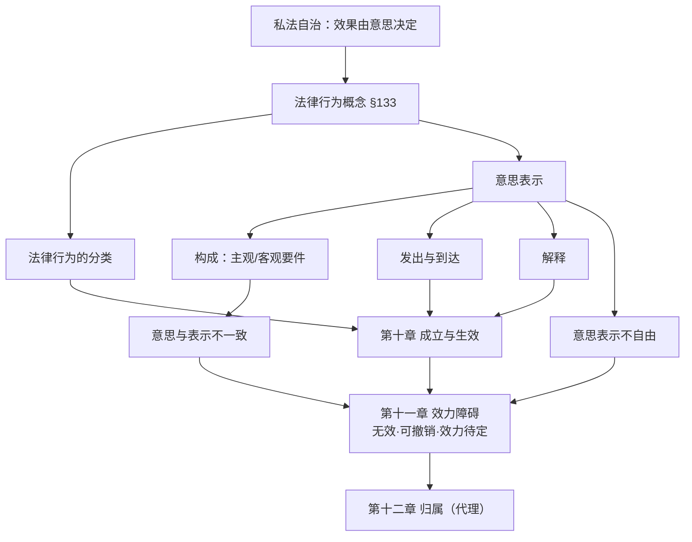
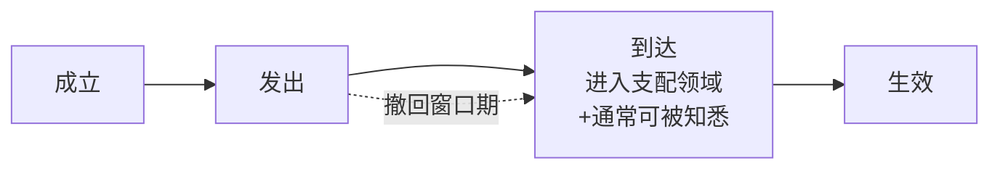

> [!quote] YOU

我们先来法律行为部分

> [!abstract] PI

先给你做会话提醒，然后我们定位起点。

**会话提醒**
- 进度：整本书 15 章都还没开始，这是我们的第一课。你的画像也没填（目标/基础/风格都是空的）。
- 复习队列：0 项到期。

「法律行为」在杨代雄这本书里是 **第 9–12 章**，也是全书最重的一块（教材第 276–507 页，占了近一半篇幅）：

| 章 | 主题 | 页码 |
|---|---|---|
| 第九章 | 法律行为与意思表示的一般原理 | 276–370 |
| 第十章 | 法律行为的成立与生效 | 371–383 |
| 第十一章 | 法律行为的效力障碍 | 384–442 |
| 第十二章 | 法律行为的归属 | 443–507 |

这四章是民法的「心脏」，但有个前提问题：法律行为讲的是「人如何通过意思表示创设、变更、消灭权利」，而第 1–8 章（权利、主体、客体、权利变动）是它的地基。直接从第 9 章切入没问题，**但我要先摸清你的底**，才能决定是从零搭地基、还是可以跳进来。

先补画像——第一个问题：

> [!question] Question
> 你的民法基础大概在哪个位置？（这决定我从第 9 章跳进来时要不要先补地基）
>
> 1. 零基础（几乎没系统学过民法）
> 2. 学过但忘了（有印象但概念模糊）
> 3. 正在学（跟过课或读过书）
> 4. 有基础（能说出法律行为、意思表示等概念）

> [!example] Answer
> 2. 学过但忘了（有印象但概念模糊）

> [!abstract] PI

「学过但忘了」——那我讲的时候会重点帮你**唤醒旧知识 + 重新校准概念**，而不是从零念定义。记下了。

第二个问题：

> [!question] Question
> 你学民法是为了什么？（决定深度和侧重：法考偏考点与速度，考研/兴趣偏原理深挖）
>
> 1. 法考
> 2. 考研
> 3. 期末
> 4. 兴趣（想把民法原理弄透）

> [!example] Answer
> 2. 考研

> [!abstract] PI

考研——那我会兼顾**体系建构 + 原理深挖 + 输出能力**（考研民法要能写出论证，不只选对选项）。记下了。

第三个问题：

> [!question] Question
> 你偏好哪种学法？
>
> 1. drill-me：多拷问我，先想后讲
> 2. explain-to-me：先讲清楚，再自测
> 3. 自适应：你按主题判断（推荐）

> [!example] Answer
> 3. 自适应：你按主题判断（推荐）

> [!question] Question
> 你每周大概能花多少小时学民法？（决定节奏和复习密度）
>
> 1. 每周 3 小时以下
> 2. 每周 3–7 小时
> 3. 每周 7 小时以上

> [!example] Answer
> 3. 每周 7 小时以上

> [!question] Question
> 有没有什么民法主题你一直在躲、特别不想碰的？（越躲越该排进来；没有就说"没有"）
>
> 1. 没有特别回避的
> 2. 有，我写在备注里

> [!example] Answer
> 1. 没有特别回避的

> [!abstract] PI

画像齐了，我记下来：

- **基础**：学过但忘了（有印象、概念模糊）
- **目标**：考研（重体系 + 原理 + 输出）
- **风格**：自适应（我按主题判断讲还是拷问）
- **时间**：每周 7 小时以上（高频，可以排得密）
- **回避点**：无

写入画像：

> [!abstract] PI

画像记好了。现在做一次轻量探测——你已经学过，我想知道你脑子里还剩下什么，好校准起点。

先让我看一下第九章教材的结构和习题，再决定怎么讲、从哪进。

> [!abstract] PI

第九章的骨架我摸清了。这是一大章（教材 95 页），讲的是**法律行为 + 意思表示**的全部基础。在给你看整体路线前，我先用一道真题探一下你「学过但忘了」还剩多少底子——别紧张，答错了正好告诉我该从哪补。

> [!question] Quiz
> 小马外出旅行，临走前交代邻居小李，帮他照看一下房子，防止小偷入室行窃，小李答应。下列选项正确的是（ ）
>
> 1. 如果小马旅行期间房子安然无恙，则小李有权请求小马支付照管费用
> 2. 小马与小李之间成立了一个法律行为
> 3. 小偷半夜爬窗进入小马房屋行窃，小李隐约听见动静，但困倦难耐，未出门查看，小李须对小马承担损害赔偿责任
> 4. 小李对小马房子的照看行为不构成无因管理

> [!success] Quiz — correct ✓
> Your answer: 4. 小李对小马房子的照看行为不构成无因管理
> Correct answer: 4
>
> 小李答应照看房子是无偿施惠，属于「情谊行为」（好意施惠），不是法律行为——因为它欠缺受法律约束的意思（约束意思/意思表示），所以 A 错、也不产生照管费请求权（B 错）。情谊行为还阻却无因管理的成立，所以小李的照看「不构成无因管理」，C 对。至于 D，小李只是未出门查看，属于一般过失，而情谊行为中的保护义务以故意或重大过失为前提，故不担责。

> [!abstract] PI

一道就对——说明你的底子还在，只是「忘了」而非「没学」。好，那我按**唤醒式**（快速校准 + 补漏）来讲，而不是从零念定义。

先把整条路线摆给你看，这一步很重要（**根错了现在改便宜**）。

---

## 法律行为部分整体路线（第九—十二章）

一句话主线：**私法自治 → 意思表示 → 法律行为 → 效力 → 归属**。



| 章 | 主题 | 一句话 | 页数 |
|---|---|---|---|
| **第九章** | 法律行为与意思表示的一般原理 | 概念 + 分类 + 意思表示全流程（构成/发出到达/解释/瑕疵） | 276–370（最重） |
| **第十章** | 法律行为的成立与生效 | 成立 ≠ 生效；一般/特别生效要件 | 371–383（最短） |
| **第十一章** | 法律行为的效力障碍 | 无效、可撤销、效力待定、附条件附期限 | 384–442 |
| **第十二章** | 法律行为的归属 | 代理（有权/无权代理、表见代理） | 443–507 |

**为什么是这个顺序**：法律行为是「意思表示造出来的东西」——先懂「意思表示怎么构成、怎么发出、到达没有」（第九章），才能谈「这个法律行为成立了没、生效了没」（第十章）；生效之后才谈「它有没有效力障碍」（第十一章）；而代理解决的是「这个法律行为算谁做的」（第十二章）。第十二章放最后，是因为它整体依赖前三章。

---

## 第九章详细计划（我们这次的战场）

这章有 6 节，全部围绕一个概念——**意思表示**：

| 节 | 内容 | 类型 | 考研分量 |
|---|---|---|---|
| 第一节 | 法律行为的概念与分类 | 情谊行为区分是 A 类；分类表是 B 类 | ★★★ |
| 第二节 | 意思表示的构成（行为意思/表示意识/效果意思；表示） | A 类为主，杨代雄有独特观点 | ★★★ |
| 第三节 | 意思表示的发出与到达（到达主义 §137） | 半 A 半 B | ★★★ |
| 第四节 | 意思表示的解释（§142） | A 类 | ★★ |
| 第五节 | 意思与表示不一致（真意保留/通谋虚伪/戏谑/错误） | 半 A 半 B，**最难** | ★★★ |
| 第六节 | 意思表示不自由（欺诈/胁迫） | A 类 | ★★★ |

这章太大，一次讲完你会消化不良。我的建议是**分 2–3 次**：这次先打**第一节 + 第二节**（概念/分类 + 意思表示怎么构成），把地基夯实；下次第三节 + 第四节；再一次第五 + 第六节（瑕疵那两块最硬，单开）。

---

你的底子不错（刚才那道题就说明你还记得情谊行为），所以我不打算从头慢讲。给你选：

> [!question] Question
> 第九章按哪个节奏走？
>
> 1. 先快速摸底，再决定跳过哪些（推荐）
> 2. 从第一节开始，逐节深入讲
> 3. 直接上最硬的第五、六节（意思表示瑕疵）

> [!example] Answer
> 1. 先快速摸底，再决定跳过哪些（推荐）

> [!question] Quiz
> 甲基于借贷合同对乙享有50万元债权。某日，甲、丙订立合同，约定甲将该借贷本息债权以52万元对价转让给丙，且债权自对价支付完毕时移转。下列选项错误的是（ ）
>
> 1. 甲、乙的借贷合同是负担行为
> 2. 题中语句描述了 4 个法律行为
> 3. 甲、丙的合同中包含了一项负担合意
> 4. 甲、丙的合同中包含了一项处分合意

> [!success] Quiz — correct ✓
> Your answer: 2. 题中语句描述了 4 个法律行为
> Correct answer: 2
>
> 甲、丙之间其实有**两个**法律行为：①债权转让合同（负担合意，使甲负担把债权转给丙的义务），②债权自对价付清时移转的**处分合意**（附条件的处分行为，直接让既存债权变动）。加上甲、乙的**借贷合同**（负担行为），共 3 个法律行为，不是 4 个，所以 A 错（本题选错误项）。B、C、D 都正确。核心记忆点：**债权让与是处分行为，不是债权行为**——它直接变动一项既存权利。

> [!abstract] PI

两道全对，你的底子比「忘了」好不少。再压两道难的。让我把剩下的题目调出来。

> [!abstract] PI

题目全在手了。继续，这次考**意思表示的构成**（行为意思 vs 表示意识——这是杨代雄理论的味道）：

> [!question] Quiz
> 甲公司办公室主任小陈某日早晨将一摞内部机构事物处理请示文件放在董事长王某的办公桌上，其中不小心夹杂着一张合同解除函，内容是解除与乙公司的租赁合同。王某未加细看，以为都是内部文件，全部签名。下列选项正确的是（ ）
>
> 1. 王某签署解除函时欠缺表示意识
> 2. 王某签署解除函时欠缺行为意思
> 3. 甲公司的解除意思表示不成立
> 4. 即便乙公司的负责人明知道真实情况，甲公司的解除意思表示仍然成立

> [!failure] Quiz — incorrect ✗
> Your answer: 2. 王某签署解除函时欠缺行为意思
> Correct answer: 1
>
> 王某**举手签了名**——他是自己想动笔的，所以有行为意思（A 错）。但他根本不知道这份解除函具有「表示价值」：他以为签的都是内部文件。欠缺的是**表示意识**（B 对）。而在杨代雄的体系里，欠缺表示意识**不一定**导致意思表示不成立——关键看有没有**可归责性**（过失）。这里王某自己有重大过失（文件不细看就签），所以意思表示**成立**（C 错），只是可能构成错误可撤销。D 也对不了，因为它属于另一个判断层次。

> [!question] Quiz
> 甲手持一份提货单，写明在某仓储公司存有一批货物，表示愿意出售给乙，但要求乙预付20万元作为定金，乙觉得物美价廉，遂同意并支付了定金。甲实际上并非该批货物所有权人，而且其订立买卖合同只是想骗取定金。下列选项错误的是（ ）
>
> 1. 甲的出售表示构成真意保留
> 2. 甲的出售表示不成立意思表示
> 3. 甲的行为构成欺诈
> 4. 乙在订立合同过程中陷入动机错误

> [!success] Quiz — correct ✓
> Your answer: 2. 甲的出售表示不成立意思表示
> Correct answer: 2
>
> Note: 甲这个和真意保留有啥关系？/2我觉得仍然是意思表示/4看不懂在说啥
>
> 甲**内心不想真卖**（只想骗定金），却在外部作出了「愿意出售」的表示——这正是**真意保留**（表意人明知表示与真意不符仍作出表示），所以 A 对。关键来了：真意保留的意思表示**原则上仍然成立、有效**（相对人不知情时），所以「不成立意思表示」是错的——本题选错误项，答案 B。甲以骗取定金为目的，构成**欺诈**（C 对）；乙因此对交易基础产生错误认识，属于**动机错误**（D 对）。

> [!question] Quiz
> 小梦在 23 点 50 分用微信给小香留言「我愿意把这次周董演唱会的门票原价转卖给你」，当时小香已经入睡，手机静音。下列选项正确的是（ ）
>
> 1. 小梦的意思表示尚未发出
> 2. 小梦的意思表示于当晚 23 点 50 分到达小香
> 3. 小梦于次日凌晨 3 点醒来，反悔，可以再发送一则微信留言，撤回意思表示
> 4. 小梦的意思表示是对话的意思表示

> [!failure] Quiz — incorrect ✗
> Your answer: 4. 小梦的意思表示是对话的意思表示
> Correct answer: 3
>
> 微信留言是**非对话**意思表示（A 错），松手发出即已发出（B 错）。23:50 小香已入睡、手机静音，**不能合理期待她当时知悉**，所以意思表示尚未到达（C 错）——到达要等到「进入支配领域 + 通常可被知悉」，即次日她醒来查看时。**撤回**必须在意思表示到达前（或同时）到达，所以次日 3 点发微信撤回，此时原意思表示还未到达，撤回有效（D 对）。核心：**发出≠到达，撤回的窗口期 = 发出后、到达前**。

> [!abstract] PI

摸底结束。你的底子比你自己以为的好，但也暴露了三个清晰的漏洞。这是你的**已知/未知地图**：

| 节点                 | 结果                    | 结论                |
| ------------------ | --------------------- | ----------------- |
| 第一节 情谊行为 vs 法律行为   | ✅ 对                   | **已掌握**，跳过        |
| 第一节 负担行为 vs 处分行为   | ✅ 对                   | **已掌握**，只需补一张分类总表 |
| **第二节 意思表示的构成**    | ❌ 行为意思/表示意识混淆         | 🔴 **漏洞，精讲**      |
| **第三节 发出与到达**      | ❌ 对话/非对话、到达、撤回全错      | 🔴 **漏洞，精讲**      |
| 第四节 意思表示的解释        | 未测                    | 🟡 待讲（考研必考）       |
| **第五节 意思与表示不一致**   | ⚠️ 半对半懂（真意保留、动机错误没搞懂） | 🔴 **漏洞，精讲**      |
| 第六节 意思表示不自由（欺诈/胁迫） | 未测                    | 🟡 待讲             |

**结论**：你不是「没学过」，而是「概念壳还在、技术细节全丢了」——特别巧的是，你丢掉的全是**意思表示的内部机理**（构成、发出到达、瑕疵），而法律行为「是什么」你反而记得清楚。所以我们的策略是：

> **第一节压缩成一张表（B 类记牢）→ 第二、三节精讲（你的洞）→ 第四节讲解释 → 第五、六节精讲（瑕疵，最硬）**

现在开始，直接从你的第一个洞讲起：**第二节 意思表示的构成**。

---

# 第二节　意思表示的构成

**先问一个「为什么」**：我们费劲研究意思表示的构成，是为了回答一个实际问题——「**这个人刚才那个动作，到底算不算一个意思表示？**」算，就可能成立法律行为、产生权利义务；不算，就什么都没发生。判断标准拆成两块：**客观**（他有没有做出一个「表示」）+ **主观**（他心里有没有相应的「意思」）。

**无条件真理先锁定**：意思表示 = 表意人将发生特定法律效果的意思**表达于外部**的行为。`[已核实: 教材第九章第二节]` 客观要件叫「表示」，主观要件通说分三层（雷曼的经典三分法）——**行为意思、表示意识、效果意思**。你刚才就是在这三层里翻了车，我们逐个钉死：

| 主观要素 | 它问的问题 | 欠缺时的典型场景 | 后果 |
|---|---|---|---|
| **行为意思** | 我想不想做**这个动作**？ | 被人抓着手指按手印、梦游、条件反射 | 常态下欠缺 → 意思表示**不成立** |
| **表示意识** | 我知不知道这动作**有法律意义**？ | 以为签的是慰问信，其实是合同 | 欠缺 + 有过失 → 仍成立（可撤销） |
| **效果意思** | 我想不想发生**这个特定效果**？ | 想写「A 型号」写成「B 型号」 | 不影响成立，构成**错误**可撤销 |

**你刚才错的那道题**（王某签解除函）关键就在前两层的区分：

- 王某**举手签了字**——他想做「签名」这个动作，**行为意思有**；
- 但他**不知道这张纸是解除函**——他不知道这个动作有「解除合同」的法律意义，**缺的是表示意识**。

一句话口诀帮你钉死：**「行为意思管『动没动』，表示意识管『知不知』」**。

---

**接下来是杨代雄这本书的独特观点，考研用这本教材的话是必须吃透的**：

传统通说把这三层当「构成要件」——缺一个，意思表示就不成立。但杨代雄说**不对**：这三者**没有一个是不可或缺的**。`[已核实: 教材第九章第二节「本书观点」]` 他的逻辑是：

> 意思表示法**不只保护表意人的自决，也保护相对人的信赖和交易安全**。如果表意人「有过失」地制造了一个看起来像意思表示的符号，相对人又合理信赖了它，那就不能因为表意人「心里没有那个意思」就一律宣布它不成立。

所以他区分两种情形：

- **常态意思表示**：有行为意思 + 表示意识 → 直接成立；
- **病态意思表示**：缺行为意思或表示意识，但表意人**有过失（可归责）** → **仍然成立**意思表示，只是可能构成错误、给表意人一个**撤销权**；
- 缺了 + **无过失** → 才不成立。

回到王某案：他没细看就签，**自己有重大过失**，所以解除意思表示**成立**（只是可撤销）。这也解释了他把「意思」的基石地位让给了「**意义**」——判断标准从「他心里想什么」转向「在相对人眼里，这个符号有没有效果意义」。

---

**连线到主线**：这节解决的是图里 `D → E` 那一步——**意思表示是怎么「造」出来的**。搞清楚「构成」，下一节才能问「造出来之后，它发出、到达了没有」。

用刚才那类题收个尾，验证你真的钉死了：

> [!question] Quiz
> 甲有一间店面，乙想以较低价格租下这间店面，但甲不同意。某日，乙拟好租赁合同书，并让丙请甲喝酒，趁甲醉酒时，丙拿出租赁合同书，拉过甲的手在合同书上摁了指印。下列选项正确的是（ ）
>
> 1. 甲摁指印时欠缺行为意思
> 2. 丙的行为构成第三人胁迫
> 3. 由于甲欠缺效果意思，不符合意思表示的主观要件，所以合同不成立
> 4. 丙的行为构成第三人欺诈

> [!failure] Quiz — incorrect ✗
> Your answer: 2. 丙的行为构成第三人胁迫
> Correct answer: 1
>
> 丙**拉过甲的手**在合同书上摁指印——这是**身体强制**（vis absoluta），甲根本没有「想摁手印」这个动作的意思，所以欠缺**行为意思**（C 对）。这里不是欺诈/胁迫（A、B 错：丙是趁人醉酒动手，不是用欺骗或威胁让甲自己决定）。D 错——按杨代雄的观点，欠缺行为意思时若甲可归责仍可能成立意思表示，何况此处甲是被强制、无过失，意思表示不成立；但选项 D 的理由（「欠缺效果意思」）张冠李戴，理由错。

> [!abstract] PI

又错了，但这次错得**很有价值**——它暴露了更深一层的混淆：你把「**胁迫**」和「**身体强制**」当成一回事了。这俩恰恰是民法里一条经典分界线，必须钉死。

**核心区分就一句话：表意人到底「自己做的」还是「别人替他做的」。**

| 情形 | 表意人的状态 | 动作是谁的 | 意思表示 | 后果 |
|---|---|---|---|---|
| **身体强制**（抓你手按指印） | 根本没想动，动作被物理强加 | **别人的** | 欠缺**行为意思** → **不成立** | 不发生法律行为 |
| **胁迫**（拿刀逼你签） | 害怕了，但**自己**拿起笔签了 | **自己的** | 成立（行为意思、表示意识都在） | 成立但**可撤销** |
| **欺诈**（骗你签） | 信了假话，**自己**决定签 | **自己的** | 成立 | 成立但**可撤销** |

看清那条线了吗：

- **胁迫、欺诈** → 都是表意人**自己**做出了表示，只是他的意思决定被「不当影响」了 → 意思表示**成立**，靠**撤销权**救济；
- **身体强制** → 表意人**根本没做**，是别人抓着他的手干的 → 欠缺**行为意思** → 意思表示**根本不成立**，谈不上撤销。

**记忆锚点**：**「胁迫是逼他自己签，强制是抓他手按」**——一个动的是"意思"，一个动的是"手"。

回到那道题：丙是「**拉过甲的手**在合同书上摁指印」，这是抓着手按，是**身体强制**，不是拿刀逼他自己签。所以答案不是胁迫（B），而是**欠缺行为意思（C）**。

这个洞你已经栽了两次，我把它记进复习队列，明天会再问你。现在当场重测一遍，确认这次真的通了：

> [!question] Quiz
> 再确认一次：丙拉过甲的手在合同书上摁指印，甲此时欠缺的是？
>
> 1. 甲摁指印时欠缺行为意思
> 2. 甲摁指印时欠缺表示意识

> [!success] Quiz — correct ✓
> Your answer: 1. 甲摁指印时欠缺行为意思
> Correct answer: 1
>
> 还是那道题的逻辑：丙抓甲的手按指印 = 身体强制，动作不是甲自己做的，欠缺行为意思，意思表示不成立。胁迫是「逼他自己做决定」，这里甲根本没做决定。

> [!abstract] PI

✅ 通了。**「逼他签」是胁迫，「抓他手按」是身体强制**——这一条你已经钉死，我记进复习队列明天再验。

继续，第二个洞：**第三节　意思表示的发出与到达**。这也是你刚才全错的那道题（微信留言 = 对话？撤回有效吗？）所在的节点。

---

## 第三节　意思表示的发出与到达

**先解决你刚才犯的第一个错：什么是「对话」、什么是「非对话」。**

区分标准**不是**"用没用文字"，而是**交流是否即时**：

| | 对话（即时） | 非对话（非即时） |
|---|---|---|
| 特征 | 表意符号**立即**被对方感知 | 要经过**传递时间差** |
| 例子 | 面谈、打电话、视频通话 | 信函、邮件、短信、**微信留言**、语音信箱 |

看懂了没：**微信「语音通话」是对话，微信「留言」是非对话**——区别在"对方能不能当场听到"，不在文字还是语音。`[已核实: 教材第九章第三节]`

---

**为什么这个区分重要？** 因为它决定意思表示**何时生效**，而生效时点决定**风险谁担**。这里有一条漂亮的推理线（A 类，你自己跟着想）：

一个非对话意思表示（比如寄信）从发出到对方真正读到，中间可能出各种事：信丢了、延误了、对方没看。法律必须定一个「生效时点」，等于决定这些风险算谁的。给你三个选项，你觉得哪个最公平：

- **发出主义**：一寄出就生效 → 信丢了的风险全算**相对人**的（他可能根本不知道有这封信，却要担责）→ 不公平；
- **了解主义**：对方真正读了才生效 → 对方"读没读、什么时候读"太难查证，而且他不及时看信的风险全算**表意人**的 → 也不公平；
- **到达主义**：意思表示**到达**相对人时生效 → 到达前（传递风险）算表意人的（传递方式是他选的）；到达后（了解风险）算相对人的（信已进入他的地盘）→ **最公平**。

所以《民法典》第 137 条选的就是这个折中：**非对话意思表示，到达主义**；**对话意思表示，了解主义**（因为对话没有传递时间差，说完对方就该听到）。`[已核实: 教材第九章第三节，§137]`

---

**「到达」怎么认定？** 两个要件，缺一不可：

> **① 进入相对人的支配领域**（住宅、信箱、电子邮箱、微信账户等）+ **② 通常可被对方知悉**（在正常时间、正常方式下他能看到）。

这就是你错那道题的核心：小香 23:50 已入睡、手机静音——微信留言确实**进入了她的微信账户**（要件①），但**不能期待她当时知悉**（要件②缺），所以**没到达**。要等她次日醒来查看时才到达。

---

**撤回的窗口期**（你错的第二点）：意思表示**发出之后、到达之前**，可以撤回。规则是——**撤回的通知须在原意思表示到达之前或同时到达**。所以小香案里，小梦次日凌晨 3 点反悔发微信撤回：此时原留言还没到达（小香没醒），撤回通知**先到达**，撤回有效。

一张图收束这一节：



**连线主线**：第二节造出意思表示（`D→E`），这一节解决它「**走到没有、生效没有**」（`F`）。生效之后，法律行为才可能成立、进而谈效力。

收个尾验证（这是你刚才的盲区）：

> [!question] Quiz
> 下列选项属于「无相对人的意思表示」的是（ ）
>
> 1. 遗嘱
> 2. 我国《民法典》中的悬赏广告
> 3. 设立财团法人的捐助表示
> 4. 意思实现

> [!warning] Quiz — unavailable
> quiz correctAnswer "ACD" does not match any option value ("B", "A", "D", "C")

> [!question] Quiz
> 下列选项属于「无相对人的意思表示」的是（ ）
>
> 1. 遗嘱
> 2. 设立财团法人的捐助表示
> 3. 意思实现
> 4. 我国《民法典》中的悬赏广告

> [!failure] Quiz — incorrect ✗
> Your answer: 1. 遗嘱, 2. 设立财团法人的捐助表示, 4. 我国《民法典》中的悬赏广告
> Correct answer: 1, 2, 3
>
> 「无相对人」= 无需受领，不存在需要了解该意思表示的相对人。遗嘱、设立财团法人的捐助表示都是典型的无相对人意思表示；意思实现是「无需受领的意思表示」，也属于无相对人（A、C、D 选）。**悬赏广告不选**——我国《民法典》第 499 条采「要约说」，悬赏广告是有相对人的意思表示（要约）。这是本教材反复强调的一个易错点。

> [!abstract] PI

两道都记下——一个是记忆点，一个是我还没正式讲（你漏了不怪你）：

**① 悬赏广告 = 要约说（B 类记忆点）**：我国《民法典》第 499 条采**要约说**，悬赏广告是向不特定人发出的**要约**。要约必然有相对人（完成指定行为的人），所以它**不是**无相对人的意思表示。`[已核实: 教材第九章，§499]` 锚点：**「悬赏＝要约，要约必有相对人」**。别跟德国式的「单方法律行为说」混——那是人家采的，我国不采。

**② 意思实现 = 无需受领（A 类，我还没讲，补一句）**：回转寿司店，你取一盘寿司吃掉 = 承诺，**不用通知店家**。它本质是意思表示，但「无需向对方发出、无需到达」→ 归入**无相对人**。锚点：**「用行为承诺，不用说话」**。

两条都进复习队列，明天一起验。

---

到这里，第九章我们已经清掉了 **第一节（压缩）+ 第二节（构成）+ 第三节（发出到达）**，你的三个洞补了两个半。剩下来的是本章最硬、考研最考的部分——**第五节「意思与表示不一致」+ 第六节「意思表示不自由」**（真意保留、通谋虚伪、戏谑、错误、欺诈、胁迫），中间还夹一个第四节「解释」。

这摊内容很大，一次讲完你撑不住。你想怎么安排：

> [!question] Question
> 接下来怎么走？
>
> 1. 继续，把瑕疵（第五、六节）讲完（推荐）
> 2. 今天先停，我更新进度文件，下次接着讲
> 3. 先补第四节「解释」，再讲瑕疵

> [!example] Answer
> 2. 今天先停，我更新进度文件，下次接着讲

> [!abstract] PI

好，今天就到这。你补了两个大洞，收获不小。我先更新进度文件。

> [!abstract] PI

进度文件已更新。今天这课收尾，给你一份总结：

## 本次课小结

**进度**：第九章 法律行为与意思表示的一般原理 —— 第一、二、三节完成（掌握度 ⭐⭐，全章 6 节过半）。

**你今天补上的洞**：
1. ✅ **行为意思 vs 表示意识**——「管动没动」vs「管知不知」
2. ✅ **身体强制 vs 胁迫**——「抓他手按」vs「逼他自己签」
3. ✅ **对话/非对话 + 到达认定 + 撤回窗口期**——微信留言是非对话；到达＝进入支配领域＋可期待知悉；撤回在「发出后、到达前」

**已排进复习队列（明天到期，5 项）**：上面三个概念 + 悬赏广告＝要约说 + 意思实现＝无相对人。明天说「**复习**」就能把它们过一遍。

**下次课接着讲**：第四节「解释」→ 第五节「意思与表示不一致」（真意保留、通谋虚伪、戏谑、错误——你最没把握的那块）→ 第六节「意思表示不自由」（欺诈、胁迫）。

---

一个小建议：今天这课信息量大、又是你的核心漏洞，值得存档。你可以发一句：

```
/md-log notes/民法总论/第九章/2026-09-29-意思表示的构成与发出到达.md
```

把会话镜像到 Obsidian 笔记，随时能翻。

下次见面直接说「**继续**」我就接着第四节往下讲；想先巩固今天的内容，说「**复习**」或「**拷问我第九章**」也行。今天辛苦了 👊
