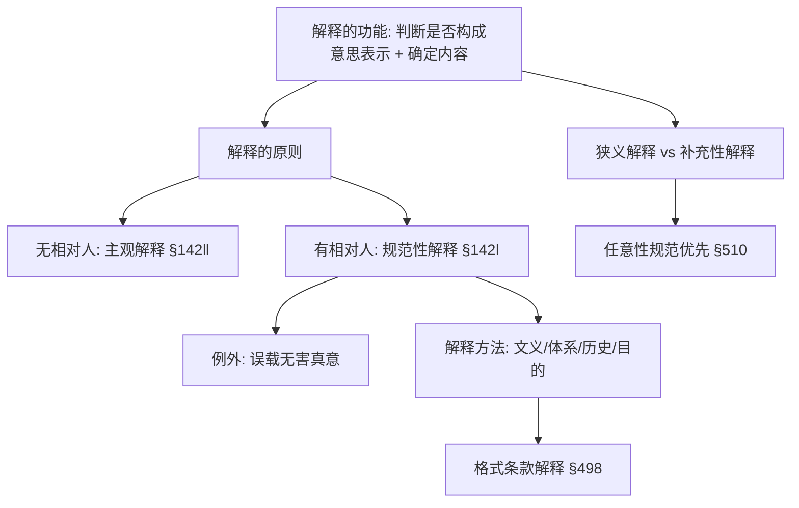
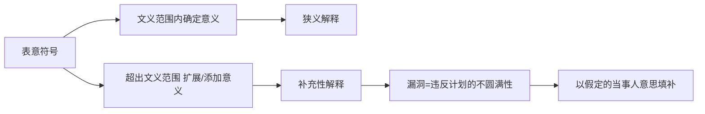
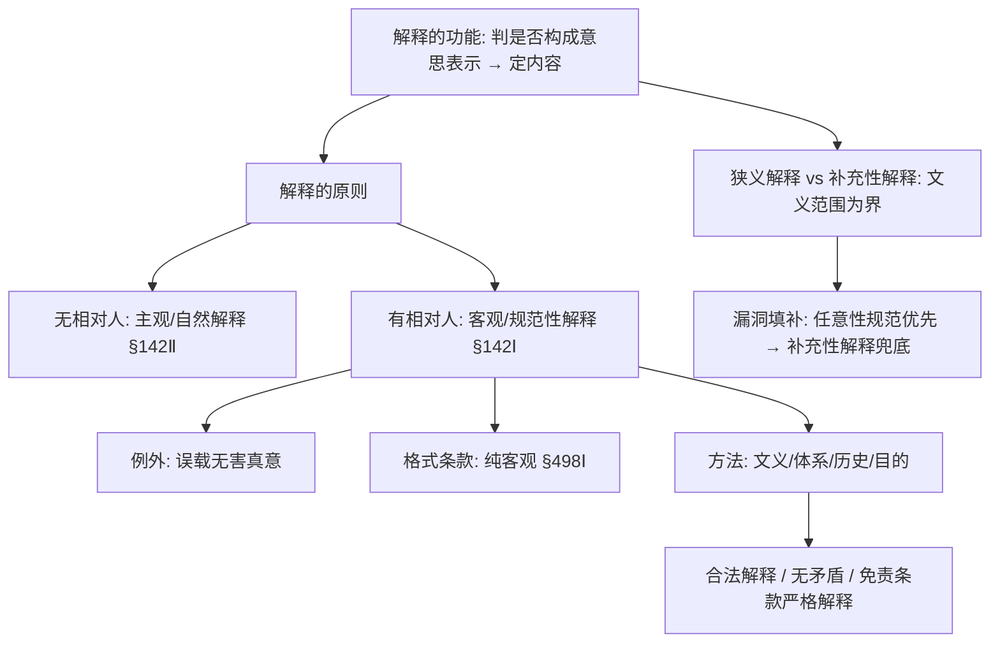

> [!quote] YOU

开始

> [!abstract] PI

早上好！我来给你报一下当前进度：

**上次学到哪**：第九章「法律行为与意思表示的一般原理」，已完成第一～三节（法律行为概念与分类、意思表示的构成、发出与到达），掌握度 ⭐⭐。剩下第四节「意思表示的解释」、第五节「意思与表示不一致」、第六节「意思表示不自由」还没讲。

**复习队列**：有 5 项待复习（行为意思/表示意识、身体强制 vs 胁迫、对话/非对话+到达、悬赏广告 §499、意思实现），但都是**明天（9-30）到期**，今天暂无到期项。

今天想怎么学？

```
1. 继续上课（接着讲第九章第四节「意思表示的解释」）→ 直接说"继续"
2. 学新章节 → 说"学第 X 章"
3. 拷问/刷题巩固 → 说"拷问我"或"刷 N 题"
4. 练案例题 → 说"练案例"
5. 复习到期的内容 → 说"复习"（今天无到期，可提前复习）
```

（也可以直接说你想干嘛，不用对菜单）

> [!quote] YOU

继续


> [!abstract] PI

好，笔记已镜像到 `notes/民法总论/第九章/2026-09-29-意思表示的解释.md`。

继续上课。先看清我们站在哪：第九章还剩三节——**第四节 意思表示的解释**、第五节 意思与表示不一致（真意保留/戏谑/通谋虚伪/错误）、第六节 意思表示不自由（欺诈/胁迫）。

这三节不是并列的散点，而是**一条逻辑链**：要判断一个意思表示有没有瑕疵（错误、欺诈、胁迫），第一步永远先要**确定这个表示"到底说了什么"**——这就是解释。教材里明写了一句口诀级的规则：**"解释先于错误（撤销）"**。所以第四节是第五、六节的地基，我先从它讲起。

## 本次规划：第四节 意思表示的解释

**路径**（为什么这个顺序）：
1. **为什么要解释**（功能）：解释不只用来"读合同条款"，第一步是判断一个符号**到底算不算意思表示**；第二步才确定它**内容是什么**。
2. **解释的原则**（核心，A 类可推导）：为什么**无相对人**用主观解释、**有相对人**用客观（规范性）解释——背后是"有没有人需要保护信赖"。以及唯一例外：**误载无害真意**。
3. **补充性解释**：合同有漏洞怎么办，为什么"法定任意性规范优先、补充性解释兜底"。
4. **解释方法**：文义 → 体系 → 历史 → 目的（含合法解释、无矛盾解释、免责条款严格解释）。
5. **格式条款特殊规则**（§498 三条）。

**依赖图**：



---

在开讲前确认一下节奏：


> [!question] Question
> 这次想讲到哪？
>
> 1. 只讲第四节「意思表示的解释」(Recommended)
> 2. 第四节 + 第五节「意思与表示不一致」
> 3. 第四节到第六节一次讲完


> [!example] Answer
> 1. 只讲第四节「意思表示的解释」(Recommended)


> [!abstract] PI

好，就讲第四节。开始。

---

## 节点 1：为什么要"解释"——先想清楚法官在干嘛

一个合同纠纷到法官手里，法官**第一步问的不是"这条款什么意思"，而是"这人到底有没有作出意思表示"**。教材把解释的功能分成两层：

1. **判断一个符号算不算意思表示**——比如那个《安慰函》写"我公司相信其有能力偿债"，得先解释出它**欠缺约束意义**，才能说它不是保证（这是第一节就碰过的柔性安慰函）。
2. **确定意思表示的内容**——已经认定是意思表示了，再问它到底约定了什么。

所以"解释"是**先于一切瑕疵判断**的动作。记住这句口诀级的规则：

> **解释先于错误（撤销）**——只有先解释出一个"客观的表示意义"，才能拿它去和表意人的内心真意对照，看有没有"不一致"（错误）。第五节讲错误时，这条链会再串起来。

[已核实: 教材第九章第四节]

---

## 节点 2：解释的原则——这是本节的命门

这里有一个**你能自己推出来**的分岔。先别往下看，想一个问题：

> 遗嘱是"无相对人"的意思表示（没人要受领它），合同是"有相对人"的。
> 同样一句话，为什么解释遗嘱时要**顺着立遗嘱人内心的真意**去读，而解释合同时却要**顺着对方（理性相对人）眼里看到的含义**去读？

想想"有没有人需要保护信赖"这个角度，再告诉我你的答案。


> [!question] Question
> 为什么无相对人的意思表示（如遗嘱）采用「主观解释」，而有相对人的意思表示（如合同）采用「客观（规范性）解释」？
>
> 1. 因为有相对人时，对方基于表示内容产生了信赖，需要保护；无相对人则无人需要保护信赖
> 2. 因为遗嘱内容更私密、更复杂，只能靠立遗嘱人本人解读
> 3. 因为合同必须公平，客观解释能得出对双方都公平的结果


> [!example] Answer
> 1. 因为有相对人时，对方基于表示内容产生了信赖，需要保护；无相对人则无人需要保护信赖


> [!abstract] PI

对，就是**信赖保护**。这正是教材给的根本理由——你自己推出来了。

把教材的原话钉死：

- **无相对人**（遗嘱、捐助、抛弃所有权）：没有需要保护信赖的人，所以**彻底贯彻私法自治**，只按表意人内心的真意解释。这就是**主观解释**，也叫**自然解释**。→ 《民法典》第 142 条第 2 款"确定行为人的真实意思"。
- **有相对人**（合同、解除、追认）：对方已经基于你**表示出来的客观含义**产生了信赖并据此行动，所以解释时**优先考虑表意符号的客观意义**。这就是**客观解释 / 规范性解释** → 第 142 条第 1 款。

[已核实: 教材第九章第四节]

这里有两个容易糊的点，我分别钉一下：

**① "客观解释"到底拿谁的脑子当尺子？**

不是拿**特定相对人本人**的脑子（他可能特别笨或特别精），也不是拿一个**抽象笼统的"理性人"**，而是拿——**"具体情境中的理性人"**：一个具备中等心智、知识、经验的假想标准人，被**放进这个具体交易情境里**去读表意符号。所以解释时要把交易习惯、市场行情、缔约前磋商、合同其他条款都喂给这个理性人。教材教学案例1（"4500斤脐橙26元"）就是典型：理性购物者看市场行情，会把"4500斤"读成"4500g"。

**② 唯一的例外：误载无害真意（错误表示无害）**

这是本节最常考、也最容易错的地方。逻辑是这样：

> 客观解释本来是要保护相对人。但如果**双方当事人都一致地给某个表意符号赋予了同一个"主观意义"**，而这个主观意义和客观文义不同——那保护信赖的理由就**消失了**：因为相对人自己心里也是这么理解的，根本没有一个"被客观文义误导的信赖"值得保护。此时改采**自然解释**，以双方一致的主观意义为准。

拉丁语境叫 `falsa demonstratio non nocet`（误载无害）。举个例子你就懂了：双方口头谈好买"洋桃"，合同书却都误写成"油桃"，两人都没细看——此时不能机械地按"油桃"解释（那会背叛双方真实合意），应按"洋桃"解释。

---

来测一下这个点，用习题册原题（多选）：


> [!question] Quiz
> 某水果批发商与某农场洽谈"洋桃"收购事宜，谈妥后，双方签订买卖合同，但合同中"货物品名"一栏所填为"油桃"，双方负责人当时未加细看。下列选项错误的是（）
>
> 1. 水果批发商有权撤销买卖合同
> 2. 本案应当采用自然解释，将买卖标的物解释为“洋桃”
> 3. 该买卖合同双方当事人都发生意思表示错误
> 4. 本案意思表示是有相对人的意思表示，应依规范性解释，将买卖标的物解释为“油桃”


> [!failure] Quiz — incorrect ✗
> Your answer: 1. 水果批发商有权撤销买卖合同, 4. 本案意思表示是有相对人的意思表示，应依规范性解释，将买卖标的物解释为“油桃”
> Correct answer: 1, 3, 4
>
> 这是「误载无害真意」：双方口头谈好的是"洋桃"，合同书却都误写成"油桃"，两人都没细看——说明双方一致赋予"油桃"一词的主观意义其实是"洋桃"。此时不存在值得保护的相对人信赖（相对人心里也是"洋桃"），应改采自然解释（选项C正确），标的物是"洋桃"。因此：说"应依规范性解释把标的物解释成油桃"错；说"双方发生意思表示错误"错（双方主观意义一致，无意思与表示的不一致）；说"有权撤销"错（不构成错误，无撤销权）。


> [!abstract] PI

你选的两个（"应依规范性解释成油桃"、"有权撤销"）都抓对了，但**漏了 B**——"该买卖合同双方当事人都发生意思表示错误"。

这暴露了本节最要命的一个坑，我得专门给你拆开：

## 你大概率把"写错了字"当成了"意思表示错误"

**这是两个完全不同的东西。** 回想一下，错误（重大误解）的构成要件之一是——

> **表示内容与表意人的意思不一致**（"意思"和"表示"发生了错位）。

而"误载无害真意"的场景里，发生了什么？

| | 误载无害真意 | 真正的错误（重大误解） |
|---|---|---|
| 双方真意 | **一致**，都是"洋桃" | 一方真意与对方理解**错位** |
| 出问题的环节 | 符号（"油桃"）是双方**共同误用**的，但真意没乱 | 表示**内容**背离了表意人的**意思** |
| 法律后果 | 自然解释，合同内容直接定"洋桃"，**无需撤销** | 可撤销 |

关键一句：**误载里，双方的意思是一致的，只是共同用一个写错的符号承载了这个一致的意思。** 既然"意思"没有和"表示"不一致，就根本不构成错误，自然没有撤销权。

反过来想：如果只有**一方**误以为写的是洋桃、**另一方**真的以为买的是油桃——那才是单方的内容错误，才有撤销问题。这道题里两人"当时未加细看"都以为是洋桃，恰恰说明**没有错位**，所以 B 也是错的。

一句话记牢：**"误载"是符号写错但意思一致；"错误"是意思与表示错位。前者靠解释矫正，后者靠撤销矫正。**

---

（这道错题我记下了，类型是"概念混淆：误载无害真意 vs 意思表示错误"，明天复习队列里会再考你。）

继续下一个节点。

## 节点 3：合同有漏洞怎么办——补充性解释

前面讲的"狭义解释"是在**表意符号的文义范围内**确定意义。但现实里合同往往**漏了条款**（当事人当时没想到、或觉得不言自明）。这时有两种补法：

1. **适用任意性法律规范**（法律早就备好的默认规则）；
2. **补充性解释**（裁判者替当事人"猜"他们本会怎么约定）。

教材给的规则是：**任意性规范优先，补充性解释兜底**。

这里又有一个你能自己推出的"为什么"。先想：

> 同样是"法官替当事人补条款"，为什么**立法者预先写好的任意性规范**（如《民法典》第 583、584 条的违约损害赔偿）要比**法官临场发挥的补充性解释**更优先？

从"确定性"和"当事人本意"两个角度，说说你的理解。


> [!question] Question
> 为什么填补合同漏洞时，「任意性法律规范的适用」原则上优先于「补充性意思表示解释」？
>
> 1. 任意性规范更清晰、确定，且当事人未约定时往往本来就指望它兜底，优先适用更稳妥
> 2. 因为补充性解释容易出错，法官水平参差不齐，所以一律禁止先用它
> 3. 因为任意性规范是强制性规范，必须优先适用


> [!example] Answer
> 1. 任意性规范更清晰、确定，且当事人未约定时往往本来就指望它兜底，优先适用更稳妥


> [!abstract] PI

对，两个理由你都抓到了。教材原文钉死：

1. **符合当事人本意**：当事人知道"合同之外还有法律兜底"，某事项没写，往往就是打算到时候**直接套任意性规范**；
2. **更稳妥**：制定法明文规定的任意性规范，比法官临场发挥的解释**更清晰、更确定**。

[已核实: 教材第九章第四节]

但优先不是绝对的，教材列了**三个例外**（都指向同一句：任意性规范"不顶用"时就用补充性解释）：
- 当事人**明确约定排除**任意性规范的；
- 任意性规范**明显背离**本案合同的利益状况的；
- 任意性规范**过于陈旧**、不适合这类合同的。

还有一个必须分的界限：**狭义解释 vs 补充性解释**，分界线在**文义范围**。



- 在**可能的文义范围内**琢磨含义 = **狭义解释**；
- **超出文义范围**去补、去添 = **补充性解释**（所以教材说它其实是在"增加意义内容"，要谨慎）。

而补充性解释补的是什么？**"假定的当事人意思"**——假设当事人订约时考虑到了这个被遗漏的事项，作为正直当事人在诚信原则下合理考量双方利益，**会怎么约定**。注意，这是"假定"的、带规范性评价的意思，不是当事人实际有的意思。

---

快速确认一下这个点（习题册辨析题）：


> [!question] Quiz
> 辨析："在填补意思表示漏洞时，补充性意思表示解释优先于任意性法律规范的适用。"
>
> 1. 错误
> 2. 正确


> [!success] Quiz — correct ✓
> Your answer: 1. 错误
> Correct answer: 1
>
> 表述错误。在填补意思表示漏洞时，任意性法律规范的适用原则上优先于补充性意思表示解释，补充性解释只是兜底。理由有二：其一，当事人未约定某事项，往往本来就打算发生纠纷时直接适用任意性规范；其二，制定法明文规定的任意性规范比法官临场的补充性解释更清晰、更确定。


> [!abstract] PI

对。这个点你过关了。

## 节点 4：解释方法——四个梯子

这一块主要是**记忆 + 理解**，考研要能准确写出名字和要点，我一次给你列清楚，用一张图串起来：

```mermaid
flowchart TD
  A[解释方法] --> B[文义解释]
  A --> C[体系解释]
  A --> D[历史解释]
  A --> E[目的解释]
  B --> B1[先看文义: 文字/图形/符号/动作/沉默的意义]
  C --> C1[结合相关条款 §142"结合相关条款"]
  D --> D1[参考合同草案/谈判纪要/备忘录/往来函件]
  E --> E1[主观目的: 相对人知道其目的或各方共同目的]
  E --> E2[客观目的: 价值评判/利益考量]
  E2 --> E3[合法解释 / 无矛盾解释 / 免责条款严格解释]
```

几个考研要点，逐个钉：

- **文义解释**："文义"不限于文字，还包括图形、特殊符号、动作、沉默的意义——比如点头、举手、默示这些表意符号的"文义"也要先解释。文义能确定，通常不必再求助其他方法。
- **体系解释**：结合相关条款（§142 第 1、2 款都写"结合相关条款"）。教材举例：第 4 条语焉不详，结合第 5 条就能推出赔偿权利人是乙。
- **历史解释**：查**合同草案的演变**（删了什么、改了什么）、谈判纪要、备忘录、往来函件，甚至可证明的口头交流。
- **目的解释**分两叉：
  - **主观目的论**：考察表意人**拟实现的目标**——但前提是**相对人知道**这个目的，或各方有**共同目的**（否则拿单方隐藏动机去解释，会坑了相对人）；
  - **客观目的论**：基于**价值评判/利益考量**定"应有意义"，从中归纳出三条规则：
    - **合法（有效）解释规则**：多种解释时，选**能避免法律行为无效**的那种；
    - **无矛盾解释规则**：选**不自相矛盾**的那种；
    - **免责/弃权条款严格解释规则**（`contra proferentem`"反对获利方"）：有歧义时作**不利于受益方**的解释。

[已核实: 教材第九章第四节]

## 节点 5：格式条款解释的特殊规则（§498）

格式条款**面向公众、无人可查制定者真意**，所以解释上更接近"解释法律条文"，《民法典》第 498 条给了三条：

| 第 498 条 | 规则 |
|---|---|
| 第 1 句 | **按通常理解**解释（纯客观视角，无须考虑制定者的真实意思和特殊背景） |
| 第 2 句 | 有多种解释的，作**不利于格式条款提供方**的解释（针对规则的体现） |
| 第 3 句 | 格式条款与**非格式条款**不一致的，采**非格式条款**（个别磋商更能体现真意） |

[已核实: 教材第九章第四节]

---

测一下格式条款这个点（习题册多选）：


> [!question] Quiz
> 某银行针对储蓄合同拟定了一系列格式条款，其中最后一个条款写明"本行对合同享有最终解释权"。下列选项正确的是（）
>
> 1. 该合同条款的解释，应当采用客观视角，无须考虑银行的真实意思
> 2. 由于储蓄合同写明"本行对合同享有最终解释权"，所以一旦与客户发生理解分歧，均应以银行对合同条款的理解为准
> 3. 某客户与该银行签约时，双方在合同书末尾添加了一个手写条款，其内容与格式条款不一致，应以该手写条款为准
> 4. 该合同条款有多种含义的，应作不利于银行的解释


> [!failure] Quiz — incorrect ✗
> Your answer: 3. 某客户与该银行签约时，双方在合同书末尾添加了一个手写条款，其内容与格式条款不一致，应以该手写条款为准, 4. 该合同条款有多种含义的，应作不利于银行的解释
> Correct answer: 1, 3, 4
>
> 这是《民法典》第498条格式条款解释的三条规则。B对：格式条款应按通常理解解释，采用客观视角，无须考虑银行的真实意思和特殊背景。C对：有多种解释的，作不利于格式条款提供方（银行）的解释。D对：格式条款与非格式条款（手写条款）不一致的，采用非格式条款，因为个别磋商的非格式条款更能体现双方真意。A错："最终解释权"条款不能排除法定解释规则，格式条款的解释不取决于提供方单方说了算，否则相对人毫无保护。


> [!abstract] PI

你选 C、D 都对，但漏了 B——**"格式条款的解释应采用客观视角，无须考虑银行的真实意思"**。

这正好又戳中同一个根，我给你连起来：

## 格式条款为什么比普通合同解释"更彻底地客观"？

回想节点 2：有相对人的合同解释，客观解释优先，但**仍留了一个主观意义的例外**（误载无害真意）——因为那是对**特定相对人**，能查明双方真意。

而**格式条款面向的是不特定的社会公众**（所有储户、所有平台用户）。制定者（银行）脑子里怎么想的，公众**根本无从得知**。既然无人能知道制定者的真意，解释时就连"照顾主观意义"的余地都没有了——只能**纯客观**，即 §498 第 1 句的"**按通常理解**解释"。

所以 B 是**教材原话的转写**，是对的：

> "格式条款面向社会公众，解释时理应采用客观视角，无需考虑公众无从得知的格式条款制定者的真实意思及其特殊背景。"

一句话串起本节的主线：**解释的主观性空间，取决于"有没有人能知道你的真意"**——无相对人 → 纯主观；有相对人 → 客观优先 + 误载无害例外；格式条款 → 纯客观。

（这道题也记入错题，类型是"记忆点遗漏：格式条款解释采纯客观视角 §498 第 1 句"。）

---

## 第四节收束：回顾



本节核心就一句话链：**解释先于错误；主观性空间取决于"谁能在场知道你的真意"；漏洞先套任意性规范再谈补充解释。**

我把进度更新一下。


> [!abstract] PI

进度已更新（`课程进度.md`、`进程树.md`），本课笔记镜像在 `notes/民法总论/第九章/2026-09-29-意思表示的解释.md`。

---

## 本节小结（第四节 意思表示的解释）

你今天的表现我复盘一下：**两道多选都栽在同一个根上**——"客观/主观解释的适用范围"还没内化成条件反射。但这也正好帮你把本节最重要的主线刻出来了：

> **解释的主观性空间，取决于"谁能在场知道你的真意"**：
> 无相对人 → 纯主观（§142Ⅱ）；有相对人 → 客观优先 + 误载无害例外（§142Ⅰ）；格式条款 → 纯客观（§498Ⅰ）。

配套两个易混对，明天复习时我会重点拷你：
1. **误载无害真意**（符号写错、真意一致，靠解释矫正）vs **意思表示错误**（意思与表示错位，靠撤销矫正）；
2. **狭义解释**（文义范围内）vs **补充性解释**（超出文义），且漏洞填补时**任意性规范优先、补充性解释兜底**。

**下一步**：第九章还剩两节——第五节「意思与表示不一致」（真意保留/戏谑表示/通谋虚伪表示/错误）和第六节「意思表示不自由」（欺诈/胁迫）。这两节是考研命题最密集的地方，尤其"错误"和"欺诈/胁迫"的构成要件，下次课接着讲。

想巩固今天的内容，随时可以说：
- **"拷问我第九章"** → 刷题
- **"练案例"** → 案例分析（习题册案例二第 2 问正好考"安慰函如何解释"，是今天的直接应用）
- **"复习"** → 提前过明天到期的 7 项

今天先到这，辛苦了。


> [!quote] YOU

拷问我


> [!abstract] PI

进入 **drill 模式**，拷问范围：**第九章 第一～四节**（你已学完的部分），5 题，一题一题来，答完我会追着问推理，别想蒙混过关。

先从第一节的"情谊行为"开刀：


> [!question] Quiz
> 小马外出旅行，临走前交代邻居小李，帮他照看一下房子，防止小偷入室行窃，小李答应。下列选项正确的是（）
>
> 1. 如果小马旅行期间，房子安然无恙，则小李有权请求小马支付照管费用
> 2. 小偷半夜爬窗进入小马房屋行窃，小李隐约听见动静，但困倦难耐，未出门查看，小李须对小马承担损害赔偿责任
> 3. 小李对小马房子的照看行为不构成无因管理
> 4. 小马与小李之间成立了一个法律行为


> [!success] Quiz — correct ✓
> Your answer: 3. 小李对小马房子的照看行为不构成无因管理
> Correct answer: 3
>
> Note: 这题做过了之前
>
> 小李答应照看房子属于情谊行为（好意施惠），欠缺法律上的约束意思，不构成法律行为，所以A错。情谊行为不产生给付请求权，小李无权请求支付照管费用，B错。情谊行为阻却无因管理的成立（小李的照看不构成无因管理），C对。情谊行为即使产生保护义务，违反该义务的损害赔偿责任也以故意或重大过失为前提；小李只是困倦难耐、未出门查看，通常不足以构成故意或重大过失，D错。


> [!abstract] PI

答对了。但你既然说之前做过，我不许你只凭印象——追一句：

**D 选项（小李没出门查看、要不要赔）错的理由是什么？** 说出那个责任标准的关键词。


> [!question] Question
> 情谊行为违反保护义务的损害赔偿责任，以什么为前提？（一句话说关键词即可）
>
> 1. 故意或重大过失
> 2. 过失即可
> 3. 无过错责任


> [!example] Answer
> 1. 故意或重大过失


> [!abstract] PI

对，**故意或重大过失**——因为情谊行为没有对价，对施惠者太苛刻不合理。过关。

第二题，上一道题的"反义面"——同样是"有没有约束意思"，但换成商事函件：


> [!question] Quiz
> 甲公司是乙公司的母公司，乙公司向丙银行借款1亿元。期满后，乙公司未偿还借款。丙银行扬言要向法院起诉，乙公司遂向甲公司诉苦。甲公司向丙银行出具《安慰函》，称"若贵银行给乙公司一段宽限期，我公司相信其有能力偿债"。下列选项正确的是（）
>
> 1. 该《安慰函》中包含了一个意思表示
> 2. 该《安慰函》没有法律约束力
> 3. 该《安慰函》属于情谊行为
> 4. 该《安慰函》构成担保行为


> [!success] Quiz — correct ✓
> Your answer: 2. 该《安慰函》没有法律约束力
> Correct answer: 2
>
> 这是"柔性"保护人声明：措辞委婉（"我公司相信其有能力偿债"），依规范性解释欠缺约束意义，不构成保证意思表示，也不构成担保行为，充其量只可能发生保护义务。所以A错、B错，D对。至于C，安慰函是商事交往中的表示，不能定性为情谊行为（情谊行为是无偿提供好处的日常施惠），C也错。故正确答案是D。


> [!abstract] PI

答对。追一句——这个《安慰函》为什么是"柔性"而非"刚性"？**判别的关键词在哪**？


> [!question] Question
> 区分「刚性」与「柔性」保护人声明的关键，在于母公司是否承诺了什么？
>
> 1. 是否承诺了具体的资金支持/确保偿债（刚性），还是仅表态度如“相信其有能力”（柔性）
> 2. 函件是否加盖公章
> 3. 函件是否由法定代表人签字


> [!example] Answer
> 1. 是否承诺了具体的资金支持/确保偿债（刚性），还是仅表态度如“相信其有能力”（柔性）


> [!abstract] PI

对，就是**是否承诺了具体的资金支持**（"将配备资金/确保偿债"=刚性，"相信其有能力"=柔性）。

第三题，回到你之前栽过的坑——**行为意思 vs 表示意识**：


> [!question] Quiz
> 甲公司办公室主任小陈某日早晨将一摞内部机构事物处理请示文件放在董事长王某的办公桌上，其中不小心夹杂着一张合同解除函，内容是解除与乙公司的租赁合同。王某未加细看，以为都是内部文件，全部签名。下列选项正确的是（）
>
> 1. 即便乙公司的负责人明知道真实情况，甲公司的解除意思表示仍然成立
> 2. 王某签署解除函时欠缺行为意思
> 3. 王某签署解除函时欠缺表示意识
> 4. 甲公司的解除意思表示不成立


> [!success] Quiz — correct ✓
> Your answer: 3. 王某签署解除函时欠缺表示意识
> Correct answer: 3
>
> 王某主动实施了签名动作，具有行为意思（行为意思=决定实施某行为的意愿，签名是他自愿做的），所以A错。但他不知道自己签署的文件中混有合同解除函，不知道自己的行为具有"解除合同"的表示价值，欠缺表示意识，所以B对。欠缺表示意识时，若表意人具有可归责性（王某未加细看即签名，稍加注意即可避免），意思表示仍成立，只是构成错误、可撤销；所以C错（解除意思表示成立）。D也错：若乙公司负责人明知真实情况（知道王某欠表示意识），依自然解释欠缺效果意义，意思表示不成立。


> [!abstract] PI

答对，这道之前你错过的，现在稳了。但我要抠一下 D——**它错的理由是什么？**

为什么"乙公司负责人明知真实情况"时，解除意思表示**不成立**？这背后是哪一条解释规则在起作用？


> [!question] Question
> "相对人明知表意人真实情况（欠表示意识）时，意思表示不成立"，背后的原理是？
>
> 1. 相对人明知时改采自然解释，依表意人真意确定表示意义，因欠缺效果意义而不成立
> 2. 相对人明知时，意思表示自动转为可撤销
> 3. 相对人明知与否不影响意思表示的成立


> [!example] Answer
> 1. 相对人明知时改采自然解释，依表意人真意确定表示意义，因欠缺效果意义而不成立


> [!abstract] PI

对——这跟今天讲的**"主观性空间取决于谁能在场知道你的真意"**完全同源：相对人一旦知道真意，就没有值得保护的信赖了，改采自然解释。你把它串起来了，很好。

第四题，你另一个老坑——**对话/非对话 + 到达 + 撤回**：


> [!question] Quiz
> 小梦在23点50分用微信给小香留言"我愿意把这次周董演唱会的门票原价转卖给你"，当时小香已经入睡，手机静音。下列选项正确的是（）
>
> 1. 小梦的意思表示于当晚23点50分到达小香
> 2. 小梦的意思表示尚未发出
> 3. 小梦于次日凌晨3点醒来，反悔，可以再发送一则微信留言，撤回意思表示
> 4. 小梦的意思表示是对话的意思表示


> [!success] Quiz — correct ✓
> Your answer: 3. 小梦于次日凌晨3点醒来，反悔，可以再发送一则微信留言，撤回意思表示
> Correct answer: 3
>
> 微信留言是非即时交流方式，属于非对话（非对话=对不在场人）的意思表示，A错。小梦留言时已按发送键，意思表示已发出（进入信息传递渠道），B错。小香已入睡、手机静音，凌晨0点前后不能合理期待其知悉留言，意思表示此时未到达，C错。撤回表示必须在原意思表示到达之前或同时到达；次日凌晨3点小香尚未读留言（意思表示尚未到达），小梦此时发撤回留言可以撤回，D对。


> [!abstract] PI

答对，又一道老坑被你填了。抠一下 C——**为什么微信已经进了小香的手机，却不算"到达"？**

到达的两个要件，缺了哪个？


> [!question] Question
> 非对话意思表示"到达"需满足哪两个要件？本题哪一环断了？
>
> 1. 进入相对人支配领域 + 通常可期待其知悉；本题已入睡且手机静音，通常不能期待知悉，故未到达
> 2. 只需进入相对人的手机即到达，与是否知悉无关
> 3. 需相对人实际点击阅读才到达


> [!example] Answer
> 1. 进入相对人支配领域 + 通常可期待其知悉；本题已入睡且手机静音，通常不能期待知悉，故未到达


> [!abstract] PI

对，两个要件：**进入支配领域 + 通常可期待其知悉**。已入睡+静音，后一个断了，所以未到达。

第五题，压轴——你之前错过的"**无相对人意思表示**"：


> [!question] Quiz
> 下列选项属于"无相对人的意思表示"的是（）
>
> 1. 意思实现
> 2. 遗嘱
> 3. 我国《民法典》中的悬赏广告
> 4. 设立财团法人的捐助表示


> [!success] Quiz — correct ✓
> Your answer: 1. 意思实现, 2. 遗嘱, 4. 设立财团法人的捐助表示
> Correct answer: 1, 2, 4
>
> 无相对人的意思表示=无需受领的意思表示。遗嘱（A）、设立财团法人的捐助表示（C）都是典型的无相对人意思表示；意思实现（D）是一种无需向相对人表达、无需受领的意思表示（如撕毁遗嘱、在赠书上划线标注），也属于无相对人意思表示。悬赏广告（B）在我国《民法典》采要约说，是要约，属于有相对人的意思表示，所以B不选。故正确选项是ACD。


> [!abstract] PI

**5/5 全对，追问也全对。** 今天这一轮打得漂亮。

## 组末小结

| 题 | 考点 | 结果 |
|---|---|---|
| 单选1 | 情谊行为（不构成法律行为/无因管理，保护义务=故意或重大过失） | ✓ |
| 单选5 | 安慰函（柔性声明欠缺约束意义） | ✓ |
| 单选15 | 行为意思 vs 表示意识（欠表示意识+可归责性→成立但可撤销） | ✓ |
| 单选18 | 对话/非对话、到达（支配领域+可期待知悉）、撤回窗口 | ✓ |
| 多选4 | 无相对人意思表示（遗嘱/捐助/意思实现；悬赏广告=要约说） | ✓ |

**最值得记的一点**：这 5 题里有 3 道是你之前的错题（单选 15、18、多选 4），今天全部答对——**说明这几个坑你正在填平，不是靠背答案，因为你把追问里"自然解释""可归责性""支配领域+可期待知悉"这些原理都答出来了。** 尤其"相对人知道真意就改采自然解释"这个点，你已经能主动连到今天的"主观性空间取决于谁在场"主线上了。

**下一步建议**：
1. **明天"复习"** → 正式过那 7 项到期内容，其中你今天新错的两道（多选7 误载无害真意、多选8 格式条款客观视角）会重点再测，答对后间隔升级。
2. **想练应用** → "练案例"，习题册案例二第 2 问（"安慰函应如何解释"）是今天第四节解释原理的直接实战，正好检验你能不能把"柔性/刚性 + 规范性解释"用起来。

（本轮无新错题，进度文件保持今天 teach 收尾时的状态，无需改动。）


> [!quote] YOU

练应用


> [!abstract] PI

进入 **case 模式**。今天练**案例二**——它正好把第三节（到达）和第四节（解释）串起来实战。

先说明范围：案例二有 4 个小问，其中第 3 问牵涉"表示意识+可归责性+错误+撤销权除斥期间"、第 4 问牵涉"债务加入/保证"（这些还没讲），所以今天**只练第 1、2 问**，都是已学范围。

---

**案例二（题干照搬自习题册）：**

> 甲公司与乙公司订立建设工程承包合同，竣工后，甲公司累计欠乙公司8000万元工程款。在另外一个项目中，乙公司欠甲公司300万元违约金。甲公司曾向乙公司寄送函件，表示将300万元违约金与同等数额的工程款抵销。由于乙公司搬离了原住所，所以该函件被邮局退回，甲公司负责人对此未加注意。乙公司多次向甲公司讨债，并与甲公司的母公司丙公司交涉。在丙公司的法务部讨论如何应对的过程中，青年员工小夏立功心切，献计称其在大学里上民法课时，听某教授说在这种情况下母公司可以出具《安慰函》，先将债权人稳住，以免其对子公司采取法律措施，而且母公司不必为此承担法律责任。法务部经理闻此高论，如获至宝，遂令小夏拟一份《安慰函》，文曰："深知贵公司向甲公司多次催款未果，勿忧，我司对此高度重视，必将确保贵公司如数收回工程款，分文不失。"加盖丙公司公章后，该《安慰函》送达乙公司。六个月后，甲公司仍未还债，乙公司遂持《安慰函》要求丙公司兑现诺言，履行义务。请回答如下问题：

1. 甲公司的抵销行为是否生效？为什么？
2. 依据意思表示解释的原理，本案中的《安慰函》应如何解释？为什么？

---

**请你写这两问的答案**（聊天里直接写，别偷看答案）。写的时候注意：**结论 + 理由，理由里要把法条/规则点出来，再把事实对进去**（涵摄），不要只给一句结论。写完我按"争点 / 规则 / 涵摄 / 结论"四维批改。


> [!quote] YOU

1.不生效。该邮件被邮局退回，到达甲处，甲未留意，存在过失。
2.该安慰函使丙公司承担担保责任


> [!abstract] PI

两问都批了，问题不小，我逐点拆。

---

## 第 1 问：结论对，理由整个反了

**① 受领人搞反了（最致命）。** 抵销函是**甲公司寄给乙公司**的，需要到达的是**乙公司**。你写"到达甲处"——甲是**寄件人**，"退回"是退回给寄件人甲，恰恰说明它**根本没到达乙公司**。

**② 规则漏了，而且补错了。** 这题真正考的是：

- 抵销表示是**有相对人的意思表示**（行使形成权的单方行为），信函=**非对话**，采**到达主义**（§137Ⅱ、§568Ⅱ），须**到达乙公司**才生效；
- 乙公司**搬离原住所** → 相对人**缺乏适当的受领设施**，属于**到达障碍**；
- 依通说，存在到达障碍时，**表意人须重新尝试寄送**，否则意思表示**未到达**、不生效。

你写的"甲未留意、存在过失"根本不是争点——这里没有"过失"问题，是"**未重新尝试寄送**"导致未到达的问题。而且甲就是寄件人，你却说"甲未留意"，方向全乱。

---

## 第 2 问：只给了结论，没做"解释"这道工序

这题问的是"**如何解释**"，你直接跳到了结果（"承担担保责任"），**把最核心的解释推理全省了**。而且"担保责任"这个术语不准。

你必须分三步走：

1. **先定性用哪套解释**：这是**有相对人**的意思表示 → 用**规范性解释**（客观、理性人视角）。为什么？因为**乙公司不知道丙公司的真实想法**（丙公司真意是"稳住对方、自己不担责"），没有可保护的"双方一致主观意义"，只能客观解释。
2. **再判断刚性还是柔性**：看措辞——"**必将确保……分文不失**"是坚定、明确的承诺，属于**刚性**保护人声明；不是"相信其有能力"那种柔性。
3. **落到解释结论**：处于乙公司位置的理性人会把它理解为**丙公司愿意受法律约束、为甲公司的工程款债务承担责任**（不是笼统的"担保责任"）。

---

**请按这三步修订两问**，重新写一遍（第 1 问把受领人、到达障碍、重新寄送三点写进去；第 2 问把"规范性解释 → 刚性 → 愿受约束"的链条写出来）。写完我再对照。


> [!quote] YOU

1.甲公司抵消行为不生效。依据到达原则，邮件未到达乙公司，意思表示发出但未到达 。   该抵销表示属于有相对人的意思表示，发出邮件，属于非对话的 形式，需采取到达注意，到达乙公司方可生效。  而乙公司搬离原住所，甲公司邮件没有到达乙公司可接受范围，属于到达障碍。存在到达障碍时表意人需重新尝试寄送，否则意思表示未到达不生效
2.依据意思解释表示原理，本案中安慰函属于有相对人的意思表示，采用规范性解释。由于乙公司不明白丙公司真实意思，只能采取客观解释。而安慰函表示中表述”必将确保...分文不失“，故属于刚性保护人声明，乙公司会产生丙公司元为甲公司工程债务承担责任的合理信赖，愿意接受法律约束。


> [!abstract] PI

修订后两问都到位了。做最终对照：

## 第 1 问 ✅ 满分

你覆盖了全部要点：**有相对人 + 非对话 + 到达主义 → 到达障碍（搬离）→ 须重新寄送，否则未到达**。与参考答案逐点一致（参考答案："抵销表示是有相对人的意思表示，采用信函方式……非对话……需要到达乙公司；乙公司搬离原住所……到达障碍……须重新尝试发送，否则意思表示未到达"）。

小提醒一处措辞：你说"没到达乙公司**可接受范围**"，规范说法是"**支配领域**"——但意思你懂了。

## 第 2 问 ✅ 达标（两处小瑕疵）

链条完整：**有相对人 → 规范性解释 → 乙公司不知真意 → 客观解释 → 措辞坚定 → 刚性声明 → 理性人理解为丙公司愿受约束**。

对照参考答案，补两点小瑕疵：

1. **错别字**："丙公司**元**为……担责"→ 应为"**愿**"。
2. **补一句最终定性**：参考答案结尾是"应将《安慰函》**解释为一项意思表示**（或一项具有效果意义的表示）"。你推到了"愿意受法律约束"，再往前钉一步——**"愿意受约束" = 具备约束意义 = 构成意思表示**，这才是"解释"这道工序的落点。

---

## 小结

你今天从"结论对但理由全反"到"四维全齐"，**一次修订就把"到达障碍"和"规范性解释"两个考点真正用起来了**。尤其第 2 问，你第一次写"承担担保责任"（术语不准），这次自己换成了"愿受约束+合理信赖"——这个自我纠正很关键。

**留个尾巴**：案例二的**第 3、4 问**（第 3 问考"丙公司欠缺表示意识+可归责性→意思表示成立但错误→撤销权 90 日除斥期间"；第 4 问考"合意/债务加入"）牵涉第五节"错误"和分则内容，**等学完第五、六节再回来补**，到时候这案子就完整了。

本轮 case 无硬伤需记入错题档案。想继续的话：**"拷问我"** 再刷一组，或 **"复习"** 提前过明天的到期项。


> [!quote] YOU

今天结束


> [!abstract] PI

好，今天到这儿。收个尾：

## 今日复盘

- **学了**：第九章第四节「意思表示的解释」——主线"解释先于错误；主观性空间取决于谁在场知道你的真意"（无相对人主观／有相对人客观／格式条款纯客观）。
- **错题 2 道**：多选7（误载无害真意 vs 错误）、多选8（格式条款纯客观视角），已入错题档案。
- **刷题 5/5 全对**：三道老坑（行为意思/表示意识、对话/非对话到达、无相对人）这次都填平了，且追问推理全过。
- **案例**：案例二第 1、2 问达标，第 3、4 问留待学完第五、六节再补。

## 进度已落盘

- `课程进度.md`：第九章 → 已完成第一～四节，掌握度 ⭐⭐
- `进程树.md`：复习队列 7 项、错题 6 道，均明天（9-30）到期
- 笔记镜像：`notes/民法总论/第九章/2026-09-29-意思表示的解释.md`

## 下次见

- **明天**：说"**复习**"→ 过 7 项到期（重点：今天新错的两道 + 之前 5 项）。
- **继续上课**：说"**继续**"→ 第五节「意思与表示不一致」、第六节「意思表示不自由」。

辛苦了，休息好。👋
