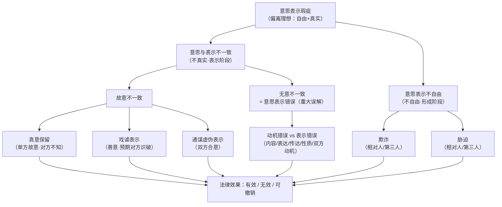
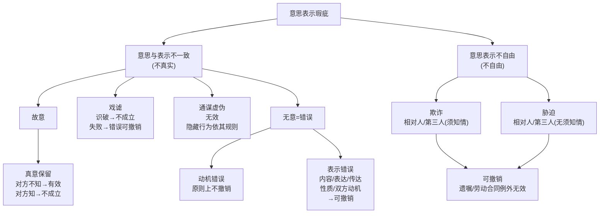

> [!quote] YOU

开始

> [!abstract] PI

今天想怎么学？

**上次进度**：第九章「法律行为与意思表示的一般原理」已讲完第一～四节（概念/分类、意思表示构成、发出与到达、解释），掌握度 ⭐⭐。**下次待讲**：第五节「意思与表示不一致」、第六节「意思表示不自由」。

**复习队列**：有 **7 项今天全部到期**（昨天课上的记忆类节点 + 6 道错题：行为意思/表示意识、身体强制 vs 胁迫、对话/非对话到达、悬赏广告、意思实现、误载无害真意、格式条款解释）——建议今天先清一波。

```
今天想怎么学？
1. 继续上课（讲第九章 第五、六节）→ 说"继续"
2. 复习到期的内容 → 说"复习"（7 项到期）
3. 拷问/刷题巩固 → 说"拷问我"或"刷 N 题"
4. 练案例题 → 说"练案例"
（也可以直接说你想干嘛）
```

> [!quote] YOU

继续上课


> [!abstract] PI

已读完教材第五、六节 + 习题册单元九，并链接了本次课笔记。下面是本次课的规划，请过目。

## 本次课规划：第五、六节

**上一课**讲的是"意思表示是什么、怎么发出/到达/解释"（正常态）。**这一课**讲它**出问题**时的样子——即「意思表示瑕疵」。教材把一个总概念切成两大块：

- **不真实**（意思与表示不一致）→ 第五节
- **不自由**（意思表示不自由）→ 第六节

根（无条件真理）只有一个：**意思表示是私法自治的工具，理想状态 = 表意人"自由 + 真实"地处置自己的利益**。一切瑕疵都是偏离这两条。



**教学顺序与 A/B 分类**：

| 节点 | 分类 | 怎么教 |
|---|---|---|
| 瑕疵总框架（自由 vs 真实） | A | 你已有基础，先让你自己切分 |
| 真意保留 vs 戏谑 vs 通谋虚伪 | A | 三个变量（约束意思、相对人是否知悉、是否合意）推导出三种型 |
| 错误：动机 vs 表示 | A | 风险分配原理推导"为什么动机错误原则上不撤销" |
| 第三人欺诈 vs 第三人胁迫 | A | 决定自由受妨害程度不同 → 要件宽严不同 |
| 胁迫违法性（目的/手段/结合） | A | 你已会"身体强制 vs 胁迫"，顺势深化 |
| 法条序号、错误类型清单、性质错误清单 | B | 直接给 + 记忆术 + 写复习队列 |

**这一课量大（两节、知识点密）**，我建议分两次讲完。你看：

1. **这次先讲第五节（意思与表示不一致）**，讲完当场用单元九相关题 quiz 检测；
2. 下次再讲第六节（欺诈、胁迫）。

还是你想**一次把两节都过完**（会比较赶、quiz 少）？点头我就按"先第五节"开讲；或者直接说你的偏好。


> [!quote] YOU

我时间充裕


> [!abstract] PI

好，那这一课我们把第五、六节一次过完。我分段讲，每段讲完当场用单元九的题检测，再往下走。

---

## 一、根：意思表示瑕疵的总框架

先立一个根，它决定下面所有东西挂在哪：

> **意思表示是私法自治的工具。理想状态 = 表意人「自由 + 真实」地处置自己的利益。**[已核实: 教材第九章第五节]

任何"出问题"的意思表示，都是偏离这两条中的一条：

- **不真实** → 表示的内容和内心真意对不上（表示阶段出问题）
- **不自由** → 意思在形成阶段就被外部因素干扰（欺诈、胁迫）

记住这个二分，它是全章的坐标轴。**为什么非要这么切？** 因为两条偏离的**纠错手段不一样**（后面你会看到：不真实→有效/无效/可撤销，不自由→可撤销）。

---

## 二、故意的意思与表示不一致（第五节前半）

"不真实"再分：**故意**还是**无意**。故意的这一族，核心是**表意人明知道自己没有效果意思，却照样作出表示**。里面再分三种，差别只在于三个变量：

| 变量 | 真意保留 | 戏谑表示 | 通谋虚伪表示 |
|---|---|---|---|
| 表意人真想受约束？ | 否（内心保留） | 否 | 否 |
| 表意人预期对方识破？ | **否**（希望对方上当） | **是**（善意开玩笑） | ——（双方串通） |
| 是否双方合意？ | 否（单方） | 否 | **是（通谋）** |

三个变量一填，三种型就出来了：

**① 真意保留（单方虚伪表示）**——表意人内心保留、不希望发生效果，且**预期对方不知**。
- 构成：①存在意思表示；②表示意义与真意背离；③表意人知道背离；④认为他人不知其真意。
- 效果：**对方不知 → 有效**（表意人可归责性高，为保护信赖）；**对方知道 → 本书观点：意思表示不成立**（自然解释，表意符号欠缺效果意义）→ 法律行为不成立。教材特别点出：这与传统通说（对方知道则"无效"）表述不同，但结论都指向"不发生效力"。

**② 戏谑表示（善意戏谑）**——开玩笑、吹牛、赌气，**预期对方能识破**。
- 对方识破 → 不成立意思表示（无效果意义）。
- 对方**没识破**（戏谑失败）→ 依规范性解释，意思表示成立，但定性为**欠缺表示意识且可归责**（≈错误），表意人**可撤销**。教材强调：戏谑表示**不需要专门规定**，要么不成立、要么按错误处理。

**③ 通谋虚伪表示**——**双方合意**都不当真（虚伪性合意）。
- 构成：①表示与真意不一致；②表意人与受领人**一致认为表示内容不应发生效力**（这是"通谋"的真义——不只是对方知道，还要**同意**）。
- 效果：虚伪行为**无效**（§146 Ⅰ）；**隐藏行为**依其自身规则判断（§146 Ⅱ），若系脱法行为则依 §153 Ⅰ 无效。
- 关键：§146 只适用于**有相对人**的意思表示（遗嘱、动产所有权抛弃不适用）。

一个高频混淆点，先钉死：**通谋 vs 真意保留** 的分界，不在"对方知不知道"，而在"对方是否**同意**"。对方知道你假、但他不配合你，你仍是真意保留；双方串通好，才是通谋虚伪。

---

先测一个，看三分是不是真装进脑子了。用单元九多选 9：


> [!question] Quiz
> 某教授主持读书会，在间歇时段与学员闲聊过程中欣然表示，愿意以五折价格向每位学员出售一本自己签名的新著《民法总论》，学员们鼓掌称好，表示十分期待。实际上，该教授当时只想开个玩笑，活跃气氛。下列选项错误的是（ ）
>
> 1. 教授的言语构成真意保留
> 2. 教授有权撤销合同
> 3. 由于学员们对教授的言语产生信赖，所以该言语成立一项意思表示
> 4. 教授与学员们之间存在通谋虚伪表示


> [!failure] Quiz — incorrect ✗
> Your answer: 4. 教授与学员们之间存在通谋虚伪表示
> Correct answer: 1, 4
>
> Note: 这怎么会是戏谑表示呢？教授给每个人送书都是很有可能的，毕竟是自己的书。现在只是五折卖书，他也不是开玩笑，
>
> 这是典型的戏谑表示（善意戏谑）：教授只想开玩笑、预期大家能识破，不是真意保留（真意保留是希望对方上当），也没有与学员通谋（通谋虚伪要求双方合意不当真）。教授"戏谑失败"——学员当真、产生信赖，依规范性解释意思表示成立，但属可归责的错误，教授享有撤销权。所以"构成真意保留""存在通谋虚伪表示"两项说法错误。


> [!abstract] PI

先解决你 note 里那个真问题——**"凭什么说他是开玩笑？"** 这里有个读题纪律要先立起来：

> 题干已经**明文给定**"实际上，该教授当时只想开个玩笑，活跃气氛"。这是题目交给你的**法律事实**，你必须照单全收，不能用"教授送书/卖书很常见"的生活经验去**反证**它。法学做题（尤其考研），第一纪律就是**以题目给定事实为准**，给定"开玩笑"就是开玩笑。

那这几种型到底怎么从题干**识别**？记住两把钥匙：

**钥匙一：表意人预期对方识破吗？——分「真意保留」和「戏谑」**
- 真意保留 = **恶意**：他希望对方**上当**、误以为真。
- 戏谑表示 = **善意**：他预期对方**能识破**，纯粹活跃气氛。

题干"只想开个玩笑，**活跃气氛**"——活跃气氛的前提恰恰是"大家知道是玩笑、不会当真"，这就是"预期对方识破"，所以是**戏谑**，不是真意保留。真意保留是"憋着坏想骗你信"，题目里没有任何这种意图。

**钥匙二：对方同意了吗？——分「通谋」和「单方」**
- 通谋虚伪 = 双方**串通**：都明知假、都同意不当真。
- 学员的反应是"鼓掌称好、表示期待"——他们是**当真/凑热闹**，不是跟教授合谋假卖。没串通，就不构成通谋虚伪。

再看一个教材案例，正好卡在这个区分上（教学案例 1）：甲公司把价值 1.5 万的热水器标成 **1 元**，本意是**刷单造假销量**，由员工找"客户"下单。结果乙误打误撞真下单买了 4 台、付了 4 元。甲公司误以为乙是它事先联系的刷单同伙——**它以为在通谋，实际通谋失败**。

教材结论：通谋失败 → 按**戏谑表示**处理（表意人预期对方能识破，属善意戏谑），**不是真意保留**。甲公司可主张重大误解（错误）撤销，但合同先成立。

这跟你错的那题是同一个逻辑链：**"以为串通"=通谋失败→戏谑；"希望骗你信"=真意保留；"真串通"=通谋虚伪**。

这个点我记进错题档案。先往下走，后面用单选 19 再回头验你一次。

---

## 三、无意的意思与表示不一致：意思表示错误（重大误解）

"不真实"的第二支是**无意**的——表意人不是故意说错，而是**认识/操作出了偏差**。这就是《民法典》第 147 条"重大误解"（教材认为叫"意思表示错误"更准，因为"误解"在字面上涵盖不了"笔误、误点"这类纯操作失误）。

**构成要件**（四个，要记）：
1. 存在一项意思表示；
2. 表示内容与表意人的意思不一致（**先解释、后判断错误**——这是流程纪律）；
3. 表意人**非故意**导致不一致（故意就落入虚伪表示那一族了）；
4. 不一致**具有显著性**（轻微偏差不撤销，否则交易安全无从保障）。

**最核心的分界：动机错误 vs 表示错误**（这是 A 类，你要懂**为什么**）：

- **动机错误** = 意思**形成**阶段的错（"我为什么买"想错了）→ **原则上不撤销**。
- **表示错误** = 意思**表达**阶段的错（"我要的表达成别的了"）→ **可撤销**。

**为什么动机错误原则上不撤销？** 一句话：**风险分配**。动机是表意人内心私事，相对人通常无从知晓、也不该替你承担它的风险。若随便一个"我买亏了、我记错了自己资金"都能撤，合同就形同儿戏，交易安全没了。

**表示错误再往下分四型**（这是 B 类，直接给 + 记）：

| 类型 | 一句话 | 例子 |
|---|---|---|
| 内容错误 | 用对了符号、但**理解错了**它的意义 | 以为"301房"是自己想买的302房（标的物同一性错误） |
| 表达错误 | **用错了符号**（操作失误） | 多写一个零、误点商品B、说错话 |
| 传达错误 | 传达人传错了（**代理人错误不算**） | 托乙传话，乙记错传给丁 |
| 性质错误 | 交易上重要的**人资格/物性质**认识错（本质是动机错误，但**例外**给撤销权） | 以为二手车没出过事故、以为合伙人信用良好 |

**记忆锚点**：动机/表示是**阶段**之分；内容/表达/传达是**表示错误内部的形态**之分；性质错误是"披着表示外衣的动机错误"被特别捞回来。

再补两个**常考的例外型**（双方动机错误 → 可撤销；签名/计算/法律后果错误 → 分情形）。

到这里先收一下，用教材的教学案例 3 做个即时判断：甲看房时想买 **302 房**，签合同时记忆混淆写成"301 房"——这是什么错误？能撤销吗？（你先自己答一句，我核对后进欺诈部分）


> [!quote] YOU

内容错误（表示错误）  可撤销


> [!abstract] PI

对。**内容错误（标的物同一性错误）**——甲是"用对了符号、理解错了意义"（以为 301 = 302），不是操作失误，属表示错误，**可撤销**。正确。

---

## 四、意思表示不自由之一：欺诈（第六节前半）

现在换到"不自由"这一支。欺诈 = **用虚构或隐瞒，让对方陷错、基于错误作出表示**。

**相对人欺诈的三个构成要件**（简答题高频，必须能完整复述）：

1. **存在欺诈行为**
   - **积极欺诈**：故意告知虚假情况（捏造、夸大、淡化不利）。
   - **消极欺诈（沉默欺诈）**：故意隐瞒真实情况——**以有告知义务为前提**（法律明文，或依诚信/交易习惯）。记住：**不是凡事都要主动说**。
   - 补充：告知义务成立要满足"该因素影响决策 + 相对人知其重要性 + 不违法背俗 + 诚信/习惯要求告知"（四个条件）。

2. **因果关系**：欺诈行为 → 陷于/维持/加深错误 → 基于错误作出意思表示。缺一环就不是欺诈。例：网店吹"三天一度电"，但你其实是冲着特惠价买的——宣传和你下单之间没因果，不构成欺诈。

3. **故意**：三个细化点，都是考点——
   - **过失不构成欺诈**（过失误导只能走"错误"或"缔约过失"）；
   - **好意欺诈仍构成欺诈**（欺诈保护的是"决定自由"，不看动机善不善）；
   - **"合法欺诈"不构成**（如雇主问不正当问题，应聘者有权"撒谎"，这叫**撒谎权**）。

**第三人欺诈**——多一个特别要件：

> **相对人知道或应当知道第三人欺诈**，才能撤销。

为什么比第三人胁迫多这个门槛？因为欺诈时表意人仍有较大决定自由、且可能自己疏于查证（有可归责性）；而胁迫时表意人几乎完全不可归责、决定自由被严重剥夺。**这个"宽严不同"是 A 类，你要能说出理由**。

**"第三人"的范围**（关键）：代理相对人阵营的人**不算**第三人——相对人的**代理人、雇员、交易辅助人**（谈判助手）、**产品广告代言人**，其欺诈**等同于相对人自己欺诈**。真正的第三人例：**中介人**、**主债务人**（欺诈担保人）。

**法律效果**：相对人欺诈与第三人欺诈 → 法律行为**可撤销**，撤销权归受欺诈方。特别法例外：受欺诈所立**遗嘱无效**（§1143 Ⅱ）、欺诈订立的**劳动合同无效**、经营者欺诈**三倍赔偿**（《消保法》§55）、投保人故意不实告知→保险人**解除权**（《保险法》§16 Ⅱ）。

---

用单元九的单选 20 验一下欺诈 + 动机错误的辨析：


> [!question] Quiz
> 小慕逛服装店，跟售货员说"那件皮衣我试一下"，售货员知道那件衣服的材质并非皮料，而是革料，但觉得此种高级革料并不逊色于皮料，故未加纠正。小慕购买这件衣服后，发现其并非皮衣，打算退货。下列选项错误的是（ ）
>
> 1. 小慕无权退货，因为服装标签上的材质栏目写的本来就是'革'，货物没有瑕疵
> 2. 小慕在订立合同过程中陷入动机错误
> 3. 售货员的行为违背诚信原则
> 4. 售货员的行为构成欺诈


> [!success] Quiz — correct ✓
> Your answer: 1. 小慕无权退货，因为服装标签上的材质栏目写的本来就是'革'，货物没有瑕疵
> Correct answer: 1
>
> 售货员明知小慕误以为是"皮衣"，却不纠正，而小慕正是基于"这是皮衣"的错误认识才决定购买——售货员对交易上重要的事项负有告知义务却保持沉默，构成消极欺诈（沉默欺诈），小慕可撤销合同（退货）。"标签写的是'革'所以无瑕疵"的说法错在：标签本身只是货物的客观记载，不能抹去售货员在缔约中的欺诈行为。小慕的"以为是皮衣"属于意思形成阶段的动机错误，但该动机错误正是欺诈所致，所以仍可依欺诈撤销。


> [!abstract] PI

答对了。注意它同时踩中一个考点：小慕的"以为是皮衣"**本身是动机错误**（意思形成阶段），但因为是**欺诈所致**，所以走欺诈可撤销——这正是"动机错误原则上不撤销"的例外之一。

---

## 五、意思表示不自由之二：胁迫（第六节后半）

胁迫 = **表示施加不利益，迫使对方作出违背真意的意思表示**。

**四个构成要件**：

1. **存在胁迫行为**——先钉死一个上一课的易错点：
   - **身体强制**（抓住你的手摁指印）＝**欠缺行为意思**，意思表示**不成立**，合同**不成立**（不是可撤销）。
   - **胁迫**＝**心理强制**：外力作用在**心理**上，你仍有选择、但被迫"两害相权取其轻"。合同**可撤销**。
   - 但胁迫**不意味着没用暴力**——先打一顿让你害怕、再逼你签字，仍是胁迫（"继续打"是默示的胁迫表示）。

2. **胁迫具有违法性**——三选一（这是 A 类，考"为什么违法"）：
   - **目的违法/不正当**：逼你做违法事；或追求**无请求权**的利益（拾得人索要远超必要费用的酬金）。
   - **手段违法**：以打人、非法拘禁、**违约**（"不照办不让上岗"）相威胁。
   - **目的与手段结合不正当**：目的正当、手段也正当，但**拿这个手段去换这个目的不适宜**。典型：公安机关以"继续采取强制措施"逼嫌疑人订还款协议——职权是用来侦查的，不能拿来逼签民事合同。

3. **因果关系**：胁迫 → 恐惧 → 作出表示。判定采**主观主义**（以表意人视角）：只要表意人自己觉得够严重、心生恐惧即可，哪怕别人觉得是鸡毛蒜皮（甚至巫蛊恐吓）。但小事要挟**难以证明**因果关系。

4. **故意**：胁迫人有意施加不利益、希望对方被迫表示。

**第三人胁迫**——与第三人欺诈形成鲜明对比，必须记住这个不对称：

> **第三人胁迫 → 可撤销，不要求相对人知情。**

为什么？被胁迫时表意人**几乎不可归责、决定自由被严重剥夺**，更值得保护；被欺诈时表意人自己可能疏于查证。**这是两组规则里最常考的对比点。**

**法律效果**：可撤销；受胁迫所立**遗嘱无效**（§1143 Ⅱ）、胁迫订立的**劳动合同无效**；若被胁迫且对价**明显失衡**，还可能同时构成**显失公平**（撤销权竞合）。

---

用单元九多选 13 收一下胁迫：


> [!question] Quiz
> 下列关于胁迫的选项正确的是（ ）
>
> 1. 第三人胁迫与第三人欺诈的效果有所不同
> 2. 受胁迫的法律行为一律可撤销
> 3. 第三人胁迫导致法律行为可撤销，不取决于相对人是否知情
> 4. 以正当手段相要挟的，不构成胁迫


> [!failure] Quiz — incorrect ✗
> Your answer: 1. 第三人胁迫与第三人欺诈的效果有所不同, 2. 受胁迫的法律行为一律可撤销, 3. 第三人胁迫导致法律行为可撤销，不取决于相对人是否知情
> Correct answer: 1, 3
>
> 第三人胁迫不要求相对人知情即可撤销，而第三人欺诈须相对人知道或应当知道才能撤销——两者效果不同，所以这两项正确。错的两项：受胁迫的法律行为并非"一律"可撤销（受胁迫所立遗嘱无效、胁迫订立的劳动合同无效）；"以正当手段相要挟的不构成胁迫"也错，因为目的与手段的结合可能不正当（如公安机关以继续采取强制措施逼订还款协议），此时正当手段也能构成违法胁迫。


> [!abstract] PI

这一题你抓对了两个核心对比，但**多勾了「一律可撤销」**——这正是这题埋的雷，也是我要你养成的反射：

> **看到「一律 / 所有 / 一切 / 均」这种全称限定词，先问一句：有没有特别法例外？**

受胁迫的法律行为**并非一律可撤销**，有两条特别法把它改成**无效**：

- 受胁迫（以及受欺诈）所立的**遗嘱 → 无效**（§1143 Ⅱ）；
- 胁迫（以及欺诈）订立的**劳动合同 → 无效**（《劳动合同法》§26 Ⅰ）。

你记住一个总规律：**一般规则给「可撤销」（把选择权留给被侵害方），但遗嘱、劳动合同这两个特殊领域立法者直接判「无效」**——遗嘱因为人已死、无法再行使撤销权；劳动合同因为涉及人身依附、要倾斜保护劳动者。这个「可撤销 vs 无效」的落差，是全章最细的 B 类记忆点，我写进复习队列。

（顺带：同一题的「以正当手段相要挟的不构成胁迫」也是错的——目的与手段的**结合**可能不正当，刚才公安机关逼订还款协议就是。）

---

## 六、收束：一张图回顾整课



**一句话塌缩**：瑕疵要么「不真实」、要么「不自由」。不真实看**故意与否**——故意的三种型靠「善意/恶意、是否通谋」两把钥匙区分；无意的错误靠「动机/表示」二分。不自由看**欺诈/胁迫**，两者在「第三人是否须知情」上正好相反。所有瑕疵的出口无非三扇门：**有效、无效、可撤销**。

现在我把进度、错题、复习队列写进文件。


> [!abstract] PI

进度已归档（`课程进度.md` + `进程树.md` 已更新，笔记已实时镜像到 `notes/民法总论/第九章/2026-09-30-意思与表示不一致与意思表示不自由.md`）。

## 本次课小结

- **第九章全部六节讲完** ✅，全章掌握度 ⭐⭐。
- 今天新错 2 道（戏谑/真意保留/通谋识别、受胁迫"一律可撤销"的特别法例外），已记入错题档案。
- 复习队列从 7 项涨到 **14 项**，全部明天到期。

## 下一步（你挑）

1. **巩固第九章** → 说"**拷问我**"（drill 模式刷第九章）或"**练案例**"（单元九有 2 个案例，正好覆盖通谋虚伪、意思实现、欺诈、无权处分这些点）
2. **清复习队列** → 说"**复习**"（14 项到期）
3. **开新课** → 说"**学第十章**"（法律行为的成立与生效）

你时间充裕，我建议先"拷问第九章"——今天信息量很大，趁热打铁错题才会固化。你想怎么走？
