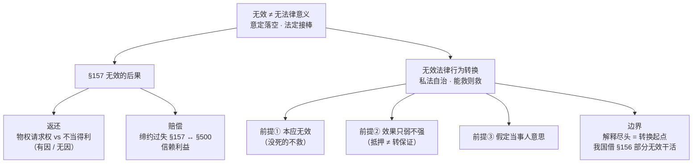

> [!quote] YOU

继续

> [!abstract] PI

收到，接着上次的位置走。上次停在第 2 步（无效事由）完成，今天进入**第十一章·第 3 步：无效法律行为转换 ＋ 无效后果（第157条）**，配刘家安第 18 讲「六、无效的后果」的后半段。

这一步的两块内容，正好是"无效"这条主线的收尾：

1. **无效法律行为转换**——无效了还能"起死回生"吗？（概念、三个前提、与解释/部分无效的边界）
2. **法律行为无效的后果**——第157条 的返还与赔偿（物权请求权 vs 不当得利 vs 缔约过失）

这两块都会挂回你第 1 步已经吃透的地基上：**"无效 ≠ 无法律意义"**（意定效果落空，法定效果接棒）。

在开讲之前，先把上次留的微任务收一下（顺带激活第 2 步）：

> 上次微任务：给不懂法的朋友讲清「路边无证摆摊卖水果的合同 **有效** vs 没律师证以律师身份接案子的合同 **无效**」——用「规范管的是什么」这把尺子，两三句话。

你直接在对话里打字交作业即可。交完（或说"跳过"）我们就进第 3 步。

> [!quote] YOU

卖水果管的是行为地点，无证律师管的是当事人资格

> [!abstract] PI

两点全中——「规范管的是什么」这把尺子你抓到了：

- **无证摆摊**：管的是「在哪卖」（行为地点/外部条件），不碰交易本身 → 合同照常有效；
- **无证律师**：管的是「谁来提供专业服务」（职业资格），目的是防止当事人接受不合格服务 → 合同无效。

补一个细节，让这条尺子更利：职业资格那一格，规范真正保护的**不是**律师协会的面子，而是「顾客会因服务者不合格而受害」——所以才会去否定合同效力。地点那格，城管罚摊贩就够了，犯不着连累买草莓的老太太。

微任务通过 ✅。现在进第 3 步。先让我把习题册里跟「转换」「无效后果」相关的题摸一遍，好随堂检测用。

> [!abstract] PI

好，进第 3 步第一块：**法律行为无效的后果（第157条）**。

先踩回地基——第 1 步你吃透的那句：**无效 ≠ 无法律意义**，意定效果落空、法定效果接棒。今天这一节，就是把"法定效果"到底长什么样、由哪些请求权接棒，讲清楚。

**教材第十一章·六（一）概述**：「法律行为无效、被撤销或者确定不发生效力，虽然不能发生当事人预期的权利义务关系，但当事人可能已经作出给付，受领给付的一方当事人需要将该给付或者其价值返还给付方。此外，法律行为无效还可能使当事人遭受损失，由此发生损害赔偿责任。《民法典》第157条规定了此类返还义务与损害赔偿责任，处理法律行为无效的善后事宜。」

这里停一下，盯住一个词——**「确定不发生效力」**。刘家安把它点破成一个上位概念：无效、被撤销、效力待定未被追认，这三种情况最后都归于「确定不生效」。效力状态的终局二分只有两格：**确定生效 / 确定不生效**——可撤销、效力待定都只是通往这两个终局的中转站。第157条 里"确定不发生效力"这几个字，就是把三个中转站全收进来。

第157条 条文 [已核实: kb/laws/民法典.md]：

**《民法典》第157条**：「民事法律行为无效、被撤销或者确定不发生效力后，行为人因该行为取得的财产，应当予以返还；不能返还或者没有必要返还的，应当折价补偿。有过错的一方应当赔偿对方由此所受到的损失；各方都有过错的，应当各自承担相应的责任。法律另有规定的，依照其规定。」

白话一句：无效后，**吃进去的要吐出来（返还/折价补偿），闯祸的要赔（赔偿）**。三种请求权对应——返还、折价补偿、赔偿。先啃返还这块最硬的骨头。

---

## 返还的请求权性质：物权请求权 vs 不当得利（本步第一个难点）

**教材第十一章·六（二）**：「以让与物权为给付内容的法律行为无效的，如果物权让与行为已经实施完毕，发生何种法律后果，取决于民法上采用何种物权变动规范模式。如果民法采用物权行为无因原则，仅负担行为无效，处分行为有效的，受让人取得物权，让与人只能向受让人请求返还不当得利……反之，如果民法不采用物权行为无因原则，法律行为无效的，受让人未取得物权，让与人仍然是物权人。」

这段话的命门，全押在**物权变动模式**上。你第十章栽过跟头的「物债二分」，现在派上大用场：

- 负担行为（买卖合同 = 欠债）→ 处分行为（交付/登记 = 转移物权）
- **无因原则**（德国）：处分行为效力独立于负担行为。买卖合同无效，交付照样有效 → 受让人**拿到了**所有权 → 出卖人只能要回"物权"本身（不当得利，请他再转回来）
- **有因原则（我国通说）**：负担行为无效，处分行为跟着无效 → 受让人**没拿到**所有权 → 出卖人还是所有权人 → 享有**所有物返还请求权**（物权请求权）

**教材第十一章·六（二）**：「我国民法未规定物权行为无因原则，学界通说认为我国民法未采用物权行为无因原则。据此，以让与物权为给付内容的法律行为无效的，如果已经交付标的物且该标的物依然存在，让与人对受让人享有的返还请求权在性质上是物权请求权。」

我国的标准答案：**无效 + 标的物还在 → 物权请求权（所有物返还请求权）**。

刘家安把这个再往下挖一层（第 18 讲【例 6】【例 7】），同一个事实、三种请求权主张：

- 【例6】甲依合同把 A 物交付乙，合同后被撤销/无效，甲要回 A 物基于什么？①物权请求权（甲从没丧失所有权）；②不当得利请求权；③第157条 专门规定的特定债权请求权。
- 【例7】接上，乙是企业、拿到 A 物后破产。甲若只是不当得利（债权请求权），就得和其他债权人**排队**；但若 A 物还是甲的（物权请求权），甲可行使**破产取回权**，直接把东西拎走、不排队。结论不重要，这个追问逼你想清一件事：**货到底还是不是甲的**。

什么时候才轮到不当得利？**教材第十一章·六（三）**：不能原状返还的情形——提供劳务、容忍对方使用标的物、支付金钱、交付的动产已被消费。这些"吃了吐不出来"的，只能折价/返还不当得利。

来，测这个节点：

> [!question] Quiz
> 辨析（判断对错）：在法律行为无效情形中，不发生物权请求权。
>
> 1. 正确
> 2. 错误

> [!success] Quiz — correct ✓
> Your answer: 2. 错误
> Correct answer: 2
>
> 这个说法一刀切了，错就错在漏了「物权变动模式」这个前提。
>
> 「正确」这一面错在：它假设无效就一定不产生物权请求权。但请求权性质取决于采用哪种物权变动模式。我国不采物权行为无因原则（通说），负担行为（如买卖合同）无效会连累处分行为（交付/登记）也无效，受让人自始没取得物权，让与人仍是所有权人——此时发生的恰恰是物权请求权（所有物返还请求权）。
>
> 「错误」才是本题结论：只有在采无因原则、且仅负担行为无效（处分行为仍有效）时，受让人才取得物权，此时让与人不能主张物权请求权、只能主张不当得利返还请求权。所以「无效情形中是否发生物权请求权」没有统一答案，须看物权变动模式。

> [!abstract] PI

✓ 判对了。这个节点你抓得准——请求权性质是「跟着物权变动模式走」的，不是跟着「是否无效」走的。

现在补上复述闭环（quiz 测的是再认，复述测的是回忆）：

> 用一句话说：无效的买卖合同里，卖方把货交付了、货也还在买方手里——卖方凭什么能把货要回来？

答完这句，我们进第二块（缔约过失 + 无效法律行为转换）。

> [!quote] YOU

1.若承认物权无因，物债二分，则负担行为无效不影响处分行为生效，只能请求不当得利。但如果不承认物权无因性，负担行为无效所以处分行为无效，物权变动不生效，采取物权请求权

> [!abstract] PI

复述到位 ✅。两个分支你都走对了：无因 → 负担行为无效不影响处分行为 → 只能不当得利；有因（我国）→ 处分行为跟着无效 → 物权请求权。

但有一处要给你扳正——你把「物债二分」和「物权无因」并排放在一起了。这两个是**两个层次**，不能混：

- **物债二分**（区分负担行为/处分行为）——我国也承认，这是讨论物权变动模式的地基；
- **无因性**（处分行为的效力独立于负担行为）——我国**不**承认这个。

关键句：**承认物债二分 ≠ 承认无因性**。我国是「物债二分 + 有因原则」的组合。这个区分你第十章栽过，今天正好借着返还请求权再焊一遍。

**核心钩子（15 字内）**：`有因要原物，无因要不当得利`——有因时让与人还是物权人，直接要"原物"（物权请求权）；无因时货已归受让人，只能要"价值"（不当得利）。

---

## 无效后果的最后一笔：缔约过失（§157 第 2 句）

返还之外，§157 还有第二项义务——赔偿。

**教材第十一章·六（四）**：「依据《民法典》第157条第2句之规定，法律行为无效的，有过错的一方应当赔偿对方由此所受到的损失。此处损害赔偿责任包括缔约过失责任……《民法典》第157条第2句仅适用于法律行为无效之情形。因此，就缔约过失责任而言，《民法典》第157条第2句与《民法典》第500条是特别法与一般法的关系。」

三个点记牢（这个节点习题册没对应题，讲清楚即可）：

1. **§157 第 2 句（特别法）** 只管「法律行为无效」；**§500（一般法）** 还管合同不成立、甚至合同有效。谁范围窄谁是特别法。
2. 赔的是**信赖利益**（缔约费用、履约费用），不是履行利益。刘家安 + 《九民纪要》32 条：缔约过失责任**不超过履行利益**。
3. §157 还多干一件 §500 干不了的活——**单方法律行为无效**的赔偿（教材例子：解除权行使时重大误解，解除错了合同，对方重新准备履行产生的额外费用）。

---

## 第二块：无效法律行为转换（本步的"起死回生"术）

**教材第十一章·五（一）概念**：「所谓无效法律行为转换是指一项无效法律行为符合另一项有效法律行为的要件，使其发生后者之效力。之所以如此，是因为第一项法律行为的预期效果在范围上包含了第二项法律行为(替代行为)的效果，导致第一项法律行为无效的恰恰是其超出第二项法律行为的那部分预期效果。」

「如果去除这部分预期效果，则第一项法律行为即被缩减为第二项法律行为，在不违背各方当事人假想意思的前提下，按照缩减后的法律行为发生法律效果，对于公共利益与私人利益均无害处。」

先问你一个推导题（A 类，别急）：**转换为什么能"救活"一个无效行为？** 线索藏在上面两句话里——"导致无效的恰恰是**超出替代行为的那部分**效果"。

你先试着用自己的话答这一句，我再往下给三个前提。

> [!quote] YOU

因为法律不想让这个行为完全无效，只要否认超出替代行为那部分即可

> [!abstract] PI

对，抓到了。再把"法律不想"背后的理由补一层，让这条推导完整：

**私法自治**。无效行为的效果里**已经包含**了替代行为的效果——当事人想进入替代行为的那份意思，本来就在原行为里。砍掉"超出部分"，**没往当事人意思里添任何东西**，只是保全了当事人真实想要的那部分。所以转换不是法律越俎代庖，恰恰是**尊重当事人剩余的真实意思**。刘家安的原话更直白：「对于法律行为的效力，**能挽救的就挽救**。」

这条私法自治的主线，直接长出三个前提——三个前提没有一个是"死记的规则"，全是"私法自治"推出来的：

**前提① 系争行为本应无效。**
**教材第十一章·五（二）**：「……但不包括可撤销而尚未被撤销的法律行为以及尚处于效力待定状态的法律行为。因为无效法律行为转换旨在使法律行为'起死回生'，可撤销与效力待定法律行为尚未'死亡'，自然无须'回生'。」
——关键词「起死回生」：还没死的（可撤销、效力待定），人家自己有自己的救济通道（撤销、追认），轮不到转换出手。

**前提② 替代行为的效果不能强于原行为（只能"弱于"）。**
**教材第十一章·五（二）**：「第二个前提是替代行为在效果上不能超越无效法律行为拟发生之效果，即前者的效果应当弱于后者的效果。」
——还是私法自治：转换不能给当事人**加义务**，只能"扣减"。最经典的翻车案例是最高法 (2015)民申字第2354号：**未经登记的抵押合同被转换成连带责任保证**——判错了。因为抵押是**物保**（只拿那套房担责，有限责任），保证是**人保**（拿保证人全部财产担责，无限责任）。保证责任**并不轻于**抵押责任，转换反而给当事人加了负担，违反前提②。

**前提③ 假定当事人意思（主观要件）。**
**教材第十一章·五（二）**：「第三个前提是：假如各方当事人在缔结法律行为时知道原定法律行为无效，则其应该愿意缔结替代行为并使其发生效力。此项假定意思可以说是无效法律行为转换的主观要件，它确保了转换之后发生的法律效果依然符合私法自治原则。」
——最后一道保险：即便前两条都过，还得问一句"当事人要是早知道无效，还愿不愿意退而求其次？"愿意，才转。

三个前提测一道（这题正是 (2015)民申字第2354号那个坑）：

> [!question] Quiz
> 甲与乙订立借款合同，约定甲将200万元钱借给乙。同时，丙与甲订立抵押合同，约定丙将一套房屋抵押给甲，担保甲对乙的借款债权。丙将房产证交给了甲，但一直未办理抵押登记。下列选项正确的是()
>
> 1. 抵押合同虽无效，但可以转换为连带责任保证合同
> 2. 抵押合同因未办理抵押登记而不生效
> 3. 甲未取得房屋抵押权
> 4. 抵押合同因未办理抵押登记而不成立

> [!failure] Quiz — incorrect ✗
> Your answer: 2. 抵押合同因未办理抵押登记而不生效
> Correct answer: 3
>
> 逐项看：
>
> 「抵押合同因未办理抵押登记而不成立」错——抵押合同是负担行为，成立只需双方意思表示合致，登记不是成立要件。
>
> 「抵押合同因未办理抵押登记而不生效」错——登记是抵押权（物权）的设立要件，不是抵押合同（债）的生效要件。未登记，抵押合同本身仍有效，只是抵押权没设立。这一项和第 10 章讲过的「质押合同 vs 质权」是同一个物债二分逻辑。
>
> 「抵押合同虽无效，但可转换为连带责任保证合同」错——这是本题最关键的干扰项，考无效法律行为转换。一方面，未登记的抵押合同并非确定无效；另一方面，即便无效，也不能转换为保证：保证是人保（以全部财产承担无限责任），抵押是物保（仅以特定财产承担有限责任），保证责任并不轻于抵押责任，转换会给当事人加负担，违反「替代行为效果不能强于原行为」这一前提。
>
> 「甲未取得房屋抵押权」对——抵押权以登记设立，未办理抵押登记，甲未取得抵押权，只是对丙享有请求办理登记的债权。

> [!abstract] PI

✗ 这一选暴露了一个**老雷**，得当场拆掉。

你选「抵押合同因未办理抵押登记而不生效」——问题出在：你把「登记」挂错了对象。这是**物债二分**那颗雷，第 10 章你栽过两次（「质押合同 vs 质权」「无权处分买卖合同有效」），今天又冒头了，正好借机焊死。

**同一个物债二分，换个马甲：**

| | 抵押合同（负担行为＝债） | 抵押权（处分行为＝物权） |
|---|---|---|
| 是什么 | 丙承诺「我拿这套房给你担保」，**创设义务** | 甲对这套房的**优先受偿权** |
| 成立/生效靠什么 | 双方意思合致即可 | **登记**（公示） |
| 没登记的后果 | 合同**照样有效** | 抵押权**根本没设立** |

关键句：**合同要合意，物权要公示**。「登记」是抵押权（物权）的设立要件，它管的是"甲有没有拿到那个物权"，**根本不碰**抵押合同（债）的生灭。

所以这道题的正确链条是：丙只签了抵押合同、没登记 → 抵押合同**有效**（A、B 都错），但抵押权**没设立**（D 对）→ 甲现在手上只有一份「请求丙去办登记」的**债权**，不是抵押权。C 也错，因为合同根本没死，谈不上"转换"；而且抵押也转不成保证（责任更重）。

**记忆锚点**：`合同要合意，物权要公示`——公示（登记/交付）只生"物权"，不动"合同"。

当场重测（换个场景，口头答，别查）：

> 甲把一辆车质押给乙，两人只签了质押合同、**没交付车**。乙现在手里有什么？

答完这句，我们再收尾「转换 vs 解释 vs 部分无效」。

> [!quote] YOU

质权请求权？

> [!abstract] PI

✗ 这词本身就自相矛盾——先把它拆开。「质权请求权」的隐含前提是"质权已经存在"。可质权**还没出生**，哪来的质权请求权？

听起来像在猜。别猜，把规则先摆出来，再套。

**质押是三层，别混：**

1. **质押合同（债）**——双方说好"我拿这车给你担保"，意思合致 → **有效**。它只给乙一个**债权**：请求甲把车交过来。
2. **质权（物权）**——《民法典》第429条 [已核实: kb/laws/民法典.md]：「质权自出质人交付质押财产时设立。」**交付 = 设立**，没交付 = 没设立。
3. 所以乙现在手里：**只有债权**（请求甲交付车），**没有质权**，更谈不上"质权请求权"。

一句话钉死：**签合同 ≠ 拿物权，物权要靠交付/登记来"生"**。合同生"债"，公示（交付/登记）生"物"。

再测一次，这次换个最直接的问题：

> 乙想让这辆车上真的挂上质权，他下一步必须做什么？

> [!quote] YOU

让甲交付车

> [!abstract] PI

✓ 对了。**交付**是质权的"出生证"——没交付，合同再漂亮也只有债权；交付了，质权才落地。这个「合同生债、公示生物」的分界，你刚才绕了两下，现在稳了。收尾时我会把它记进复习队列（物债二分今天第 3 次冒头，得重点盯）。

---

## 最后一块：转换 vs 解释 vs 部分无效

转换不是孤立的招，它和两样东西挨着，边界要分清。

**① 转换 vs 解释**（教材第十一章·五（三）1）：
「无效法律行为转换以意思表示解释为前提，只有先通过解释确定法律行为的内容，才能判断其是否无效，进而决定可否进行转换。解释与转换分属于两个阶段，**解释的尽头就是转换的起点**。」

——先解释（搞清当事人到底说了什么），解释完发现"这内容无效"，才轮到转换（能不能砍成有效的替代行为）。顺序不能倒。

**② 转换 vs 部分无效**（教材第十一章·五（三）2）：
「无效法律行为转换与法律行为部分无效也存在交叉之处。无效法律行为转换意味着对拟发生的法律效果予以'扣减'，使其发生较弱的法律效果。此种'扣减'有时也可以借助于法律行为部分无效规则实现。」

——两者是**同一把"扣减"刀**，只是出刀角度不同：转换说"把它当作另一个较弱的有效行为"，部分无效说"把超出的那部分判无效、剩下的照旧"。教材给的例子是**股权让与担保**：约定"逾期不还，股权终局归属债权人、无须清算"——这既可以**转换**成股权质押，也可以用 §156 **部分无效**（只判流担保条款无效）。**经济效果大同小异**。

关键落点（学硕考点）：**我国《民法典》没有明文规定"转换"**，所以实践里，法院常常**借用部分无效规则**来干转换的活。这是"转换"在我国的生存状态。

测这个交叉点：

> [!question] Quiz
> 甲公司与乙公司订立借款合同，约定甲公司将1000万元自有资金借给乙公司，年利率10%，期限1年。同时，丙与甲公司订立担保合同，约定丙将其持有的丁公司15%股权转让给甲公司，担保甲公司对乙公司的借款债权，乙公司届期不还债的，股权直接归属于甲公司，无须对股权价值与债权数额进行清算。下列选项正确的是()
>
> 1. 依据风险自负原则，债务届期时，若股权价值低于债务数额，乙公司无须补足差额
> 2. 甲、丙的担保合同无效
> 3. 甲、丙的担保合同中关于“股权归属于甲公司且无须清算”的条款无效
> 4. 甲、乙的借款合同无效

> [!failure] Quiz — incorrect ✗
> Your answer: 1. 依据风险自负原则，债务届期时，若股权价值低于债务数额，乙公司无须补足差额
> Correct answer: 3
>
> Note: 你没有和我讲过什么是流担保条款
>
> 这是「股权让与担保」，考点是流担保条款的部分无效。
>
> 「甲、丙的担保合同无效」错——并非整体无效，只有流担保条款无效。若判整体无效，反而连当事人想要的那部分担保意思一起杀掉了，违背「能救则救」的思路。
>
> 「甲、丙的担保合同中关于『股权归属于甲公司且无须清算』的条款无效」对——「股权直接归属、无须清算」就是流担保条款（流质条款），依让与担保规则（《九民纪要》71 条、《民法典担保制度解释》68 条）无效。但该条款无效不影响担保合同其余部分的效力，担保权人仍可就股权折价、拍卖、变卖所得价款优先受偿（须清算）。
>
> 「甲、乙的借款合同无效」错——借款合同与担保合同是两个独立的法律行为，主借款合同不因担保条款瑕疵而无效。
>
> 「依据风险自负原则……乙公司无须补足差额」错——乙是主债务人，本来就对全部债务负清偿责任，担保股权价值不足时仍须补足，没有「风险自负」一说。这也印证流担保条款为什么无效：它会架空清算，让债权人多拿、债务人吃亏。

> [!abstract] PI

你这条 note 提得对，是**我漏了**——「流担保条款」这个词我当成你会了，直接扔了出来，没拆。违反了我自己"未掌握术语必须单独立项"的规矩。补上：

## 流担保条款（流押 / 流质）——补课

**定义**：担保合同里约定「债务人到期不还债，**担保财产直接归债权人所有**」，而且**不经清算**（不折价、不拍卖、不变卖，也不把多出来的差额还回去）。

- 在**抵押**场合叫「流押」，在**质押**场合叫「流质」，本题的股权让与担保这种，统称「**流担保**」。

**为什么要否定它**（A 类，能推）：
1. 债务人借钱时通常处于**弱势**，债权人可能趁人之危把担保物压到远低于市价，到期直接把**超值部分**吞掉——暴利；
2. 它**架空清算**。正常担保是「变价 → 优先受偿 → 多退少补」；流担保是「直接拿走，值多少不管」，等于债权人可以多拿、债务人吃亏。

**现行法的处理**（已核实 [kb/laws/民法典.md]）：
**《民法典》第401条**：「抵押权人在债务履行期限届满前，与抵押人约定债务人不履行到期债务时抵押财产归债权人所有的，**只能依法就抵押财产优先受偿**。」
**《民法典》第428条**：「质权人……约定债务人不履行到期债务时质押财产归债权人所有的，**只能依法就质押财产优先受偿**。」

注意措辞——不是笼统说「无效」，而是「**只能依法就担保财产优先受偿**」：即"直接归债权人所有"这一层效果**不发生**，但仍按**清算**规则来（变价、优先受偿）。学理上仍习惯称"流质条款无效"，指的是"直接吞掉担保物"这层无效，**担保本身照常有效**。

---

## 回到本题

丙把股权"转让"给甲，附一句「乙到期不还债，股权**直接归甲、无须清算**」——这句就是**流担保条款**。所以：

- 担保合同**不整体无效**（A 错）——只有那一句流担保条款无效，剩下的担保意思照样有效；
- **「股权直接归属、无须清算」这句无效**（B 对）——甲不能直接吞股权，只能就股权变价**优先受偿**；
- 借款合同独立、有效（C 错）；
- 乙是主债务人，欠多少还多少，股权不够照样**补足**，没有"风险自负"（D 错）。

这道题和上道题其实是一条线：上道是"抵押转保证不行"，这道是"流担保条款要扣掉、担保照旧"。**核心还是那两个字——清算**。流担保条款的罪状，就是它**逃过了清算**。

收一下这个知识点（换场景，口头答）：

> 甲向乙借款，把房产抵押给乙，约定"到期不还，房子直接归乙"。到期甲没还。乙能直接去办房子过户吗？

> [!quote] YOU

不能，流押了

> [!abstract] PI

✓ 对——**不能直接收房**。这就是流押：那句"到期房子归我"的约定不生"直接过户"的效果，乙只能就房子变价、优先受偿（清算）。

今天第 3 步到此收束。塌缩一下：

**双清单清零**：教材「五、无效法律行为转换」全节点 +「六、法律行为无效的后果」全节点 ✓；刘家安第 18 讲「六、无效的后果」含【例6】【例7】【例9】✓（「七、部分无效」已在第 1 步覆盖）。无遗漏。

现在把进度和错题落盘：

> [!abstract] PI

进度落盘完成 ✅（课程进度 + 进程树都更新了；今天两道错题——「抵押合同 vs 抵押权」「流担保条款」——已入错题档案和复习队列，「物债二分」标了第三次复发重点盯）。

**今日微任务**（下次课开头交，就地打字）：

> 给不懂法的朋友讲清下面这个人**错在哪**（两三句话）：
> 「我签了抵押合同，这房已经押给我了。他欠钱不还，我直接收房。」
>
> 用今天两把尺子：①「合同生债、公示生物」；②「流押逃清算、无效」。

---

**小结**：第 3 步把「无效」这条主线收尾了——无效之后，法定效果分三路接棒（返还 / 折价补偿 / 赔偿），返还的性质跟着物权变动模式走；无效行为还有一次「转换」的起死回生机会，但以私法自治为界（不强加义务、尊重假定意思）。

下次进**第 4 步：第二节 法律行为效力待定**（追认权、催告权、善意相对人撤销权）。

想巩固这章，随时可以说「拷问我第十一章」「练一道案例」或「复习」。
