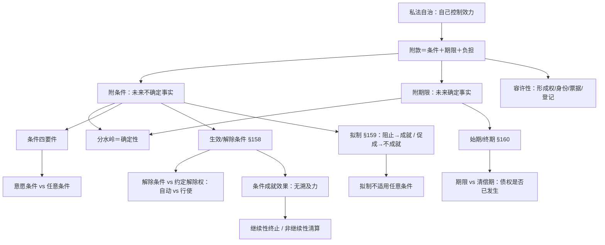
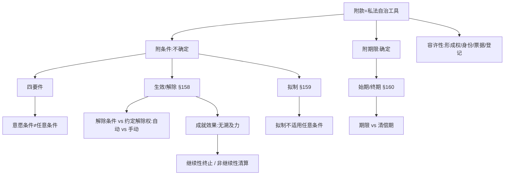

> [!quote] YOU

继续

> [!abstract] PI

好，接着上次。第十一章第 5 步（可撤销）已收尾，今天进 **第 6 步：第四节 附条件与附期限**。

先交个作业——上次留的微任务是：

> 给不懂法的朋友讲清「被人拿刀逼着低价卖房」vs「对方趁你老婆重病急需钱压价买你画」——为什么一个是**胁迫**、一个是**显失公平**？用「逼 vs 趁」这把尺子，两三句话。

你直接打字交，我边看边校正。

> [!quote] YOU

胁迫是强迫别人做什么事，比如拿刀逼。。。显失公平是利用对方的危困状态，比如称老婆重病

> [!abstract] PI

作业收到，核心抓对了，但有一个要件漏了，顺带提醒一个旧坑：

1. ✅ **「逼 vs 趁」对了**——胁迫＝逼（威胁让你恐惧，你为摆脱恐惧而就范）；显失公平＝趁（趁你危困/没判断力，狠压价）。
2. ⚠️ **显失公平漏了客观要件**。光「趁危困」还不够，还得**对价明显失衡**（100 万的画 50 万买走＝失衡）。反过来，只失衡不「趁」也不是显失公平——朋友半卖半送，你事后不能反悔说显失公平。**两个要件缺一不可**。
3. ⚠️ **旧坑提醒**（第九章踩过）：「拿刀逼你、你自己签」＝胁迫（可撤销）；但「抓着你手按手印」＝身体强制＝无行为意思＝**不成立**。你说的「拿刀逼」是前者，对。

---

## 第 6 步：第四节 附条件与附期限

先把方向交代清楚：前 5 步（无效/效力待定/可撤销）讲的是**法律怎么评价你的行为**；这一节翻面——**你自己怎么控制行为何时生效、何时失效**。这是「效力自我控制」的收官，也是第十章「成立≠生效」那条线的落地。

**路径叙述**（教材第四节 + 刘家安**第 16 讲第四节**，注意：上次进度里写的「第 19 讲后半」是笔误，附条件附期限实际在刘家安第 16 讲第四节）：

1. **附款是什么、为什么**（私法自治工具：控制「效力」而非「内容」）——A 类
2. **容许性**：哪些行为不得附条件/期限（形成权行使、身份行为、票据、不动产处分登记）——「形成权＝是死是活给个痛快话」是理解钥匙
3. **条件 vs 期限的分水岭＝未来事实的确定性**（高频考点：「下第一场雪」「父死」＝期限；「三月内疫情结束」＝条件）
4. **条件四要件**，重点拆**意愿条件 vs 任意条件**（这是教材最刁的一个区分）
5. **生效条件/解除条件**（§158），重点：**解除条件 vs 约定解除权**（§562Ⅱ「自动 vs 行使」）
6. **拟制规则**（§159：阻止→成就、促成→不成就；拟制不适用任意条件）
7. **条件成就效果**：无溯及力＋判断时点＝缔结时＋继续性/非继续性两种清算
8. **期待权/预先效力**（我国法无明文，漏洞填补）
9. **期限**：始期/终期（§160）；**期限 vs 清偿期**（债权是否已发生）

**依赖图**（教学顺序＝这张图）：

随堂检测只从习题册抽样（单选 15–18、多选 12–15、辨析 9–10、简答 5–6），不编题。

**这个顺序和切法你认可吗？** 点头我就从「附款的功能」开讲。

> [!quote] YOU

嗯

> [!abstract] PI

开讲。

## 节点 1：附款的功能——控制「效力」不是控制「内容」

**教材·第十一章第四节**：「附条件与附期限皆为法律行为的附款（Nebenbestimmung）。除此之外，学理上还认为法律行为的附款尚包括负担（modus）……附条件与附期限是当事人对法律行为效力进行自我控制的手段。」

拆两个词，这是本节第一个「发现」点：

- **附款**＝挂在主干法律行为上的「附加条款」，作用是控制**效力**（何时生效、何时失效、在什么条件下生效）。
- **负担（modus）**＝附负担赠与里的那类约定：受赠人拿到利益后**有义务**做某事。

**教材·第十一章第四节**把两者摆在一起对比，先亮原文：

> 「负担与条件不同，一方面，负担本身不决定法律行为的生效或者失效，所以不具备法律行为的效力控制功能，仅意味着当事人在获得财产利益之后有义务为或者不为特定行为；另一方面，条件所涉行为不构成当事人的义务，所以对方不得诉请履行。」

你先把这两个例子对号入座——

> 甲赠与乙一部手机，约定「若乙将手机用于玩游戏，则赠与失效」。
> 甲赠与乙一栋房屋，约定「乙应当留出其中一层由甲终身居住」。

**问：哪个是附解除条件、哪个是附负担？判断的尺子是什么？**（先答主问题；卡住了再看提示：从「甲能不能诉请乙去做这件事」这个口子切入。）

> [!quote] YOU

玩手机是解除条件，留一层是附负担。

> [!abstract] PI

对，两个都对。但先把**尺子**钉死，不然还是靠直觉：

**条件 vs 负担，两把尺子：**
1. **能不能诉请履行**——负担是义务，能诉请（甲能要求乙留一层给他住）；条件所涉行为**不是**义务，不能诉请（甲不能告到法院要乙「去玩游戏」）。
2. **影响的是效力还是义务**——条件影响**效力**（乙一玩游戏，赠与自动失效）；负担不影响效力（乙不留房，赠与不失效，甲只能请求履行/追究违约责任）。

一句话钩子：**「条件管死活，负担管干活」**。

---

## 节点 2：容许性——不是所有行为都能附条件

**教材·第十一章第四节**给出两类「不许附」的理由，刘家安第 16 讲补了那句最狠的解读：

**维护公共秩序**——结婚、离婚、收养**不得附条件/期限**（婚姻不允许「先登记、再看前男友回不回头」这种保留）；继承的放弃、遗赠的接受/拒绝、票据的承兑/背书/保证也不得附。

**保护相对人**——**形成权的行使不得附条件**。刘家安原话：

> 形成权的相对人「已经要忍受自己在某种法律关系中的命运操控于对方之手，就需要**是死是活给个痛快话**，不要再附条件了。」

抵销（§568Ⅱ）、解除权、追认权、买回权、优先购买权、选择权，行使时都不许附条件。**例外**：继续性合同的终止行为可以附**期限**（「三个月后合同终止」反而方便承租人找替代）；双方事先合意的，可以附。

**效果**：欠缺容许性，原则上**法律行为本身无效**；例外**视为未附条件、行为照常有效**——票据最典型（§33Ⅰ 背书附条件「不具有汇票上的效力」、§48 保证附条件「不影响保证责任」）。

这里藏着一条你反复踩过的坑——**物债二分**。看这道题：

> [!question] Quiz
> 下列法律行为不得附条件的是()
>
> 1. 票据的背书行为
> 2. 追认行为
> 3. 收养
> 4. 不动产买卖合同

> [!success] Quiz — correct ✓
> Your answer: 1. 票据的背书行为, 2. 追认行为, 3. 收养
> Correct answer: 1, 2, 3
>
> 逐项看：\n\n「收养」——身份行为，基于伦理秩序不得附条件，属于不得附条件的行为，正确，应选。\n\n「不动产买卖合同」——这是负担行为（只生债权债务），可以附条件；真正不得附条件的是不动产所有权让与的处分行为（须登记、要保证登记簿记载清晰）。这一项错误，不选。\n\n「追认行为」——追认权是形成权，行使形成权「是死是活给个痛快话」，不得附条件，正确，应选。\n\n「票据的背书行为」——票据为保文义确定性与流通性，背书不得附条件（§33Ⅰ），正确，应选。

> [!abstract] PI

✅ 全对，物债二分这条这次没掉坑（「买卖合同」是负担行为，可以附条件）。

## 节点 3：条件 vs 期限——分水岭是「未来事实是否确定发生」

这是本节**最高频的考点**，刘家安第 16 讲用例子把它点透了：

- **条件**＝未来**不确定**的事实（可能发生、可能不发生）。
- **期限**＝未来**确定**发生的事实（必到），只是**何时到不确定**。

刘家安【例 6】：甲说「下次下雨时送你一把伞」——沙漠也总会下雨，**必到**，所以是**期限**。【例 7】：「父死时把房租给你」——人必有死，也是**期限**。反过来，「如果 3 月 31 号之前疫情结束我就去」——**不一定结束**，是**条件**。

一句话钩子：**「必到的是期限，或到或不到的是条件」**。

## 节点 4：条件的四个构成要件

**教材·第十一章第四节**给条件立了四个门槛（简答 5 直接考）：

1. **未来不确定事实**——排除两类假条件：**既成条件**（订约时已发生/已确定不发生，不算）；**必成条件**（必然发生，按始期处理）。
2. **意定性**——排除**法定条件**（法律规定的生效前提不算，如「须批准」）。
3. **不含意思表示**——排除**意愿条件**。这是最刁的一个，看教材原句：

> 「甲、乙约定，甲以 20 万元价格向乙购买一辆汽车，但同时又附加约定『合同自甲三天内最终同意购买时生效』。该约定在本质上并非附条件汽车买卖合同，因为附加约定表明甲尚未终局性地决定以此等价格向乙购买该辆汽车，其所谓购车表示只是一个交易意向而已，欠缺效果意义，不构成意思表示。」

拆开：条件必须是**意思表示之外**的客观事实；「我三天内最终同意」＝甲自己还没做终局决定＝**欠缺效果意思**＝连意思表示都不是，合同根本没成立，自然谈不上附条件。这和「任意条件」（如「甲下个月不回国」，虽是甲的自由行为，但**是**真条件）是两回事——**意愿条件＝还没定，任意条件＝已定但留了后手**。

4. **效力前提**——条件决定的是**效力**，不是成立（「自双方签章时生效」＝成立，不是条件）；也区别于**义务的履行条件**（「尾款在验货满月后付」＝付款义务的条件，不是合同生效条件）。

四个要件、三类假条件全在这道题里：

> [!question] Quiz
> 下列哪些选项不是附生效条件法律行为()
>
> 1. 尾款支付条件为买受人使用标的物满一个月未发现瑕疵
> 2. 本合同自双方签章时生效
> 3. 本合同自一个月内获得主管机关批准时生效
> 4. 本合同自今年下第一场雪时生效

> [!failure] Quiz — incorrect ✗
> Your answer: 2. 本合同自双方签章时生效, 4. 本合同自今年下第一场雪时生效
> Correct answer: 1, 2, 4
>
> 逐项看：\n\n「本合同自一个月内获得主管机关批准时生效」——这是附生效条件：把法定条件（须批准）上又叠加了「一个月内」的意定不确定因素，构成真条件。它属于附生效条件，不选。\n\n「本合同自双方签章时生效」——签章是合同成立要件（§490Ⅰ），签章前合同还没成立，谈不上附条件。它不是附生效条件，应选。\n\n「本合同自今年下第一场雪时生效」——下第一场雪是必然发生的事实（内蒙古必下雪），只是时间不确定，这是附期限（始期）而非附条件。它不是附生效条件，应选。\n\n「尾款支付条件为买受人使用标的物满一个月未发现瑕疵」——这是尾款支付义务的履行条件，不是法律行为（合同）本身的生效条件。它不是附生效条件，应选。

> [!abstract] PI

漏了一个，而且漏得很「典型」——你抓住了「成立≠生效」（签章）和「条件≠期限」（下雪）两把尺子，但**第三把尺子没拿出来**：**「条件管的是合同死不死 vs 某笔钱什么时候该付」**。

这正是要件 4 的后半句。教材原文：

**教材·第十一章第四节**：「条件影响的是法律行为本身的效力，这使条件区别于某一项义务的履行条件。后者如股权转让合同约定，受让人支付尾款的条件是让与人已通过工商变更登记将股权登记于受让人名下。股权移转登记仅为受让人付款义务的履行条件，并非股权转让合同的条件。」

拆开：

- **法律行为（生效/解除）条件**：管的是**整个合同**死不死、活不活。
- **义务的履行条件**：合同**早就生效了**，只是「这笔尾款**什么时候该付**」挂在一个事实上。它不影响合同效力。

题里「尾款支付条件为…满一个月未发现瑕疵」——买卖已经生效，只是**尾款这笔付款义务的履行时点**取决于「满月无瑕疵」。所以它不是「附生效条件法律行为」。

教材还补了一刀更细的（考研要能说）：

> 「合同为某种义务所附的条件**也可能具备法律行为条件的属性**。比如…『股权收益率连续两年低于 10%』这项条件决定的是**回购义务之发生**而非其履行…回购义务的发生条件对股权转让合同效力具有部分控制力，不妨称之为**部分附条件法律行为**。」

所以真正的尺子是：**管「义务何时履行」＝履行条件（非法律行为条件）；管「义务是否发生/合同效力」＝法律行为条件**。

现在请你用一句话把这道题讲清楚——**为什么「尾款满月无瑕疵再付」不是附生效条件？**（就答这一句，我盯着你的措辞。）

> [!quote] YOU

合同已经成立且生效了，满月无瑕疵是履行付款义务的条件

> [!abstract] PI

✅ 措辞到位。钩子钉死：**「合同已生效，条件只是给付款义务定个闹钟」**。这个坑以后见「尾款/付款…条件」字眼就条件反射——先问一句「合同本身生效了没」。

---

## 节点 5：生效条件 vs 解除条件（§158）

**教材·第十一章第四节**：§158 把条件分两种——

- **生效条件**（停止条件/延缓条件）：法律行为**已成立、未生效**，条件成就时才生效（「甲三个月内拿到移民签证，就把车卖你」——签证到手，合同才活）。
- **解除条件**：法律行为**已生效**，条件成就时**自动失效**。

**这一节的命门是「解除条件 vs 约定解除权」**，刘家安第 16 讲反复敲：

> 「附解除条件的法律行为，条件一经成就，合同效力**自动**发生消亡…而《民法典》第 562 条第 2 款只是规定解除合同的事由发生时，一方当事人**产生了合同的解除权**，如果解除权人不去行使这个权利，合同的效力即不受任何影响。」

**教材·第十一章第四节**的案例（教学案例 2）正是这个：A 卖车给 B，约定「若一年内 A 持有的股票解套，则买卖合同解除」。八个月后股票解套——

> 「条件成就，该合同**自动解除，无须 A 作出解除合同的意思表示**，所以 A 无权选择不解除合同。」

钩子：**「附解除条件＝自动挡；约定解除权＝手动挡」**。手动挡有选择权（可以不解），自动挡没得选（到点就灭）。

把这条跟你刚学的「意愿条件」接上——「我两个月内表示不买，合同就失效」这种，正是意愿条件变解除权的现场：

> [!question] Quiz
> 甲与乙订立股权转让合同，约定甲将其持有的某公司20%股权以1000万元价格转让给乙，并特别约定“若甲在本合同订立后2个月内表示不愿意转让，则本合同失效”。下列选项正确的是()
>
> 1. 甲、乙的股权转让合同附单方解除权
> 2. 甲、乙的股权转让合同未生效
> 3. 甲、乙的股权转让合同附解除条件
> 4. 合同中的那项特别约定无效

> [!success] Quiz — correct ✓
> Your answer: 1. 甲、乙的股权转让合同附单方解除权
> Correct answer: 1
>
> 这里约定的「甲在订立后 2 个月内表示不愿意转让」是甲的意愿表示（意思表示），把它作为合同失效的前提＝意愿条件。按教材，意愿条件不构成真正的条件；当它决定的是「效力丧失」时，应定性为附解除权的法律行为——合同已成立生效，只是赋予甲一个单方解除权。\n\n「附解除条件」这一项错误：附解除条件是「条件成就自动失效」；而这里是甲须「表示」不愿意转让，是行使解除权的意思表示，非自动失效。\n\n「合同未生效」这一项错误：合同已成立且生效，只是甲握有解除权。\n\n「该特别约定无效」这一项错误：约定有效，只是性质是授予解除权，而非附条件。

> [!abstract] PI

✅ 「附单方解除权」抓得准。这样「意愿条件」这条线就闭环了：**意愿条件→附解除权，任意条件→真条件**。

## 节点 6：拟制规则（§159）——禁止「耍赖」

**教材·第十一章第四节**：

> 《民法典》第 159 条第 1 分句：「……当事人为自己的利益不正当地阻止条件成就的，视为条件已成就；」其中的当事人是指**因条件成就而受不利益**之当事人，其阻止条件成就之行为违背诚实信用原则，所以应通过拟制成就使其承担不利后果。

一句话：**阻止条件成就 → 视为已成就；促成条件成就 → 视为不成就**。原理是诚信——谁也别想通过「做手脚」让条件朝对自己有利的方向跑。

**但有个例外**，教材配了教学案例 1：

> 甲「下个月不回国」是一项自由行为……甲刻意更改计划，提前回国，导致「下个月不回国」之条件不成就，不应拟制该条件成就，租期不应延长一年。

为什么？因为「不回国」是**任意条件**（本就取决于甲的自由决定），他改计划是**自由选择**，不违背诚信。**钩子：拟制不适用于任意条件——自由选择不叫耍赖。**

看这道题：

> [!question] Quiz
> （单选 17 的续例）乙订立合同后反悔，遂借助其在政府中的人脉，做了一些工作，使得甲、丙的合作项目没有得到批准。下列选项错误的是()
>
> 1. 甲、乙的股权转让合同因条件未成就而不发生效力
> 2. 乙的做法违背诚信原则
> 3. 关于甲、丙的合作项目未获批准，甲有权请求乙赔偿
> 4. 甲、乙的股权转让合同因条件成就而发生效力

> [!success] Quiz — correct ✓
> Your answer: 1. 甲、乙的股权转让合同因条件未成就而不发生效力
> Correct answer: 1
>
> 这是单选 17 的续例：合同附生效条件「甲与丙的合作项目获得政府批准」。乙为了让自己脱身，通过人脉使项目未获批准——这是「为自己的利益不正当地阻止条件成就」，依 §159 应拟制条件已成就，合同发生效力。\n\n题目问「错误的是」，所以「因条件未成就而不发生效力」这一项错——不是真的不成就，而是拟制成就。\n\n「因条件成就而发生效力」这一项正确：拟制成就后合同生效。\n\n「乙的做法违背诚信原则」这一项正确：阻止条件成就违背诚实信用。\n\n「甲有权请求乙赔偿」这一项正确：乙的不当干预给甲造成损失，甲可请求赔偿。

> [!abstract] PI

✅ 对。先记一个关键**对比**，这条线两分支都要会：

- **单选 18**：乙阻止的是「甲丙合作项目获批」——这是**第三方**（政府）决定的事实，乙做手脚＝不正当阻止 → **拟制成就**。
- **教学案例 1 / 多选 14**：阻止的是**自己**的自由行为（回国/考试）——这是**任意条件**，自己的选择不叫耍赖 → **不拟制**。

我把多选 14 跟原 PDF 核对过了（答案无误），它考的就是「拟制不适用任意条件」这支，正好跟你刚答的单选 18 凑成一对：

> [!question] Quiz
> 高中生小东与小西约定，如果本次数学月考小东的成绩及格，则小西欠小东的100元债务免除。此后，小东想起寒假游玩计划资金不足，后悔与小西达成那项约定，遂于数学月考过程中故意少答了一道题，导致不及格。下列选项错误的是()
>
> 1. 双方达成了附解除条件法律行为
> 2. 双方约定的条件违背公序良俗，所以无效
> 3. 因为条件不成就，所以债务免除约定不发生效力
> 4. 因为小东故意阻止条件成就，所以应拟制条件成就，债务免除

> [!failure] Quiz — incorrect ✗
> Your answer: 1. 双方达成了附解除条件法律行为, 4. 因为小东故意阻止条件成就，所以应拟制条件成就，债务免除
> Correct answer: 1, 2, 4
>
> 约定「及格则债务免除」＝附生效条件（债务免除以「及格」为生效前提），不是附解除条件。\n\n逐项看：\n\n「双方达成了附解除条件法律行为」这一项错——是附生效条件，不是解除条件，应选。\n\n「双方约定的条件违背公序良俗，所以无效」这一项错——「成绩及格」是正常事项，不背俗，应选。\n\n「因为条件不成就，所以债务免除约定不发生效力」这一项正确——「及格」取决于小东自己的考试表现这一自由行为，属任意条件；拟制不适用于任意条件，小东故意不及格是其自由选择、不违背诚信，故条件真的不成就，债务免除不发生效力。不选。\n\n「因为小东故意阻止条件成就，所以应拟制条件成就」这一项错——任意条件不拟制，应选。

> [!abstract] PI

两个难点你都抓对了（解除条件≠生效条件、任意条件不拟制）——**但漏了最「送分」的一项：「成绩及格」怎么可能违背公序良俗？**

这是多选的老毛病：**盯住难的两项，漏掉扫一眼就该排除的项**。以后多选逐项过一遍，别挑着看。（顺带记一笔：教材在「条件种类」处把「考试合格」归**混合条件**，但本题按「取决于小东自由行为」这层处理成任意条件——这个边界学理上有张力，考研论述可点到，客观题跟着题走。）

---

## 节点 7：条件成就的效果——原则上无溯及力

**教材·第十一章第四节**三句话，句句是考点：

**① 无溯及力。**「条件成就的法律效果原则上无溯及力。附生效条件法律行为于条件成就时发生效力，附解除条件法律行为于条件成就时丧失效力。」——§158 明文「**自**条件成就时生效/失效」，是「此时起」不是「倒回去」。

**② 判断时点＝缔结时。**「当事人的权利能力、行为能力、法定代理人的同意、善意与否……仍以法律行为**缔结之时**而非以条件成就之时为判断时点。」（所以条件成就前当事人已丧失行为能力，不影响合同命运——单选 17 考的就是这个。）

**③ 解除条件成就后，两种清算：**
- **继续性债务关系**（租赁、雇佣）：只是**向将来终止**。已收的租金不返还、欠的租金仍须付；承租人返还租赁物。
- **非继续性债务关系**（买卖）：债务关系消灭 + **清算**，已履行的按**不当得利**返还——但因为是「向将来」而非「溯及」，买受人不返还条件成就前的**收益**，出卖人也不付价款的**利息**。

看这道题（把 ②③ 全串起来）：

> [!question] Quiz
> 甲、乙订立合同约定，甲将一艘小型游艇卖给乙，立即交付，若半年内甲未能移民成功，则买卖合同自动失效。半年后，甲已经确定移民失败。下列选项正确的是()
>
> 1. 关于游艇，甲对乙享有不当得利返还请求权
> 2. 双方达成了附解除条件法律行为
> 3. 合同订立后的半年内，乙是游艇的所有权人
> 4. 甲确定移民失败，导致乙的游艇所有权溯及消灭

> [!success] Quiz — correct ✓
> Your answer: 1. 关于游艇，甲对乙享有不当得利返还请求权, 2. 双方达成了附解除条件法律行为, 3. 合同订立后的半年内，乙是游艇的所有权人
> Correct answer: 1, 2, 3
>
> 约定「半年内甲未能移民成功，则买卖合同自动失效」＝附解除条件。\n\n逐项看：\n\n「双方达成了附解除条件法律行为」这一项正确——移民失败是解除条件，条件成就合同自动失效。\n\n「关于游艇，甲对乙享有不当得利返还请求权」这一项正确——买卖是非继续性债务关系，解除条件成就后债务关系消灭、发生清算，甲可依不当得利请求乙返还游艇。\n\n「合同订立后的半年内，乙是游艇的所有权人」这一项正确——游艇已交付，在解除条件成就前乙已经取得所有权。\n\n「甲确定移民失败，导致乙的游艇所有权溯及消灭」这一项错误——条件成就无溯及力，乙的所有权只是自解除条件成就时起丧失，不是溯及消灭。

> [!abstract] PI

✅ 全对，无溯及力这条稳了。

## 节点 8：条件成否未定期间——期待权

从成立到条件确定，有一段「悬而未决期」（Schwebezeit）。教材讲受益人在此期间享有一个**期待权**，两点「预先效力」：

1. 受益人的权利在悬置期被相对人**过错损害**的，条件成就后可请求**赔偿**；
2. 附条件**处分行为**在悬置期，权利人再处分（「中间处分」）有害于受益人的，条件成就后**不生效力**——但**第三人善意**的除外（结果如同善意取得）。

我国法没明文，属漏洞填补，考研知道「期待权 + 预先效力」这俩词就够。

## 节点 9：附期限（§160）

- **始期**＝生效期限（届至时生效）；**终期**＝终止期限（届满时失效）。
- 期限＝将来**确定发生**的事实（何时到可能不确定，比如「某人死亡时」）。
- **命门区分：期限 vs 清偿期**——

> 附始期的债权是**未来债权**（债还没发生）；未届清偿期的债权**已经发生**，只是暂不能请求履行。所以：清偿未届期债务 → **不能**请求返还不当得利（你自愿提前还）；附始期债务在届至前「清偿」→ **可以**请求返还不当得利（债根本还没生，白给了）。

到这里附条件/附期限主体讲完。把「判断时点」那条正式测一下：

> [!question] Quiz
> 甲与乙订立股权转让合同，约定甲将其持有的某公司20%股权以1000万元价格转让给乙，并特别约定“本合同的生效条件为甲与丙的合作项目获得政府批准”。3个月后，甲与丙的合作项目获得了政府的批准，但此时甲因故丧失了民事行为能力。下列选项正确的是()
>
> 1. 股权转让合同是否有效，取决于甲的法定代理人是否追认
> 2. 甲、乙的股权转让合同附停止条件
> 3. 在甲、丙的合作项目获得批准后，甲、乙的股权转让合同自订立时生效
> 4. 因甲丧失民事行为能力，所以股权转让合同不发生效力

> [!failure] Quiz — incorrect ✗
> Your answer: 3. 在甲、丙的合作项目获得批准后，甲、乙的股权转让合同自订立时生效
> Correct answer: 2
>
> Note: 附停止条件不是附解除条件么？
>
> 合同约定「本合同的生效条件为甲与丙的合作项目获得政府批准」——这是把合同生效系于「合作项目获批」这一未来不确定事实，属附生效（停止）条件。\n\n「附停止条件」这一项正确：附停止条件即附生效条件。\n\n「自订立时生效」这一项错误：条件成就原则上无溯及力，是自条件成就时生效，不是自订立时溯及生效。\n\n「因甲丧失民事行为能力，所以股权转让合同不发生效力」这一项错误：行为能力等影响效力的因素以法律行为缔结之时为判断时点，甲缔约时有行为能力，条件成就后丧失行为能力不影响。\n\n「取决于甲的法定代理人是否追认」这一项错误：同上，判断时点是缔约时，不因事后丧失行为能力而转为效力待定。

> [!abstract] PI

你这个 note 抓到了问题的**根**——正好是本节最容易踩的术语坑，值得停下来钉死。

**「停止条件」≠「解除条件」，恰恰相反，它是「生效条件」的别名。**

「停止」不是「终止/关掉」，而是「**效力被拦下、停住、还没发动**」。三个名字是同一回事：

**生效条件 = 停止条件 = 延缓条件**

刘家安第 16 讲原话：「附停止条件……是指法律行为做出后，其效力处在**停顿或延缓**的状态之下，在条件成就时，其延缓或停顿的状态消失，法律行为正常的发生效力。」

所以锚点记成——**方向相反**：

| | 效力状态 | 条件成就时 | 类比 |
|---|---|---|---|
| **停止条件**（生效/延缓） | 还没生效，停在**起点** | 才**启动**（生效） | 等发令枪 |
| **解除条件** | 已经生效，**在路上** | 才**收摊**（失效） | 到点刹车 |

「停止」=**起点停**（还没发动）；「解除」=**终点停**（发动了又灭）。

回到刚才那道题：「生效条件为…获得政府批准」——批准前合同**成立但未生效**，就是「停在起点等批准」，所以是**附停止条件**；而「自订立时生效」错在**无溯及力**（不是倒回订立时生效）。

现在你用自己的话说一遍：**「停止条件」三个字，为什么是「生效」而不是「解除」？**（一句话，我用它验收你过没过这道坎。）

> [!quote] YOU

停止指的是成立了但还没生效，处于停止状态

> [!abstract] PI

✅ 过了这道坎。「停止」＝**成立但未生效、效力停在原地等条件**。钩子收下：**「停止条件＝起点停（等发令枪），解除条件＝终点停（到点收摊）」**——以后看到「停止/延缓/生效」三个词，一律翻译成「还没生效，等条件」。

最后把两处「容许性 + 效果」和「任意/意愿」收个尾：

> [!question] Quiz
> 甲与乙登记结婚，双方私下达成协议，约定其结婚附解除条件，一旦婚后乙对甲撒谎累计达到3次，则婚姻自动解除。下列选项正确的是()
>
> 1. 双方私下达成的协议无效，原因是未经登记
> 2. 若婚后乙对甲撒了3次谎，则婚姻关系自动终止
> 3. 甲、乙的结婚行为因违背公序良俗而无效
> 4. 甲、乙的结婚行为视为未附解除条件

> [!failure] Quiz — incorrect ✗
> Your answer: 3. 甲、乙的结婚行为因违背公序良俗而无效
> Correct answer: 4
>
> 结婚是身份行为，基于伦理秩序不得附条件（§158 但书「依其性质不得附条件」）。但附了条件不等于婚姻无效，而是「条件视为未附」、婚姻本身照常有效。\n\n「甲、乙的结婚行为因违背公序良俗而无效」这一项错误：婚姻本身有效，只是所附条件不生效力。\n\n「若婚后乙对甲撒了3次谎，则婚姻关系自动终止」这一项错误：条件视为未附，不会因撒谎自动解除婚姻。\n\n「甲、乙的结婚行为视为未附解除条件」这一项正确：婚姻不得附条件，附了解除条件视为未附，婚姻照常有效。\n\n「双方私下达成的协议无效，原因是未经登记」这一项错误：婚姻已经登记成立，问题在于附条件本身欠缺容许性，而非未登记。

> [!abstract] PI

这里踩了个真坑，得拆开。

你把「**附条件欠缺容许性**」直接当成「**违背公序良俗**」了——这是两个不同的层面：

- **条件内容背俗**（如「限制再婚」＝限制婚姻自由）→ 条件**无效**，可能连累整个行为（§153Ⅱ + §156）。
- **身份行为不得附条件**（容许性欠缺，但条件本身没问题，如「撒谎 3 次」）→ 条件**视为未附**，行为本身照常有效。

单选 15 是第二种：**结婚本身不背俗、已经登记有效**；「撒谎 3 次」也不背俗；问题只在于**婚姻这种身份行为不容许附条件**。教材把它落点放在 §156：

**教材·第十一章第四节**：「附条件与附期限作为法律行为的附款，其欠缺容许性是否影响法律行为的整体效力，应当依据《民法典》第 156 条处理。」

也就是说：**附款（条件）部分无效 → 视为没附 → 婚姻这一部分照常有效**（把「部分无效」那章的知识接回来了）。「因背俗而无效」是把整个婚姻判死刑，方向反了。

现在你自己收一句：**为什么结婚附解除条件是「条件视为未附、婚姻有效」，而不是「婚姻无效」？**（一句话，用「容许性 ≠ 背俗」这把尺子说。）

> [!quote] YOU

婚姻这种身份行为不容许附条件，而不让撒谎并不背俗

> [!abstract] PI

✅ 到位了。「容许性」管的是**能不能附**（身份行为不能附），「背俗」管的是**附的内容脏不脏**（限制再婚＝脏）。前者→**视为没附**，后者→**无效**。钩子：**「不能附，不等于附了会死」**。

最后两道辨析收口：

> [!question] Quiz
> 辨析：行使形成权的法律行为一律不得附条件或者附期限。
>
> 1. 正确
> 2. 错误

> [!failure] Quiz — incorrect ✗
> Your answer: 1. 正确
> Correct answer: 2
>
> 「一律」二字是错的。原则上的确如此——形成权的相对人已要忍受命运操控于对方之手，行使形成权需要「是死是活给个痛快话」，所以原则上不得附条件、附期限。但有例外：其一，继续性合同的终止行为可以附期限（「三个月后终止」反而方便承租人安排替代交易）；其二，《民法典》第 565 条第 1 款允许解除权的行使附条件。所以不能说「一律」不得附。

> [!abstract] PI

「一律」又是你——这是**第三次**踩在「一律/一概」这类绝对化触发词上了（前两次是「欺诈胁迫一律可撤销」漏了遗嘱、劳动合同无效）。

**规律记牢：看到「一律」「一概」「统统」，条件反射先翻例外。** 这里两个例外：

1. **继续性合同的终止行为可以附期限**（「三个月后合同终止」——反而方便承租人找替代，保护相对人的目的没被破坏）；
2. 解除权的行使附条件（§565Ⅰ，较偏，知道即可）。

原则是「原则上不得附」，不是「一律不得附」——差一个「原则上」，就差了例外。

最后一道：

> [!question] Quiz
> 辨析：法律行为所附条件如果取决于一方当事人的自由意志，则不构成真正的条件。
>
> 1. 错误
> 2. 正确

> [!failure] Quiz — incorrect ✗
> Your answer: 2. 正确
> Correct answer: 1
>
> 题干把「任意条件」和「意愿条件」搅在一起了。取决于一方自由意志的事实（如「甲方下个月回国」）是任意条件，它仍然是真正的条件；真正不构成条件的是「意愿条件」——以一方当事人的意思表示本身作为条件（如「三天内表示同意购买」），因为此时该方尚未终局决定，欠缺效果意思，连意思表示都不构成。所以「取决于自由意志→不构成真正条件」这一说法错误。

> [!abstract] PI

「任意条件」和「意愿条件」这两兄弟还没分清——这正是题干设的局。

- **任意条件**：取决于一方当事人的**自由行为**（一件**客观的事**：回国、付款、考试）→ **是真条件**。
- **意愿条件**：取决于一方当事人的**意思表示**（一个**主观表态**：「我表示同意」「我愿意」）→ **不是条件**（因为还没终局决定，欠缺效果意思）。

钩子钉死：**「行为当条件＝真（任意）；表态当条件＝假（意愿）」**。

题干说「取决于自由意志」＝自由**行为**＝任意条件，是**真**条件，所以「不构成真正的条件」是**错**的。回想单选 16（「2 个月内表示不愿转让」＝意愿条件→附解除权）和教学案例 1（「下个月不回国」＝任意条件→真条件），两个正好一真一假。

---

## 第 6 步收束：附条件与附期限

这节讲的是「你自己控制效力」，一张图塌缩：

**第十一章全章到此讲完**（无效→效力待定→可撤销→附条件附期限）。今天 6 个错点我都记下了，会进错题档案和复习队列。

**微任务**（打字交，两三句话）：给不懂法的朋友讲清——

> 约定「若我股票解套，则合同**自动解除**」 vs 约定「若我股票解套，则我**有权解除**合同」——同样一句「股票解套」，为什么一个是「到点自动熄火」、一个是「到点给你一个开关」？

我先把进度和错题落盘，你先把这道题想一下。

> [!abstract] PI

进度落盘完毕：

- **课程进度.md**：第十一章标为 ✅ 已学完；新增第 6 次课记录、6 条错题、12 条复习队列。
- **进程树.md**：第十一章状态 → ✅，复习队列 52→64、错题档案 22→28，最近笔记已挂上今天的。

**第十一章（效力障碍）全章收官**：无效 → 效力待定 → 可撤销 → 附条件附期限，四节全部讲完、全部测过。

等你交微任务（「股票解套」自动挡 vs 手动挡那道）。交完我可以接着做这几件事里的一件：

1. **拷问第十一章**——把今天 6 个错点连同旧错题一起刷；
2. **学第十二章**（法律行为的归属＝代理）；
3. **复习**——把 14 个久未触及的主题顺一遍。

你说方向即可。

> [!quote] YOU

一个是附解除条件，一个是附解除权利

> [!abstract] PI

两个标签对——**附解除条件** vs **附解除权**。一个术语先校准：后者准确叫**「解除权」**（不是「解除权利」），而且是**约定解除权**（§562Ⅱ）。

但微任务要的是「给不懂法的朋友讲」，你只甩了两个术语，还没说到**为什么**。补上这一句——用「自动熄火 vs 给你一个开关」的比喻，把机制说清楚：

> 第一个（附解除条件）：股票一解套，合同**自己就灭了**，你什么都不用做，想留也留不住。
> 第二个（约定解除权）：股票解套只是**发给你一个开关**，合同还没死——你按下去（行使解除权）它才灭；你不按，合同继续活着。

所以区别在哪一句话？**一个是「到点自动死」，一个是「到点给你决定权」。** 这是本节命门，也是将来合同解除那一大章的地基——「自动」与「行使形成权」是两条完全不同的路。

这道算你过关（核心分拿到了）。接下来走哪条？

1. **拷问第十一章**（把今天 6 个错点＋旧错题一起刷）；
2. **学第十二章**（法律行为的归属＝代理）；
3. **复习**（顺一遍 14 个久未触及的主题）。

> [!quote] YOU

明后天尽量结束总论部分，早点进入债法，一些复习做题等穿插在学债法的过程中

> [!abstract] PI

收到，方向记下了：**加速收尾总论 → 尽早进债法，复习/做题不单设专门日，穿插在债法里带。**

具体怎么走（跟既有规划一致，只是提速）：

- **第十二章 代理**＝法律行为的最后一块，讲完 ch9–12「法律行为」线就完整闭环。这一章不能省（无权代理/表见代理是债法合同编的地基）。
- **ch13 请求权 / ch14 时效 / ch15 期间**＝按原计划**穿插**在债法各阶段讲，不进债法前专门耗时间。
- **复习/错题**＝每次债法 session 开头带 1–2 个久未触及项（比如「悬赏广告＝要约说」「意思实现＝无相对人」这些意思表示老底子，正好是合同法要约承诺的地基），不设专门复习日。

节奏上：第十二章正常讲满（1–2 次课），不因为赶进度而砍双清单。

**现在就开始第十二章（法律行为的归属＝代理）吗？** 还是你想先花 10 分钟把今天这 6 个错点快速过一遍再进新章？
