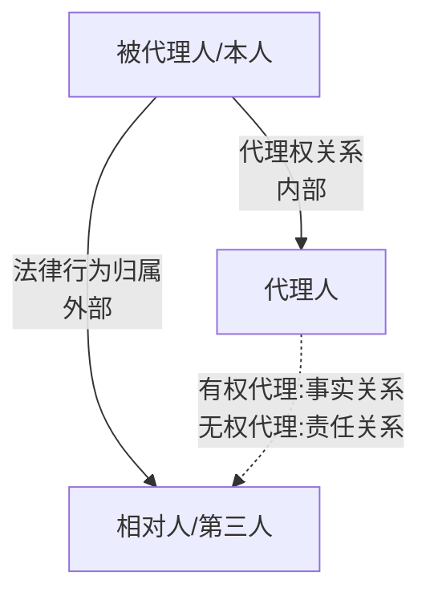
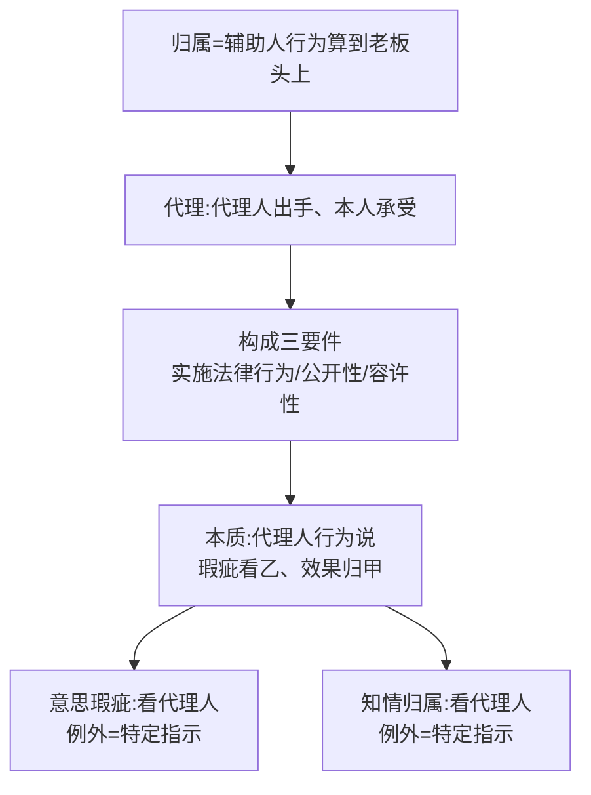

> [!quote] YOU

继续

> [!abstract] PI

进入第十二章「法律行为的归属」（代理）前，先收个尾 + 摸个底：

**① 上次的微任务**（第十一章收尾）：给不懂法的朋友讲清「股票解套→合同**自动解除**」vs「股票解套→甲**有权解除**」，用「自动挡 vs 手动挡」这把尺子，两三句话——直接在对话里打出来。

**② 摸底**：第十二章是「代理」这一大块（8 节、教材 443–507 页，约 65 页）。你之前学过代理吗？到什么程度（比如：代理/传达的区别、表见代理的构成要件、无权代理的责任，这几个有没有印象）？

交完作业、说下底子，我给你排这一章的教学路径。

> [!quote] YOU

附解除条件/约定解除权

> [!quote] YOU

附解除条件/约定解除权

> [!abstract] PI

✓ 对。你把两个概念点到位了：**附解除条件**＝自动挡（§158，条件成就时合同**自动**失效，谁都不用动手）；**约定解除权**＝手动挡（§562Ⅱ，条件成就只是让甲**取得**解除权，必须甲主动行使、发出通知，合同才解除）。

给不懂法的朋友，一句话版就是：

> 写「股票解套，合同自动解除」——解套那一刻合同自己就没了；写「股票解套，甲有权解除」——解套了合同还活着，得甲主动喊一声才散。

——这个「自动挡 vs 手动挡」的钩子你已经拿稳了，这条从复习队列里销掉。

---

现在摸底（第十二章·代理）。这块你之前学过吗？到什么程度？给你几个自查点，哪个有印象就说哪个：

- 代理 vs **传达**（使者）的区别——谁在形成意思？
- 代理的本质三说（本人行为说 / 代理人行为说 / 共同行为说）
- 自己代理、双方代理——为什么原则上禁止、后果是什么？
- **表见代理**的构成要件
- **无权代理**中无权代理人对相对人承担什么责任（§171Ⅲ）

零基础也没关系，直说，我就从地基讲。

> [!quote] YOU

直接开讲

> [!abstract] PI

好，直接开讲。这一章 8 节按教材顺序走：

> **归属一般原理 → 代理基本概念 → 代理法律效果 → 代理权 → 无权代理 → 表见代理 → 无权代表与表见代表 → 使用他人名义（借名/冒名）**。刘家安对应第 19、20 讲（代理之一、之二），按节点穿插。

今天先啃前两节：**归属原理 + 代理基本概念**。

---

## 第一节 法律行为归属的一般原理

先别急着背"代理"的定义。整章的总钥匙是一个更底层的词——**归属（Zurechnung）**。

**教材 p.443**：「社会生活在本质上就是互相协作，每个人都需要他人辅助，同时，每个人也都是他人的辅助人。辅助人实施行为可产生有利或者不利的效果，此类效果在何种前提下应由被辅助人（事务主人）承受，即为行为归属问题。」

一句话：**归属 = 辅助人干的事，什么条件下算到"老板"头上。**

### 用章首案例打开它

**教材 p.443**：甲公司与乙公司洽谈设备采购。磋商中，乙公司技术部员工**童某**（不是代理人）就设备性能欺诈了甲公司的代理人吴某；乙公司的代理人谢某对此一无所知。甲公司能不能以"受欺诈"为由撤销合同？

先回想第九章的旧知识——**第三人欺诈**（§149）：第三人实施欺诈的，只有相对人**知道或应当知道**时才可撤销。

这里的关键就卡在一个字上：童某的欺诈，算**"乙公司自己欺诈"**，还是算**"第三人欺诈"**？

- 如果算"第三人欺诈"→ 须谢某（乙的代理人）知情才能撤销 → 谢某不知情 → 甲公司不能撤。
- 如果算"乙公司自己欺诈"→ 无需知情，甲公司直接可撤。

教材的答案是后者：**童某是乙公司的缔约辅助人，他的欺诈行为"归属于"乙公司，不构成第三人欺诈，而构成相对人欺诈**。所以甲公司有权撤销。`[已核实: 教材 p.443 案例解析]`

你看到没有——同一个行为，**"归不归"决定了能不能撤**。这就是"归属"这个技术要解决的问题。

### 归属的两条腿

归属规范分两类，整章都在这两条腿上：

1. **辅助人规则**（因"辅助关系"而归属）；
2. **基于信赖保护原则的归属**（因"相对人值得保护"而归属——表见代理、冒名/借名等，后文第六、八节展开）。

先看第一类——**八种辅助人**。它们各自的"归属对象"不同，抓这个表：

| 辅助人 | 什么行为 | 归属给谁 |
|---|---|---|
| ① 代理人 | 代他人**作出/受领意思表示** | 被代理人 |
| ② 传达人（表示使者/受领使者） | 转达意思表示 / 接收意思表示 | 表意人 / 受领人 |
| ③ 缔约辅助人 | 辅助缔约磋商（不作出意思表示） | 被辅助人 |
| ④ 履行辅助人 | 履行债务中辅助活动 | 债务人（过错归属） |
| ⑤ 受领辅助人 | 受领给付中辅助活动 | 债权人 |
| ⑥ 占有辅助人 | 管领占有物 | 被辅助人（被辅助人才是占有人） |
| ⑦ 加工辅助人 | 辅助完成加工 | 被辅助人（取得所有权） |
| ⑧ 事务辅助人（雇员） | 执行职务侵害第三人 | 雇主（侵权责任 §1191） |

这八种里，**本章主角是①②**，而**①②正是最常考的一对**——代理人和传达人的区别。先埋一个钩子，第二节细拆：

> **代理人自己"形成"意思**（有权决定买什么牌子的水管、什么价）；**传达人只"搬运"别人已经形成的意愿**（照原话转达，没有决定自由）。

一个能"拍板"，一个只"传话"——这就是分水岭。`[已核实: 教材 p.445–447]`

### 代理法的地位

**教材 p.444**：「代理适用于法律行为，不适用于事实行为。」为什么？因为代理要求"**以他人名义**"实施行为——只有作出意思表示时才谈得上"名义"，而"名义的表达本身就是行为归属意思的表示"。事实行为不靠意思表示，所以没名义可挂，自然不适用代理。**准法律行为也是表示行为，所以准用代理。**

而有权代理的归属基础是**代理权**；无权代理本不归属，但构成**表见代理**时，**信赖保护取代代理权**，成为归属基础。这句话先记住，它就是第五、六节的纲。

---

先测一下第一节。

> [!question] Quiz
> 下列哪种情形不发生行为归属之效果？
>
> 1. 占有辅助人对占有物的管领行为
> 2. 缔约辅助人实施的欺诈行为
> 3. 无权代理人与恶意相对人实施的法律行为
> 4. 受领使者对意思表示的接收行为

> [!success] Quiz — correct ✓
> Your answer: 3. 无权代理人与恶意相对人实施的法律行为
> Correct answer: 3
>
> 归属 = 辅助人干的事算到"老板"头上。逐项看：
>
> 「缔约辅助人实施的欺诈行为」——发生归属：缔约辅助人的欺诈归属于被辅助人（章首童某案正是此理，构成相对人欺诈而非第三人欺诈）。
>
> 「占有辅助人对占有物的管领行为」——发生归属：占有辅助人不是占有人，被辅助人才是占有人，管领行为归属于被辅助人。
>
> 「受领使者对意思表示的接收行为」——发生归属：受领使者接收 = 意思表示进入受领人"信箱"，归属于受领人。
>
> 「无权代理人与恶意相对人实施的法律行为」——不发生归属：无权代理且不构成表见代理时，行为不能归属于被代理人（恶意相对人更不值得保护）。本题问"不发生"归属，故该项正确。

> [!abstract] PI

✓ 对。归属这道门你进来了——"辅助人干的事算到老板头上"，而"无权代理且不构成表见代理"是那条不算的线。继续。

## 第二节 代理的基本概念

### 一、代理的含义 + 三角结构

**教材 p.444**：「代理是指代理人以被代理人名义作出意思表示或者受领意思表示，其法律效果直接归属于被代理人。」

三个角色、三组线：

- **代理人 ↔ 被代理人**：代理权关系（内部）——代理权从哪来。
- **被代理人 ↔ 相对人**：法律行为归属（外部）——权利义务落在谁头上。
- **代理人 ↔ 相对人**：有权代理时通常只是**事实关系**（乙只是"出手"的人，权利义务与他无关）；无权代理时才有**责任关系**。

一句话记住：**代理人是"出手"的人，不是"承受"的人**——有权代理里，乙做完就抽身，合同直接长在甲、丙之间。

### 二、代理的构成（三要件）

**教材 p.444**：代理的三要件 = **①代理人实施法律行为 ②代理的公开性 ③代理事项的容许性**。

先盯住一个反直觉的点：**代理权不是构成要件**，而是"行为归属于被代理人"的要件——没代理权也能"构成代理"，那就是无权代理。

#### 要件①：代理人实施法律行为——关键在"独立形成意思"

**教材 p.445**：「就意思表示的作出而论，所谓独立，是指代理人对于代理事项自己形成意思并将其表达于外部。」「学理上甚至把传达人称为表示工具。反之，代理人对表示内容的形成有决定自由。」

教材的例子（p.445）一眼就能看出差别：

- 甲委托乙去丙商店买"一根 5 米、口径 32mm 的水管"，记甲账下——乙可以自己决定买什么**品牌、什么价** → 乙是**代理人**。
- 甲委托乙告诉丙"我要买 5 米、32mm、每米 13 元的皮尔萨牌水管"——乙只是**原话转达**，没有任何决定空间 → 乙是**传达人**。

判断尺子就一句：**乙能不能"拍板"？能拍板 = 代理人；只传话 = 传达人。**

这一对的区别在四个关节上展开（教材 p.446–447，高频考点，逐个说透）：

1. **行为能力**：传达人不需要形成意思，**6 岁小孩也能当传达人**；代理人要形成意思，**无行为能力人不能当代理人**（限制行为能力人可否，有争议——德国承认；我国监护人须完全行为能力，故**法定代理人**须完全，但**意定代理人**可为限制行为能力人）。
2. **意思表示错误以谁为准**：代理 = 以**代理人**的意思为准；传达 = 以**表意人（委托人）**的意思为准。
3. **到达与解释**：受领**代理人**——意思表示到达他即等于到达相对人，解释也以他的视角；受领**传达人**——仅当通常能预期他会转达时才算到达，解释仍以相对人本人视角。
4. **知情归属**：代理 = 原则上以**代理人**知道与否为准；传达 = 以**本人**为准。

（第 4 点先埋着，第三节"知情归属"专门展开。）

---

测一下这个"代理 vs 传达"的分水岭。

> [!question] Quiz
> 小宝9岁，家里装修，爸爸派他到楼下一家建材店，跟熟人老板说："我爸说从你这里再买一个和昨天那个一样的水龙头。"老板给他一个水龙头后，小宝拿回家。下列选项正确的是？
>
> 1. 小宝的行为符合显名原则，所以构成代理
> 2. 小宝是爸爸的传达人
> 3. 由于小宝是未成年人，不能成为代理人，所以本案不构成代理
> 4. 该买卖合同对小宝发生效力

> [!success] Quiz — correct ✓
> Your answer: 2. 小宝是爸爸的传达人
> Correct answer: 2
>
> 关键在"能不能拍板"。小宝只是转达爸爸已经形成的意愿（"我爸说……"），没有决定自由，所以是传达人而非代理人。
>
> 「该买卖合同对小宝发生效力」错：小宝既非代理人更非当事人，合同对爸爸发生效力。
>
> 「由于小宝是未成年人，不能成为代理人，所以本案不构成代理」错：方向错了——小宝根本不是代理人，所以"未成年人能否当代理人"这个坑用不上；而且传达人本就无需行为能力，9 岁完全可以当传达人。
>
> 「小宝的行为符合显名原则，所以构成代理」错：显名原则是代理的构成要件，但小宝压根不是代理（未独立形成意思），谈不上显名。
>
> 故「小宝是爸爸的传达人」正确。

> [!abstract] PI

✓ 又对。传达人"只传话、能拍板的是代理人"这个钩子你拿稳了。继续两个要件。

#### 要件②：代理的公开性（显名原则）

**《民法典》第 162 条**：「代理人在代理权限内，以被代理人名义实施的民事法律行为，对被代理人发生效力。」`[已核实]`

为什么非要"显名"？**教材 p.447**：目的在于公开代理关系、保护相对人——让相对人知道乙是在为甲（不是为自己）行事，从而决定要不要跟他缔约。这是显名代理（直接代理）与隐名代理（间接代理）的分水岭：**显名 = 效果直接归属；隐名 = 不能直接归属**。

"以他人名义"**不等于**必须明说名字，分两层：

- **明示显名**：明确说出/写出被代理人的名字。
- **默示显名**：行为当时的相关情事表明代理人在以他人名义行事，甚至不要求当时得知名字、事后能确定即可。典型：职员在营业活动中通常代理老板。

法条上两对（p.448）：
- **§925**（第三人知道受托人与委托人之间有代理关系 → 合同直接约束委托人）＝ **默示显名**；
- **§926**（第三人**不知道**代理关系）＝ 真正的**隐名/间接代理**，委托人只能靠**介入权**、相对人靠**选择权**才被拉进合同。

显名原则有个例外——**为相关人实施法律行为**（Geschäft für den, den es angeht）：日常现金交易里，行为人没说是为自己还是为他人，**相对人根本不关心交易对方是谁**（每天海量、当场履行完毕）。比如代甲买支钢笔、买袋吐司。通说：照样发生代理效果，对"不知名的相关人"生效。`[已核实: 教材 p.448]`

#### 要件③：代理事项的容许性

**《民法典》第 161 条第 2 款**：「依照法律规定、当事人约定或者民事法律行为的性质，应当由本人亲自实施的民事法律行为，不得代理。」`[已核实]`

三类：

1. **法定不得代理**：结婚（§1049 双方亲自登记）、协议离婚（§1076Ⅰ）。
2. **约定不得代理**：当事人自己约定须亲为。
3. **依行为性质不得代理**：**较强人身属性**的行为——**遗嘱、收养、解除收养、成年人意定监护协议**等。注意一个细节（p.449）：代书遗嘱、打印遗嘱、公证遗嘱虽没明文要"亲笔签名"，但**依性质仍不适用代理**——代书人只是代为书写，**遗嘱内容还是被继承人自己形成的**，不是代他订遗嘱。

---

测一下显名这个点（尤其"为相关人"例外）。

> [!question] Quiz
> 小梅帮小兰到校园超市买了3盒牛奶，付款后离开，当时并未声明是代他人购买。下列选项正确的是？
>
> 1. 本案不发生行为归属之效果
> 2. 该买卖合同对小梅发生效力
> 3. 因不符合显名原则，故小梅的行为不构成代理
> 4. 该买卖合同对小兰发生效力

> [!failure] Quiz — incorrect ✗
> Your answer: 1. 本案不发生行为归属之效果
> Correct answer: 4
>
> 这是"为相关人实施法律行为"的典型案型：日常现金交易（买牛奶、当场履行完毕），超市根本不关心交易对方是谁。通说认为，此时虽未显名，仍发生代理效果，法律行为对"不知名的相关人"（小兰）发生效力。
>
> 「该买卖合同对小梅发生效力」错：小梅是代理人（或说为相关人实施行为者），不是承受效果的人。
>
> 「因不符合显名原则，故小梅的行为不构成代理」错：这正是显名原则的例外——现金交易中相对人不关心交易对方，法律上例外承认归属。
>
> 「本案不发生行为归属之效果」错：恰恰相反，通说认定发生归属（对小兰）。
>
> 故「该买卖合同对小兰发生效力」正确。

> [!abstract] PI

这道错了，而且错得很有信息量——你选"不发生归属"，说明你**把"显名原则"当成了绝对规则**：没显名 → 一律不归属。这是你老毛病"一律/一概"的又一次复发（还记得"一律可撤销"漏遗嘱、劳动合同两处例外吗）。

回到**目的**想，这条例外其实是可以自己推出来的（A 类）：

- 显名原则**为什么存在**？教材原话——「目的在于公开代理关系，**保护相对人**」，让相对人知道交易对方是谁、再决定要不要缔约。
- 那么当**相对人根本不需要这个保护**的时候呢？——日常现金交易，买袋牛奶当场付清，超市压根不在乎"谁"是买家。**保护目的落空，形式要求就跟着松动**。
- 所以通说才承认：这种场合虽未显名，仍发生代理效果，合同对"不知名的相关人"（小兰）生效。

一句话钩子：**显名是保护相对人的手段；相对人不看人（现金小额交易）→ 不必显名也归属。**

顺便把这对边界钉死：

| 情形 | 显名？ | 归属？ |
|---|---|---|
| 普通代理 | 明示/默示显名 | 直接归属被代理人 |
| 隐名/间接代理（§926） | 不显名 | **不**直接归属，靠介入权/选择权 |
| 为相关人实施法律行为 | 不显名 | 例外，仍归属"不知名的相关人" |

现在**用你自己的话，一句话**说清"为什么买牛奶没报名字，合同还算在小兰头上"——不许背我的原话。

> [!quote] YOU

用现金买卖超市不需要关心是否是代理，直接就能结清，所以可以发生代理效果

> [!abstract] PI

✓ 抓住了。再抠精确一个词：不是"结清"本身在起作用，而是——**当场钱货两讫，超市根本不在乎"对方是谁"，显名要保护的那个利益不存在了**，所以例外。你的逻辑链对，收下。这条记入错题档案，锚点就用你刚说的这句话。

继续。第二节还剩两块：**代理的本质**（学说争议，考研正餐）和**代理的分类**。

### 三、代理的本质（三说之争）

问题是：法律行为上的**意思到底是谁形成的**——本人还是代理人？这决定了"意思表示效力以谁的状况判断"。教材三说（p.449–450）：

| 学说 | 意思由谁形成 | 效力看谁 | 一句话理由 | 缺陷 |
|---|---|---|---|---|
| **本人行为说**（萨维尼） | 本人 | 本人 | 代理人只是本人意思的"法律器官/载体"向外表达 | ①混淆代理与传达；②无法解释**法定代理**（无行为能力的本人哪来的意思？）③无法解释"有行为能力的本人不能借无行为能力的代理人行事" |
| **代理人行为说**（布林茨→温德沙伊德，**通说**） | 代理人 | 代理人 | 代理人是行为人，因有代理权而归属于本人 | — |
| **共同行为说**（米泰斯） | 本人授权＋代理人行为 | 部分看本人、部分看代理人 | 二者合为整体事实构成 | ①无法解释**法定代理**（无授权行为）；②无法解释**无权代理也构成法律行为** |

看出规律了吗？**谁能解释更多"硬现象"，谁就是通说**。代理人行为说之所以赢，是因为它同时扛得住三个现象：①法定代理（不必本人形成意思）②无权代理（无授权也构成代理行为）③代理人独立形成意思（区别于传达）。

教材的结论（p.450）：「代理行为在本质上确实是代理人的行为……被代理人之所以被视为法律行为以及由此产生的法律关系的当事人，是行为归属的结果。**此项归属是一种法律上的拟制，以法律效果的承担为着眼点**。至于意思表示是否存在瑕疵、是否善意等问题的判定，原则上仍应以作为"行为人"的代理人为准。」

这句话是第三节"意思瑕疵与知情归属"的总纲——先背下来：**瑕疵看代理人，善意看代理人（除非特定指示）**。

### 四、代理的分类

- **法定 vs 意定**（以代理权发生原因为准，§163"委托代理"＝意定代理）：法定＝基于法律规定（监护人）；意定＝基于法律行为（授权）。注意两个定性：**职务代理＝意定代理**（§170 置于"委托代理"之下，任命即含授权）；**家事代理权**有法定代理说/机关说/家庭法特殊权利说之争（本书采"区分说"：纯以自己名义、相对人看不出婚姻关系→不构成代理）。
- **积极 vs 消极**：作出意思表示 / 受领意思表示。
- **有权 vs 无权**：有无代理权。

---

补测一下刚讲的"容许性"（要件③）——这题还顺手考你的"一律/一概"警觉。

> [!question] Quiz
> 下列哪些行为依其性质不得代理？
>
> 1. 遗嘱
> 2. 成年人意定监护协议
> 3. 订立赔偿协议
> 4. 收养

> [!success] Quiz — correct ✓
> Your answer: 1. 遗嘱, 2. 成年人意定监护协议, 4. 收养
> Correct answer: 1, 2, 4
>
> 依行为性质不得代理的是具有较强人身属性的法律行为。
>
> 「遗嘱」——不得代理：即便代书、打印、公证遗嘱没明文要求"亲笔签名"，代书人也只是代为书写，遗嘱内容仍由被继承人自己形成，不是代他订遗嘱。
>
> 「收养」——不得代理：较强人身属性。
>
> 「成年人意定监护协议」——不得代理：教材明确列举，较强人身属性。
>
> 「订立赔偿协议」——可以代理：无强人身属性，代理人可代本人订立。
>
> 故正确选项为「遗嘱」「收养」「成年人意定监护协议」三项。

> [!abstract] PI

✓ 对，三项人身属性行为＋"赔偿协议可代理"。要件②③都过了。

## 第三节 代理的法律效果

这一节是**代理人行为说的落地**。既然代理人是"行为人"，那自然冒出两个问题：**①意思瑕疵看谁？②知道不知道（知情）看谁？** 答案先甩给你——都**以代理人为准**，但都藏着一个共同例外：**"特定指示"**。

### 一、意思瑕疵问题（以代理人为准）

**教材 p.452**：代理人作出的意思表示可能因错误、欺诈、胁迫有瑕疵，「究竟是否存在此类瑕疵，原则上应以代理人为准予以判定」。

拆开看：

- **错误**：比的是**代理人的表示** vs **代理人的主观意思**（不是被代理人的）。
- **真意保留/通谋虚伪**：看**代理人**是否保留真意、是否与相对人合意虚伪。
- **欺诈/胁迫**：相对人的欺诈胁迫必须**指向代理人**才构成。

三个例外（务必记住，全是考点）：

1. **代理人+相对人通谋虚伪欺骗被代理人** → 相对人**不得**对被代理人主张无效（否则被代理人反而遭殃）。
2. **授权行为本身有瑕疵**（被代理人授权时被欺诈/胁迫/错误）→ 被代理人撤销**授权行为** → 代理行为沦为**无权代理**，效力待定。
3. **特定指示**：代理人按被代理人的**特定指示**实施行为，就指示内容被代理人存在瑕疵 → 被代理人的瑕疵也影响效力。

**教学案例1**（p.451）：甲授权丙买"那幅两人都以为是赵佶真迹"的书法。丙按甲的特定指示购买，指示内容（是否为真迹）甲有认识错误 → 甲构成重大误解，可撤销。

### 二、知情归属问题（以代理人为准）

**教材 p.453**：一方用代理方式实施行为时，其"知道或应当知道"某种情况（如善意取得中"让与人无处分权"、表见代理中"代理人无代理权"），**原则上以代理人为准**。此时代理人称"知情代理人"。

**例外还是"特定指示"**：被代理人自己参与决定了法律行为（如指定买某一个特定物），则被代理人自己知道与否也影响效果。

**教学案例2**（p.451）：丙受甲特定指示买书法，丙磋商中得知该作品实为丁委托乙保管之物（乙无权处分）。既然甲自己或代理人丙知道，甲就**不是善意**，不能善意取得。

**深化拓展**（p.454）：晚近有把"特定指示"**宽泛解释**的趋势——被代理人虽未指示，但对代理人即将实施的特定行为有具体认识、本来可干预却未干预，也视为"指示"，不能让被代理人违背诚信地坐享代理人的善意。

---

测意思瑕疵这个点（注意别被"甲知情"绕进去）。

> [!question] Quiz
> 甲授权乙作为代理人与丙订立合同。在磋商过程中，丙欺骗了乙，甲无意中知道了这个情节，但因忙碌忘了提醒乙。数日后，乙与丙订立合同。下列选项正确的是？
>
> 1. 甲知道乙受骗而未加提醒，自己有过失，所以不得撤销合同
> 2. 甲为合同当事人，既已知真相，就不能说系受丙欺诈而订立合同，故无撤销权
> 3. 甲、丙的合同系因丙欺诈而订立，甲享有撤销权
> 4. 乙受丙欺诈而订立合同，所以乙享有撤销权

> [!failure] Quiz — incorrect ✗
> Your answer: 1. 甲知道乙受骗而未加提醒，自己有过失，所以不得撤销合同
> Correct answer: 3
>
> 核心规则：意思瑕疵以代理人为准。丙欺诈了代理人乙 → 乙作出的意思表示有欺诈瑕疵 → 视同被代理人甲受欺诈。而合同当事人是甲，所以撤销权归甲（被代理人），而非乙（代理人）。
>
> 「甲为合同当事人，既已知真相……故无撤销权」错：瑕疵看代理人乙，甲自己事后知情并不消灭"乙被欺诈"这一事实，也不消灭撤销权。
>
> 「甲知道乙受骗而未加提醒，自己有过失，所以不得撤销」错：甲的过失不影响——意思瑕疵判断以代理人为准，甲知情与否、有无过失都不在瑕疵构成之内。
>
> 「乙受丙欺诈而订立合同，所以乙享有撤销权」错：乙是代理人，不是合同当事人；受欺诈的是"甲这一方"，撤销权归甲。
>
> 故「甲、丙的合同系因丙欺诈而订立，甲享有撤销权」正确。

> [!abstract] PI

这道又错在同一个根子上——你老往**被代理人甲**身上找理由（"甲知道没提醒→有过失→不能撤"）。记住这句总纲，一句话钉死：

> **瑕疵看"出手的人"（代理人乙），不看"承受的人"（被代理人甲）。**

丙骗的是**乙**，乙在受骗状态下作出意思表示 → 这就是"受欺诈的意思表示"。撤销权的来源是"乙被骗"这个事实，跟甲知不知道、有没有提醒**一点关系都没有**。

甲的"知情未提醒"是另一个故事——它顶多构成甲的其他过失，但**挡不住**"乙被骗→可撤销"这条线。

再给你一个更狠的对照，把这节的两个规则彻底分开：

| | 看谁？ | 例外 |
|---|---|---|
| **意思瑕疵**（欺诈/错误/胁迫） | **代理人**（谁作意思表示看谁） | 特定指示等 |
| **知情归属**（知道不知道某种情况） | **代理人**（"知情代理人"） | 特定指示 |

本题里甲"知道乙受骗"——既不是甲自己作了意思表示，也**不是特定指示**（甲没指定乙买什么），所以甲的知情对撤销权**毫无影响**。

---

现在**用你自己的话**说一句：为什么甲明知道乙被丙骗、却没提醒，甲依然能撤销合同？（不许说"因为瑕疵看代理人"这种空话，要说出**为什么甲知情不碍事**。）

> [!quote] YOU

因为这不属于特定指示，乙有较完整的代理权，效力责任也归属于乙

> [!abstract] PI

停一下，你后半句**说反了**，这是个大坑，必须当场掰正。

你说"**效力责任也归属于乙**"——错。整章从头到尾都在讲一件事：**效果归属于被代理人甲，绝不归属于代理人乙**。乙是"出手的人"，做完就抽身，合同权利义务（连同撤销权）全长在**甲**身上。

你为什么会反？因为你把两套"看谁"搅在一起了。这里其实有**两个不同的"谁"**：

1. **判断基准**——瑕疵、善意，用**谁的眼睛**看？→ 用**代理人乙**（乙才是作出意思表示的行为人）。
2. **归属对象**——效力、权利义务，装进**谁的口袋**？→ 装进**被代理人甲**（乙是为甲办事）。

一句话记死：**用乙的眼睛看，装进甲的口袋。**

所以本题的完整链条是：

- 不是"特定指示" → 甲的知情不纳入判断；
- 用**乙的眼睛**看 → 乙被丙欺诈 → 意思表示有瑕疵；
- 装进**甲的口袋** → "甲这一方"受欺诈 → **撤销权归甲**。

你前半句"不属于特定指示"对，后半句"归属于乙"翻车。现在再答一次：**乙被丙骗了，为什么"能撤销"的是甲、而不是乙？**（用"眼睛/口袋"这对词说也行。）

> [!quote] YOU

因为效力等归属于甲

> [!abstract] PI

✓ 对，**效力归甲**。这半你掰正了。再补上另一半，答案才完整：

- **为什么"甲受欺诈"**？——用**乙的眼睛**看（瑕疵看代理人乙），乙被骗 = "甲这一方"被骗。
- **为什么"甲"撤销（不是乙）**？——装进**甲的口袋**（效力归属甲），甲是合同当事人，撤销权归甲。

两半合起来："**乙的眼睛看，甲的口袋装**"。这句是这个考点（也是整个第三节）的总钩子。

---

前三节收个束。看一眼我们搭起来的骨架：

这一章还剩 **第四节 代理权 → 第五节 无权代理 → 第六节 表见代理 → 第七节 代表 → 第八节 借名/冒名**，是更硬的一堆（尤其第四节代理权、第五六节无权/表见代理）。

先让我把今天的进度和错题落盘。

> [!abstract] PI

进度已落盘（课程进度 + 进程树 + 核实日志 + 复习队列/错题档案都更新了）。

**今天小结**：第十二章前三节走完——归属原理、代理基本概念、代理法律效果。两个错题（显名"为相关人"例外、意思瑕疵"看代理人"）已记入错题档案，锚点都挂上了。

**留个微任务**（下次课开头交，就地打字）：

> 用「**乙的眼睛看、甲的口袋装**」给不懂法的朋友讲清：乙代理甲卖房，乙被丙欺诈签了合同，为什么能撤销的是**甲**而不是**乙**？两三句话。

---

接下来第四节「代理权」是本章最硬的一块（性质之争、授予行为的无因性、自己代理/双方代理、代理权滥用、消灭原因），要单独一节课啃。

今天先到这，还是**继续往下讲第四节**？或者想巩固前三节，可以说「**拷问我第十二章**」（不过目前只覆盖前三节的题）。你定。

> [!quote] YOU

继续

> [!abstract] PI

好，继续。第四节「代理权」是本章最硬的一块，我按 **性质 → 分类 → 授予 → 行使限制 → 消灭** 走。

## 第四节 代理权

### 一、代理权的性质——先问：代理权是"权利"吗？

教材三说（p.454–455）：

| 学说 | 主张 | 缺陷 |
|---|---|---|
| **权利说** | 代理权是形成权，代理人据此创设/变更他人法律关系 | 代理权**非为代理人利益**，欠缺权利的本质属性 |
| **能力说** | 类似权利能力/行为能力的一种民法能力 | 授予代理权**既没改变代理人也改变被代理人的行为能力** |
| **资格说（权力说，通说）** | 法律上的资格（Legitimation）/权力，据以他人名义实施行为、为他人创设规则 | — |

为什么通说是资格说？**这是可以推出来的**（A 类）：

- **权利的本质** = 利益归属于权利人。代理权给代理人带来利益了吗？**没有**——乙的报酬来自**委托合同**（债），不是来自代理权本身。代理权只给乙一个"以甲名义行事、效果归甲"的资格。
- **能力**：甲授予乙代理权，甲乙的行为能力都没变，所以也不是能力。

所以只能落在"**资格 / 权限**"上。刘家安把这点讲得更白：代理权**严格说是"代理权限"**，它没给代理人带来丝毫法律利益，只是"有资格替甲办事"。

一句话：**代理权不是权利，是资格；它给的是"出手的许可"，不是"装进口袋的利益"。**

### 二、代理权的分类

1. **特别 / 类别 / 概括**（按范围）：特别＝某一具体行为（订这辆二手车）；类别＝某类行为数量不限（柜员每日存取款）；概括＝所有行为（**法定代理权是概括代理权**）。
2. **单独 / 共同**（§166）：这是考点。**数人代理同一事项，默认是共同代理权**——须数人**共同行使**才能归属；除非另有约定才是"数个单独代理并存"（集合代理）。
3. **本代理 / 复代理**（§169）：复代理权＝**代理人**授予的代理权（本代理权＝本人授予）。复代理要有效，前提是**本代理人有复任权**——我国意定代理原则上应亲自，复任权须特别授予，**紧急情况**（为维护被代理人利益）例外。法定代理人当然有复任权。

先给你一个**共同代理里最反直觉的点**（§166 + 教材 p.457）：**受领意思表示，任何一个共同代理人都有权单独受领**——意思表示到达一个共同代理人，即发生完全到达效力。（"作出"要共同，"受领"可单独。）

---

测共同代理。

> [!question] Quiz
> 甲公司授权乙、丙作为代理人与丁公司磋商订立股权转让合同。在磋商过程中，乙、丙皆以代理人身份露面，出示了授权书。数日后，乙单独代理甲公司与丁公司签订了股权转让合同。下列选项错误的是？
>
> 1. 如果丙事先同意乙单独代理甲公司，则股权转让合同对甲公司发生效力
> 2. 如果丙事后对乙的代理行为予以追认，则股权转让合同对甲公司发生效力
> 3. 如果甲公司事后对乙的代理行为予以追认，则股权转让合同对甲公司发生效力
> 4. 乙、丙皆可单独代理甲公司签订合同，所以乙与丁公司签订的合同对甲公司发生效力

> [!success] Quiz — correct ✓
> Your answer: 4. 乙、丙皆可单独代理甲公司签订合同，所以乙与丁公司签订的合同对甲公司发生效力
> Correct answer: 4
>
> 规则：§166 数人代理同一事项，默认共同代理权，须数人共同行使；除非另有约定才是"各人可单独"（集合代理）。题干没有"另有约定"，所以乙、丙是共同代理人，乙单独签合同不能当然归属甲公司——该项表述错误，正是题目要选的那项。
>
> 「如果丙事先同意乙单独代理甲公司，则合同对甲发生效力」正确：共同代理人之一表示同意，等于共同行使的简化。
>
> 「如果丙事后对乙的代理行为予以追认，则合同对甲发生效力」正确：事后追认同样补足共同行使的欠缺。
>
> 「如果甲公司事后对乙的代理行为予以追认，则合同对甲发生效力」正确：乙单独代理=欠缺共同行使→无权代理，被代理人甲追认即生效。
>
> 故「乙、丙皆可单独代理甲公司签订合同……」这一项错误，为应选项。

> [!abstract] PI

✓ 对。共同代理"作出要共同、受领可单独"这个反直觉点你接住了。继续。

### 三、代理权的授予

**1. 授予行为是单方法律行为**（教材 p.460）。

为什么是单方？因为它**没让被授权人负担任何义务**，只是让他"取得一种资格"——所以**无须被授权人同意**即可成立。两个推论：

- **无排他效力**：授权后，甲自己照样能就同一事项亲自实施法律行为（债法上另可约定限制）。
- **可附条件、附期限**。

**2. 内部授权 vs 外部授权**——这是本节最容易混的一对：

| | 向谁作出 | 受领人 |
|---|---|---|
| **内部授权** | 向代理人 | 代理人 |
| **外部授权** | 向第三人（相对人） | 第三人 |

两种都是**需受领的意思表示**。外部授权的妙处：甲直接对丙说"我授权乙办这件事"，**代理权即产生，甚至乙自己还不知道**。

要命的区分是**内部授权的外部告知**：授权已因"意思表示到达代理人"生效，甲只是把这事**通知**第三人（观念通知，非意思表示）。语言上的标尺（p.461）：

- 外部授权 = 「本人**将**某一事项的代理权授予某人」；
- 外部告知 = 「本人**已将**某一事项的代理权授予某人」。

一字之差，一个是"生权"（意思表示），一个是"报信"（观念通知）。

**3. 形式**：原则**非要式**；例外要式（政府采购法§43Ⅱ、公司法§106、企业破产法§59Ⅳ要求提交授权委托书）。

**4. 授予行为与原因行为的关系——"法学上之发现"**（学硕重点）。

19 世纪中期以前，民法学界认为**代理＝委托的外部层面**，两者同时成立、同时消灭。1866 年德国法学家**拉邦德**把它拆开：代理权授予与委托合同是**两个独立的法律行为**——这就是被誉为"**法学上之发现**"的"授权行为独立性（无因性）理论"。

独立性（§165 只须被代理人签章，单方行为；委托合同是双方行为）在我国已落实。**无因性**（基础关系无效，授权是否仍有效）则要分情形，教材结论（p.463）：

1. **外部授权 → 无因**：因为外部授权发生在**甲与第三人**之间，原因行为（委托）发生在**甲与乙**之间，当事人不同，效力互不影响；第三人无从知晓内部关系，没理由让他担调查义务。
2. **未外部告知的内部授权 → 有因**：第三人通常无正当信赖，用无因原则保护过多、有失公平。
3. **已外部告知的内部授权 → 不必无因**：表见代理（"善意"由被代理人证明）已足够保护，力度接近无因。

一句话：**授权和委托是两回事（独立性）；委托烂了，授权还活不活（无因性）——看第三人知不知道。**

---

测授予这一块（尤其外部授权的"三无"：无需代理人知情、无需书面、无需委托关系）。

> [!question] Quiz
> 甲与乙闲聊时曾经透露将来可能要授权乙向丙购买电脑配件。数日后，甲向丙发送微信，表示授予乙代理权，向丙购买一批电脑配件。次日，乙路过丙的商店，看到丙新进了许多电脑配件，感觉不错，遂以甲的名义订购了一批，让丙直接送到甲处。下列选项错误的是？
>
> 1. 因乙不知道甲昨日向丙发送那条微信，所以乙未取得代理权
> 2. 因微信不符合书面形式要求，所以本案不存在有效的代理权授予行为
> 3. 甲通过发送微信实施了代理权授予行为
> 4. 因甲、乙之间根本不存在委托合同关系，所以乙未取得代理权

> [!failure] Quiz — incorrect ✗
> Your answer: 1. 因乙不知道甲昨日向丙发送那条微信，所以乙未取得代理权, 2. 因微信不符合书面形式要求，所以本案不存在有效的代理权授予行为
> Correct answer: 1, 2, 4
>
> 这是外部授权：甲向第三人（丙）作出授权意思表示，代理权即产生。
>
> 「甲通过发送微信实施了代理权授予行为」正确（不选）：外部授权向第三人作出即生效，无需乙知情、无需乙同意。
>
> 「因乙不知道甲昨日向丙发送那条微信，所以乙未取得代理权」错误（选）：外部授权的代理权不因代理人不知情而受影响——乙已经取得代理权。
>
> 「因微信不符合书面形式要求，所以本案不存在有效的代理权授予行为」错误（选）：代理权授予原则上非要式，微信有效。
>
> 「因甲、乙之间根本不存在委托合同关系，所以乙未取得代理权」错误（选）：授权与委托是两个独立行为（独立性），无委托合同不影响授权的效力。
>
> 故应选上述三项错误的表述。

> [!abstract] PI

漏选了第三条——"因甲、乙无委托合同所以乙未取得代理权"。这漏得很有价值，说明你心里还压着拉邦德之前那个旧观念：**"代理＝委托的外部层面"**。

掰死这一条，就一句话：

> **授权给"资格"（单方行为，甲对乙/丙说一句就生权）；委托给"义务"（双方行为，约定乙必须办事）。资格 ≠ 义务，两者可以各走各的。**

三种组合，全是考点：

| 情形 | 有授权？ | 有委托？ | 结果 |
|---|---|---|---|
| 甲委托乙修房子（乙根本不对外作意思表示） | ✗ | ✓ | 有委托、**无代理** |
| 甲对丙说"乙是我代理人"，但甲乙之间**没有任何合同**（本题） | ✓ | ✗ | 有授权、**无委托，照样有代理权** |
| 委托合同无效，但外部授权独立有效 | ✓ | ✗（无效） | 委托烂了，**授权仍活**（无因性） |

本题正是中间那行：甲向丙（第三人）作出外部授权，**代理权已经成立，乙有没有接到甲的内部"委托"、甲乙之间有没有合同，都无所谓**。

刘家安把这点讲得更狠：「但凡说"代理人有义务为被代理人办事"，这句话本身就是错的——那只能是委托合同的义务。代理权授予只给乙资格，**没给乙任何义务**。」

所以锚点记死：**授权=给资格（单方）；委托=给义务（双方）。无委托，不妨碍有代理权。**

---

用你自己的话答一句：**为什么甲、乙之间连委托合同都没有，乙照样取得了代理权？**（不许说"因为独立性"这种空话，说清"资格 vs 义务"即可。）

> [!quote] YOU

代理权不需要通过委托合同来获得，这只是一种资格，乙获取了，但没有义务去做

> [!abstract] PI

✓ 漂亮，"资格 ≠ 义务"这半你彻底拿下了。继续。

### 四、代理权行使的限制

#### （一）自己代理与双方代理（§168）

**概念**：学理统称**自我行为**——代理人"左右互搏"，同时代表两方利益，可能损一方，所以原则上禁止。

- **自己代理**：代理人自己与被代理人实施法律行为（乙代理甲卖房，**自己买下**）。
- **双方代理**：代理人同时代理双方当事人（乙同时代理甲卖房、丙买房）。

**构成要件里最刁的一个点**（教材 p.466）：必须是**对向**的意思表示。两个意思表示若是**平行**（同一方向），不构成：

- 甲、乙共同向丙租房，甲自己签名 + 代理乙签名 → 甲、乙是**同一方**，意思表示平行 → **不构成**。
- 甲、乙、丙订公司设立合同，甲自己签 + 代理乙签 → 甲、乙意思表示**对向**（彼此相对）→ **构成**自己代理。

**三个例外**（§168 但书 + 目的论限缩）：

1. **被代理人同意或追认**（双方代理须**双方**都同意）；
2. **纯获利益**（无利益冲突）；
3. **专为履行债务**（债务已届期且无抗辩；**不含代物清偿**——代物清偿有"以物换债"的交换，仍存冲突）。

**法律效果**：属于**越权代理 → 效力待定**（不是无效！§168 不是 §153Ⅰ 那种强制性规定）。

#### （二）代理权滥用

**概念**：代理人在**代理权范围内**，但违背诚信、善良风俗或内部义务，损害被代理人。两类：

1. **串通代理**（恶意串通）：代理人＋相对人恶意串通损害被代理人 → **无效**（§154，本质是 §153Ⅱ 的具体规定，其主要案型就是串通代理）。
2. **违反内部约束**：外部授权下，代理人违反内部约束仍是有权代理；但**相对人明知**代理权滥用时 → 准用无权代理规则 → **效力待定**（不是无效，因为没到背俗的程度）。

---

测"平行 vs 对向"这个构成要件的分水岭。

> [!question] Quiz
> 甲、乙共同向丙租了一套房屋，签约当天，甲因故不能到场，遂授权乙代理签约。乙在租赁合同上同时签了自己的名字和甲的名字。下列选项正确的是？
>
> 1. 乙的签约行为不构成自己代理，也不构成双方代理
> 2. 乙的签约行为虽构成自己代理，但事先经过甲的同意，所以对甲发生效力
> 3. 乙的签约行为构成双方代理，所以对甲不发生效力
> 4. 乙的签约行为构成自己代理，所以对甲不发生效力

> [!failure] Quiz — incorrect ✗
> Your answer: 2. 乙的签约行为虽构成自己代理，但事先经过甲的同意，所以对甲发生效力
> Correct answer: 1
>
> 关键：自己代理/双方代理的前提是代理人同时代表两个当事人作出对向的意思表示。本案甲、乙共同向丙租房，甲、乙是同一方当事人，乙为甲签名的意思表示与乙自己签名的意思表示是平行（同向）的，两个归属主体之间无利益冲突，故既不构成自己代理，也不构成双方代理。
>
> 「乙的签约行为构成双方代理……对甲不发生效力」错：双方代理要求乙同时代理丙（相对人），本案乙没代理丙。
>
> 「乙的签约行为构成自己代理……对甲不发生效力」错：自己代理要求乙以甲名义与自己（作为相对人）实施法律行为，本案乙与甲是同一方，不是相对人。
>
> 「乙的签约行为虽构成自己代理，但事先经过甲的同意」错：前提（构成自己代理）即不成立，谈不上同意。
>
> 故「乙的签约行为不构成自己代理，也不构成双方代理」正确。

> [!abstract] PI

又掉进一个典型坑——你被"**甲的同意**"这个钩子带跑了。

看到"甲授权乙代理签约"，你就条件反射想到"自己代理 + 甲同意 → 有效"。但你**跳过了第一步**：**这到底构不构成自己代理？**

先问"两头占没占"，再问"同意没同意"。顺序不能反。

**自己代理 = 乙在交易的两头**（一边代理甲、一边是乙自己或另一个被代理人）。看本题：

- 甲、乙共同向丙租房——甲、乙都在**同一头**（都是承租方）；
- 乙签两份名，只是"**帮同伙签字**"；
- 交易的另一头是**丙**（房东），乙根本没去占丙那一头。

乙没有"两头占"，所以**没有利益冲突，根本不构成自己代理**。既然不构成，选项里"虽构成自己代理但经同意"这个前提就是假的——**"甲的同意"根本没地方挂**。

锚点：**自己代理 = 一头是代理人自己、另一头是被代理人（对向）；同伙站一头（平行）不是自己代理。先判"占几头"，再谈"同意"。**

---

用你自己的话说一句：**甲、乙一起租房，乙帮甲签了字，为什么这不叫"自己代理"？**（点出"乙占了几头"即可。）

> [!quote] YOU

因为是同向的，加以之间没有利益冲突

> [!abstract] PI

✓ 对，"同向、无利益冲突"就是本题的命门。这半拿下。

### 五、代理权的消灭

#### 意定代理权的消灭原因（§173，八种）

1. **存续期限届满**（即便事务未完，亦然）
2. **代理事务完成**（持未届满的授权书重复处理 → 无权代理，善意第三人依表见代理保护）
3. **被代理人撤回授权**（意定代理原则上可**任意撤回**——基础是信赖关系，且代理权对代理人通常无自己利益）
4. **代理人放弃代理权**（§173Ⅱ"辞去委托"＝放弃代理权＋解除委托合同）
5. **代理人丧失民事行为能力**（⚠️ 重点，下面细说）
6. **代理人死亡或终止**（代理权基于信任，不能作遗产移转）
7. **被代理人死亡或终止**（＋§174 四种例外：①代理人不知且不应知 ②继承人承认 ③授权明定事务完成时终止 ④死亡前已实施、为继承人利益继续代理）
8. **解除条件成就**

第 5 项藏着一个**最容易错的反直觉点**（教材 p.470）：

> 限制行为能力人**可以**被授予代理权（§145 类推"中性行为"），但这**不等于**：完全行为能力人**嗣后**变成限制行为能力人时代理权就不消灭。授予时的"愿意"体现被代理人意思自由；**嗣后变限制**则未必符合被代理人意思。所以——**嗣后变成限制行为能力人，原则上代理权消灭**，除非代理事项对意思能力要求不高、足以应对。

一句话区分：**"一开始就授给限制行为能力人"＝可以；"授权后变限制"＝原则上消灭。**

#### 法定代理权的消灭原因（§175，三种）

①被代理人取得/恢复完全行为能力；②法定代理人丧失行为能力；③代理人或被代理人死亡。

---

测这个"嗣后变限制"的反直觉点。

> [!question] Quiz
> 甲公司授权乙为代理人，对外采购原材料。乙在履职过程中因遭遇感情纠葛，精神错乱，部分丧失民事行为能力。下列选项错误的是？
>
> 1. 限制行为能力人可以成为代理人，所以乙的代理权不消灭
> 2. 乙的代理权因其部分丧失行为能力而消灭
> 3. 如果乙在此状态下与丙公司订立原材料买卖合同，则合同不能归属于甲公司
> 4. 如果在签约过程中，丙公司向甲公司反馈了乙的状态，甲公司表示没问题，则原材料买卖合同归属于甲公司

> [!failure] Quiz — incorrect ✗
> Your answer: 2. 乙的代理权因其部分丧失行为能力而消灭
> Correct answer: 1
>
> Note: 我看错了我以为选对的，我感觉24是对的。我觉得3可以构成表见代理
>
> 反直觉点：限制行为能力人"一开始"可以被授予代理权（中性行为，效果不归于自己），但完全行为能力人"嗣后"变成限制行为能力人，原则上代理权消灭（未必符合被代理人意思）。所以"限制行为能力人可以成为代理人，所以乙的代理权不消灭"这个推理不成立——该项错误，是应选项。
>
> 「乙的代理权因其部分丧失行为能力而消灭」正确：授权后变限制，原则上消灭。
>
> 「如果乙在此状态下与丙订合同，则合同不能归属于甲」正确：代理权已消灭，乙属无权代理。
>
> 「如果丙向甲反馈乙的状态，甲表示没问题，则合同归属于甲」正确：甲的同意/追认使合同生效。
>
> 故「限制行为能力人可以成为代理人，所以乙的代理权不消灭」错误。

> [!abstract] PI

先点破你的第一层问题——**审题**。这题问的是"**错误的是**"，你选了"乙的代理权因其部分丧失行为能力而消灭"——而这句话本身是**真命题**（正确的），所以它不可能是"错误项"。你看反了方向。

（这是你第二次在"选对/选错"方向上翻车，下次先把题干的"正确/错误"两个字圈出来再动手。）

但你 note 里那句"**我觉得 3 可以构成表见代理**"——这是个**好问题**，值得停下来表扬一下，它正好撞到第六节的门上：

你的直觉没错。**§172 表见代理明文覆盖"代理权终止后仍然实施代理行为"**。所以理论上，乙代理权消灭后，若他还攥着授权书、丙不知情，确实可能构成表见代理，合同**反而归属甲**。

那为什么选项 3 还是"正确"的？因为**选项 3 没给任何"表象/善意"的事实**，它是在**默认情形（狭义无权代理）**下陈述"合同不能归属甲"——默认就是无权代理不归属。它没说"绝对不可能归属"，所以这个陈述成立。

换句话说：**选项 3 的"不能归属"是默认值；你的"表见代理"是例外值。** 题目只考默认值，例外留给第六节。你这个"例外值"的嗅觉，到第六节会变成主菜。

回到本题真正的考点：**选项 A 的推理错在哪**——"限制行为能力人可以成为代理人"（✓，一开始授给他可以）→"所以乙的代理权不消灭"（✗，**嗣后变限制≠一开始就是限制**）。这道题的锚点就是那句：

> **一开始授给限制行为能力人 = 可以；授权后变限制 = 原则上消灭。**

---

第四节到这里全部走完（性质→分类→授予→行使限制→消灭）。这一节信息量很大，你今天的错题也集中在这里（多选6 独立性、单选11 平行对向、单选14 审题）。

先把今天的进度和这几道错题落盘。

> [!abstract] PI

进度落盘完毕。第四节「代理权」走完了——这是本章最重的一节，你今天的信息量很大，辛苦。

**今日错误模式盘点**（帮你建立自查雷达，考研刷题时这比单个知识点值钱）：

1. **审题方向**：看反"正确/错误"（单选14）——以后题干先圈方向。
2. **跳步骤**：不先判"构不构成"，直接跳到"同意/例外"（单选11 自己代理、多选6 独立性）。
3. **从被代理人视角想瑕疵**（单选7）——记住"乙的眼睛看、甲的口袋装"。

这三个都是**程序性**毛病，不是理解力问题，刷题时慢半拍就能压住。

**别忘了上次的微任务还欠着**（下次课开头交）：

> 用「乙的眼睛看、甲的口袋装」给不懂法的朋友讲清：乙代理甲卖房，乙被丙欺诈签了合同，为什么能撤销的是**甲**而不是**乙**？

---

**当前进度**：第十二章 8 节走完 4 节（归属原理 → 基本概念 → 法律效果 → 代理权）。剩下 **第五节 无权代理 → 第六节 表见代理 → 第七节 代表 → 第八节 借名/冒名**，是整章最硬核的对抗区（尤其第五、六节）。

今天已经够长，建议歇。要**继续第五节**，还是先**拷问/复盘**这四节，还是**收工**？你定。
