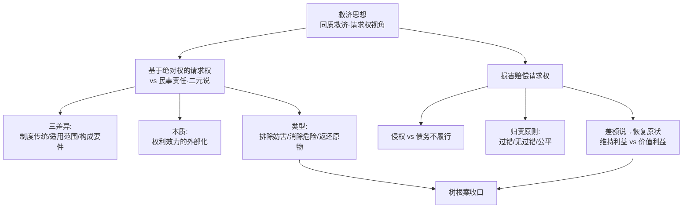

> [!quote] YOU

继续

> [!quote] YOU

继续

> [!abstract] PI

已定位到下一课 **B2 = 第十三章 权利救济 · 第一节「救济请求权」**（这是债法方法论底子：请求权思维是后面债法全线的骨架）。先把路径摆出来，你点头我就开讲。

## 这节课学什么（第一节「救济请求权」）

**路径**（从「救济思想」的根，一路派生到「怎么赔」）：

1. **救济思想**〔刘家安第7讲〕——民法是「同质救济／填平」，不是惩罚；「民事责任」视角错在哪、为什么要换成「请求权（权利）视角」。
2. **基于绝对权的请求权**——概念 → 一元说 vs 二元说之争（教材采二元说，展开三差异：制度传统／适用范围／构成要件）→ 本质＝权利效力的外部化 → 民法典的模棱两可立场。
3. **基于绝对权请求权的类型**——以原权性质分 / 以内容分（含「为什么排除 §234 确认物权、§237 恢复原状」这个易错点）。
4. **损害赔偿请求权**——侵权 vs 债务不履行两大基本类型 → 归责原则（§1165/1166/1186）→ 差额说→恢复原状→维持利益 vs 价值利益 → 债务不履行赔「履行利益」。

**贯穿全节的钥匙案例**：教材开头「甲的树根延伸挤瘪乙埋的水管，乙对甲有何请求权」——讲到最后用这个案例收口。

**拟带读的关键原文**：教材「二元说」论证段、温德沙伊德「请求权是权利的一个方向」、梅迪库斯「物权请求权是物权的实现」；刘家安「民事责任视角是错的／同质救济」段。

**随堂检测**：习题册单元十三的单选题 1–6、多选 1–2、辨析 4–5，收束用简答 1 + 论述题。（涉及私力救济的题留到 B3，不提前碰。）

---

这个路径 OK 吗？还是你有想调整的（比如先直接讲、或哪个节点想多挖）？确认后我从第 1 个节点「救济思想」开讲。

> [!quote] YOU

继续

> [!abstract] PI

路径你已点头，笔记也接上了。开讲——从根开始。

---

## 节点 1 · 救济思想：为什么本章叫「权利救济」而不是「民事责任」

**先动机化**：你现在手头这本教材的第十三章标题是「权利救济」，但你可能在别处（甚至法考讲义）见过另一种叫法——「民事责任」。这俩不是换个词那么轻松，背后是**整章的观察视角**：你到底把「甲弄坏乙的车该赔」这件事，看成「甲犯错了 → 国家/法律罚甲」，还是看成「乙的权利被侵害了 → 乙有权利要求甲恢复」。选哪个视角，后面所有结论的走向都跟着变。

先看刘家安怎么拆这个问题（这是本章的「根」，我带你读原文）：

**刘家安·第7讲**：「有些法学基础理论认为对不当行为应承担三种责任：刑事责任、行政责任和民事责任，但『民事责任』这一视角是错的。刑事责任和行政责任都是法秩序用强制力将刑罚、行政责任以国家之名义强加给行为人……相反，民事诉讼是不告不理，民事诉讼是由法律关系的一方当事人发起的。原告要求被告承担民事责任，其真正诉求是在『要求被告尊重我的权利、将原告的权利恢复到原始状态、赔偿原告所遭受的损失』，换个角度看，原告要求被告承担民事责任实质上是原告对被告提出的诉讼请求。」

**刘家安·第7讲**：「民法是权利救济思维，是**同质救济**，以填补权利人所受损害……民法讲救济是微观的，是想办法弥补所受损害……民法学原则上是排除惩罚性思想的，其基本思想不在于制裁责任人……是**填平规则**。」

这里有个词你可能第一次见，先拆掉——**同质救济**：就是说你受了什么损害，就填什么损害，救济「质」和损害「质」是同一的（车漆刮了 → 补漆，杯子碎了 → 赔一个杯子）。反义词是**惩罚**：罚你超过损害本身的部分，为了让你疼、让社会出口气——那是刑法、行政法的逻辑，不是民法的主逻辑。

**停下来想想**（先答主问，卡住再看提示）：

> 刘家安说「民事责任这个视角是错的」，他给出的最关键理由是什么？

提示：想一想「谁把这件事推到法院去的」——是国家主动去查办，还是当事人自己来告？这一个区别，决定了「责任」这个词到底合不合适。

（你答完这题，我们再往下走——这一题的答案，就是后面「为什么赔礼道歉是民事责任、而排除妨害是请求权」那类结论的同一把尺子。）

> [!quote] YOU

民事责任是等着当事人来告。确实责任不合适，只是要回应当事人的请求

> [!abstract] PI

对，方向完全正确，我再把它说精确一点——这题的尺子是「**谁把这件事推到公权力面前**」：

- **刑法、行政法**：国家**主动**追查、主动处罚，责任是国家以自己名义强加给行为人的 → 「责任」这个词准确。
- **民法**：**不告不理**，国家是被动的被请求人；原告说的「要他承担责任」，实质是「**我的权利被侵害了，我请求恢复、请求赔偿**」——这是一项**请求权**，是**权利语言**，不是「国家罚你」的义务语言。

所以刘家安说「民事责任视角是错的」，错在把民法救济误解成了国家的惩罚动作；正确视角是**权利救济 = 同质救济（填平）**。

**钩子（15字）**：`民事救济=请求权视角；不告不理，填平而非惩罚`

这一条是整章的根，也是债法全线的底子——因为「债」本身就是一个请求权关系。你记着这把尺子，后面「赔礼道歉为什么算民事责任、排除妨害为什么算请求权」都能用同一把尺子切下去。

---

## 节点 2 · 基于绝对权的请求权：它和「民事责任」到底是不是一回事

现在进入本章第一个硬概念。先看教材怎么定义它：

**教材 p.508**：「物权、人格权、知识产权等属于绝对权，权利内容主要体现为权利人以法律允许的各种方式支配权利客体。圆满状态是不受侵害、干扰的支配。当此种圆满状态因他人的侵害、干扰而不复存在时，权利人有权请求该他人为或者不为一定的行为，使权利回复到圆满状态。此项请求权即为**基于绝对权的请求权**，学理上又称之为绝对权请求权或者支配权请求权。」

**逐词拆**：先确认你手上已有的牌——「**绝对权**」指可以对抗一切人的权利（物权、人格权、知识产权）；它的特点是权利内容 = 直接**支配**客体，不需要别人配合。那它的「圆满状态」就是：我安稳地支配我的物/我的名誉，没人来动。

一旦有人来动（侵占我的物、往我土地上排污、发谣言毁我名誉），这个圆满状态被打破了。这时权利人得到一个新的东西——**请求权**：要求那个特定的人「做点什么」（返还、停止）或「别做什么」（别再排污）。注意，这里从「支配权」长出了一个「请求权」，这个长出动作就是本章要讲的核心现象。

**关键问题来了**（先想再答）：教材说，民法学界对「基于绝对权的请求权」和「民事责任（侵权责任）」的关系，有「一元说」和「二元说」之争。你先猜猜——

> 这两个学说争的到底是什么？「一元说」主张把基于绝对权的请求权「纳入」民事责任（当作侵权责任的一种形式），它会带来什么实际后果——换句话说，一元说眼里，你的物权被人侵占了，你找那个人要回东西，这件事的「性质」被理解成了什么？

（提示：想想「纳入侵权责任」意味着什么——侵权责任要成立，通常得先证明什么？）

这题答完，我再带你读教材论证「为什么二元说更对」的三差异——那是本章最重要的论证段。

> [!quote] YOU

得有过错，造成了损害。这件事背理解成了一个人有罪，司法等压力变大

> [!abstract] PI

核心抓对了——「过错」这条是关键。我再把「有罪」这个说法校正一下：不是「有罪」（那是刑法评价），而是「侵权责任要成立，通常得先满足**过错**这个要件，而且针对的是**已经发生的加害行为**」。

**一元说的实际后果**（这是它的软肋）：如果把「返还所有物」「排除妨害」都当成侵权责任的一种形式，那么这些请求权就得按侵权责任的门槛来——先证明对方**有过错**、是**加害行为**。可问题是，物权圆满状态的恢复，凭什么取决于对方有没有错？

用教材开头那个钥匙案例一击即中：

**教材 p.508 教学案例**：「甲是 A 地块的物权人，乙是 B 地块的物权人。甲种的一棵树的树根延伸到 B 地块里，挤瘪了乙埋在地下的水管。」

甲有「过错」吗？没有——树根自己长的。甲做了「加害行为」吗？严格说也没有——那是树根（一个设施/自然生长物）在妨害乙的土地，不是甲伸手去侵害。如果按一元说，乙要排除这个妨害，得先证明甲有过错、有加害行为——**乙根本告不赢**。但常识告诉我们：乙的土地被甲的树根越界妨害了，乙就该能要求甲把越界的树根切掉，**管你甲有没有错**。

这就是「二元说」要守住的直觉：**基于绝对权的请求权，不看过错、不看加害行为，只看「权利的圆满状态被妨害」这个客观事实**。

现在读教材论证二元说最硬的三差异（这是本章最重要的一段论证，逐句跟）：

**教材 p.508–509**：「首先，从**制度传统**看，侵权责任源于罗马法中的私犯（delictum）之债，而基于绝对权的请求权则源于罗马法中的『要求返还所有物诉权』与『排除妨害诉权』。私犯是一种犯罪……私犯责任具有很强的制裁性，体现了法律对于行为人的非难、谴责。现代大陆法系民法将罗马法中的私犯改造为侵权责任，只保留了损害赔偿这种责任形式，但『侵权责任』这个概念仍然包含着一定的**非难**因素……『要求返还所有物诉权』与『排除妨害诉权』都属于对物诉权……其着眼点在于**保护所有权**，而不是对他人行为的非难。」

**拆这句**：侵权责任的血统是「私犯」——古罗马人认为这是一种「犯罪」，所以到今天侵权责任里还带着「非难」（说你做错了）的味道；而返还所有物、排除妨害的血统是「对物诉权」——它的眼里只有「这块物、这块地」，目的是把物/地的圆满状态找回来，**压根不关心你这个人做错了没有**。两个制度生下来就不是一路的。

第二、第三个差异，教材是这么说的：

**教材 p.509**：「其次，基于绝对权的请求权与侵权责任的**适用范围**有所不同。一方面，侵权责任适用于加害行为，而基于绝对权的请求权除适用于加害行为之外，还适用于造成权利妨害的某个设施或者物品……另一方面，就加害行为而言，侵权责任只适用于已经发生的加害行为，而基于绝对权的请求权还可以适用于**即将发生**的加害行为，比如消除危险请求权。」

**教材 p.509**：「最后，基于绝对权的请求权与侵权责任的**构成要件**不同。侵权责任一般以行为人的主观过错为构成要件……与此不同，基于绝对权的请求权不以行为人或者致害设施所有权人的过错为要件。」

到这里，三差异齐了。**停下来检验一下**，用你自己的话（别翻上面）：

> 「基于绝对权的请求权」和「侵权责任」，最核心的区别到底是一句话什么？（往「请求权眼里看的是什么 vs 侵权责任眼里看的是什么」这个方向说）

（答完我给你一条 15 字钩子，然后进入「本质 = 权利效力的外部化」这个收口。）

> [!quote] YOU

结束

> [!abstract] PI

好，今天就到这里。我先把这个会话的进度落盘，保证下次能接着「本质=权利效力的外部化」继续，不会断。

> [!abstract] PI

已收工，进度都落盘了。今天这节（B2-a 上册）讲到这里：

**讲过的**
- **救济思想**（刘家安第7讲）——同质救济/填平 vs 惩罚；「不告不理 → 责任实为请求权」的权利视角。钩子：`民事救济=请求权视角；不告不理，填平而非惩罚`
- **基于绝对权的请求权**（定义 + 一元说/二元说 + 三差异）——树根案一击击穿一元说软肋（要求过错/加害行为 → 乙告不赢）；三差异 = 制度传统（私犯 vs 对物诉权）/ 适用范围（设施妨害＋即将发生）/ 构成要件（无过错）

**下次接着讲**
- N3 收口「**本质 = 权利效力的外部化**」（温德沙伊德「请求权是权利的一个方向」+ 梅迪库斯「物权请求权是物权的实现」+ 《民法典》§235/236 vs §179/995/1167 的模棱两可立场）
- 然后进 B2-b：类型 → 损害赔偿请求权 → 差额说/恢复原状，最后回树根案收口

状态已同步到 `学习路线.md` §六、`进程树.md`、`课程进度.md`、`plan` 节点表（N2/N4 ✅、N3 定义✅本质⬜）。

想巩固今天这两块，随时说「拷问第13章」或「复习」；继续上课就说「继续」。

> [!quote] YOU

结束

> [!abstract] PI

好的，今天到此为止。进度已存好，下次说「继续」就从 N3「本质＝权利效力的外部化」接着讲。有需要随时叫我。

> [!quote] YOU

结束
